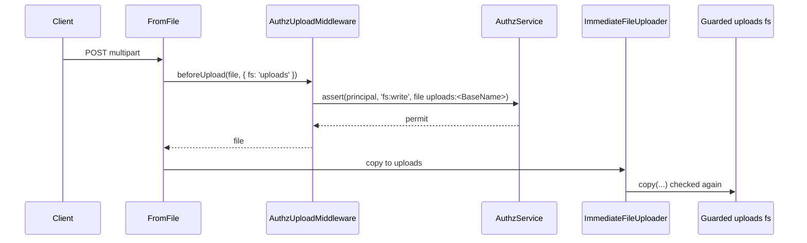

# Upload checks

`AuthzUploadMiddleware` checks `fs:write` on the file an HTTP upload will be written to, before the uploader copies it. A denied upload answers 403 and is never copied. Add it when a route stores uploads in a guarded filesystem.

It is **not** in the default middlewares: list it in `http.upload.middlewares` or in a route's `middlewares`.

## How it works

1. `FromFile` of `@spinajs/http` runs the upload middlewares on each form file while it is still in the upload directory ([Upload middlewares](../http/09-upload-middlewares-and-uploaders.md)).
2. `AuthzUploadMiddleware.beforeUpload(file, options)` picks the filesystem the uploader copies to: `file.Provider.Name`, else `options.fs`, else `__file_upload_default_provider__` (`DEFAULT_UPLOAD_FS`).
3. It reads `authz.fs.<that name>`. With mode `off` it returns the file unchanged.
4. It normalises `file.BaseName` with the base path of the published provider. An empty name throws `InvalidArgument`.
5. It checks `fs:write` on `{ type: 'file', id: '<fs>:<BaseName>' }` in the filesystem's domain, as the current principal:
   - `enforce`: a denial throws `AccessDenied` (403); the temp file is removed, not copied.
   - `audit`: a denial logs a warning.
6. The uploader then copies the file. The guarded `copy` checks the destination again.



## Configuration

| Key | Type | Default | Allowed values | Meaning |
| --- | --- | --- | --- | --- |
| `http.upload.middlewares` | `UploadFileMiddlewareDescriptor[]` | `['FileInfoMiddleware']` | add `'AuthzUploadMiddleware'` | Runs it for every `@File()` and `@Files()`. |
| `authz.fs.<name>.mode` | `string` | required | `off`, `audit`, `enforce` | The mode the middleware applies to filesystem `<name>`. |

```ts sample
const config = {
  http: { upload: { middlewares: ['AuthzUploadMiddleware'] } },
  authz: {
    fs: {
      uploads: { mode: 'enforce' },
      // the uploader reads and deletes temp files here as the request principal
      __file_upload_default_provider__: { mode: 'off' },
    },
  },
};

export default config;
```

Configuration arrays from several files are concatenated, so this entry follows http's own `FileInfoMiddleware`.

## Services and extension points

| Service | DI token and lifetime | Default implementation | Alternatives | How to replace or extend |
| --- | --- | --- | --- | --- |
| Upload check | `FileUploadMiddleware` of `@spinajs/http`, registered at import (`@Injectable(FileUploadMiddleware)`); resolved by the name in its descriptor | `AuthzUploadMiddleware` | none | Subclass it, override `beforeUpload()` calling `super`, register the subclass with `@Injectable()` and list its class name instead. |

`AuthzUploadMiddlewareOptions`, the constructor argument (for tests and hand wiring):

| Option | Default | Meaning |
| --- | --- | --- |
| `container` | `DI.RootContainer` | Where the configuration, the published providers and `AuthzDomains` are resolved. |
| `service` | `AuthzDomains.service(domain)` | The service that decides for a domain. |
| `principal` | `currentPrincipal` | Who is checked. |
| `log` | `engineLog('authz-fs')` | Receives the `audit` warnings. |

### AuthzUploadMiddleware: extend it

```ts sample
import { AuthzUploadMiddleware } from '@spinajs/authz-fs';
import { Injectable } from '@spinajs/di';
import { InvalidArgument } from '@spinajs/exceptions';
import type { IUploadOptions, IUploadedFile } from '@spinajs/http';

// Refuse scripts and executables, then check fs:write as usual.
@Injectable()
export class SafeUploadMiddleware extends AuthzUploadMiddleware {
  public override async beforeUpload(file: IUploadedFile, options?: IUploadOptions): Promise<IUploadedFile> {
    if (/\.(exe|bat|cmd|sh)$/i.test(file.Name)) throw new InvalidArgument(`upload ${file.Name} is an executable`, 'Name');
    return super.beforeUpload(file, options);
  }
}

// config: http.upload.middlewares: ['SafeUploadMiddleware']
```

## Important behaviour

- **Why it exists.** The guarded copy also refuses a denied upload, but `ImmediateFileUploader` turns that denial into `IOFail` (500). The middleware gives the 403 first.
- **Order.** It checks `file.BaseName` as it is when it runs. A middleware that renames the file (`ZipFileTransformer`, `UnzipFileTransformer`) must run before it.
- **Lazy uploads.** With `http-lazy-file-uploader` the middleware checks the route's filesystem. The copy runs later in a job, and its guarded `copy` checks the destination as the principal the job runs as.
- **Default upload filesystem.** Keep it `off`: the uploader reads and deletes the temp file there as the request principal.

## Best practices

- Put it in the route's `middlewares`, after the transformer, on a route that zips or unzips uploads.
- Check `fs:write` on a directory per user, so one user cannot overwrite the uploads of another ([Paths, refs and permissions](02-paths-refs-and-permissions.md#examples)).

## Patterns and antipatterns

```ts
// Don't: the check runs on the name before the transformer renames the file
@File({ fs: 'uploads', middlewares: ['AuthzUploadMiddleware', 'ZipFileTransformer'] })

// Do: check the name the file is written under
@File({ fs: 'uploads', middlewares: ['ZipFileTransformer', 'AuthzUploadMiddleware'] })
```

## Examples

### Refuse uploads into a filesystem the user may not write

```ts sample
import { BasePath, BaseController, File, Post } from '@spinajs/http';
import type { IUploadedFile } from '@spinajs/http';

@BasePath('documents')
export class Documents extends BaseController {
  // With http.upload.middlewares: ['AuthzUploadMiddleware'] and authz.fs.uploads.mode 'enforce',
  // a caller without fs:write on uploads gets 403 and nothing is copied.
  @Post()
  public async upload(@File({ fs: 'uploads' }) file: IUploadedFile) {
    return { name: file.BaseName };
  }
}
```

## Related

- [Upload middlewares and uploaders](../http/09-upload-middlewares-and-uploaders.md): where the middleware runs.
- [File uploads](../http/08-file-uploads.md): `@File()` and `IUploadOptions`.
- [Lazy file upload](../http-lazy-file-uploader/01-lazy-file-upload.md): copies that run later as a job.
- [Guarded file systems](01-guarded-file-systems.md): the guard that checks the copy.
