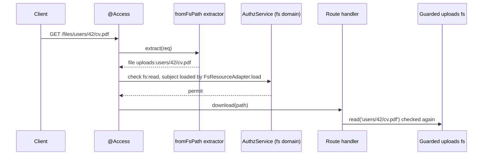

# Route checks with `fromFsPath`

`fromFsPath(fsName, param)` is a resource extractor for the `@Access` decorator of `@spinajs/authz-http`. It turns a URL parameter into the same ref the guard checks for that path, so a route that serves files can refuse a request before the handler runs.

## How it works

1. `fromFsPath(fsName, param)` checks its arguments and returns an extractor. `fsName` must be non-empty and hold no `:`.
2. On each request, `@Access` calls the extractor with the request.
3. It reads `req.params[param]`, URL parameters only.
   - A string is the path.
   - An Express 5 wildcard (`*path`) gives an array of segments. They are joined with `/`; each segment the normaliser refuses on its own (`..`, `.`, an empty one, one holding `/` or `\`) throws `InvalidArgument`.
4. It normalises the path with `normalizeFsPath()` and the base path of the published provider `fsName`.
5. It returns `{ type: 'file', id: '<fsName>:<path>' }`, or `{ type: 'fs', id: fsName }` for the root.
6. A missing parameter, one that is neither a string nor a non-empty string array, or a refused path throws `InvalidArgument` (400).



## Decorators

| Decorator | Target | Options | Effect |
| --- | --- | --- | --- |
| `@Access(permission, { resource: fromFsPath(fs, param), domain, subject })` | method | `domain`: the filesystem's `authz.fs.<name>.domain`; `subject: 'load'` | Checks the permission on the path ref before the handler runs. |

## Important behaviour

- **`subject: 'load'`.** Owner grants and `fs-abac` `resource.*` policies answer with a residual. authz-http settles it only against a loaded subject, which `FsResourceAdapter.load` gives without IO. Without `subject: 'load'` such a permit passes the route for every path, and only the guarded call in the handler still checks.
- **No domain.** The extractor carries none. For a filesystem whose `authz.fs.<name>.domain` is not `root`, set the same `domain` in `@Access`, or the route is checked in root.
- **Always a `file` ref.** A route that lists a directory checks a `file` ref with the directory's path. A `dir` grant on that same path does not match it: the ancestors of a `file` ref are its parent directories, not the path itself as a `dir`. The guard still checks the `dir` ref when the handler calls `list`.
- **The guard still checks.** The route check gives an early 403; the guarded call in the handler checks again.

## Best practices

- Pass the same parameter to the provider that the extractor read, so the path checked on the route is the path read.
- Use `fromFsPath` rather than `fromParam(param, 'file')`: `fromParam` takes the raw parameter as the id, without the `<fs>:` prefix and without normalisation, so its ref never matches what the guard checks.

## Patterns and antipatterns

```ts
// Don't: no subject, so an owner grant passes the route for every file
@Access('fs:read', { resource: fromFsPath('uploads', 'path') })

// Do: load the row, so the owner grant decides per file
@Access('fs:read', { resource: fromFsPath('uploads', 'path'), subject: 'load' })
```

## Examples

### Serve files from a guarded filesystem

```ts sample
import { Access } from '@spinajs/authz-http';
import { fromFsPath } from '@spinajs/authz-fs';
import { getFs } from '@spinajs/fs';
import { BaseController, BasePath, Get, Param } from '@spinajs/http';

@BasePath('files')
export class Files extends BaseController {
  // GET /files/users/42/cv.pdf; the uploads filesystem is checked in the domain 'fs'
  @Get('*path')
  @Access('fs:read', { resource: fromFsPath('uploads', 'path'), domain: 'fs', subject: 'load' })
  public async download(@Param() path: string[]) {
    return getFs('uploads').read(path.join('/'));
  }
}
```

## Related

- [HTTP adapter](../authz-http/README.md): `@Access`, its options and the other extractors.
- [Paths, refs and permissions](02-paths-refs-and-permissions.md): the refs the extractor builds.
- [File system domains](09-file-system-domains.md): why `domain` must match.
