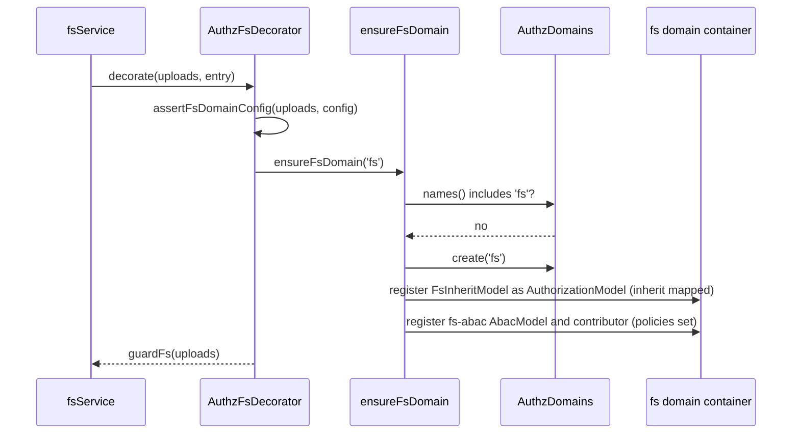

# File system domains

`authz.fs.<name>.domain` runs the checks of a filesystem in an authz domain of its own. authz-fs creates that domain when it is missing and registers the two fs models there: `fs-inherit` ([Inherited access](10-inherited-access.md)) and `fs-abac` ([File system policies](11-file-system-policies.md)). Use a domain when files take access from other resources, or when a filesystem has policies of its own.

## How it works

1. `AuthzFsDecorator` wraps a filesystem whose `domain` is not `root` and calls `ensureFsDomain(domain)` while `fsService` resolves. A guard built with `guardFs()` calls it on its first check.
2. `ensureFsDomain()` runs once per domain container. It resolves `AuthzDomains` synchronously; when that fails it throws `AuthzConfigError` ("import the authz host before the fs providers resolve").
3. A missing domain is created with `AuthzDomains.create(domain)`; its parent is `authz.domains.<domain>.parent`, else `root`.
4. `domainFilesystems(domain)` collects the filesystems checked there (mode not `off`).
5. When one of them maps `inherit`, it registers an `FsInheritModel` (`fs-inherit`) in the domain, unless the domain registers an `FsInheritModel` class of its own.
6. When one of them has `policies`, it registers an `AbacModel` named `fs-abac` over the union of their policies, with its contributor.
7. If the domain already booted and a model is due, it throws `AuthzConfigError`: a booted domain never sees later registrations.



## Configuration

| Key | Type | Default | Allowed values | Meaning |
| --- | --- | --- | --- | --- |
| `authz.fs.<name>.domain` | `string` | `'root'` | a domain name | Where the checks of the filesystem run. |
| `authz.domains.<domain>.parent` | `string` | `'root'` | a domain name | Parent of a domain authz-fs creates. |
| `authz.domains.<domain>.combine` | object | the parent's | see [Config](../authz/04-host-boot-and-configuration.md#configuration) | Which models decide in the domain. List `fs-inherit` and `fs-abac` there next to the parent's models. |

```ts sample
const config = {
  authz: {
    fs: {
      uploads: {
        mode: 'enforce',
        domain: 'fs',
        resolver: 'TaskAttachmentPathResolver',
        inherit: { 'fs:read': 'read', 'fs:write': 'update', 'fs:delete': 'update' },
      },
    },
    domains: {
      fs: {
        parent: 'root',
        combine: { default: { algorithm: 'deny-overrides', models: ['rbac', 'abac', 'fs-abac', 'fs-inherit'] } },
      },
    },
  },
};

export default config;
```

`assertFsDomainConfig()` refuses `inherit` or `policies` on a filesystem checked in `root`, with an `AuthzConfigError` naming the key. The decorator and every domain boot run it. Root-wide policies belong in `authz.abac.policies`.

## Services and extension points

| Service | DI token and lifetime | Default implementation | Alternatives | How to replace or extend |
| --- | --- | --- | --- | --- |
| `fs-inherit` model | `AuthorizationModel`, an instance registered in the domain container by `ensureFsDomain` | `FsInheritModel` | a subclass of `FsInheritModel` the domain registers itself | Register your class (a class registration, not a factory) as `AuthorizationModel` in the domain container before the providers resolve; `ensureFsDomain` then adds none. |
| `fs-abac` model | `AuthorizationModel` and `AuthzContributor`, instances registered in the domain container | `AbacModel` named `fs-abac` | none | A model of the app with that name fails the boot (two models with one name). |

Exports: `ensureFsDomain(domain, container?)`, `domainFilesystems(domain, container?)`, `assertFsDomainConfig(fsName, config)`, `ROOT_DOMAIN` (`'root'`), `FS_INHERIT_MODEL` (`'fs-inherit'`), `FS_ABAC_MODEL` (`'fs-abac'`).

## Important behaviour

- **Root never holds the fs models.** That is why `inherit` and `policies` need a domain.
- **Parent first.** The decorator runs while `fsService` resolves, so the parent domain must exist by then; otherwise `fsService.resolve()` fails with `AuthzConfigError`.
- **A child's `combine` replaces its parent's**, `types` included, for every permission checked in it: the `fs:*` checks and the parent checks of `fs-inherit` (`task:read`). A model left out is unrouted there, and its deny rules do not apply in the domain.
- **Boot rule 1.** A `combine` that names `fs-inherit` without any `inherit` mapping fails the boot: the model is then not registered.
- **Booted domains.** Resolve the fs providers before the domain's first `AuthzDomains.service()`. A boot still running when the providers resolve is not detected: with a `combine` that lists the fs models it fails rule 1; without one the domain runs without them.
- **App-created domains** get the fs models too, once.

## Best practices

- Copy the parent's model list into the fs domain's `combine` and add `fs-abac` and `fs-inherit`.
- Set `domain` in `@Access` to the filesystem's domain on routes that use [`fromFsPath`](08-route-checks-with-fromfspath.md).

## Patterns and antipatterns

```ts
// Don't: root never runs fs-inherit; boot fails
fs: { uploads: { mode: 'enforce', inherit: { 'fs:read': 'read' } } }

// Do: give the filesystem a domain
fs: { uploads: { mode: 'enforce', domain: 'fs', inherit: { 'fs:read': 'read' } } }
```

## Related

- [Authorization in SpinaJS](../authz/04-host-boot-and-configuration.md#configuration): domains, `combine` and the boot rules.
- [Inherited access](10-inherited-access.md): the `fs-inherit` model and path resolvers.
- [File system policies](11-file-system-policies.md): the `fs-abac` model.
