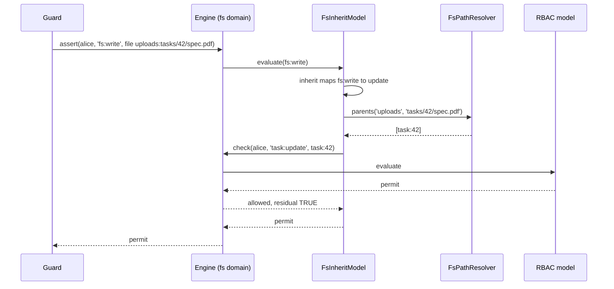

# Inherited access (`fs-inherit`) and path resolvers

`fs-inherit` gives a path the access its owner resource has: a user who may `update` task 42 may write the attachments under `tasks/42/`. An `FsPathResolver` you write names the resource behind a path; `authz.fs.<name>.inherit` maps each `fs:*` permission to an action on it.

## How it works

1. `ensureFsDomain()` registers `FsInheritModel` in the filesystem's [domain](09-file-system-domains.md) when one of its filesystems maps `inherit`.
2. `FsInheritModel.init()` reads the `inherit` map of every filesystem checked in its domain.
3. `applies(permission, type)` is `true` for `file` and `dir` refs whose permission a map names, or names through a permission that implies it.
4. For a check of `fs:<op>` on a file or directory, `evaluate()` looks up the actions the map gives `fs:<op>`: its own entry first, then those of the permissions that imply it. With `'fs:read': 'read'`, `fs:stat` goes to `read` too.
5. `resolveFsParents(fsName, path)` asks the resolvers for the path's domain parents, nearest first, without repeats:
   - the `FsPathResolver` `authz.fs.<name>.resolver` names, by class name (`AuthzConfigError` when none has that name);
   - without that key, every registered resolver whose `fs` matches the filesystem name, in registration order.
6. For each parent and action it checks `<parent type>:<action>` on the parent, in the same domain, as the principal the models run with, with the request's actor and env.
7. The first parent permit without a residual makes the vote a permit, carrying the parent's `validUntil`.
8. A parent permission that is not registered on the parent's type, or a parent check that throws, makes the vote indeterminate, unless another parent permits. Without a mapping, parents or a parent permit it abstains. It never denies.



## Configuration

| Key | Type | Default | Allowed values | Meaning |
| --- | --- | --- | --- | --- |
| `authz.fs.<name>.inherit` | `Record<string, string>` | none | keys `fs:<op>`, values action names | `fs:<op>` on a path is permitted when the principal holds `<parent type>:<action>` on a domain parent. Needs a domain other than `root`. |
| `authz.fs.<name>.resolver` | `string` | every registered `FsPathResolver` whose `fs` matches | class name of a registered `FsPathResolver` | Takes only that resolver. |

```ts sample
const config = {
  authz: {
    fs: {
      uploads: {
        mode: 'enforce',
        domain: 'fs',
        resolver: 'TaskAttachmentPathResolver',
        inherit: { 'fs:read': 'read', 'fs:list': 'read', 'fs:write': 'update', 'fs:delete': 'update' },
      },
    },
    domains: {
      fs: { combine: { default: { algorithm: 'deny-overrides', models: ['rbac', 'fs-inherit'] } } },
    },
  },
};

export default config;
```

Each `inherit` key is declared to the domain's boot, so an unregistered key fails it.

## Services and extension points

| Service | DI token and lifetime | Default implementation | Alternatives | How to replace or extend |
| --- | --- | --- | --- | --- |
| Path resolver | `FsPathResolver`, every registration resolved on each check (`Array.ofType(FsPathResolver)`) in the root container | none | none shipped | Extend `FsPathResolver`, register it with `DI.register(MyResolver).as(FsPathResolver)` before the first check, optionally name it in `authz.fs.<name>.resolver`. |
| `fs-inherit` model | `AuthorizationModel` in the domain container | `FsInheritModel` | your subclass | See [File system domains](09-file-system-domains.md#services-and-extension-points). |

### FsPathResolver: custom implementation

| Member | Contract |
| --- | --- |
| `fs` | `string \| RegExp`: the filesystem names it serves. A `RegExp` is tested with `lastIndex` reset. |
| `parents(fsName, path)` | The domain parents of the normalised path, nearest first, or `null` for none. Each must be an instance ref: a `type` and a non-empty `id`. Anything else throws `AuthzConfigError`. |

Answer from the path alone. Votes are cached, and resolver answers carry no invalidation tag.

```ts sample
import type { ResourceRef } from '@spinajs/authz';
import { FsPathResolver } from '@spinajs/authz-fs';
import { DI } from '@spinajs/di';

// tasks/<id>/... belongs to task <id>; anything else has no parent.
export class TaskAttachmentPathResolver extends FsPathResolver {
  readonly fs = 'uploads';

  async parents(_fsName: string, path: string): Promise<readonly ResourceRef[] | null> {
    const match = /^tasks\/([^/]+)(\/|$)/.exec(path);
    return match ? [{ type: 'task', id: match[1] }] : null;
  }
}

DI.register(TaskAttachmentPathResolver).as(FsPathResolver);
```

## Important behaviour

- **Unconditional parents only.** The parent row is not loaded, so a parent permit with a condition (an `owner` grant on the task) gives nothing.
- **Not ancestors.** Resolver parents do not join the path's ancestor chain. A role assigned on `task:42` does not grant `fs:*` directly; only `fs-inherit` reads it.
- **Caching.** A resolver that reads a table (attachment row → task) can leave a decision in the cache for up to `authz.cache.ttlSeconds` after the link changes.
- **Late errors.** Resolvers do not declare their parent types, so a parent permission missing on a type (`project:update` for a `project` parent) is found per call, not at boot.
- **Summary.** `summarize()` lists every permission it may grant as conditional, so `covers` holds only for a holder that has them on every file.
- **The domain's `combine`** must list `fs-inherit`, and every model that decides the parent permissions (`rbac` for `task:update`).

## Best practices

- Encode the owner resource in the path (`tasks/42/...`), so the resolver needs no IO and no cache invalidation.
- Name the resolver in `authz.fs.<name>.resolver` when several resolvers match a filesystem name.
- Map `fs:list` too when users browse the attachment directory.

## Patterns and antipatterns

```ts
// Don't: a resolver that reads the database answers from a cache after the link changed
async parents(_fs: string, path: string) {
  const row = await Attachment.where({ path }).first();
  return row ? [{ type: 'task', id: String(row.TaskId) }] : null;
}

// Do: derive the parent from the path
async parents(_fs: string, path: string) {
  const m = /^tasks\/([^/]+)\//.exec(path);
  return m ? [{ type: 'task', id: m[1] }] : null;
}
```

## Examples

### Task members read and edit the task's attachments

With the configuration and the resolver above, and an RBAC role `task.editor` granting `task:read` and `task:update`, assigned on `task:42` to `alice`:

```ts
await getFs('uploads').write('tasks/42/spec.pdf', pdf);   // alice: fs:write → task:update on task:42, permitted
await getFs('uploads').read('tasks/7/plan.pdf');          // alice: no role on task:7, AccessDenied
```

## Related

- [File system domains](09-file-system-domains.md): where `fs-inherit` runs.
- [Per-scope roles](../authz-rbac/README.md): roles assigned on a task or a project.
- [Paths, refs and permissions](02-paths-refs-and-permissions.md): ancestors versus domain parents.
