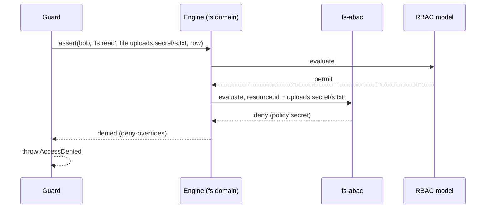

# File system policies (`fs-abac`)

`authz.fs.<name>.policies` are ABAC policies that hold for one filesystem: "anyone may read `public/`", "nobody reads `secret/`". authz-fs loads them into an `AbacModel` named `fs-abac` in the filesystem's [domain](09-file-system-domains.md). Use them for rules on paths that roles cannot express.

## How it works

1. `parseFsAccessConfig()` checks each policy and gives a policy without `scope` the filesystem: `{ type: 'fs', id: <name> }`.
2. `ensureFsDomain()` collects the policies of every filesystem checked in the domain (`domainFilesystems`) and registers one `AbacModel` named `fs-abac` over a `ConfigPolicyStore` of them, with a contributor.
3. At the domain's boot the contributor declares each policy's permissions, so a policy naming an unregistered permission fails the boot. Boot errors name the `authz.fs.<name>.policies` key and the policy id.
4. On a check, `fs-abac` evaluates the policies as the ABAC model does. `resource.*` conditions read the subject row `{ id, type, fs, path }` the guard passes.
5. The domain's `combine` decides how its votes join those of the other models; a deny policy beats permits of other models under `deny-overrides`.



## Configuration

| Key | Type | Default | Allowed values | Meaning |
| --- | --- | --- | --- | --- |
| `authz.fs.<name>.policies` | `Policy[]` | none | the policy shape of `authz.abac.policies`, limited as below | Policies of this filesystem. Needs a domain other than `root`. |
| `authz.fs.<name>.policies[].scope` | `ResourceRef` | `{ type: 'fs', id: <name> }` | the filesystem, or a `dir` or `file` of it | Where the policy holds. |
| `authz.fs.<name>.policies[].permissions` | `string[]` | required | `fs:` permissions or globs (`fs:*`) | What the policy decides. |
| `authz.fs.<name>.policies[].resourceTypes` | `string[]` | all | `fs`, `dir`, `file` | Which refs it applies to. |

```ts sample
const config = {
  authz: {
    fs: {
      uploads: {
        mode: 'enforce',
        domain: 'fs',
        policies: [
          { id: 'public', effect: 'permit', permissions: ['fs:read', 'fs:stat'], when: { attr: 'resource.id', glob: 'uploads:public/**' } },
          { id: 'secret', effect: 'deny', permissions: ['fs:read'], when: { attr: 'resource.id', glob: 'uploads:secret/**' }, reason: 'secret' },
        ],
      },
    },
    domains: {
      fs: { combine: { default: { algorithm: 'deny-overrides', models: ['rbac', 'abac', 'fs-abac'] } } },
    },
  },
};

export default config;
```

Each policy is refused with an `AuthzConfigError` naming the key and the policy id when it has:

- a `scope` other than its filesystem or a `dir` or `file` of it. A resolver parent such as a task is no ancestor of a path and would never match;
- a permission or glob that does not start with `fs:`. It would also answer the domain's other checks, such as the `task:read` of `fs-inherit`;
- a resource type other than `fs`, `dir` or `file`.

## Services and extension points

| Service | DI token and lifetime | Default implementation | Alternatives | How to replace or extend |
| --- | --- | --- | --- | --- |
| `fs-abac` model | `AuthorizationModel` and `AuthzContributor`, instances registered in the domain container by `ensureFsDomain` | `AbacModel` of `@spinajs/authz-abac` named `fs-abac`, over a `ConfigPolicyStore` | none | Not replaceable. Policies stored through `AuthzAdmin` belong in the `abac` model of [authz-abac](../authz-abac/README.md). |

## Important behaviour

- **Per filesystem.** A permit under `uploads` does not open `archive` in the same domain: each policy gets its filesystem as scope.
- **Unique ids.** Policy ids must be unique within a domain. Two filesystems with one id are an `AuthzConfigError` naming both.
- **Root never holds `fs-abac`.** Policies on a filesystem checked in `root` fail the boot; root-wide policies belong in `authz.abac.policies`.
- **Booted domains.** As for `fs-inherit`, registering into a domain that already booted is refused.
- **Summary.** The model's summary lists each permitted permission as conditional, since every fs policy has a scope.
- **Case.** `resource.id` keeps the path's case. On case-insensitive disks a deny on one spelling does not stop another ([Paths, refs and permissions](02-paths-refs-and-permissions.md#important-behaviour)).
- **Dependencies.** Importing `@spinajs/authz-fs` also loads `@spinajs/authz-abac`, which registers its `authz_policy` migration and its admin handlers.

## Best practices

- Prefer permit policies and narrow grants over deny policies on paths.
- List `fs-abac` in the domain's `combine` next to the parent's models; a model left out does not decide there.

## Patterns and antipatterns

```ts
// Don't: a task scope is no ancestor of a path; the policy is refused
policies: [{ id: 'task-files', effect: 'permit', permissions: ['fs:read'], scope: { type: 'task', id: '42' } }]

// Do: inherit access from the task through fs-inherit
inherit: { 'fs:read': 'read' }
```

## Related

- [The ABAC model](../authz-abac/README.md): the policy shape and conditions.
- [`@spinajs/authz-abac`](../authz-abac/README.md): the model behind `fs-abac`.
- [File system domains](09-file-system-domains.md): where `fs-abac` runs.
- [Inherited access](10-inherited-access.md): access from other resources.
