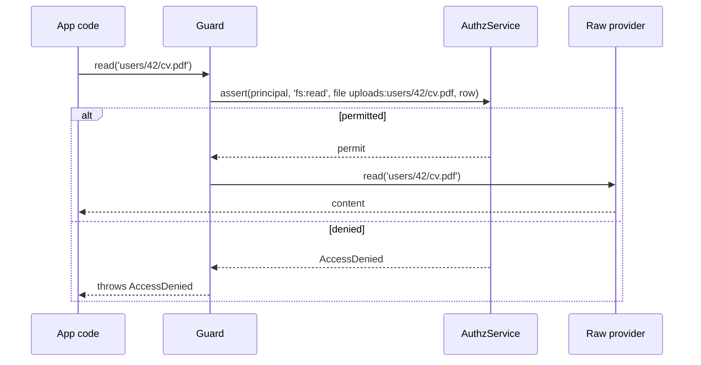

# `@spinajs/authz-fs`

Authorization for `@spinajs/fs` filesystems. Each filesystem named in `authz.fs` is wrapped in a guard that checks the caller's `fs:*` permissions on every path before the provider runs, and can record who owns each file.

A filesystem without an `authz.fs.<name>` entry is **not** guarded. The guard protects files from principals (users, clients, share links), not from application code: properties of a provider and code that runs inside an operation pass unchecked.

## Install

```sh
npm install @spinajs/authz-fs
```

Import it before `fsService` resolves, and take providers after it resolved.

## Features

| Feature | What it does |
| --- | --- |
| [Guarded file systems](01-guarded-file-systems.md) | `AuthzFsDecorator` and `guardFs()`: modes, the check of every call, the `authz.fs.<name>` configuration. |
| [Paths, refs and permissions](02-paths-refs-and-permissions.md) | `normalizeFsPath`, the `fs`/`dir`/`file` refs and their ancestors, the six `fs:*` permissions, `FsResourceAdapter`, granting access. |
| [Operation table](03-operation-table.md) | Which permission each provider method needs; `authz.fs.<name>.operations` and `list: 'each'`. |
| [File owners](04-file-owners.md) | `stampOwner`: the first writer owns a path; the `owner` relation for grants. |
| [File metadata stores](05-file-metadata-stores.md) | `FileMetadataStore`: `OrmFileMetadataStore` (`fs_object`), `S3ObjectMetadataStore`, custom stores. |
| [Signed URLs](06-signed-urls.md) | `fs:share` on `signedUrl` and `getSignedUrl`, and the lifetime cap. |
| [Upload checks](07-upload-checks.md) | `AuthzUploadMiddleware`: 403 before an HTTP upload is copied. |
| [Route checks with `fromFsPath`](08-route-checks-with-fromfspath.md) | The `@Access` resource extractor for routes that serve files. |
| [File system domains](09-file-system-domains.md) | `authz.fs.<name>.domain` and `ensureFsDomain`: where the fs models run. |
| [Inherited access](10-inherited-access.md) | `fs-inherit` and `FsPathResolver`: files take access from a task or project. |
| [File system policies](11-file-system-policies.md) | `fs-abac`: ABAC policies per filesystem. |

## How a file call is checked

1. App code calls a method of the provider from `getFs(name)`: the guard proxy.
2. The [operation table](03-operation-table.md) names the permission per path argument: `read` needs `fs:read`, `write` needs `fs:write`.
3. The guard normalises each path and builds its ref, such as `{ type: 'file', id: 'uploads:users/42/cv.pdf' }` ([Paths, refs and permissions](02-paths-refs-and-permissions.md)).
4. The `AuthzService` of the filesystem's domain decides, with the path's row as subject. The ref's ancestors (parent directories, the filesystem) let grants on a directory cover what is below.
5. `enforce` throws `AccessDenied`; `audit` warns and goes on.
6. The raw provider runs with the normalised path; the guard updates the [owner metadata](04-file-owners.md).



The full flow, nested calls and errors: [Guarded file systems](01-guarded-file-systems.md#how-it-works).

## Quick start

Protect the `uploads` filesystem: every user writes there, and reads only the files they uploaded.

```ts sample
import '@spinajs/authz-fs';

// Import the package before fsService resolves.
const config = {
  fs: {
    defaultProvider: 'uploads',
    providers: [{ service: 'fsNative', name: 'uploads', basePath: './data/uploads' }],
  },
  authz: {
    fs: {
      uploads: { mode: 'enforce', metadata: 'OrmFileMetadataStore', stampOwner: true },
    },
    rbac: {
      roles: {
        user: {
          grants: [
            { permission: 'fs:write', on: [{ type: 'fs', id: 'uploads' }] },
            { permission: 'fs:read', relation: 'owner', on: [{ type: 'fs', id: 'uploads' }] },
          ],
        },
      },
    },
  },
};

export default config;
```

Apply the migrations first, so `fs_object` exists ([File metadata stores](05-file-metadata-stores.md#best-practices)).

## Related packages

- [`@spinajs/authz`](../authz/README.md): the engine, principals, domains and `AccessDenied` the guard uses.
- [`@spinajs/authz-rbac`](../authz-rbac/README.md): roles that grant `fs:*` permissions, with `on` patterns and the `owner` relation.
- [`@spinajs/authz-abac`](../authz-abac/README.md): the model behind `fs-abac`, loaded by this package.
- [`@spinajs/authz-orm`](../authz-orm/README.md): the adapter for model rows. authz-fs does not need it; its `fs_object` table lives on the alias `authz-fs`, apart from authz-orm's `authz` alias.
- [`@spinajs/authz-http`](../authz-http/README.md): `@Access`, which takes [`fromFsPath`](08-route-checks-with-fromfspath.md).
- [`@spinajs/fs`](../fs/README.md): the providers the guard wraps, through [provider decorators](../fs/07-provider-decorators.md).
- [`@spinajs/fs-s3`](../fs-s3/README.md): `fsS3`, whose object metadata `S3ObjectMetadataStore` uses, and its URL signers.
- [`@spinajs/http`](../http/README.md): the upload pipeline `AuthzUploadMiddleware` plugs into.
- [`@spinajs/orm`](../orm/README.md): `FsObjectRecord` and the `fs_object` migration.
