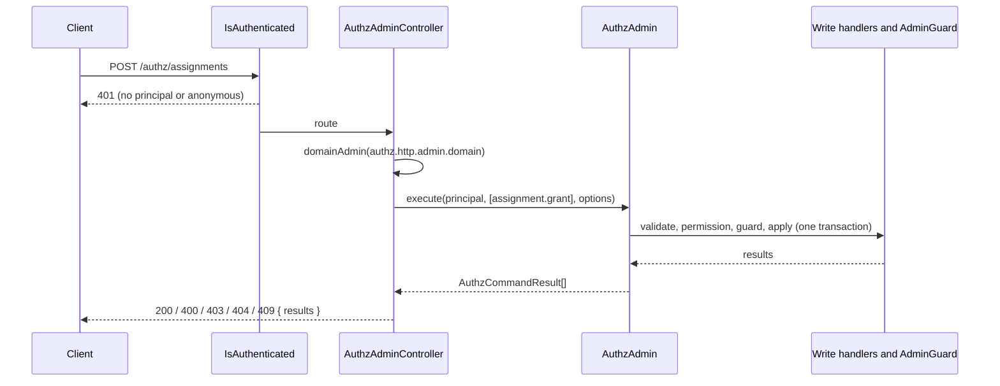

# Admin routes

`AuthzAdminController` serves 18 routes under `/authz` over the `AuthzAdmin` of one authz domain. Each route turns the request into an `AuthzCommand` list or an `AuthzAdminQuery`, runs it as the caller and maps the result to an HTTP status.

Use it to drive an admin UI or a script over HTTP with the same answers an in-process `AuthzAdmin` call gives.

## How it works

1. `@Policy(IsAuthenticated)` on the controller runs first. A request without a principal, or with an anonymous one, answers `401` and never reaches the route.
2. The route arguments are extracted. No route reads the raw request (`@Req()`):
   - `@AdminDomain()` reads the domain from `authz.http.admin.domain` (on every call) and lets the [`AuthzDomainResolver`](../authz/05-domains.md#per-request-domains) replace it for the request;
   - `@CurrentPrincipal()` (`@spinajs/authz-http`) is the actor;
   - `@Param()` checks `:id` (1 to 160 characters) and `:type` (1 to 64);
   - `@Body()` builds the body DTO (`AuthzAssignmentGrant`, `AuthzLinkPatch`, ...) and validates it against its `@Schema`; `@AdminBody()` does the same for the open attribute bodies, and `@AdminBatch()` for `POST /authz/commands` (see [Command batches](02-command-batches.md));
   - `@AdminQuery()` builds the query DTO (`AuthzAssignmentsQuery`, `AuthzWriteOptionsQuery`, ...) from the whole query string and validates it.
   Every DTO schema is closed (an unknown key is refused) and has an `authz.` id, so it is validated without type coercion. See [Input validation](#input-validation).
3. The route builds a command list (`decodeCommand` turns ISO 8601 expiry strings into `Date`s) or an `AuthzAdminQuery` (`readAssignmentsQuery`, `readPageQuery`) from the validated input, and gets the domain's `AuthzAdmin`: `AuthzDomains.service(domain).admin()`.
4. The route calls `admin.execute(principal, commands, options)` or `admin.list(principal, query)`. The actor is always the request principal; the body cannot name another one.
5. `AuthzAdmin` validates, checks the actor's permission, runs the guard and applies the batch in one transaction. See [AuthzAdmin](../authz/10-authz-admin.md).
6. The route answers:
   - a write: `{ results }` with `200` when every command succeeded, else the status of the failed command (`resultsStatus`);
   - a list: `{ items, total, next? }` with `200`;
   - an `AuthzAdminFailure` thrown on the way: `{ error: { code, message, field? } }` with the status of its code (`adminErrorStatus`).
   Any other error propagates to the http error handling.



## Configuration

| Key | Type | Default | Allowed values | Meaning |
| --- | --- | --- | --- | --- |
| `authz.http.admin.domain` | `string` | `'root'` | a non-empty domain name | The authz domain whose `AuthzAdmin` the routes use; the fallback of the `AuthzDomainResolver`. |
| `authz.http.admin.basePath` | `string` | not set, the routes mount under `authz` | a non-empty path without the route prefix | Where `commands`, `assignments`, `holders`, `links`, `rules`, `policies` and `scopes/:type/:id/attributes` mount. They move together. |
| `system.dirs.controllers` | `string[]` | the package's `lib/mjs/controllers` or `lib/cjs/controllers` | | Set by the package config; it is how http finds `AuthzAdminController`. |

```ts
// config of a multi-tenant app: the admin routes manage the "tenant" domain
export default {
  authz: {
    http: {
      admin: {
        domain: 'tenant',
      },
    },
  },
};
```

The schema `AUTHZ_HTTP_CONFIGURATION_SCHEMA` of `@spinajs/authz-http` validates the key: an empty string is refused at boot.

Everything else that shapes an answer is `AuthzAdmin` config: `authz.admin.permissions`, `authz.admin.maxBatch` (default `100`) and `authz.admin.guard.*`. See [AuthzAdmin](../authz/10-authz-admin.md).

## Route reference

The permission is the default one; `AuthzAdmin` checks it at the resource in the last column. `authz.admin.permissions` maps it to your own (see [Permissions](#permissions)).

| Method and path | Runs on `AuthzAdmin` | Permission | Checked at |
| --- | --- | --- | --- |
| `POST /authz/commands` | `execute(commands)` | per command | per command |
| `GET /authz/assignments` | `list({ kind: 'assignments' })` | `authz:assignments.read` | `scope` query, else `$global` |
| `POST /authz/assignments` | `execute([assignment.grant])` | `authz:assignments.manage` | the body `scope` |
| `PATCH /authz/assignments/:id` | `execute([assignment.setTags, addTags, removeTags, setExpiry])`, one per key given | `authz:assignments.manage` | the assignment's scope |
| `DELETE /authz/assignments/:id` | `execute([assignment.revoke])` | `authz:assignments.manage` | the assignment's scope |
| `GET /authz/links` | `list({ kind: 'links' })` | `authz:links.read` | `scope` query, else `$global` |
| `POST /authz/links` | `execute([link.create])` | `authz:links.manage` | the body `scope` |
| `PATCH /authz/links/:id` | `execute([link.update])` | `authz:links.manage` | the link's scope |
| `DELETE /authz/links/:id` | `execute([link.revoke])` | `authz:links.manage` | the link's scope |
| `GET /authz/rules` | `list({ kind: 'rules' })` | `authz:rules.read` | `scope` query, else `$global` |
| `PUT /authz/rules/:id` | `execute([rule.put])` | `authz:rules.manage` | the rule's `scope` |
| `DELETE /authz/rules/:id` | `execute([rule.delete])` | `authz:rules.manage` | the stored rule's scope |
| `GET /authz/policies` | `list({ kind: 'policies' })` | `authz:policies.read` | `scope` query, else `$global` |
| `PUT /authz/policies/:id` | `execute([policy.put])` | `authz:policies.manage` | the policy's `scope`, else `$global` |
| `DELETE /authz/policies/:id` | `execute([policy.delete])` | `authz:policies.manage` | the stored policy's scope |
| `GET /authz/scopes/:type/:id/attributes` | `list({ kind: 'attributes' })` | `authz:attributes.read` | `<type>:<id>` |
| `PATCH /authz/scopes/:type/:id/attributes` | `execute([scope.setAttributes])` | `authz:scope.manage` | `<type>:<id>` |
| `PUT /authz/scopes/:type/:id/attributes` | `execute([scope.replaceAttributes])` | `authz:scope.manage` | `<type>:<id>` |

`assignment.revokeWhere`, `set.addMember`, `set.removeMember` and `scope.forget` have no route of their own; send them through [`POST /authz/commands`](02-command-batches.md).

The paths sit under the app's route prefix (`http.controllers.route.prefix`) when one is set. With `authz.http.admin.basePath: 'internal/authz'` every `/authz` above reads `/internal/authz` (`/api/internal/authz` under the prefix `api`). Pass the same value as the second argument of `describeAuthzAdminDocument(doc, basePath)` so the [OpenAPI document](06-openapi-documentation.md) keeps its bodies and query parameters.

To change the permission or the guard of a route instead of its path, subclass `AuthzAdminController`, give it its own `@BasePath`, and register it with `DI.register(Mine).as(AuthzAdminController)`; see [Moving a controller to another path](../http/02-controllers-and-routing.md#moving-a-controller-to-another-path).

### Permissions

- The core registers none of the `authz:*` permission names. Declare the ones you grant in `authz.permissions`, then give them to admin roles.
- `authz.admin.permissions` maps a write by command kind (`assignment.grant`) or family (`assignment.*`), and a list by `list.<kind>` (`list.assignments`, `list.links`, `list.rules`, `list.policies`, `list.attributes`) or `list.*`. A value is a permission, or an object keyed by scope type with `*` as the fallback.

```ts
authz: {
  admin: {
    permissions: {
      'assignment.*': { project: 'project:members.manage' },
      'list.assignments': { project: 'project:members.read' },
    },
  },
},
```

## Request encodings

| Where | Encoding |
| --- | --- |
| `scope` query | `<type>` or `<type>:<id>`, split at the first `:` (`file:uploads:a/b.pdf` is type `file`, id `uploads:a/b.pdf`); `$global` is the global scope. |
| `subject` query | `<type>:<id>` (a principal) or `set:<role>@<type>:<id>` (the holders of a role at a scope). |
| `includeExpired`, `dryRun` query | `true` or `false`. |
| `limit`, `offset` query | non-negative integers, `limit` at most `500`; `AuthzAdmin` defaults the one you leave out and may refuse a value, such as `limit=0`. |
| `after` query | the `next` of the previous page, taken as is. It replaces `offset`: both together, or an empty `after`, answer `400 invalid_query` on `after`. `/authz/policies` takes no `after`. |
| `reason`, `idempotencyKey` query | text, on the single-command write routes: `reason` up to 512 characters, `idempotencyKey` 1 to 128. `POST /authz/commands` takes them in the body. |
| expiry dates in a body | ISO 8601 date-time with `Z` or an offset, such as `2027-01-01T00:00:00Z`. Seconds and fraction are optional. `null` clears the expiry. |

A query key given twice (`role=a&role=b`) or a key the route does not take answers `400 invalid_query`.

## Input validation

Each input is checked against its schema before the route runs. A refusal answers `400` with `{ error: { code, message, field } }` and runs nothing, through the controller's `@OnError(..., { stages: ['arguments'] })`:

| Input | Code | `field` |
| --- | --- | --- |
| Query string (`@AdminQuery()`) | `invalid_query` | the query key, such as `limit` or `reason` |
| Body of a single-command route (`@Body()`, `@AdminBody()`) | `invalid_request` | the path in the body, such as `scope.id` or an unknown key |
| Path parameter | `invalid_request` | `id` or `type` |
| Body of `POST /authz/commands` | `invalid_request` when the body is not an object, else `invalid_batch` | `commands.<n>.<path>` for a command, or the option name |

- **Caps.** Ids (rows, scope and principal ids) 1 to 160 characters, types 1 to 64, roles 1 to 128, `reason` 512, `idempotencyKey` 1 to 128, `limit` 500.
- **No coercion.** `replaceLadder: "true"` or `dryRun: 1` in a body is refused; a query string value is read as the type its schema names (`true`/`false`, digits).
- **Unknown keys are refused**, also `kind` in the body of a single-command route.
- **Expiry dates** must be `date-time` strings (seconds included) or `null`; another string is refused here instead of reaching `AuthzAdmin`.
- **Scope attributes** are an open object; `AuthzAdmin` still checks their keys, depth, size and the scope type's attribute schema (`invalid_attributes`).
- A domain the resolver names that no live domain bears is refused in the same step (`403 unknown_domain`), before the input is checked.

## Answers and status codes

| Answer | Body |
| --- | --- |
| A write | `{ results: AuthzCommandResult[] }`, one entry per command up to the first failure. A success entry is `{ ok: true, kind, id?, token?, affected }`; the failed one is `{ ok: false, kind, error: { code, message, field? } }`. |
| A list | `{ items, total, next? }`; `total` counts the matching rows before paging. `next` is there when more rows follow a first or `after` page; pass it as `after` to read them. See [Keyset paging](#keyset-paging). |
| A refused request | `{ error: { code, message, field? } }`, when the failure came before any command ran. |

| Status | Codes |
| --- | --- |
| `200` | every command succeeded, or the list was read |
| `400` | `invalid_request`, `invalid_query`, `invalid_batch`, `invalid_command` and every other validation code (`unknown_role`, `not_assignable`, `wrong_scope_type`, `unknown_ladder`, `unknown_permission`, `rule_not_compilable`, `invalid_attributes`, `not_list_filterable`, `set_cycle`, `set_too_deep`, ...) |
| `401` | no principal, or an anonymous one (`IsAuthenticated`) |
| `403` | `forbidden`, `escalation`, `last_holder`, `self_lockout`, `protected_role` |
| `404` | `not_found`: a row the command names does not exist, or no handler or reader serves the kind |
| `409` | `conflict`: the row changed or exists already |

An unknown error code maps to `400`.

### Keyset paging

The list routes for assignments, holders, links and rules page by cursor as well as by `offset`. A page with more rows after it carries `next`, an opaque string. Send it back as `after` to read the following page:

```
GET /authz/assignments?scope=project:p1&limit=100
GET /authz/assignments?scope=project:p1&limit=100&after=MjAyNi0xMC0wMVQxMjowMDowMC4wMDBafGE0Mg
```

- The cursor names the last row read, in `(created_at, id)` order (holders: its subject key), so a row added or removed between two reads never repeats or skips a row you already have. Rows added later appear on a later page.
- The last page has no `next`. A page read with `offset` has none either: `offset` paging works as before.
- `total` still counts every matching row, whatever `after` is.
- A cursor the store did not issue answers `400` with `invalid_page` on `page.after`. Do not build or edit one.
- A custom `AuthzAdminReader` or store that cannot page by cursor returns no `next`.

## Services and extension points

| Service | DI token and lifetime | Default implementation | Alternatives | How to replace or extend |
| --- | --- | --- | --- | --- |
| `AuthzAdminController` | `BaseController`, loaded by http from the controllers dir in `system.dirs.controllers` | `AuthzAdminController` | none | Build your own routes with the exported helpers: [Custom admin routes](07-custom-admin-routes.md). |
| `AuthzAdmin` | resolved per call through `domainAdmin(domain)` | `DefaultAuthzAdmin` (`@spinajs/authz`) | none | See [AuthzAdmin](../authz/10-authz-admin.md). |
| `AdminGuard` | named by `authz.admin.guard.service` | none in this package | `DefaultAdminGuard` (`@spinajs/authz-rbac`) | Register your guard and name it in `authz.admin.guard.service`. |

<!-- TODO(docs-hook): verify how an app that installs the package turns the /authz routes off (removing the controllers dir from system.dirs.controllers) -->

## Important behaviour

- **Authentication and input shape at the http layer.** The only policy is `IsAuthenticated`; the DTO schemas refuse malformed input. Every permission, guard and semantic check runs in `AuthzAdmin`, so a well-formed HTTP call and an in-process call with the same principal get the same answer.
- **The actor is the principal.** No body key or query parameter names another actor; `POST /authz/commands` reads only `commands`, `reason`, `idempotencyKey` and `dryRun` from its body.
- **One transaction per request.** A write route runs one `execute` batch. The first failure rolls the whole batch back; the entries before it report `affected: 0`.
- **A resolver-named domain that does not exist is a 403.** `{ error: { code: 'unknown_domain', message } }`, and no command runs. Only a domain the resolver names is refused this way; a misconfigured `authz.http.admin.domain` stays a 500.
- **The domain is read on every call.** A domain that does not exist, or a non-string value set at runtime, fails the request with an error that is not an `AuthzAdminFailure` (`500` in the package tests). It never falls back to `root`.
- **No write over GET.** Only the five list routes answer `GET`.
- **`dryRun=true`** validates, checks the permission and runs the guard, then rolls back. It ignores the `idempotencyKey`.
- **Idempotency.** A request with an `idempotencyKey` that `AuthzAdmin` already holds for the same domain and actor (24 hours) answers the stored results and runs nothing, whatever the new body says.
- **Missing model.** Without `@spinajs/authz-abac` the policy routes answer `404 not_found`: no handler or reader serves the kind.

## Best practices

- Grant `authz:*.read` and `authz:*.manage` at the narrowest scope that works. A project manager needs `authz:assignments.manage` at `project:<id>`, not at `$global`.
- Send `reason` on every write: it goes to the audit entry of each command.
- Send an `idempotencyKey` from clients that retry on timeouts, with a fresh key per user action.
- Use `dryRun=true` to ask whether the caller may grant a role before you show the button.

## Patterns and antipatterns

```ts
// Don't: reuse one idempotency key for different requests; the second answers the first one's results and writes nothing
await post('/authz/assignments?idempotencyKey=onboarding', grantViewer);
await post('/authz/assignments?idempotencyKey=onboarding', grantEditor);

// Do: one key per user action
await post(`/authz/assignments?idempotencyKey=${actionId}`, grantViewer);
```

```ts
// Don't: treat a non-200 write as "nothing to read"; the failed command and its code are in results
if (res.status !== 200) throw new Error('failed');

// Do: read the error from the last result, or from error when no command ran
const code = body.results?.at(-1)?.error?.code ?? body.error?.code;
```

## Examples

### Check an admin answer from a script

```ts sample
interface AdminError {
  code: string;
  message: string;
  field?: string;
}

interface AdminAnswer {
  results?: ({ ok: true; kind: string; id?: string; affected: number } | { ok: false; kind: string; error: AdminError })[];
  error?: AdminError;
}

/** Runs one admin write and throws the AuthzAdmin error code when it is refused. */
export async function adminWrite(baseUrl: string, bearer: string, method: 'POST' | 'PUT' | 'PATCH' | 'DELETE', path: string, body?: unknown): Promise<AdminAnswer> {
  const res = await fetch(`${baseUrl}${path}`, {
    method,
    headers: { Authorization: `Bearer ${bearer}`, ...(body === undefined ? {} : { 'Content-Type': 'application/json' }) },
    ...(body === undefined ? {} : { body: JSON.stringify(body) }),
  });
  const answer = (await res.json()) as AdminAnswer;
  if (res.status === 200) return answer;

  const last = answer.results?.at(-1);
  const error = last && !last.ok ? last.error : answer.error;
  throw new Error(`${method} ${path}: ${res.status} ${error?.code ?? 'unknown'}${error?.field ? ` (${error.field})` : ''}`);
}
```

## Related

- [AuthzAdmin](../authz/10-authz-admin.md): the pipeline, permissions, guard and config every route runs through.
- [`@spinajs/authz-http`](../authz-http/README.md): principal sources and `IsAuthenticated`.
- [Command batches](02-command-batches.md): the route that takes any command.
- [OpenAPI documentation](06-openapi-documentation.md): the schemas of these bodies and answers.
