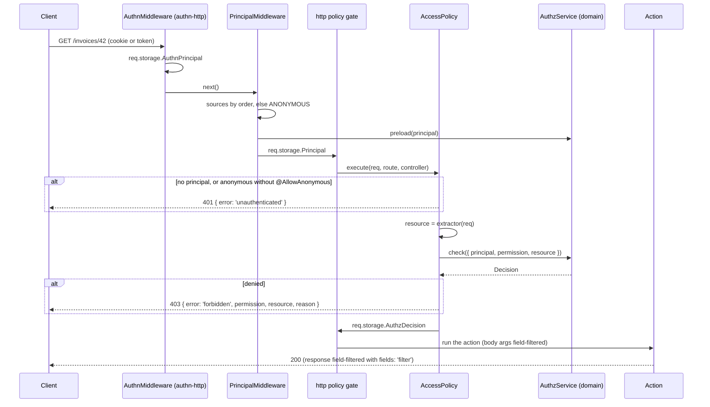

# Protecting routes

`@Access` guards a controller or a route with an authorization check: the route runs only when the request's principal holds one of the named permissions on the resource. `@AllowAnonymous` lets an anonymous caller reach the check, and `@Unscoped` marks a route that reads lists without `.accessible()`.

Use `@Access` on every route that reads or changes protected data. For a route that answers about the caller only, use the `HasPrincipal` or `IsAuthenticated` policy instead.

## How it works

At module load:

1. `Access(permission, opts)` turns one permission or a list into a frozen rule. It throws on an empty list and on a malformed permission name (`parsePermission`), so a typo fails when the controller module loads.
2. The decorator writes the rule into the controller's access descriptor (`ACCESS_DESCRIPTOR` on the prototype; see [Access metadata and OpenAPI](10-access-metadata-and-openapi.md)). A second `@Access` on the same member of the same class throws.
3. It adds one policy group to the route (method) or the controller (class): `AccessPolicy` first, then each class in `opts.also`. On a subclass it removes the inherited `AccessPolicy` group of that place first, so the subclass rule replaces the parent's rule instead of becoming an alternative.
4. With `fields: 'filter'` it also adds the `AuthzFieldsMiddleware` route middleware ([Field filters](06-field-filters.md)).

At boot:

1. `AccessContributor` (an `AuthzContributor`) lists, for each domain that boots, the permissions every registered controller names in an `@Access` of that domain, with the resource type when one is known.
2. The domain's boot fails when a permission is not registered in `authz.permissions` or is checked on a type outside its types. For the root domain the boot runs when the HTTP server starts listening, and a failed boot stops the server ([Principal resolution](03-principal-resolution.md#how-it-works)).

Per request:

1. authn-http's `AuthnMiddleware` leaves the authenticated principal in `req.storage.AuthnPrincipal` ([`@spinajs/authn-http`](../authn-http/README.md)).
2. `PrincipalMiddleware` picks the request's principal and puts it in `req.storage.Principal` ([Principal resolution](03-principal-resolution.md)).
3. http's policy gate runs every policy of the route in parallel ([Policies](../http/13-policies.md)). `AccessPolicy.execute(req, route, controller)` reads the rule of its scope (`'route'` or `'class'`) from the descriptor.
4. It writes `req.storage.AuthzHttpRoute = { domain, unfilteredInput? }` for the input field filter.
5. No principal: 401. A principal with `authenticated: false` (the anonymous one) on a route or class without `@AllowAnonymous`: 401. No model runs in either case.
6. It resolves the `AuthzService` of `opts.domain` (default `root`).
7. It runs `opts.resource(req)` when set ([Resource extractors](02-resource-extractors.md)). A `null` or `undefined` result is a 400. An unloaded `fromModel` instance is turned into a ref by the domain's `ResourceAdapter`. Without an extractor the resource is the type-level ref of the permission, `{ type: 'invoice' }` for `invoice:read`.
8. `AccessPolicy.decide()` calls `authz.check({ principal, permission, resource })` for each permission in order and stops at the first allow. With `subject: 'load'` a conditional allow is settled against the loaded row.
9. A denial throws `AccessDenied` with the 403 body below; the first denial is reported. An allow from the route's own `@Access` (else the class's) goes to `req.storage.AuthzDecision`.
10. The route runs when every scope (class and route) has one group that passed. The checks run in `req.storage`'s async store, so they share the per-request decision cache with the action's own `authz()` calls.



## Decorators

| Decorator | Target | Options | Effect |
| --- | --- | --- | --- |
| `@Access(permission, opts?)` | class or method | `permission`: one `Permission` or a non-empty list (any of them grants); `opts`: `AccessOptions` below | Adds the `AccessPolicy` group (AND with `opts.also`). On a class it guards every route; a route `@Access` then narrows it (AND). |
| `@AllowAnonymous()` | class or method | none | Lets a principal with `authenticated: false` pass the authentication step of `@Access`. A request with no principal still gets 401. |
| `@Unscoped(reason)` | method | `reason`: non-empty string | Adds `UnscopedMiddleware`: after the policies pass, it sets `req.storage.Unscoped = reason` and records an `unscoped` audit entry. Route registration fails when neither the route nor its class has `@Access`. |
| `@UnfilteredInput(reason)` | class or method | `reason`: non-empty string | Turns off the body field filter of the route; see [Field filters](06-field-filters.md). |
| `@CurrentPrincipal()` | parameter | none | The request's principal; see [Principal resolution](03-principal-resolution.md). |

`AccessOptions`:

| Option | Type | Default | Effect |
| --- | --- | --- | --- |
| `resource` | `ResourceExtractor` | type-level ref of the permission's resource | Where the checked resource comes from: `fromParam`, `fromBody`, `fromQuery`, `fromModel`, `typedExtractor` or your function. |
| `also` | `Class<BasePolicy>[]` | `[]` | More policies in the same group: all of them and `AccessPolicy` must pass. |
| `domain` | `string` | `'root'` | The authz domain the check runs in. |
| `subject` | `'load' \| 'none'` | `'none'` | `'load'`: a conditional allow is checked again against the row the domain's adapter loads, so the answer is definite. A missing row is a 403 with reason `unknown_resource`. |
| `fields` | `'filter' \| 'none'` | `'none'` | `'filter'`: the response keeps only the fields the decision lets the caller read. |

Order does not matter. `@Access` creates the route entry when the route decorator (`@Get`, `@Post`) has not run yet, and `@AllowAnonymous` and `@UnfilteredInput` only write the descriptor.

## Status codes and error bodies

Each error goes through http's error handler, which answers `{ ...error fields, message }` and adds `stack` outside production ([Error handling](../http/11-error-handling.md)).

| Status | When | Body fields |
| --- | --- | --- |
| 401 | No principal on an `@Access`, `HasPrincipal` or `IsAuthenticated` route. | `error: 'unauthenticated'`, `message: 'this route needs a principal'` |
| 401 | An unauthenticated principal on an `@Access` route without `@AllowAnonymous`, or on an `IsAuthenticated` route. | `error: 'unauthenticated'`, `message: 'this route needs an authenticated principal'` |
| 403 | Every permission of the rule is denied, or `subject: 'load'` finds no row. | `error: 'forbidden'`, `permission`, `resource`, `reason` (the deny reason without `priority` and `sortKey`, e.g. `{ code: 'no_access' }`), `trace` only when [explain](09-explain.md#trace-in-a-403) allows it |
| 400 | An extractor finds no usable id, or a custom extractor returns `null` or `undefined`. | `message`, `fieldName` (`url parameter id`, `body.projectId`, `query parameter team` or `resource`) |
| 400 | A body field the caller may not write, in `reject` mode. | `error: 'fields_not_writable'`, `fields` ([Field filters](06-field-filters.md)) |
| 500 | `AuthzConfigError`: no `ResourceAdapter` accepts a `fromModel` instance, a principal source returned a `system` or `unattended` principal, the root domain cannot boot. | `message` |

A 403 for `invoice:approve` on invoice 42:

```json
{
  "error": "forbidden",
  "permission": "invoice:approve",
  "resource": { "type": "invoice", "id": "42" },
  "reason": { "code": "no_access" },
  "message": "Access denied: invoice:approve on invoice:42 (no_access)"
}
```

The `Decision` object itself is never in the body: `AccessDenied.decision` is not enumerable.

## Configuration

`@Access` reads no `authz.http.*` key. It depends on these core keys ([`authz.*` config](../authz/04-host-boot-and-configuration.md#configuration)):

| Key | Type | Default | Allowed values | Meaning |
| --- | --- | --- | --- | --- |
| `authz.permissions.<name>` | `object` | none | permission declarations | Every permission an `@Access` names must be declared here, or the domain's boot fails. |
| `authz.audit.unscoped` | `boolean` | `true` | | `false` (per domain) stops the `unscoped` audit entries of `@Unscoped` routes. |
| `authz.audit.service` | `string` | the registered `DecisionAudit` | class name of a registered `DecisionAudit` | The audit `@Unscoped` writes to, as the host picks it. |

```ts
export default {
  authz: {
    permissions: {
      'invoice:read': {},
      'invoice:approve': { consistency: 'fresh' },
    },
    audit: { unscoped: true },
  },
};
```

## Services and extension points

| Service | DI token and lifetime | Default implementation | Alternatives | How to replace or extend |
| --- | --- | --- | --- | --- |
| `AccessPolicy` | not registered; `@Access` puts `{ Type: AccessPolicy, Options: ['route' \| 'class'] }` in the policy group and http builds it per route; `@NewInstance` | `AccessPolicy` | `TelemetryAccessPolicy` (`@spinajs/telemetry`) builds one with `new AccessPolicy('route')` for a rule read from configuration | Add checks next to it with `also`. To decide a rule that is not on a controller, call `execute(req, { ...route, Method: key }, holder)` with a holder carrying an `IAccessDescriptor` under `ACCESS_DESCRIPTOR`. Protected hooks: `decide()`, `refOf()`, `load()`, `trace()`, `inStore()`. <!-- TODO(docs-hook): verify that DI.register(Sub).as(AccessPolicy) replaces the policy http resolves for @Access --> |
| `AccessContributor` | `AuthzContributor` list, `@Injectable(AuthzContributor)`, resolved at each domain boot | `AccessContributor` | `TelemetryAccessContributor` (`@spinajs/telemetry`) | Register another `AuthzContributor` for permissions you check outside `@Access`, so the boot validates them too. |
| `UnscopedMiddleware` | route middleware added by `@Unscoped` through `@Middleware(UnscopedMiddleware, reason)`; `@NewInstance` | `UnscopedMiddleware` | | Not meant to be replaced. |
| `HasPrincipal`, `IsAuthenticated` | plain `BasePolicy` classes, used with `@Policy` | | | Use as they are, or in `also`. |

### `also`: a policy in the `@Access` group

An `also` policy runs with `AccessPolicy` in one AND group: both must pass. Write it as an http `BasePolicy` ([Policies](../http/13-policies.md#services-and-extension-points)).

```ts sample
import { Access, fromParam } from '@spinajs/authz-http';
import { BaseController, BasePath, BasePolicy, Ok, Param, Post } from '@spinajs/http';
import type { Request } from '@spinajs/http';
import { Forbidden } from '@spinajs/exceptions';

/** Payouts leave the bank only on working hours, whoever asks. */
export class OfficeHoursOnly extends BasePolicy {
  public isEnabled(): boolean {
    return true;
  }

  public async execute(_req: Request): Promise<void> {
    const hour = new Date().getHours();
    if (hour < 8 || hour >= 18) {
      throw new Forbidden('payouts run between 8:00 and 18:00');
    }
  }
}

@BasePath('payouts')
export class PayoutsController extends BaseController {
  @Post(':id/send')
  @Access('payout:send', { resource: fromParam('id', 'payout'), also: [OfficeHoursOnly] })
  public send(@Param() id: string) {
    return new Ok({ id, status: 'sent' });
  }
}
```

## Important behaviour

- **A conditional allow passes the route.** Without `subject: 'load'` an allow with a residual other than `TRUE` ("yes, if the row matches") lets the action run, and the decision with its residual stays in `req.storage.AuthzDecision`. The action must load the row and check it, or the route must use `subject: 'load'`.
- **Several permissions mean any.** `@Access(['invoice:update', 'invoice:approve'])` passes on the first allow.
- **Class and route `@Access` combine with AND.** A class `@Access` guards every route; a route `@Access` adds a second check. `req.storage.AuthzDecision` holds the route's decision.
- **Another `@Policy` group is an alternative (OR).** `@Policy(X)` next to `@Access` at the same place lets the route run when `X` alone passes. Put extra checks in `also`.
- **A subclass replaces, never adds.** `@Access` on a subclass replaces the inherited `@Access` group of that place. A subclass without `@Access` keeps the parent's.
- **401 comes before any model.** An anonymous request on a route without `@AllowAnonymous` never reaches the engine.
- **`@AllowAnonymous` does not admit a missing principal.** With `authz.principals.anonymous.enabled: false` an unrecognised request has no principal and gets 401 everywhere.
- **`@Unscoped` runs only after the policies pass.** A refused request writes no audit entry. The reason in `req.storage.Unscoped` lets authz-orm's access guard skip the route's multi-row selects that have no `.accessible()` ([Access lists](../authz-orm/01-access-lists.md)). It does not remove an `.accessible()` filter the code adds.
- **The boot sees controllers registered before it.** A controller registered after a domain booted is checked by that domain's next boot only.
- **Only the route's own decision is kept.** When the class `@Access` and the route `@Access` both pass, the route's decision goes to `req.storage.AuthzDecision`.

## Best practices

- Pass a resource extractor whenever the route works on one object, and `subject: 'load'` when the permission can be conditional (owner rules, ABAC conditions).
- Declare every permission an `@Access` names in `authz.permissions`; the boot then catches a typo before the first request.
- Use `IsAuthenticated` or `HasPrincipal` for routes about the caller only (`/me`, the caller's teams), where no permission names the action.
- Give `@Unscoped` a reason a reviewer understands ("nightly report export"); it lands in the audit.
- Keep `@Access` on the controller class of a package and narrow it per route, so a new route is never left unguarded.

## Patterns and antipatterns

```ts
// Don't: the second @Policy group is an alternative, so OfficeHoursOnly alone lets the route run.
@Post(':id/send')
@Access('payout:send', { resource: fromParam('id', 'payout') })
@Policy(OfficeHoursOnly)
public send(@Param() id: string) {}

// Do: both must pass.
@Post(':id/send')
@Access('payout:send', { resource: fromParam('id', 'payout'), also: [OfficeHoursOnly] })
public send(@Param() id: string) {}
```

```ts
// Don't: a type-level check lets a caller who may edit some invoices edit invoice 42.
@Put(':id')
@Access('invoice:update')
public update(@Param() id: string) {}

// Do: check the invoice the route changes, settled against its row.
@Put(':id')
@Access('invoice:update', { resource: fromParam('id', 'invoice'), subject: 'load' })
public update(@Param() id: string) {}
```

## Examples

### Require a permission on a new route

1. Declare the permission in config: `authz: { permissions: { 'invoice:approve': {} } }`.
2. Grant it through your model, e.g. an RBAC role ([`@spinajs/authz-rbac`](../authz-rbac/README.md)).
3. Add `@Access` with the resource the route works on.
4. Start the app: the root domain's boot fails when the permission is not declared.

```ts sample
import { Access, AllowAnonymous, Unscoped, fromParam } from '@spinajs/authz-http';
import { BaseController, BasePath, Get, Ok, Param, Post } from '@spinajs/http';

@BasePath('invoices')
@Access('invoice:read')
export class InvoicesController extends BaseController {
  // Class rule only: type-level invoice:read.
  @Get('/')
  public list() {
    return new Ok([]);
  }

  // Class rule AND route rule on invoice <id>; a conditional grant is settled on the row.
  @Post(':id/approve')
  @Access('invoice:approve', { resource: fromParam('id', 'invoice'), subject: 'load' })
  public approve(@Param() id: string) {
    return new Ok({ id, approved: true });
  }

  // Audited: the export reads every invoice without .accessible().
  @Get('export')
  @Access('invoice:export')
  @Unscoped('accounting export of all invoices')
  public export() {
    return new Ok({ queued: true });
  }
}

@BasePath('pages')
export class PublicPagesController extends BaseController {
  // The anonymous principal reaches the check; a grant to it decides.
  @Get(':slug')
  @AllowAnonymous()
  @Access('page:read', { resource: fromParam('slug', 'page') })
  public page(@Param() slug: string) {
    return new Ok({ slug });
  }
}
```

### A route about the caller only

```ts sample
import type { Principal } from '@spinajs/authz';
import { CurrentPrincipal, IsAuthenticated } from '@spinajs/authz-http';
import { BaseController, BasePath, Get, Ok, Policy } from '@spinajs/http';

@BasePath('me')
export class MeController extends BaseController {
  @Get('/')
  @Policy(IsAuthenticated)
  public me(@CurrentPrincipal() caller: Principal) {
    return new Ok({ type: caller.type, id: caller.id });
  }
}
```

## Related

- [Resource extractors](02-resource-extractors.md): what `resource` accepts.
- [Field filters](06-field-filters.md): what `fields: 'filter'` and the body filter do with the decision.
- [Policies](../http/13-policies.md): how http combines policy groups and scopes.
- [Error handling](../http/11-error-handling.md): how the 401, 403 and 400 bodies are built.
- [`@spinajs/authz`](../authz/01-check-flow.md#concepts): permissions, decisions, residuals and deny reasons.
- [`@spinajs/authz-orm`](../authz-orm/README.md): `@AccessResource` for `fromModel` and `.accessible()` for list routes.
