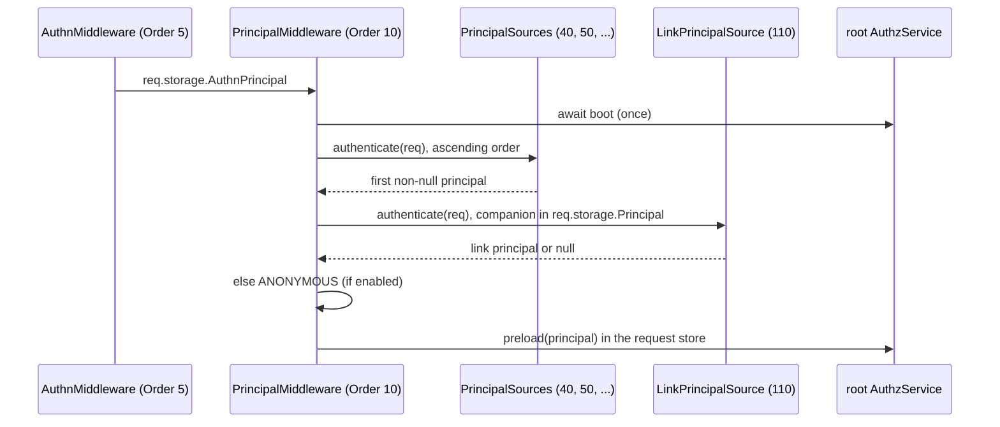

# Principal resolution

`PrincipalMiddleware` decides, once per request, who the caller is for authorization: the principal every `@Access`, `authz()` call and ORM list filter of the request uses. It asks the registered principal sources, falls back to the anonymous principal, and preloads the result in the root domain.

It does not read credentials itself. Logins, sessions, tokens and keys belong to [`@spinajs/authn-http`](../authn-http/README.md); this middleware takes the principal authn-http left on the request.

## How it works

At startup:

1. `HttpServer` resolves `PrincipalMiddleware` as a `ServerMiddleware` (`Order` 10, `PRINCIPAL_MIDDLEWARE_ORDER`). `resolve()` sorts the injected `PrincipalSource`s by `order`.
2. It waits for the `http.server.listening` event, then resolves the root `AuthzService`, which boots the root domain. The boot runs after the controllers registered, so the `@Access` permission check sees all of them.
3. When the root domain cannot boot, the middleware logs the error and stops the HTTP server: a bad authz configuration never serves requests.

Per request, `PrincipalMiddleware.before()`:

1. Awaits the root `AuthzService` (booted once and shared).
2. Asks every source except `LinkPrincipalSource` in ascending `order`; the first non-null answer wins ([Principal sources](04-principal-sources.md)).
3. Stores that answer in `req.storage.Principal`, then asks the link sources. A link principal replaces the answer and keeps it as its companion ([Share links](05-share-links.md)).
4. No answer: the frozen `ANONYMOUS` principal (`{ type: 'anonymous', id: 'anonymous', authenticated: false, source: 'anonymous' }`) while `authz.principals.anonymous.enabled` is on, else no principal.
5. A source that returns a `system` or `unattended` principal throws `AuthzConfigError` (500). Those principals come only from `runAs`, `@Job` and `@Unscoped` code paths.
6. Sets `req.storage.Principal` and runs `authz.preload(principal)` inside the request's async store, so what models keep per request reaches the later checks.
7. Calls `next()`. An error from a source or from the root boot goes to `next(err)` and http's error handler.

`AccessEpochMiddleware` (`Order` 11) then stamps `X-Access-Epoch` on the response ([Client access API](07-client-access-api.md#x-access-epoch)).

In the action, `authz().current()` returns `req.storage.Principal`, or `UNATTENDED` when the request has none. `UNATTENDED` is denied every check.



## Decorators

| Decorator | Target | Options | Effect |
| --- | --- | --- | --- |
| `@CurrentPrincipal()` | parameter | none | Injects `req.storage.Principal`, or `UNATTENDED` without one, through the `CurrentPrincipalArg` route argument. |

## Configuration

| Key | Type | Default | Allowed values | Meaning |
| --- | --- | --- | --- | --- |
| `authz.principals.anonymous.enabled` | `boolean` | `true` | `true`, `false` | `true`: a request no source recognised gets `ANONYMOUS`. `false`: it gets no principal; `@Access` routes answer 401 and actions run as `UNATTENDED`. Unset and `null` count as `true`. |

```ts
export default {
  authz: {
    principals: { anonymous: { enabled: false } },   // an API with no public routes
  },
};
```

### `req.storage` keys

The package augments http's `IActionLocalStoregeContext` (the type of `req.storage`) with the authz and authn keys:

| Key | Type | Written by | Read by |
| --- | --- | --- | --- |
| `AuthnPrincipal` | `Principal \| null` | authn-http's `AuthnMiddleware` | `AuthnPrincipalSource` |
| `Principal` | `Principal` | `PrincipalMiddleware` | `AccessPolicy`, `@CurrentPrincipal()`, `authz().current()`, authz-orm |
| `AuthzDecision` | `Decision` | `AccessPolicy` on allow | the field filters, your action |
| `AuthzHttpRoute` | `{ domain, unfilteredInput? }` | `AccessPolicy` | the input field filter |
| `Unscoped` | `string` | `UnscopedMiddleware` | authz-orm's access guard |
| `AuthzCache` | `Map` | the authz host | the per-request decision cache |

## Services and extension points

| Service | DI token and lifetime | Default implementation | Alternatives | How to replace or extend |
| --- | --- | --- | --- | --- |
| `PrincipalMiddleware` | `ServerMiddleware` list, `@Injectable(ServerMiddleware)`, resolved once by `HttpServer` | `PrincipalMiddleware` | | Add a source instead ([Principal sources](04-principal-sources.md)). To change the flow, subclass and override the protected `authenticate(req)`, `ask(source, req)` or `attach(req)`, then `DI.register(Mine).as(PrincipalMiddleware)` before `HttpServer` resolves. |
| `CurrentPrincipalArg` | `RouteArgs`, `@Injectable()`, `SupportedType` `'CurrentPrincipalArg'` | `CurrentPrincipalArg` | | Not meant to be replaced; see [Custom route arguments](../http/05-custom-route-arguments.md). |
| `AccessDomainArg` | `RouteArgs`, `@Injectable()`, `SupportedType` `'AccessDomainArg'` | `AccessDomainArg` | | The argument of `@AccessDomain()`: `resolveAuthzDomain(req, authz.http.access.domain)`. Not meant to be replaced; change the domain with an `AuthzDomainResolver` instead. |
| `AccessEpochMiddleware` | `ServerMiddleware` list, `Order` 11 | `AccessEpochMiddleware` | | See [Client access API](07-client-access-api.md). |

## Important behaviour

- **Every request waits for the root domain.** The first requests after start wait for its boot; a failed boot answers 500 and stops the server.
- **A source error fails every request**, guarded or not: the middleware runs before routing. A source should return `null` for credentials it does not recognise.
- **The principal is frozen per request.** A login or role switch inside the request does not change `req.storage.Principal`; the next request picks the new one.
- **Anonymous is on by default.** Turn it off for an API without public routes, so an unrecognised caller is 401, not "anonymous".
- **Preload runs once per request, in the root domain only.** A route whose `@Access` names another domain gets no preload there.

## Best practices

- Use `@CurrentPrincipal()` in actions instead of reading `req.storage` yourself.
- Pass the principal to services explicitly (`teams.createTeam(caller, ...)`) rather than calling `authz().current()` deep in a service.
- Keep `authn-http` and `authz-http` both loaded in a web app: without `AuthnMiddleware` every caller is anonymous.

## Patterns and antipatterns

```ts
// Don't: rebuilds what PrincipalMiddleware already decided, and ignores service and link principals.
@Get('/')
public me(@Req() req: Request) {
  return new Ok({ id: req.storage.AuthnPrincipal?.id });
}

// Do
@Get('/')
@Policy(IsAuthenticated)
public me(@CurrentPrincipal() caller: Principal) {
  return new Ok({ id: caller.id });
}
```

## Examples

### Pass the caller to a service

```ts sample
import type { Principal } from '@spinajs/authz';
import { authz } from '@spinajs/authz';
import { Access, CurrentPrincipal, fromParam } from '@spinajs/authz-http';
import { BaseController, BasePath, Ok, Param, Post } from '@spinajs/http';

export class ProjectArchiver {
  public async archive(caller: Principal, projectId: string): Promise<void> {
    // The route checked project:archive; the service checks again for callers outside http.
    await authz().assert(caller, 'project:archive', { type: 'project', id: projectId });
  }
}

@BasePath('projects')
export class ProjectsController extends BaseController {
  protected archiver = new ProjectArchiver();

  @Post(':id/archive')
  @Access('project:archive', { resource: fromParam('id', 'project') })
  public async archive(@CurrentPrincipal() caller: Principal, @Param() id: string) {
    await this.archiver.archive(caller, id);
    return new Ok({ id, archived: true });
  }
}
```

## Related

- [Principal sources](04-principal-sources.md): the sources this middleware asks.
- [`@spinajs/authn-http`](../authn-http/README.md): `AuthnMiddleware`, which leaves `req.storage.AuthnPrincipal`.
- [Request storage and tracing](../http/19-request-storage-and-tracing.md): `req.storage` and its async store.
- [Server middlewares](../http/15-server-middlewares.md): `Order` and replacing a shipped middleware.
- [`@spinajs/authz`](../authz/01-check-flow.md#concepts): principals, `UNATTENDED` and `SYSTEM`.
