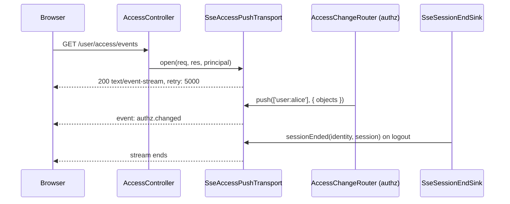

# Access events

`GET /user/access/events` is a server-sent events stream that tells a client when its access changed: an admin granted a role, revoked an assignment or changed a policy. The client then drops its cached access answers and asks again. It is the HTTP counterpart of the socket push in [`@spinajs/http-socket`](../http-socket/11-access-change-push.md); both are `AccessPushTransport`s of the authz host.

## How it works

Opening a stream:

1. `AccessController.events()` runs behind `IsAuthenticated`: the anonymous principal and a request without a principal get 401.
2. It returns an `AccessEventStream` response, which hands the Express response to `SseAccessPushTransport.open(req, res, principal)`.
3. `open()` answers 200 with `Content-Type: text/event-stream; charset=utf-8`, `Cache-Control: no-cache, no-transform` (the compression middleware skips it) and `X-Accel-Buffering: no` (nginx does not buffer it), flushes the headers and writes `retry: 5000`.
4. It closes the oldest streams of the same principal past `authz.http.events.maxStreamsPerPrincipal`.
5. The stream listens under the principal's key and the keys of its companions (`pushKeys(principal)`), and remembers the principal's session handle when a session signed it in.
6. A heartbeat comment (`: heartbeat`) goes out every 25 seconds, below the 30-second idle timeout of common proxies.
7. When the client goes away (`res` `close`), the stream is forgotten.

Pushing a change:

1. After an admin write commits, the root domain's `AccessChangeRouter` asks the registered audiences whom the change affects and calls `push(principals, event)` on every `AccessPushTransport` ([`@spinajs/authz`](../authz/10-authz-admin.md)).
2. `SseAccessPushTransport.push()` writes one frame to each open stream of those principal keys, or of every stream for `'*'`:

```text
event: authz.changed
data: {"objects":[{"type":"invoice","id":"42"}]}

```

`objects` is present only when the change is exact; without it the client refetches everything.

Ending streams with the session:

1. `SseSessionEndSink` (an authn `AuthnEventSink`) hears successful `logout`, `session.revoke` and `session.expire` events.
2. It ends the identity's streams whose session handle the event names.
3. When a `SessionIssuer` is registered, it also lists the identity's live sessions and ends every other session stream whose handle is no longer listed. This catches a revoke that names no session (revoke all, revoke the others) and a handle that went stale through a rotation or role switch.
4. `impersonation.start`, `impersonation.end` and `impersonation.expire` re-check the impersonated identity's and the actor's streams against the `SessionIssuer` only, because their `session` is not always the ended one.

When the HTTP server stops (`http.server.closing`), the transport ends every stream and its socket, so open streams do not hold the shutdown.



## Configuration

| Key | Type | Default | Allowed values | Meaning |
| --- | --- | --- | --- | --- |
| `authz.http.events.maxStreamsPerPrincipal` | `integer` | `5` | `1` or more | Open streams one principal may hold; a new one past the limit closes the oldest. |
| `authz.bus.service` | `string` | the in-process bus | `'QueueChangeBus'` (`@spinajs/authz-queue`) | With several nodes, every node must see every change to push it to its own streams. |

```ts
export default {
  authz: {
    bus: { service: 'QueueChangeBus' },            // several nodes behind a load balancer
    http: { events: { maxStreamsPerPrincipal: 3 } },
  },
};
```

## Services and extension points

| Service | DI token and lifetime | Default implementation | Alternatives | How to replace or extend |
| --- | --- | --- | --- | --- |
| `SseAccessPushTransport` | `AccessPushTransport` list, `@Injectable(AccessPushTransport)`, `@Singleton`, `name` `'sse'` | `SseAccessPushTransport` | the socket transport of `@spinajs/http-socket` | Register another `AccessPushTransport` for a new channel; `count(principalKey?)` and `closeAll()` help in tests and shutdown hooks. |
| `SseSessionEndSink` | `AuthnEventSink` list, `@Injectable(AuthnEventSink)` | `SseSessionEndSink` | | Not meant to be replaced. |
| `SessionIssuer` (`@spinajs/authn`) | resolved per session end, only when registered | the one your authn setup registers | | Without one, only streams whose handle the event names end. |

## Important behaviour

- **Authenticated principals only.** Anonymous callers get 401, as the socket transport admits only authenticated connections to principal rooms.
- **Push is per node.** Each node pushes to its own streams. With the in-process bus, only clients connected to the node that made the change hear of it; use `QueueChangeBus` on several nodes.
- **Session ends are seen only on the node that handled them.** A stream on another node, or of a session that expires without an event, lasts until the client reconnects; the reconnect then gets 401.
- **A stream hears its companions.** A link principal's stream also gets the changes of the signed-in user behind the link.
- **`http` has no SSE of its own.** The route sends no body through http's response pipeline; the transport writes to the Express response directly.

## Best practices

- Open one stream per tab at most; the cap closes the oldest when a user opens more.
- On `authz.changed` without `objects`, drop every cached answer; with `objects`, drop only theirs.
- Reconnect with the browser's `EventSource` defaults; the server's `retry: 5000` sets the delay.

## Examples

### React to access changes in the browser

```ts
const events = new EventSource('/user/access/events', { withCredentials: true });

events.addEventListener('authz.changed', (e) => {
  const { objects } = JSON.parse((e as MessageEvent<string>).data) as { objects?: { type: string; id: string }[] };
  if (objects) objects.forEach((o) => accessCache.drop(o.type, o.id));
  else accessCache.clear();
});
```

## Related

- [Client access API](07-client-access-api.md): the answers this stream invalidates, and `X-Access-Epoch`.
- [Access change push in http-socket](../http-socket/11-access-change-push.md): the socket transport.
- [`@spinajs/authz`](../authz/10-authz-admin.md): `AccessChangeRouter` and change audiences.
- [`@spinajs/authn`](../authn/README.md): session events and `SessionIssuer`.
