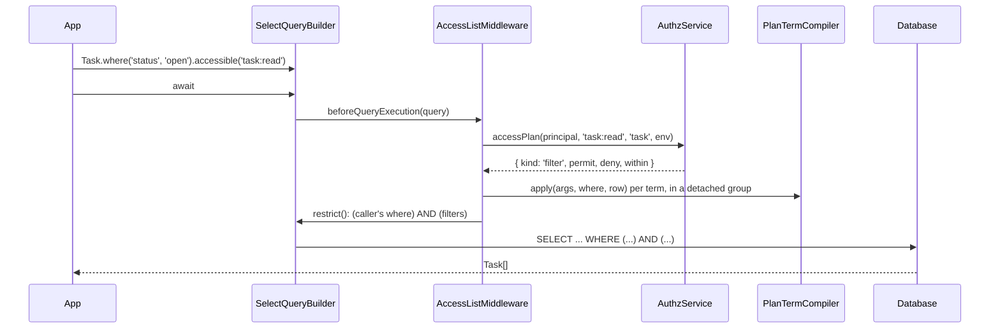

# Access lists on query builders

`.accessible(permission)` limits an ORM query to the rows the current principal may act on. `.within(refs)` narrows it to a part of the resource tree, and `.withAccess(permissions)` adds a `$access` map to every row. All three turn into where conditions of the query builder when the query runs; no SQL text is written by hand.

Use them on every multi-row select, update or delete of an `@AccessResource` model. Single objects are checked with `authz().assert()` instead ([Single-object checks](05-single-object-checks.md)).

## How it works

1. `Task.where(...).accessible('task:read')` (and `.within()`, `.withAccess()`, `.unscoped()`) only marks the builder. The method throws `AuthzConfigError` when the model is not an `@AccessResource` model, when the permission is not a permission name, or when `.accessible()` and `.unscoped()` meet on one builder.
2. On `await`, `AccessListMiddleware.beforeQueryExecution(query)` (a `QueryMiddleware`, order 100) reads the marks. It picks the domain from `authz.orm.domain` and the principal from `currentPrincipal()`. A `.unscoped(reason)` query writes an `unscoped` audit entry and gets no filter.
3. `planRow(query, entry)` builds the `PlanRow` the plan terms compile against: the row's type, its id column cast to text, its `owner` / `self` columns, the ancestor table, the database's `now()` and `from()` for sub-queries on the query's connection.
4. For `.accessible()`, `AuthzService.accessPlan(principal, permission, type, env)` returns the plan, and `planFilter(plan, row)` turns it into one of three answers:
   - `none`: `AccessDenied` with the plan's deny reason, or `where(false)` with `{ onNone: 'empty' }`;
   - `all`: no condition;
   - `where`: a function that adds `(permit OR …) AND NOT (deny OR …) AND within` to a where group. Each term goes through the `PlanTermCompiler` registered for its `op` ([Plan term compilers](02-plan-term-compilers.md)).
5. Each `.within(refs)` call becomes `applyWithin(where, refs, row)`: the row is one of the refs, or a correlated `whereExist()` over `authz_resource_ancestor` finds one of them above it.
6. For `.withAccess()` on a select, the middleware compiles one condition per permission, each in a where group not yet attached to the query (`none` is `where(false)`, `all` is `where(true)`).
7. `restrict(query, apply)` first builds every filter in a detached `WhereBuilder`. Only when all of them compiled does it move the caller's where statements into one group and append the filter groups after it; HAVING statements stay last.
8. `.withAccess()` then adds each condition with `selectCondition('__authz_access_<i>', …)` (and `select('*')` when the query has no column list). `AccessFieldMiddleware` reads each column as a boolean, moves it into `row.$access[permission]` and drops the raw column.



## Builder methods

| Method | Builders | Effect |
| --- | --- | --- |
| `.accessible(permission, { env?, onNone? })` | select, update, delete | Rows the plan of `permission` allows. One permission per query. `onNone`: `'deny'` (default) throws `AccessDenied` on a `none` plan, `'empty'` matches no row. `env` passes request facts to the models (ABAC). |
| `.within(ref \| refs)` | select, update, delete | Rows that are one of the refs or lie below one. The refs of one call are OR-ed; chained calls are AND-ed. Narrows only: it authorizes nothing. |
| `.withAccess(permissions, { env? })` | select | One boolean per permission on every row, under `authz.orm.accessField` (default `$access`). Each permission needs `list: true`. |
| `.unscoped(reason)` | select, update, delete | No filter; writes an `unscoped` audit entry (`authz.audit.unscoped`). Excludes `.accessible()`. |

`.within()` refs:

| Ref | Matches |
| --- | --- |
| `{ type: 'team', id: '42' }` | the row itself when the row is `team:42`, or any row with `team:42` among its ancestors |
| `{ type: 'team' }` | any row with a `team` ancestor |
| `{ type: '<the row's own type>' }` or `GLOBAL` | every row |
| `[]` | no row |

## Configuration

| Key | Type | Default | Allowed values | Meaning |
| --- | --- | --- | --- | --- |
| `authz.permissions.<name>.list` | `boolean` | `false` | | The permission has an access plan. `.accessible()` and `.withAccess()` need it. In a child domain: `authz.domains.<name>.permissions`. |
| `authz.orm.domain` | `string` | `'root'` | a domain name | The domain whose service plans the lists. |
| `authz.orm.accessField` | `string` | `'$access'` | non-empty string | The row key `.withAccess()` writes. |

```ts
export default {
  authz: {
    permissions: { 'task:read': { list: true }, 'task:update': { list: true }, 'task:delete': { list: true } },
    orm: { domain: 'root', accessField: '$access' },
  },
};
```

## Services and extension points

| Service | DI token and lifetime | Default implementation | Alternatives | How to replace or extend |
| --- | --- | --- | --- | --- |
| `AccessListMiddleware` | `QueryMiddleware`, registered by `@Injectable(QueryMiddleware)` when `@spinajs/authz-orm` is imported; order 100 | `AccessListMiddleware` | none | Not meant to be replaced; extend lists with a plan term compiler. |
| `AccessGuardMiddleware` | `QueryMiddleware`, registered the same way; order 95 | `AccessGuardMiddleware` | none | Not meant to be replaced; `guardMode()` picks throw, warn or off from the env. |
| Plan term compilers | `PlanTermCompiler`, resolved as `Array.ofType(PlanTermCompiler)` from the DI root | `RelationOwnerTerm`, `RelationSelfTerm` | authz-rbac's `RbacAssignmentTerm` | Register one per op: [Plan term compilers](02-plan-term-compilers.md). |
| `restrict(query, apply)` | exported function | | | Use it in a query middleware of your own that must AND a condition with the caller's where. |
| `planFilter(plan, row, compilers?)`, `applyWithin(where, refs, row)`, `planRow(query, entry)` | exported functions | | | Build the same conditions outside `AccessListMiddleware`. |

`restrict()` keeps the caller's where in one group, so a top-level `OR` of the caller cannot escape the filter:

```ts
import { restrict } from '@spinajs/authz-orm';

// inside a QueryMiddleware's beforeQueryExecution(query)
restrict(query, (where) => {
  where.where('archived', false);
});
```

`apply` runs on a detached group before the query changes. When it throws, the query stays as the caller wrote it.

## Important behaviour

- **No permit at all is a 403.** A `none` plan throws `AccessDenied` (H16), never an empty list, unless the call says `{ onNone: 'empty' }`. A permission without `list: true` throws `AuthzConfigError`.
- **The query changes all at once or not at all.** Every condition, the `.withAccess()` ones included, is compiled in a detached group first. A compiler that throws `AuthzConfigError` leaves the builder as the caller wrote it.
- **A term must add a condition.** A compiler that adds nothing, or only empty nested groups, fails the query with `AuthzConfigError`: such a group compiles to no condition and would keep every row. `WhereBuilder.hasCondition()` looks through nested groups.
- **Deny terms are negated with `whereNot()`.** The deny group compiles to `NOT ( … )`. A `NULL` inside it makes the negation `NULL`, which keeps no row.
- **`.within()` is a correlated sub-query.** It is `whereExist()` on `authz_resource_ancestor` with `resource_id` bound to `outer(row.id)`, plus an `IN` on the row's own id for refs of its own type.
- **`.withAccess()` reads booleans.** Each column is `CASE WHEN … THEN 1 ELSE 0 END`; the builder reads it as `true` or `false`, and only `true` grants. `$access` equals what `POST /user/access/checks` answers for that row.
- **Expiry uses the database's clock.** List terms compare `expires_at` with `row.now()`, the database's current instant. Checks use `AuthzClock`. Where the two clocks differ, a row whose assignment expires within the skew can be listed while a check of it denies, or the reverse. Keep the database and application hosts on one time source.
- **Long subject lists are one parameter.** An RBAC term names every subject key of the principal; PostgreSQL, SQLite and MSSQL bind a long `whereIn` list as one parameter ([`@spinajs/orm` query builder](../orm/05-query-builder.md#filtering)).
- **The runtime guard names the app's line.** In `development`, `AccessGuardMiddleware` warns once per call site about a multi-row select without `.accessible()`, `.unscoped()` or `runAs(SYSTEM)`. The call site is the first stack frame outside `di`, `util`, `orm`, any `orm-<name>` package, `authz` and `authz-orm` (their `src` or `lib` folders). An app folder with one of those names followed by `src` or `lib` counts as internal too ([The runtime guard](07-runtime-guard.md)).
- **A route's `@Unscoped(reason)` covers its selects.** authz-http stores the reason for the request; the guard lets every select of that request through. `.unscoped(reason)` on one builder is the per-query form.
- **Relations are not filtered.** `populate()`, joins and sub-queries get no filter. Authorize the aggregate root; a child type that is its own resource calls `.accessible()` inside the populate callback, whose `this` is the relation's query (see the example below). Without `{ onNone: 'empty' }` there, a caller who may read the parent but no child gets `AccessDenied`, which fails the whole load.
- **A clone keeps the marks.** `SelectQueryBuilder.clone()` copies `.accessible()`, `.within()`, `.withAccess()` and `.unscoped()` to the copy.
- **One permission per query.** A second `.accessible()` with another permission throws `AuthzConfigError`; the same permission again is a no-op.

## Best practices

- Pass `{ onNone: 'empty' }` only where "no access" is a normal answer, such as a child list inside `populate()`.
- Use `.within()` for "the tasks of this team" and keep `.accessible()` next to it: `.within()` alone authorizes nothing.
- Ask for every per-row permission in one `.withAccess([...])` call; each permission adds one column to the same query.

## Patterns and antipatterns

```ts
// Don't: .within() narrows, it does not authorize; the guard throws in the test env
const tasks = await Task.query().within({ type: 'team', id: teamId });

// Do
const tasks = await Task.query().within({ type: 'team', id: teamId }).accessible('task:read');
```

## Examples

### List the open tasks of a team, with edit and delete flags

```ts sample
import { AccessResource, Owner, Parent } from '@spinajs/authz-orm';
import { Model, ModelBase, Primary } from '@spinajs/orm';

@AccessResource('task')
@Model('tasks')
export class Task extends ModelBase<Task> {
  @Primary()
  public id!: number;

  @Parent('team')
  public team_id!: number;

  @Owner()
  public owner_id!: string;

  public status!: string;
}

export async function openTeamTasks(teamId: string) {
  // rows[i].$access = { 'task:update': boolean, 'task:delete': boolean }
  return await Task.where('status', 'open').within({ type: 'team', id: teamId }).accessible('task:read').withAccess(['task:update', 'task:delete']);
}
```

### Archive the done tasks the caller may update

```ts sample
import { AccessResource } from '@spinajs/authz-orm';
import { Model, ModelBase, Primary } from '@spinajs/orm';

@AccessResource('task')
@Model('tasks')
export class Task extends ModelBase<Task> {
  @Primary()
  public id!: number;

  public done!: boolean;

  public archived!: boolean;
}

export async function archiveDone() {
  return await Task.update({ archived: true }).where('done', true).accessible('task:update');
}
```

### Load a project with the tasks the caller may read

```ts
const project = await Project.where('id', id)
  .populate('tasks', function () {
    this.accessible('task:read', { onNone: 'empty' });
  })
  .firstOrFail();
await authz().assert(currentPrincipal(), 'project:read', project);
```

The project select is a single primary-key load, so the guard leaves it alone and the `assert()` covers it. The `tasks` relation query gets its own filter; a caller with no `task:read` at all gets an empty `tasks` list.

## Migration

`renderPlan`, `Rendered`, `withinSql`, `rowContext`, `dialectOf`, `castText`, `quoterOf` and `SqlDialect` are removed. Lists build ORM conditions, so no dialect switch is left. `restrict()` takes a callback that adds conditions to a where group.

```ts
// Before
const rendered = renderPlan(plan, rowContext(query, entry, new Date()));
if (rendered.kind === 'sql') restrict(query, rendered);
const team = withinSql([{ type: 'team', id: '42' }], rowContext(query, entry, new Date()));

// After
const filter = planFilter(plan, planRow(query, entry));
if (filter.kind === 'where') restrict(query, filter.apply);
restrict(query, (where) => applyWithin(where, [{ type: 'team', id: '42' }], planRow(query, entry)));
```

## Related

- [Plan term compilers](02-plan-term-compilers.md): how each plan term becomes a condition.
- [Declaring access resources](04-access-resources.md): which models accept `.accessible()`.
- [Single-object checks](05-single-object-checks.md): the check side of the same permissions.
- [The ancestor table](06-ancestor-table.md): the table `.within()` and the RBAC term read.
- [The runtime guard](07-runtime-guard.md): what flags a select without `.accessible()`.
- [`@spinajs/authz`](../authz/01-check-flow.md#concepts): access plans, `list: true` and boot rule 12.
- [`@spinajs/orm` query builder](../orm/05-query-builder.md): `whereNot()`, `whereExist()`, `outer()` and `selectCondition()`.