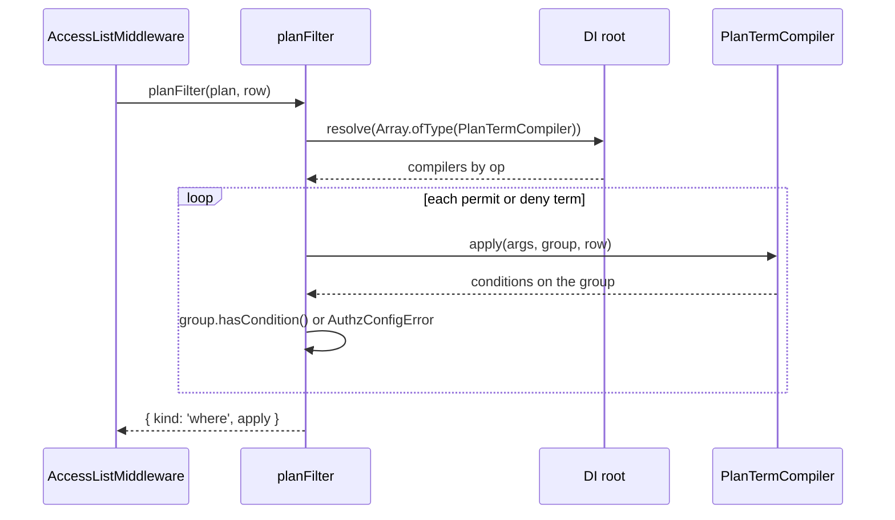

# Plan term compilers

An access plan holds opaque terms (`{ op, args }`) that each model's `listPlan` returns. A `PlanTermCompiler` turns the terms of one `op` into conditions on a where group of the resource query. Register one when a model of your own serves lists, or when you add an op to an existing model.

The contract lives in the entry point `@spinajs/authz-orm/plan`, which loads nothing else of the adapter (no migrations, query middlewares or contributor). A model package depends on it without pulling in the ORM adapter.

## How it works

1. `AccessListMiddleware` asks `AuthzService.accessPlan()` for the plan of an `.accessible()` or `.withAccess()` permission ([Access lists](01-access-lists.md)).
2. `planFilter(plan, row)` resolves the compilers with `planTermCompilers()`: `DI.resolve(Array.ofType(PlanTermCompiler))` on the DI root, keyed by `op`. Two different compilers for one op, or a compiler without an `op`, throw `AuthzConfigError`.
3. For each term, `planFilter` opens a group with `where.orWhere(function () { … })` and calls `compiler.apply(term.args, this, row)` inside it. A term with no compiler throws `AuthzConfigError` (`no PlanTermCompiler applies op …`).
4. After `apply()` returns, the group must hold a condition (`hasCondition()`). An empty group, or one holding only empty nested groups, throws `AuthzConfigError` (`… added no condition`).
5. The permit terms are OR-ed in one group, the deny terms OR-ed and negated with `whereNot()`, and the plan's `within` added as a third group: `(permit OR …) AND NOT (deny OR …) AND within`. An empty permit list is `where(false)`.
6. All of this runs on a detached group. `restrict()` attaches it, ANDed with the caller's where, only after every term compiled.



## The contract

`@spinajs/authz-orm/plan` exports:

| Export | Kind | Meaning |
| --- | --- | --- |
| `PlanTermCompiler` | abstract class | `op: string` and `apply(args: unknown, where: IWhereBuilder<unknown>, row: PlanRow): void`. |
| `PlanRow` | interface | The row a term filters, seen from a where group of the resource query. |
| `RELATION_OWNER_OP` | `'relation.owner'` | The op of the `owner` relation. |
| `RELATION_SELF_OP` | `'relation.self'` | The op of the `self` relation. |
| `RelationPlanArgs` | interface | `{ principals: readonly { type: string; id: string }[] }`, the args of both relation ops. |

The same names are exported from `@spinajs/authz-orm`.

`PlanRow`:

| Member | Type | Use |
| --- | --- | --- |
| `type` | `ResourceType` | The resource type of the query's model. |
| `id` | `Wrap` | The row's id column cast to text. `where.whereIn(row.id, ids)` on the group; `outer(row.id)` inside a sub-query. |
| `relation(name)` | `(name: 'owner' \| 'self') => { column, typeColumn? } \| undefined` | The `@Owner()` / `@Self()` columns, when the model declares them. |
| `ancestorTable` | `string` | `authz_resource_ancestor`: `resource_type`, `resource_id`, `ancestor_type`, `ancestor_id`, `depth`. |
| `now()` | `RawQuery` | The database's current instant: `where('expires_at', '>', row.now())`. |
| `from(table, alias)` | `ISelectQueryBuilder<unknown>` | A query on the row's connection. `whereExist()` or `whereIn()` correlates it with the group it is called on. |

A column name on `where` is the row's column: the group belongs to the resource query.

## Shipped compilers

| op | Class | Registered by | Adds |
| --- | --- | --- | --- |
| `relation.owner` | `RelationOwnerTerm` | `@spinajs/authz-orm` | The `@Owner()` column, as text, is one of the `user` principals in `args.principals`. With `typeColumn`, one `(typeColumn = type AND column IN ids)` group per principal type, OR-ed, and `where(false)` when `args.principals` is empty. |
| `relation.self` | `RelationSelfTerm` | `@spinajs/authz-orm` | The `@Self()` column, as text, is one of the `user` principals in `args.principals`. |
| `rbac.assignment` | `RbacAssignmentTerm` | `@spinajs/authz-rbac` | `EXISTS` over `authz_assignment` at the row, at an ancestor, or at `$global`, with live expiry ([`@spinajs/authz-rbac`](../authz-rbac/README.md)). |

Both relation compilers throw `AuthzConfigError` when `args` is not `{ principals: { type, id }[] }`, or when the model has no matching `@Owner()` / `@Self()` column.

## Services and extension points

| Service | DI token and lifetime | Default implementation | Alternatives | How to replace or extend |
| --- | --- | --- | --- | --- |
| `PlanTermCompiler` | `PlanTermCompiler`; the shipped ones are `@Singleton()`. Resolved as a list (`Array.ofType(PlanTermCompiler)`) on the DI root, each time a list query runs. | `RelationOwnerTerm`, `RelationSelfTerm` | `RbacAssignmentTerm` (authz-rbac) | Add `@Injectable(PlanTermCompiler)` to a subclass, or `DI.register(MyTerm).as(PlanTermCompiler)` on the root container. One compiler per op: a second one for the same op fails every list query. To replace a shipped compiler, `DI.unregister(<its class>)` first ([example](../authz-rbac/01-list-filter-term.md#rbacassignmentterm-custom-implementation)). |

### PlanTermCompiler: custom implementation

Write a compiler for each op your model's `listPlan` returns. Register it in the DI root before the first list query that meets the op: compilers are resolved when a query runs, and a compiler registered only in a child domain's container is not seen.

`apply()` must add at least one predicate. A term that matches no row adds `where(false)`. The condition must keep exactly the rows a check of each row would allow; boot rule 12 guarantees that for the RBAC and ABAC plans, and a model of your own guarantees it for its terms.

The example lists invoices shared with the principal through an `invoice_share` table (`invoice_id` holds the invoice id as text, `subject_key` the holder, `expires_at` an optional expiry). The sharing model's `listPlan` returns `{ op: 'invoice.share', args: { subjects: [...] } }`.

```ts sample
import { AuthzConfigError } from '@spinajs/authz';
import { AccessResource } from '@spinajs/authz-orm';
import { PlanTermCompiler } from '@spinajs/authz-orm/plan';
import type { PlanRow } from '@spinajs/authz-orm/plan';
import { Injectable, Singleton } from '@spinajs/di';
import { Model, ModelBase, Primary, outer } from '@spinajs/orm';
import type { IWhereBuilder } from '@spinajs/orm';

@AccessResource('invoice')
@Model('invoices')
export class Invoice extends ModelBase<Invoice> {
  @Primary()
  public id!: number;

  public archived!: boolean;
}

@Singleton()
@Injectable(PlanTermCompiler)
export class InvoiceShareTerm extends PlanTermCompiler {
  readonly op = 'invoice.share';

  apply(args: unknown, where: IWhereBuilder<unknown>, row: PlanRow): void {
    const subjects = (args as { subjects?: unknown } | null)?.subjects;
    if (!Array.isArray(subjects) || !subjects.every((s) => typeof s === 'string')) {
      throw new AuthzConfigError(`invoice.share args must be { subjects: string[] }, got ${JSON.stringify(args)}`);
    }
    if (subjects.length === 0) {
      where.where(false);
      return;
    }
    const shares = row.from('invoice_share', 'share');
    shares
      .whereColumn('invoice_id', '=', outer(row.id))
      .whereIn('subject_key', [...subjects])
      .where(function () {
        this.whereNull('expires_at').orWhere('expires_at', '>', row.now());
      });
    where.whereExist(shares);
  }
}

export async function openInvoices() {
  return await Invoice.where('archived', false).accessible('invoice:read');
}
```

- `row.id` is text. Compare it with a text column, or wrap your column with `Wrapper.Text()`.
- `row.now()` keeps the expiry on the database's clock, the same clock the RBAC term uses.
- Import `PlanTermCompiler` from the copy of `@spinajs/authz-orm` the app runs: `planTermCompilers()` keeps only `instanceof PlanTermCompiler` answers, so a compiler built on a second installed copy is skipped.

## Important behaviour

- **Each term is its own group.** A top-level `orWhere()` inside `apply()` stays inside the term.
- **Fail closed on an empty term.** Nothing added, or only empty nested groups, throws `AuthzConfigError` instead of compiling to no condition, which would keep every row.
- **Nothing is attached until every term compiled.** A compiler that throws leaves the caller's query unchanged.
- **Two compilers for one op: none is chosen.** `planTermCompilers()` runs on every `planFilter()` call and throws `AuthzConfigError` (`authz-orm: two PlanTermCompilers for op "<op>" (<A>, <B>)`). Every `.accessible()` and `.withAccess()` query then fails, whatever ops its plan holds. The same instance registered twice is not a conflict.
- **An error from `apply()` rejects the query as it is.** `AccessListMiddleware.beforeQueryExecution()` does not catch or wrap it: the `await` of the query rejects with the error `apply()` threw, the builder keeps the caller's conditions, and no statement reaches the database. A term with no compiler, or one that added no condition, rejects the same way with `AuthzConfigError`.
- **Sub-queries run on the row's connection.** `row.from()` builds on the resource query's driver, the connection `db.Aliases.authz` names ([The `authz` connection and records](03-authz-connection-and-records.md)).
- **TypeScript resolution.** `@spinajs/authz-orm/plan` is listed in `exports` and in `typesVersions`, so it resolves under `moduleResolution` `node` too.

## Best practices

- Validate `args` in `apply()` and throw `AuthzConfigError` naming the op; a malformed plan is a configuration error, never "no rows".
- Bind ids and keys as values (`whereIn`, `where(column, value)`); never build SQL text from `args`.
- Keep `RELATION_OWNER_OP` and `RELATION_SELF_OP` for the `owner` and `self` relations: the shipped compilers already serve them.

## Patterns and antipatterns

```ts
// Don't: one group per id, and an empty list leaves an empty group, so the query fails with "added no condition"
apply(args: unknown, where: IWhereBuilder<unknown>, row: PlanRow): void {
  where.where(function () {
    for (const id of (args as { ids: string[] }).ids) this.orWhere(function () { this.whereIn(row.id, [id]); });
  });
}

// Do: one IN over the ids, and where(false) for none
apply(args: unknown, where: IWhereBuilder<unknown>, row: PlanRow): void {
  const ids = (args as { ids: string[] }).ids;
  if (ids.length === 0) where.where(false);
  else where.whereIn(row.id, ids);
}
```

## Migration

`PlanTermSql`, `SqlRowContext` and `SqlFragment` are removed from `@spinajs/authz`, and `RelationOwnerSql` / `RelationSelfSql` from `@spinajs/authz-orm`. A compiler adds conditions to a where group instead of returning SQL text. `RELATION_OWNER_OP`, `RELATION_SELF_OP` and `RelationPlanArgs` are imported from `@spinajs/authz-orm/plan`, not from `@spinajs/authz-rbac`.

```ts
// Before
import { PlanTermSql } from '@spinajs/authz';
import type { SqlFragment, SqlRowContext } from '@spinajs/authz';

@Singleton()
@Injectable(PlanTermSql)
export class TenantSql extends PlanTermSql {
  readonly op = 'myapp.tenant';
  toSql(args: unknown, row: SqlRowContext): SqlFragment {
    return { sql: `${row.rowColumn('tenant_id')} = ?`, bindings: [(args as { tenant: string }).tenant] };
  }
}

// After
import { PlanTermCompiler } from '@spinajs/authz-orm/plan';
import type { PlanRow } from '@spinajs/authz-orm/plan';
import type { IWhereBuilder } from '@spinajs/orm';

@Singleton()
@Injectable(PlanTermCompiler)
export class TenantTerm extends PlanTermCompiler {
  readonly op = 'myapp.tenant';
  apply(args: unknown, where: IWhereBuilder<unknown>, _row: PlanRow): void {
    where.where('tenant_id', (args as { tenant: string }).tenant);
  }
}
```

| `SqlRowContext` | `PlanRow` |
| --- | --- |
| `rowId` (SQL text) | `id` (`Wrap`): `whereIn(row.id, …)`, `outer(row.id)` |
| `rowColumn(column)` | the column name on the group; `outer(column)` in a sub-query |
| `ancestorTable` (quoted) | `ancestorTable` (table name, for `row.from()`) |
| `now` (`Date` from `AuthzClock`) | `now()` (`RawQuery`, the database's instant) |
| `dialect` | none: the ORM compiles for the connection's dialect |
| `relation(name)` | `relation(name)` |

## Related

- [Access lists](01-access-lists.md): where `planFilter()` runs and how the result joins the query.
- [`@spinajs/authz-rbac`](../authz-rbac/README.md): the `rbac.assignment` term and its args.
- [`@spinajs/authz`](../authz/01-check-flow.md#concepts): models, `listPlan` and access plans.
- [`@spinajs/orm` query builder](../orm/05-query-builder.md#filtering): `whereExist()`, `whereColumn()`, `outer()` and `hasCondition()`.
