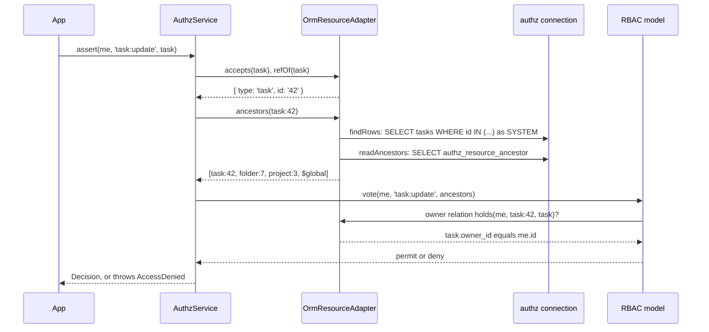

# Single-object checks

`OrmResourceAdapter` lets the authz engine check one row of an `@AccessResource` model. It names the row's resource ref, reads its ancestors from `authz_resource_ancestor`, loads the row when a model needs it, and answers the `owner` and `self` relations from the row's columns.

A single object is checked before the operation runs. No query is rewritten: load the row, check it, then act on it.

## How it works

A check starts with `authz().assert(principal, 'task:update', task)`, or with `@Access('task:update', { resource: fromModel(Task, 'task') })` on a route.

1. The engine asks each `ResourceAdapter` whether it `accepts(target)`. `OrmResourceAdapter.accepts()` is true for a `ModelBase` instance whose class `entryOf()` knows.
2. `refOf(task)` returns `{ type, id }`: the type from `@AccessResource`, the id from the primary key column as text. A row without a primary key value throws `AuthzConfigError`. `fromModel()` hands the engine an unloaded instance that holds only the URL parameter as its primary key, so a route check needs no row load.
3. `ancestors(ref)` runs `findRows([ref])` to confirm the row exists, then `readAncestors([ref])` on `authz_resource_ancestor`. It answers `[self, parent, …, $global]`, nearest first. A row that does not exist answers `null`, and the engine denies with `unknown_resource`. A ref without an id answers `[{ type }, $global]`.
4. The models vote ([the authz guide](../authz/01-check-flow.md#concepts)). RBAC matches assignments at the row, at any ancestor and at `$global`.
5. A grant limited to a relation (`owner`, `self`) asks the `RelationResolver` from `relations()`. It reads the column from the row the check was given, or loads the row as `SYSTEM` when the check has only a ref.
6. `assert()` throws `AccessDenied` on a deny; `can()` and `check()` return the answer.



## Adapter members

| Member | Answers |
| --- | --- |
| `kind` | `'orm'`. |
| `types` | A live view of `registeredTypes()`. |
| `accepts(target)` | `true` for an instance of a registered model. |
| `refOf(row)` | `{ type, id }`, the id as text. |
| `ancestors(ref)` | `[self, …ancestors by depth, $global]`, or `null` for a missing row. |
| `ancestorsMany(refs)` | The same for many refs, keyed by `resourceKey`: one row query per class and one ancestor query per type. |
| `load(ref)` | The row, loaded as `SYSTEM`, or `null`. |
| `loadMany(refs)` | The rows by `resourceKey`; a missing key is a missing row. |
| `relations()` | One `owner` resolver per type with an `@Owner` column, one `self` resolver per type with a `@Self` column. |
| `permissions()` | `<type>:read`, `<type>:create`, `<type>:update`, `<type>:delete` per registered type. |

`checkAll()` (and `POST /user/access/checks` in authz-http) uses `loadMany` and `ancestorsMany`, so a page of checks reads each table once per type instead of once per row.

## Configuration

The adapter has no config keys. The tables it reads live on the connection `db.Aliases.authz` names ([The `authz` connection and records](03-authz-connection-and-records.md#configuration)).

## Services and extension points

| Service | DI token and lifetime | Default implementation | Alternatives | How to replace or extend |
| --- | --- | --- | --- | --- |
| `OrmResourceAdapter` | `ResourceAdapter`, `@Singleton()`, registered by `@Injectable(ResourceAdapter)` when `@spinajs/authz-orm` is imported | `OrmResourceAdapter` | Other packages' adapters (authz-fs, authz-queue) for other kinds of resources | Not meant to be replaced. Change what it answers through the declarations ([Declaring access resources](04-access-resources.md)) and the ancestor table ([The ancestor table](06-ancestor-table.md)). |
| `AuthzOrmContributor` | `AuthzContributor`, `@Singleton()`, registered on import | `AuthzOrmContributor` | none | Not meant to be replaced. At every domain boot it runs `checkResourceConnections(orm)` and gives the registered types as `listTypes`. It does nothing while the `Orm` is not resolved. |

## Important behaviour

- **Ancestors come from the table, not the columns.** A check reads `authz_resource_ancestor`. A row written outside the ORM has no ancestor rows until `authz:ancestors-rebuild` runs, so grants on its parents do not reach it ([The ancestor table](06-ancestor-table.md)).
- **Answers are cached per request.** Inside a request store (`requestScope()`), `ancestors()` and `load()` keep their answer per ref for the rest of the request. A rejected load is not kept. Outside a request store nothing is cached.
- **Rows load as `SYSTEM`.** `findRows()` runs under `runWithPrincipal(SYSTEM, …)`, so the runtime guard and any app scoping do not filter the adapter's own reads. The caller keeps its principal.
- **An impossible id is a miss.** Before it binds an id, the adapter asks the ORM's `lookupValue()` whether the key column can hold it: a non-numeric id on an integer column, or a non-UUID on a UUID column, is a missing row, never a failed query.
- **A create is checked against the parent.** A new row has no id yet: check `task:create` on the parent ref, `{ type: 'project', id }`. The ORM checks nothing on insert.
- **A move needs a check of the new parent.** Writing a `@Parent` column moves the row and its subtree. Check the permission on the new parent before the update; the ORM only keeps the ancestor table right.
- **The connection rule is checked at boot.** `checkResourceConnections(orm)` throws `AuthzConfigError` when no connection answers to `authz`, or when an `@AccessResource` model uses another connection.

## Best practices

- On routes, prefer `@Access(permission, { resource: fromModel(Model, 'param') })`: the check runs before the handler and needs no row load ([`@spinajs/authz-http`](../authz/09-adapters-and-resolvers.md)).
- In services, load the row by primary key, then `assert()` it. A single primary-key select passes the runtime guard without `.accessible()`, except inside a route whose decision is conditional ([The runtime guard](07-runtime-guard.md#single-object-loads)).
- Pass the loaded row, not a ref, when a grant depends on `owner` or `self`: the resolver then reads the column without a second load.

## Patterns and antipatterns

```ts
// Don't: .accessible() on a single row turns a 403 into "not found" and runs a list plan for one row
const task = await Task.where('id', id).accessible('task:update').first();

// Do: load by primary key, then check
const task = await Task.getOrFail(id);
await authz().assert(currentPrincipal(), 'task:update', task);
```

## Examples

### Update a task the caller may edit

```ts sample
import { authz, currentPrincipal } from '@spinajs/authz';
import { AccessResource, Owner, Parent } from '@spinajs/authz-orm';
import { Model, ModelBase, Primary } from '@spinajs/orm';

@AccessResource('task')
@Model('tasks')
export class Task extends ModelBase<Task> {
  @Primary()
  public id!: number;

  @Parent('project')
  public project_id!: number;

  @Owner()
  public owner_id!: string;

  public title!: string;
}

export async function renameTask(id: number, title: string) {
  const task = await Task.getOrFail(id);
  await authz().assert(currentPrincipal(), 'task:update', task);
  task.title = title;
  await task.update();
}
```

### Create a task and move it to another project

```ts sample
import { authz, currentPrincipal } from '@spinajs/authz';
import { AccessResource, Parent } from '@spinajs/authz-orm';
import { Model, ModelBase, Primary } from '@spinajs/orm';

@AccessResource('task')
@Model('tasks')
export class Task extends ModelBase<Task> {
  @Primary()
  public id!: number;

  @Parent('project')
  public project_id!: number;

  public title!: string;
}

export async function createTask(projectId: number, title: string) {
  // the row does not exist yet: check the parent it will live under
  await authz().assert(currentPrincipal(), 'task:create', { type: 'project', id: String(projectId) });
  return await Task.create({ project_id: projectId, title });
}

export async function moveTask(id: number, projectId: number) {
  const me = currentPrincipal();
  const task = await Task.getOrFail(id);
  await authz().assert(me, 'task:update', task);
  await authz().assert(me, 'task:create', { type: 'project', id: String(projectId) });
  task.project_id = projectId;
  await task.update();
}
```

## Related

- [Declaring access resources](04-access-resources.md): the declarations the adapter reads.
- [The ancestor table](06-ancestor-table.md): where `ancestors()` reads from.
- [Access lists](01-access-lists.md): the list side of the same permissions.
- [`@spinajs/authz`](../authz/03-checking-permissions.md): `assert`, `can`, `check` and `checkAll`.
- [Authorization internals](../authz/storage-and-check-flow.md#check-flow): the engine's check pipeline step by step.
