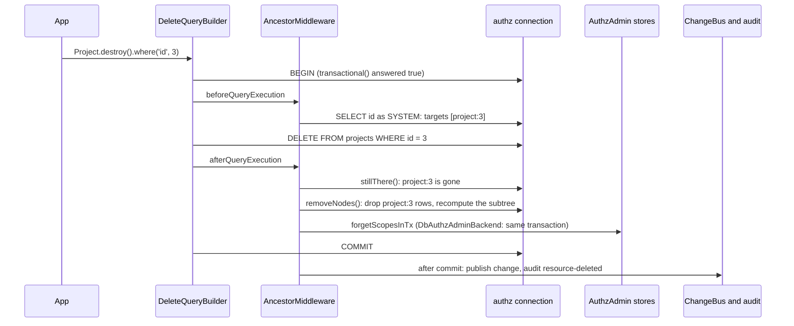

# The ancestor table

`authz_resource_ancestor` is a closure table: one row for every proper ancestor of every resource, with its depth. Checks, `.within()` and the RBAC list term read it, so a grant on a project reaches every folder and task below it with one indexed lookup and no recursion.

authz-orm keeps the table right on every ORM write of an `@AccessResource` model. `reparent()` moves many rows at once, and two CLI commands verify and rebuild the table after writes outside the ORM.

## How it works

`AncestorMiddleware` is a `QueryMiddleware` (order 90) registered when `@spinajs/authz-orm` is imported. It never changes a query; it reads what a write reaches and writes the table in the same transaction.

1. `beforeQueryExecution(query)` picks the writes it handles:
   - a delete of any `@AccessResource` model;
   - an insert of a model with a `@Parent` column;
   - an update that writes a `@Parent` column.
   Other writes pass untouched.
2. A delete, a `@Parent` update and an upsert (insert with ignore, replace or update) must run in a transaction. The middleware answers `transactional(query) = true`, so the ORM opens one when the caller has none. When none can be opened, the write fails with `AuthzConfigError`.
3. `requireConnection(AncestorRecord, query.Driver, …)` checks that the write runs on the connection of `authz_resource_ancestor`. Another connection throws `AuthzConfigError` before any row changes.
4. For an update or a delete, `targetRefs()` selects the ids the write reaches: the same where statements, as `SYSTEM`, soft-deleted and archived rows included.
5. The statement runs.
6. `afterQueryExecution(query, result)` updates the table:
   - **insert**: `insertedRefs()` reads the written ids from the supplied keys, the driver's `RETURNING` rows or its last insert id. `rebuildFrom()` writes each new row's ancestors.
   - **update**: `rebuildFrom()` recomputes each moved row and every resource the table lists below it.
   - **delete**: `stillThere()` keeps only the ids that are really gone. `removeNodes()` drops their rows and recomputes everything below them without them. `cleanupDeleted()` then forgets their scopes.
7. The closure itself is `closeOver()`: for each direct parent `p` of a row, `p` at depth 1 and every ancestor of `p` one level deeper. Where two chains meet, the smallest depth wins. A loop in the `@Parent` links throws `AuthzConfigError` (`the @Parent links form a cycle through <type>:<id>`).

### Forgetting a deleted resource

`cleanupDeleted()` deletes everything authz kept at the deleted resource's scope: assignments, links, rules, policies and scope attributes (`forgetScopesInTx()` from `@spinajs/authz`). It runs in the domain `authz.orm.domain` names.

| `authz.admin.backend` | Where the forget runs | After the commit |
| --- | --- | --- |
| `'DbAuthzAdminBackend'` | In the delete's own transaction; the stores bump `authz_version` themselves. | Publishes one change on the domain's `ChangeBus` and writes one audit entry per resource (`kind: 'system'`, `reason: 'resource-deleted'`, principal `SYSTEM`). |
| any other (default `'MemoryAuthzAdminBackend'`) | After the commit, in a transaction of that backend, followed by `bumpVersion()`. | The same publish and audit. |

A step that runs after the commit cannot roll the delete back: its failure is logged (`authz-orm: <step> after a committed delete failed`) and the delete stands. A rolled-back delete forgets and publishes nothing.



## Configuration

| Key | Type | Default | Allowed values | Meaning |
| --- | --- | --- | --- | --- |
| `authz.orm.domain` | `string` | `'root'` | a domain name | The domain whose stores a delete cleans and whose `ChangeBus` and audit it uses. |
| `authz.admin.backend` | `string` | `'MemoryAuthzAdminBackend'` | the class name of a registered `AuthzAdminBackend` | Read to decide where the forget of a delete runs. Owned by `@spinajs/authz` ([AuthzAdmin](../authz/10-authz-admin.md)). |

The CLI commands come from the package config `system.dirs.cli`, which points at `node_modules/@spinajs/authz-orm/lib/<cjs|mjs>/cli/commands` ([command discovery](../cli/05-command-discovery.md)).

## Schema

The table and its migration `AuthzResourceAncestor_2026_10_14_00_00_00` are described in [The `authz` connection and records](03-authz-connection-and-records.md#authz_resource_ancestor).

## Services and extension points

| Service | DI token and lifetime | Default implementation | Alternatives | How to replace or extend |
| --- | --- | --- | --- | --- |
| `AncestorMiddleware` | `QueryMiddleware`, registered by `@Injectable(QueryMiddleware)` on import; order 90 | `AncestorMiddleware` | none | Not meant to be replaced. Writes outside the ORM need `authz:ancestors-rebuild`. |
| `reparent(model, ids, newParentId, column?)` | exported function | | | Bulk move through the ORM. |
| `rebuildFrom(driver, roots)`, `rebuildNodes(driver, nodes, gone?)`, `removeNodes(driver, deleted)` | exported functions | | | Recompute rows from the `@Parent` columns inside your own transaction, after a write the middleware cannot see. |
| `readAncestors(refs)` | exported function | | | The table rows of each ref, keyed by `resourceKey`, nearest first. |
| `AncestorRecord`, `AUTHZ_RESOURCE_ANCESTOR_TABLE`, `AncestorRow` | ORM model, constant, row type | | | Read the table. Write it only through the functions above. |

## Commands

| Command | Does |
| --- | --- |
| `authz:ancestors-verify [type]` | Recomputes the expected rows from the `@Parent` columns and compares them with the table. Prints `missing`, `extra` and `depth` lines (at most 50 per type, then `… and N more`), one summary line per type, and sets exit code 1 on any difference. Without `type` it checks every registered type and every type the table lists. |
| `authz:ancestors-rebuild [type]` | Rewrites the rows of each type from the `@Parent` columns: one transaction per type deletes its rows and inserts the expected ones. Prints `<type>: <n> rows`. Without `type` it rebuilds every registered type. |

Both run as `SYSTEM`. A `type` with no `@AccessResource` model fails with `no @AccessResource model has type '<type>'` and exit code 1. Both read whole tables: every table of the type and of every type above it (`typesAbove()`).

## Important behaviour

- **A plain insert joins the caller's transaction, if any.** The middleware asks for a transaction only for deletes, `@Parent` updates and upserts. A plain insert outside a transaction writes its ancestor rows after the insert, as a separate statement.
- **An insert that reports no ids leaves rows missing.** When the driver returns neither the keys nor a usable last insert id (a multi-row insert on a driver without `insertIdIsFirstOfBatch`, for one), the rows get no ancestors. The middleware logs one warning per model. Access only narrows: grants on the parents do not reach those rows until `authz:ancestors-rebuild` runs.
- **An update that leaves `@Parent` columns alone does nothing.** It needs no transaction and reads nothing.
- **Deletes see soft-deleted and archived rows.** `targetRefs()` adds `withDeleted()` and `withArchived()`, so a hard delete of a soft-deleted row still cleans up.- **A deleted id reused later inherits nothing.** Its assignments, links, rules, policies and scope attributes are gone with the row.
- **A `NULL` parent column is a root.** The row gets no rows for that chain.
- **Raw SQL is not tracked.** Imports, raw SQL, builders from `driver.insert()`, `driver.update()` or `driver.del()` (no model) and database triggers bypass the middleware. Run `authz:ancestors-rebuild` afterwards, or call `rebuildFrom()` in the same transaction.
- **Ids are stored as text.** Integer and UUID keys share one table; `resource_id` and `ancestor_id` are `varchar(64)`.

## Best practices

- Run `authz:ancestors-verify` in CI or after a deployment that imported data; it exits with code 1 on drift.
- Move many rows with `reparent()`, not a loop of updates: it is one statement and one subtree recompute.
- Use `DbAuthzAdminBackend` in production, so a delete and its forget commit together.
- Check the new parent before a move ([Single-object checks](05-single-object-checks.md#important-behaviour)); the middleware keeps the table right but authorizes nothing.

## Patterns and antipatterns

```ts
// Don't: a builder without a model bypasses the middleware, so the moved folders keep their old ancestors
await driver.update().in('folders').update({ parent_id: archiveId }).whereIn('id', ids);

// Do: the ORM update runs the middleware, which recomputes every moved subtree in one transaction
await reparent(Folder, ids, archiveId, 'parent_id');
```

## Examples

### Move folders under an archive folder

```ts sample
import { AccessResource, Parent, reparent } from '@spinajs/authz-orm';
import { Model, ModelBase, Primary } from '@spinajs/orm';

@AccessResource('folder')
@Model('folders')
export class Folder extends ModelBase<Folder> {
  @Primary()
  public id!: number;

  @Parent('folder', { nullable: true })
  public parent_id!: number | null;

  @Parent('project')
  public project_id!: number;
}

export async function archiveFolders(ids: number[], archiveId: number): Promise<number> {
  // two @Parent columns: name the one to write
  return await reparent(Folder, ids, archiveId, 'parent_id');
}
```

`reparent()` resolves with the number of rows changed. A model with exactly one `@Parent` column needs no `column`; a model with several throws `AuthzConfigError` without it.

### Check and repair the table after an import

```sh
npx spinajs authz:ancestors-verify task
npx spinajs authz:ancestors-rebuild task
```

The `spinajs` bin comes from `@spinajs/cli` ([Running the CLI](../cli/01-running-the-cli.md)).

## Related

- [The `authz` connection and records](03-authz-connection-and-records.md): the table's schema and connection.
- [Declaring access resources](04-access-resources.md): the `@Parent` columns the table follows.
- [Access lists](01-access-lists.md): `.within()` reads the table.
- [`@spinajs/authz-rbac` list filter term](../authz-rbac/01-list-filter-term.md): the RBAC term joins it.
- [`@spinajs/orm` transactions](../orm/08-transactions.md): how the ORM opens the transaction the middleware asks for.
