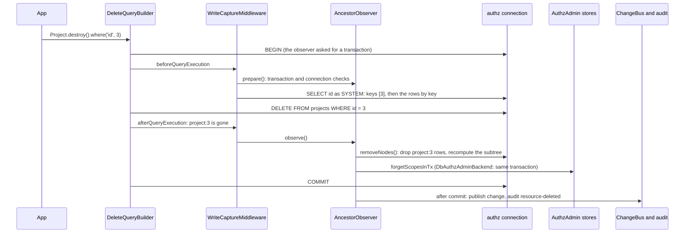

# The ancestor table

`authz_resource_ancestor` is a closure table: one row for every proper ancestor of every resource, with its depth. Checks, `.within()` and the RBAC list term read it, so a grant on a project reaches every folder and task below it with one indexed lookup and no recursion.

authz-orm keeps the table right on every ORM write of an `@AccessResource` model. `reparent()` moves many rows at once, and two CLI commands verify and rebuild the table after writes outside the ORM.

## How it works

`AncestorObserver` is a `WriteObserver` on the [ORM write capture](../orm/25-write-capture.md), registered when `@spinajs/authz-orm` is imported. It never changes a query: the capture reads the rows a write reaches before and after it, once for every observer of the statement (the column changelog shares the same reads), and the observer writes the table in the write's transaction.

1. `interest(statement)` picks the writes it handles and asks for the primary key and the `@Parent` columns:
   - a delete of any `@AccessResource` model;
   - an insert of a model with a `@Parent` column;
   - an update that writes a `@Parent` column.
   Other writes pass untouched.
2. A delete, a `@Parent` update and an upsert (insert with ignore, replace or update) must run in a transaction. The observer asks for one, so the capture opens one when the caller has none. When none can be opened, `prepare(statement)` fails the write with `AuthzConfigError`.
3. `prepare(statement)` also checks with `requireConnection(AncestorRecord, query.Driver, …)` that the write runs on the connection of `authz_resource_ancestor`. Another connection throws `AuthzConfigError` before any row is read or changed.
4. For an update or a delete, the capture's key select finds the ids the write reaches: the same where statements, as `SYSTEM`, soft-deleted and archived rows included. An upsert's rows are found by its key and unique columns.
5. The statement runs.
6. `observe(write)` updates the table from the rows the capture hands it:
   - **insert**: `rebuildFrom()` writes the ancestors of each row the insert wrote or, for an upsert, updated.
   - **update**: `rebuildFrom()` recomputes each moved row and every resource the table lists below it.
   - **delete**: the rows that are gone after the statement go to `removeNodes()`, which drops their rows and recomputes everything below them without them. `cleanupDeleted()` then forgets their scopes.
7. The closure itself is `closeOver()`: for each direct parent `p` of a row, `p` at depth 1 and every ancestor of `p` one level deeper. Where two chains meet, the smallest depth wins. A loop in the `@Parent` links throws `AuthzConfigError` (`the @Parent links form a cycle through <type>:<id>`).

### Forgetting a deleted resource

`cleanupDeleted()` deletes everything authz kept at the deleted resource's scope: assignments, links, rules, policies and scope attributes (`forgetScopesInTx()` from `@spinajs/authz`). It runs in the domain `authz.orm.domain` names.

| `authz.admin.backend` | Where the forget runs | After the commit |
| --- | --- | --- |
| `'DbAuthzAdminBackend'` | In the delete's own transaction; the stores bump `authz_version` themselves. | Publishes one change on the domain's `ChangeBus` and writes one audit entry per resource (`kind: 'system'`, `reason: 'resource-deleted'`, principal `SYSTEM`). |
| any other (default `'MemoryAuthzAdminBackend'`) | After the commit, in a transaction of that backend, followed by `bumpVersion()`. | The same publish and audit. |

A step that runs after the commit cannot roll the delete back: its failure is logged (`authz-orm: <step> after a committed delete failed`) and the delete stands. A rolled-back delete forgets and publishes nothing.



## Configuration

| Key | Type | Default | Allowed values | Meaning |
| --- | --- | --- | --- | --- |
| `authz.orm.domain` | `string` | `'root'` | a domain name | The domain whose stores a delete cleans and whose `ChangeBus` and audit it uses. |
| `authz.admin.backend` | `string` | `'MemoryAuthzAdminBackend'` | the class name of a registered `AuthzAdminBackend` | Read to decide where the forget of a delete runs. Owned by `@spinajs/authz` ([AuthzAdmin](../authz/10-authz-admin.md)). |

The CLI commands come from the package config `system.dirs.cli`, which points at `node_modules/@spinajs/authz-orm/lib/cli/commands` ([command discovery](../cli/05-command-discovery.md)). The CLI resolves only the command, so a command resolves the `Orm` before it reads. The boot fails while a migration is pending or failed: run [`npx spinajs migrate-up`](../orm/10-migrations.md#deploying-migrations) first.

## Schema

The table and its migration `AuthzResourceAncestor_2026_10_14_00_00_00` are described in [The `authz` connection and records](03-authz-connection-and-records.md#authz_resource_ancestor).

## Services and extension points

| Service | DI token and lifetime | Default implementation | Alternatives | How to replace or extend |
| --- | --- | --- | --- | --- |
| `AncestorObserver` | `WriteObserver`, registered by `@Injectable(WriteObserver)` on import, before `ColumnChangeObserver` | `AncestorObserver` | none | Not meant to be replaced. Writes outside the ORM need `authz:ancestors-rebuild`. |
| `reparent(model, ids, newParentId, column?)` | exported function | | | Bulk move through the ORM. |
| `rebuildFrom(driver, roots)`, `rebuildNodes(driver, nodes, gone?)`, `removeNodes(driver, deleted)` | exported functions | | | Recompute rows from the `@Parent` columns inside your own transaction, after a write the write capture cannot see. |
| `readAncestors(refs)` | exported function | | | The table rows of each ref, keyed by `resourceKey`, nearest first. |
| `AncestorRecord`, `AUTHZ_RESOURCE_ANCESTOR_TABLE`, `AncestorRow` | ORM model, constant, row type | | | Read the table. Write it only through the functions above. |

## Commands

| Command | Does |
| --- | --- |
| `authz:ancestors-verify [type]` | Recomputes the expected rows from the `@Parent` columns and compares them with the table. Prints `missing`, `extra` and `depth` lines (at most 50 per type, then `… and N more`), one summary line per type, and sets exit code 1 on any difference. Without `type` it checks every registered type and every type the table lists. |
| `authz:ancestors-rebuild [type] [--prune]` | Rewrites the rows of each type from the `@Parent` columns: one transaction per type locks the tables it reads, reads the columns, deletes its rows and inserts the expected ones (see "A rebuild locks out writers, not readers"). Prints `<type>: <n> rows`. Without `type` it rebuilds every registered type. It first checks every type: when rows link to an ancestor type that no `@Parent` of the type names in this process (a parent declared by a module the CLI did not load), it rewrites nothing, prints the types and exits with code 1. `--prune` deletes those links; with a type no model declares, it deletes that type's rows. |

A write keeps the same rule. When an insert, an update of a `@Parent` column, a delete or an upsert of an
`@AccessResource` row would rewrite rows (the row's own, and those the table lists below it) that link to an ancestor
type no `@Parent` names in the running process, the write fails with `AuthzConfigError` and rolls back. Import every
module that declares parents (for tenants: `@spinajs/tenancy-orm/authz`) in every process that writes such rows.
`authz:ancestors-verify` prints the same line next to the extra rows of such a type.

Both run as `SYSTEM`. A `type` with no `@AccessResource` model fails with `no @AccessResource model has type '<type>'` and exit code 1, except for `authz:ancestors-rebuild <type> --prune`. Both read whole tables: every table of the type and of every type above it (`typesAbove()`).

## Important behaviour

- **A plain insert joins the caller's transaction, if any.** The observer asks for a transaction only for deletes, `@Parent` updates and upserts. A plain insert outside a transaction writes its ancestor rows after the insert, as a separate statement.
- **An insert that reports no ids leaves rows missing.** When the connection reports no keys for the inserted rows (a multi-row insert without `RETURNING` on MSSQL or SQLite, for one), the rows get no ancestors. The observer logs one warning per model. Access only narrows here: grants on the parents do not reach those rows until `authz:ancestors-rebuild` runs.
- **An upsert the capture cannot key rebuilds only the keys it supplies.** When the capture cannot find an upsert's rows (a unique index over several columns or with an expression or prefix part, a conflict value that is not a string or an integer), the observer warns and rebuilds the rows whose primary keys the upsert supplies. A row it moved to another `@Parent` through another unique key, without naming its primary key, keeps its old ancestors: grants on the old parent still reach it until `authz:ancestors-rebuild` runs. Supply the primary key in such upserts.
- **A replace deletes like a delete.** A row an `orReplace` insert deletes through a unique column is dropped from the table and its scopes are forgotten, so a reused id inherits nothing.
- **`db.WriteCapture.MaxRows` applies.** When it is set, a delete or `@Parent` update of an access resource that reaches more rows is refused with `WriteCaptureLimitExceeded`; maintaining the table needs every row the write reaches.
- **An update that leaves `@Parent` columns alone does nothing.** It needs no transaction and reads nothing.
- **Deletes see soft-deleted and archived rows.** The capture's key select adds `withDeleted()` and `withArchived()`, so a hard delete of a soft-deleted row still cleans up.
- **The model needs a single-column primary key.** The capture refuses a write of a model with a composite key, and the domain boot refuses such an `@AccessResource` model.
- **A deleted id reused later inherits nothing.** Its assignments, links, rules, policies and scope attributes are gone with the row. A later `authz:ancestors-rebuild` is the exception for links: see "A rebuild links children to a deleted parent" below.
- **A `NULL` parent column is a root.** The row gets no rows for that chain.
- **Raw SQL is not tracked.** Imports, raw SQL, builders from `driver.insert()`, `driver.update()` or `driver.del()` (no model) and database triggers bypass the write capture. Run `authz:ancestors-rebuild` afterwards, or call `rebuildFrom()` in the same transaction.
- **A write through a class without `@Parent` writes no links.** When two classes of one type map to one table and only one of them declares `@Parent`, an insert or a parent-column update through the other leaves the row without ancestor links. `authz:ancestors-verify` reports them missing, and `authz:ancestors-rebuild` adds them, reading the table through the class that declares the columns. Declare the same `@Parent` columns on every class of the type that maps to the table.
- **A rebuild locks out writers, not readers.** Each type's transaction first locks the tables it reads against writes: the class tables of the type and of every type above it, in name order, then `authz_resource_ancestor`. Only then does it check the type for undeclared links again and read the `@Parent` columns. Until it commits, every insert, update and delete of those resource tables waits, and so does every write of the ancestor table, of any type. The waiting write then runs on the rebuilt rows. On PostgreSQL and MySQL an authorization check never waits: it reads the type's old rows or its new ones, never a mix. On SQLite in one process, and on MSSQL, it does wait (below).
  - PostgreSQL: `SHARE` on the resource tables and `SHARE ROW EXCLUSIVE` on `authz_resource_ancestor`, which only one session holds at a time: a second rebuild waits for the first for at most 5 s, then fails with the lock-timeout error below and changes nothing. Run one rebuild at a time. MySQL: `SELECT COUNT(*) … FOR UPDATE` on each table. Plain reads go on; locking reads (`FOR SHARE`, `FOR UPDATE`) of those tables wait. SQLite: the rebuild takes the database's write lock. In one process every statement outside the transaction waits until it ends, reads included, as for any transaction. MSSQL: a shared table lock (`TABLOCK, HOLDLOCK`) on each table. Two rebuilds at once can deadlock there, so run one at a time. Readers wait for the rows the rebuild deleted, and for the whole table once SQL Server escalates the DELETE to a table lock (about 5,000 rows), unless the database has `READ_COMMITTED_SNAPSHOT` on. None of the MSSQL behaviour is tested.
  - A write waits as long as the type's transaction lasts: in the package's tests 0.3 to 0.9 s for 5,000 links on a quiet machine, and 3.2 to 3.7 s at 50,000 links on all three tested databases; several times longer on a loaded server. Readers stayed fast meanwhile: the slowest read at 50,000 links took 594 ms on PostgreSQL and 420 ms on MySQL. A write with a lock timeout of its own (`lock_timeout` on PostgreSQL, `innodb_lock_wait_timeout` on MySQL, 50 s by default, the busy timeout on SQLite) fails with that error instead.
  - The rebuild itself first waits for the transactions already writing those tables, and writes that arrive meanwhile queue behind it, for at most 5 s on PostgreSQL: a rebuild that cannot lock its tables within 5 s fails that type with `could not lock the tables of the rebuild within 5 s: a transaction is writing them, or another rebuild is running` and stops: the types rebuilt before it stay rebuilt, it and the ones after it are unchanged; run it again. Its DELETE fails the same way when an application holds `FOR UPDATE` or `FOR SHARE` on ancestor rows of the type for longer than 5 s. On MySQL writes do not queue behind a waiting rebuild, and the rebuild itself waits up to `innodb_lock_wait_timeout`.
  - A rebuild can deadlock with an application transaction that started before it. On PostgreSQL, with one that writes two of the locked resource tables in the other order (a child table whose name sorts before its parent's, written after the parent). The database ends the session whose `deadlock_timeout` (1 s by default) expires first: the rebuild when the application's second write follows at once, the application's request when it comes later. On MySQL also with one that writes rows of `authz_resource_ancestor` twice, through two inserts or moves of any `@AccessResource` model, of any type: the rebuild locks that whole table row by row. InnoDB ends the lighter transaction, usually the rebuild. A rebuild that ends this way exits with code 1 and rewrote nothing of that type: run it again. An application request that ends this way gets a deadlock error and can be retried.
- **A rebuild has known limits.** Decisions cached before the rebuild keep their answer until `authz.cache.ttlSeconds` ends. A type with two resource types on one table is not rebuilt correctly yet.
  - The rebuild publishes no change on the domain's `ChangeBus`. A decision cached before the rebuild keeps its answer for up to `authz.cache.ttlSeconds`: wait that long before you rely on a link the rebuild removed.
  - Two resource types on one table: a write writes the rows of the written model's type only, the rebuild writes every row as both types, and after a rebuild a move through one class leaves the other type's links at the old parent. Map each resource type to a table of its own.
- **A rebuild links children to a deleted parent.** Deleting a parent row drops its children's links to it, but the children's `@Parent` columns still name it, so `authz:ancestors-rebuild` links them to that id again. A row created later with the same id then passes its grants, and those of its ancestors, to the old children. Before a rebuild, point such children at another parent or clear their parent column, and do not reuse resource ids.
- **Ids are stored as text.** Integer and UUID keys share one table; `resource_id` and `ancestor_id` are `varchar(64)`.

## Best practices

- Run `authz:ancestors-verify` in CI or after a deployment that imported data; it exits with code 1 on drift.
- Move many rows with `reparent()`, not a loop of updates: it is one statement and one subtree recompute.
- Use `DbAuthzAdminBackend` in production, so a delete and its forget commit together.
- Check the new parent before a move ([Single-object checks](05-single-object-checks.md#important-behaviour)); the middleware keeps the table right but authorizes nothing.

## Patterns and antipatterns

```ts
// Don't: a builder without a model bypasses the middleware, so the moved folders keep their old ancestors
await driver.update().in('folders').update({ parent_id: archiveId }).whereIn('id', ids);

// Do: the ORM update runs the middleware, which recomputes every moved subtree in one transaction
await reparent(Folder, ids, archiveId, 'parent_id');
```

## Examples

### Move folders under an archive folder

```ts sample
import { AccessResource, Parent, reparent } from '@spinajs/authz-orm';
import { Model, ModelBase, Primary } from '@spinajs/orm';

@AccessResource('folder')
@Model('folders')
export class Folder extends ModelBase<Folder> {
  @Primary()
  public id!: number;

  @Parent('folder', { nullable: true })
  public parent_id!: number | null;

  @Parent('project')
  public project_id!: number;
}

export async function archiveFolders(ids: number[], archiveId: number): Promise<number> {
  // two @Parent columns: name the one to write
  return await reparent(Folder, ids, archiveId, 'parent_id');
}
```

`reparent()` resolves with the number of rows changed. A model with exactly one `@Parent` column needs no `column`; a model with several throws `AuthzConfigError` without it.

### Check and repair the table after an import

```sh
npx spinajs authz:ancestors-verify task
npx spinajs authz:ancestors-rebuild task
```

The `spinajs` bin comes from `@spinajs/cli` ([Running the CLI](../cli/01-running-the-cli.md)).

## Related

- [The `authz` connection and records](03-authz-connection-and-records.md): the table's schema and connection.
- [Declaring access resources](04-access-resources.md): the `@Parent` columns the table follows.
- [Access lists](01-access-lists.md): `.within()` reads the table.
- [`@spinajs/authz-rbac` list filter term](../authz-rbac/01-list-filter-term.md): the RBAC term joins it.
- [`@spinajs/orm` transactions](../orm/08-transactions.md): how the ORM opens the transaction the middleware asks for.
