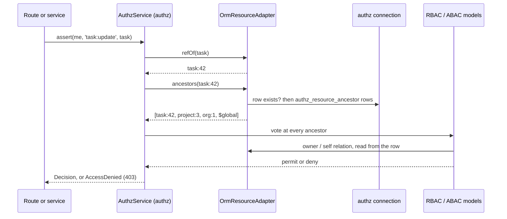
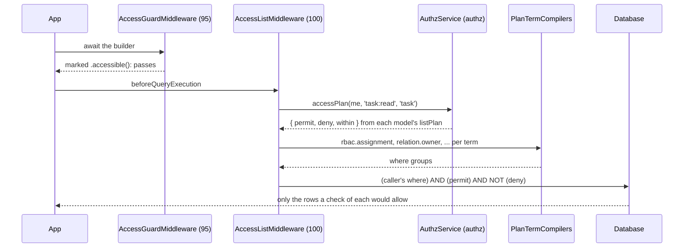

# `@spinajs/authz-orm`

The ORM adapter of SpinaJS authorization. It turns ORM models into authz resources, keeps their ancestors in a closure table, checks single rows, filters lists through the query builders, and ships database stores for the audit trail and scope attributes.

It does **not** rewrite queries on its own: a single row is checked before access, and a list asks for filtering with `.accessible()`. It does **not** filter `populate()`, joins or sub-queries, authorize a create or a move, or track writes made outside the ORM.

## Install

```sh
npm install @spinajs/authz-orm
```

```ts
import '@spinajs/authz-orm';
```

The import registers `OrmResourceAdapter`, `AuthzOrmContributor`, the query middlewares (`AncestorMiddleware`, `AccessGuardMiddleware`, `AccessListMiddleware`), the `owner` and `self` plan term compilers and the `authz.orm` config schema. Its package config maps `db.Aliases.authz` to `default` and adds the `authz:ancestors-*` commands to `system.dirs.cli`.

| Entry point | Holds |
| --- | --- |
| `@spinajs/authz-orm` | The decorators, the adapter, the list helpers, the ancestor functions, the plan contract and the scope attribute store. |
| `@spinajs/authz-orm/plan` | `PlanTermCompiler`, `PlanRow` and the relation ops; loads nothing else of the adapter. |
| `@spinajs/authz-orm/audit` | `DbDecisionAudit`, `AuthzAuditEntry` and the `authz_audit` migration. |
| `@spinajs/authz-orm/scope-attributes` | `DbScopeAttributeStore`, its records and migration. |

## Features

| Feature | What it does |
| --- | --- |
| [Access lists](01-access-lists.md) | `.accessible()`, `.within()` and `.withAccess()` turn an access plan into where conditions of the query builder. |
| [Plan term compilers](02-plan-term-compilers.md) | `PlanTermCompiler` in `@spinajs/authz-orm/plan`: the extension point that compiles each plan term onto a where group. |
| [The `authz` connection and records](03-authz-connection-and-records.md) | The ancestor and scope attribute tables on the alias `db.Aliases.authz`, and `DbScopeAttributeStore`. |
| [Declaring access resources](04-access-resources.md) | `@AccessResource`, `@Parent`, `@Owner`, `@Self` and `registerAccessResource()`: which models are resources and how they relate. |
| [Single-object checks](05-single-object-checks.md) | `OrmResourceAdapter`: refs, ancestors, row loads and the `owner` / `self` relations for `assert()` and `@Access`. |
| [The ancestor table](06-ancestor-table.md) | `AncestorMiddleware`, `reparent()` and the `authz:ancestors-verify` / `authz:ancestors-rebuild` commands keep the closure table right. |
| [The runtime guard](07-runtime-guard.md) | `AccessGuardMiddleware` flags a multi-row select of a resource without `.accessible()`, `.unscoped()` or `SYSTEM`. |
| [Database audit](08-database-audit.md) | `DbDecisionAudit` writes the audit trail to `authz_audit`. |

New to the package: read [Declaring access resources](04-access-resources.md), then [Single-object checks](05-single-object-checks.md) and [Access lists](01-access-lists.md).

## How it fits together

### A check on one row

A route guarded by `@Access('task:update', { resource: fromModel(Task, 'task') })`, or a service calling `authz().assert(me, 'task:update', task)`:



1. `OrmResourceAdapter.refOf()` names the row from `@AccessResource` and the primary key.
2. `ancestors()` reads the closure table that `AncestorMiddleware` keeps current.
3. The models vote; a grant on `project:3` reaches `task:42` through its ancestors. Detail: [Single-object checks](05-single-object-checks.md).

### A list query

`Task.where('status', 'open').accessible('task:read')`, with `task:read` declared `list: true`:



1. `AccessGuardMiddleware` lets the query through because it is marked ([The runtime guard](07-runtime-guard.md)).
2. `AccessListMiddleware` asks for the access plan; a plan with no permit is a 403, never an empty list ([Access lists](01-access-lists.md)).
3. Each plan term goes through the `PlanTermCompiler` of its op: authz-rbac's `rbac.assignment` adds an `EXISTS` over `authz_assignment` and `authz_resource_ancestor` ([Plan term compilers](02-plan-term-compilers.md)).

## Quick start

Protect a `Task` model: declare it, mark its list permission `list: true`, then check rows and filter lists.

```ts sample
import { authz, currentPrincipal } from '@spinajs/authz';
import { AccessResource, Owner, Parent } from '@spinajs/authz-orm';
import { Model, ModelBase, Primary } from '@spinajs/orm';

@AccessResource('task')
@Model('tasks')
export class Task extends ModelBase<Task> {
  @Primary()
  public id!: number;

  @Parent('project')
  public project_id!: number;

  @Owner()
  public owner_id!: string;

  public status!: string;
}

// config: authz: { permissions: { 'task:read': { list: true } } }

export async function openTasks() {
  return await Task.where('status', 'open').accessible('task:read');
}

export async function closeTask(id: number) {
  const task = await Task.getOrFail(id);
  await authz().assert(currentPrincipal(), 'task:update', task);
  task.status = 'closed';
  await task.update();
}
```

The full checklist is in [Declaring access resources](04-access-resources.md#protect-a-new-model).

## Related packages

- [`@spinajs/authz`](../authz/README.md): the engine, `authz()`, access plans, `list: true`, boot rule 12 and `AuthzAdmin`.
- [`@spinajs/authz-rbac`](../authz-rbac/README.md): the RBAC model; registers the `rbac.assignment` plan term and stores assignments on the same `authz` connection.
- [`@spinajs/authz-abac`](../authz-abac/README.md): the ABAC model; its policies vote on the same rows and pass `env` facts from `.accessible(perm, { env })`.
- [`@spinajs/eslint-plugin-authz`](../eslint-plugin-authz/README.md): `@spinajs/authz/require-accessible` flags at edit time what the runtime guard flags at run time.
- [`@spinajs/orm`](../orm/README.md): the query builders, query middlewares, `db.Aliases` and transactions this package builds on.
- [`@spinajs/cli`](../cli/README.md): runs the `authz:ancestors-verify` and `authz:ancestors-rebuild` commands.
