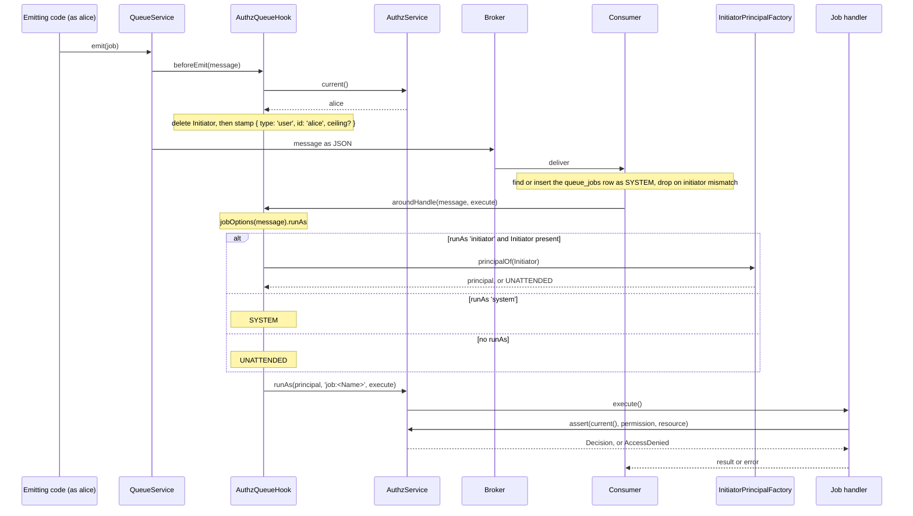

# Job authorization

`AuthzQueueHook` carries the emitter's identity across the queue and sets the principal a handler runs as. Use it to protect a job handler with the same checks as an HTTP route: inside the handler, `authz().current()` is the principal its `@Job({ runAs })` chose.

A handler runs as `UNATTENDED` unless its job says otherwise, and every check denies `UNATTENDED` ([Unattended and system](../authz/01-check-flow.md#concepts)).

## How it works

Emitting, inside `QueueService.emit(message)`, which awaits every [message hook](../queue/06-message-hooks.md) before any transport sees the message:

1. `AuthzQueueHook.beforeEmit(message)` deletes `message.Initiator`. Only the current principal may be named, never a value the caller set.
2. It resolves the `AuthzService` of the domain `authz.queue.domain` names, through `AuthzDomains.service()`. A name with no booted domain throws `AuthzConfigError`, and `emit()` rejects.
3. It reads `AuthzService.current()`: the principal of the current async context, else `UNATTENDED`.
4. It writes nothing, and the message leaves with no `Initiator`, when the principal is:
   - `UNATTENDED`, or of type `unattended`;
   - of type `system` but not the `SYSTEM` singleton (a forged copy);
   - delegated or impersonating (`onBehalfOf`, `delegation` or `authn.impersonator` is set). The stamp cannot carry these, and rebuilding the principal without them would widen its rights.
5. Otherwise it writes `message.Initiator = { type, id }`, with `id` converted to a string.
6. A principal with a `ceiling` gets a copy of it in `Initiator.ceiling`, rebuilt by `reviveCeiling()`. A ceiling that is not a plain object, or whose `expiresAt` is not a `Date`, or whose `reason` is empty, is stamped as `{ permissions: [] }`: deny-all, never "no limit".
7. The transport serialises the message. `Initiator` travels as plain JSON.

Handling, inside the consumer that `QueueService.consume()` builds:

1. For a job, the consumer first finds or inserts its `queue_jobs` row and drops the message when the row's initiator differs from `message.Initiator` ([Job tracking](../queue/03-job-tracking.md#how-it-works)). Those row queries run as `SYSTEM` ([Job rows as a resource](03-job-resource.md)).
2. The consumer calls `AuthzQueueHook.aroundHandle(message, next)`, where `next` runs the job's `execute()`, its `onFailed()`, or the `consume()` callback.
3. `jobOptions(message)` reads `runAs` from the `@Job()` of the message's own class. Any value other than `'initiator'` or `'system'` counts as absent.
4. The hook picks the principal:
   - `runAs: 'system'`: `SYSTEM`. The `Initiator` is ignored.
   - `runAs: 'initiator'` and the message has an `Initiator`: `InitiatorPrincipalFactory.principalOf(message.Initiator)` ([Initiator principal factory](02-initiator-principal-factory.md)). The default factory turns a malformed stamp into `UNATTENDED`.
   - anything else, events included: `UNATTENDED`.
5. It calls `AuthzService.runAs(principal, 'job:<Name>', next)`, where `<Name>` is `message.Name`. `UNATTENDED` is set explicitly too, so a consumer that runs inside the emitter's async context does not inherit the emitter's principal.
6. `runAs` records a `runAs` audit entry when `authz.audit.runAs` is on for the domain ([Config](../authz/04-host-boot-and-configuration.md#configuration)), and preloads the principal unless it is `SYSTEM` or `UNATTENDED`.
7. Inside `next`, `authz().current()` is the chosen principal. Checks, `assert()` and the ORM's `.accessible()` use it.
8. The handler's result and its error pass through the hook unchanged.



What the stamp holds, and what a `runAs: 'initiator'` handler runs as with the default factory:

| Principal when the message is emitted | `message.Initiator` | Handler runs as |
| --- | --- | --- |
| none (`UNATTENDED`) | absent | `UNATTENDED` |
| `SYSTEM` | `{ type: 'system', id: 'system' }` | `SYSTEM` |
| a copy of `SYSTEM`, not the singleton | absent | `UNATTENDED` |
| delegated or impersonating | absent | `UNATTENDED` |
| any other principal | `{ type, id }` | that type and id, `source: 'queue'`, no attributes |
| any other principal with a ceiling | `{ type, id, ceiling }` | as above, with the ceiling |

## Decorators

`@Job()` comes from `@spinajs/queue`; this package gives `runAs` its meaning.

| Decorator | Target | Options | Effect |
| --- | --- | --- | --- |
| `@Job(opts?)` | class extending `QueueJob` | `runAs?: 'initiator' \| 'system'` (`JobOptions`) | `'initiator'`: the handler runs as the principal that emitted the message. `'system'`: it runs as `SYSTEM`. Absent: it runs as `UNATTENDED`. The options belong to the decorated class only: a subclass does not inherit its parent's `runAs`. |

`@Event()` has no `runAs`, so every event handler runs as `UNATTENDED`.

## Configuration

| Key | Type | Default | Allowed values | Meaning |
| --- | --- | --- | --- | --- |
| `authz.queue.domain` | `string` | `'root'` | the name of a booted authz domain | The domain whose principal is stamped and whose `runAs` wraps the handler. `AuthzQueueTrackingHook` uses it too. An empty string fails boot; a name with no booted domain makes every emit and handle throw `AuthzConfigError`, with no fallback to `root`. |
| `authz.queue.stampedInitiatorWarning` | `boolean` | `true` | `true`, `false` | See [Initiator principal factory](02-initiator-principal-factory.md#configuration). |

```ts
export default {
  authz: {
    queue: { domain: 'root', stampedInitiatorWarning: true },
  },
};
```

The schema `AUTHZ_QUEUE_CONFIGURATION_SCHEMA` (`$configurationModule: 'authz.queue'`) validates these keys at boot. The package registers it at import, and `AuthzQueueConfigBootstrapper` registers it again at bootstrap.

## Services and extension points

| Service | DI token and lifetime | Default implementation | Alternatives | How to replace or extend |
| --- | --- | --- | --- | --- |
| Message hook | `QueueMessageHook`, one entry of the list the queue resolves with `Array.ofType(QueueMessageHook)` on every emit and handle; singleton; registered by `@Injectable(QueueMessageHook)` at import | `AuthzQueueHook` | none | Subclass it and override the protected `initiator(initiator)` (which principal a stamp becomes) or `service()` (which `AuthzService` it uses). Then `DI.unregister(AuthzQueueHook)` and `DI.register(MySubclass).as(QueueMessageHook)` before the queue starts. |
| Initiator principal factory | `InitiatorPrincipalFactory`, singleton | `StampedInitiatorPrincipalFactory` | `UserInitiatorPrincipalFactory` (`@spinajs/users/queue`) | See [Initiator principal factory](02-initiator-principal-factory.md). |

`QueueMessageHook` and the `JobOptions` type are re-exported from `@spinajs/queue`. The package exports the stamp's shape as `Initiator`: `{ readonly type: PrincipalType; readonly id: string; readonly ceiling?: Ceiling }`.

### `AuthzQueueHook`: custom implementation

Replace the hook only to change how a stamp maps to a principal for every job; to reload users, replace the [factory](02-initiator-principal-factory.md) instead. Hooks run in registration order, the first registered outermost, so a hook that needs the job's principal must be registered after this one.

```ts sample
import '@spinajs/authz-queue';
import { DI } from '@spinajs/di';
import { UNATTENDED } from '@spinajs/authz';
import type { Principal } from '@spinajs/authz';
import { AuthzQueueHook, QueueMessageHook } from '@spinajs/authz-queue';
import type { Initiator } from '@spinajs/authz-queue';

// A share-link bearer may emit messages, but no job ever runs with the link's rights.
export class NoLinkJobsHook extends AuthzQueueHook {
  protected async initiator(initiator: Initiator): Promise<Principal> {
    if (initiator.type === 'link') return UNATTENDED;
    return super.initiator(initiator);
  }
}

DI.unregister(AuthzQueueHook);
DI.register(NoLinkJobsHook).as(QueueMessageHook);
```

## Important behaviour

- **The broker is trusted.** `Initiator` is plain data with no signature. Anyone who can write to the broker can name any principal, `SYSTEM` included, for a `runAs: 'initiator'` job.
- **The default is no authority.** A job without `runAs`, a mistyped `runAs`, an event, and a `runAs: 'initiator'` job emitted with no principal all run as `UNATTENDED`.
- **`runAs: 'initiator'` uses the principal at emit time, rebuilt.** The default factory rebuilds it from the stamp alone: no attributes, no `authn` facts, `source: 'queue'`. Rules that read `principal.attributes` or `principal.authn.*` see none.
- **A ceiling survives the trip.** A narrowed principal stays narrowed in the job; a malformed ceiling narrows to nothing.
- **Delegated and impersonating principals are not stamped**, so their `runAs: 'initiator'` jobs run unattended.
- **The same principal wraps `execute()`, `onFailed()` and the `consume()` callback**, each through its own `runAs`.
- **Every handler run is a `runAs`**, so with `authz.audit.runAs` on, each job leaves an audit entry with the reason `job:<Name>`.
- **A failing domain fails closed.** When `authz.queue.domain` names no booted domain, `emit()` rejects and handlers fail; nothing runs as `root` instead.
- **Both sides need the import.** An emitter without it stamps nothing; a worker without it ignores `runAs`.

## Best practices

- Give every job an explicit decision: `runAs: 'initiator'` for work a user asked for, `runAs: 'system'` only for maintenance jobs, no `runAs` for jobs that need no checks.
- In a `runAs: 'initiator'` handler, check with `authz().assert(authz().current(), ...)` as an HTTP route would. The handler is not protected by the route that emitted it.
- Emit user jobs where the user's principal is current: in an HTTP request (its async store holds the principal), or inside `authz().runAs(user, reason, fn)`. Code run from cron or the CLI has no principal, so its `runAs: 'initiator'` jobs run unattended.
- In production, replace the default factory with one that reloads the user, such as `@spinajs/users/queue`, so a deactivated user's queued jobs stop acting.

## Patterns and antipatterns

```ts
// Don't: a SYSTEM job that trusts a user id from the payload; any emitter can name any user
@NewInstance()
@Job({ runAs: 'system' })
export class DeleteAccountData extends QueueJob {
  public UserId: string;

  public async execute() {
    await deleteDataOf(this.UserId);
  }
}

// Do: run as the user who asked, and check their right to act on the target
@NewInstance()
@Job({ runAs: 'initiator' })
export class DeleteAccountData extends QueueJob {
  public UserId: string;

  public async execute() {
    await authz().assert(authz().current(), 'account:delete', { type: 'account', id: this.UserId });
    await deleteDataOf(this.UserId);
  }
}
```

```ts
// Don't: the hook deletes a caller-set Initiator before stamping
await ExportProjectReport.emit({ ProjectId: '42', Initiator: { type: 'user', id: 'alice' } });

// Do: emit as alice
await authz().runAs(alice, 'export requested by support', () => ExportProjectReport.emit({ ProjectId: '42' }));
```

## Examples

### Export a report as the user who asked for it

```ts sample
import '@spinajs/authz-queue';
import { NewInstance } from '@spinajs/di';
import { authz } from '@spinajs/authz';
import { Job, QueueJob } from '@spinajs/queue';

@NewInstance()
@Job({ runAs: 'initiator' })
export class ExportInvoices extends QueueJob {
  public CustomerId: string;

  public async execute() {
    const me = authz().current();
    // A user narrowed by a ceiling (for example a scoped API token) is still narrowed here.
    await authz().assert(me, 'invoice:export', { type: 'customer', id: this.CustomerId });
    return { file: `exports/invoices-${this.CustomerId}.csv`, by: me.id };
  }
}

export async function requestInvoiceExport(customerId: string) {
  return ExportInvoices.emit({ CustomerId: customerId });
}
```

### Rebuild search indexes nightly as `SYSTEM`

```ts sample
import '@spinajs/authz-queue';
import { NewInstance } from '@spinajs/di';
import { SYSTEM, authz } from '@spinajs/authz';
import { Job, QueueJob } from '@spinajs/queue';

@NewInstance()
@Job({ runAs: 'system' })
export class RebuildSearchIndex extends QueueJob {
  public Index: string;

  public async execute() {
    // Emitted by a scheduler with no principal; it still runs as SYSTEM.
    if (authz().current() !== SYSTEM) throw new Error('RebuildSearchIndex must run as SYSTEM');
    return { rebuilt: this.Index };
  }
}

export async function scheduleNightlyRebuild() {
  return RebuildSearchIndex.emit({ Index: 'documents' });
}
```

### Act on an event as the user who emitted it

Event handlers run as `UNATTENDED`. To act as the emitter, rebuild it from the stamp with the registered factory and wrap the work in `runAs` yourself. Events have no job row, so no initiator check guards them: the stamp is as trustworthy as the broker.

```ts sample
import '@spinajs/authz-queue';
import { DI, NewInstance } from '@spinajs/di';
import { UNATTENDED, authz } from '@spinajs/authz';
import { Event, QueueEvent, QueueService } from '@spinajs/queue';
import { InitiatorPrincipalFactory } from '@spinajs/authz-queue';
import type { Initiator } from '@spinajs/authz-queue';

@NewInstance()
@Event()
export class DocumentShared extends QueueEvent {
  public DocumentId: string;
}

export async function startShareNotifier(notify: (documentId: string) => Promise<void>) {
  const queue = await DI.resolve(QueueService);
  const initiators = await DI.resolve(InitiatorPrincipalFactory);

  await queue.consume<DocumentShared>(DocumentShared, async (event) => {
    const emitter = event.Initiator ? await initiators.principalOf(event.Initiator as Initiator) : UNATTENDED;
    if (emitter === UNATTENDED) return;

    await authz().runAs(emitter, 'event:DocumentShared', async () => {
      await authz().assert(emitter, 'document:read', { type: 'document', id: event.DocumentId });
      await notify(event.DocumentId);
    });
  });
}
```

## Related

- [Authorization concepts](../authz/01-check-flow.md#concepts): principals, ceilings, `UNATTENDED`, `SYSTEM` and `runAs`.
- [Message hooks](../queue/06-message-hooks.md): the hook chain `AuthzQueueHook` is part of.
- [Events and jobs](../queue/01-events-and-jobs.md): `@Job()`, `@Event()`, `emit()` and `consume()`.
- [Initiator principal factory](02-initiator-principal-factory.md): turns the stamp back into a principal.
- [Job rows as a resource](03-job-resource.md): the stamp also makes the initiator the owner of the job row.
- [Jobs run as their initiator](../users/16-jobs-run-as-initiator.md): the users package's reloading factory.
