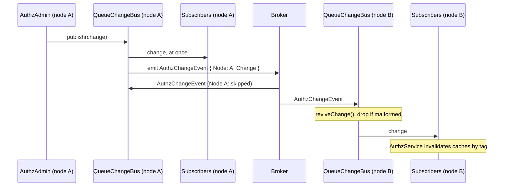

# Queue change bus

`QueueChangeBus` is a `ChangeBus` that sends every `AuthzChange` to the other nodes over the queue. Use it when the app runs on more than one node: a role or assignment changed on one node then drops the stale cached decisions on all of them. The default `InProcessChangeBus` of `@spinajs/authz` reaches only the node that made the change.

## How it works

Selecting the bus:

1. The import registers `QueueChangeBus` with `@Injectable(ChangeBus)`, as a singleton.
2. At each domain boot, the authz host picks the bus. With `authz.bus.service` unset, it resolves `ChangeBus`, which gives the last registered class: `QueueChangeBus` once the package is imported. With `authz.bus.service` set, it takes the registered `ChangeBus` class of that name, and fails boot with `AuthzConfigError` when there is none.
3. The domain subscribes once. `QueueChangeBus.subscribe(fn)` adds `fn` and starts listening on the queue.

Listening:

1. `QueueChangeBus` resolves `QueueService` through its protected `queueService()`, on each start attempt.
2. When `authz.bus.topic` is a non-empty string and `queue.routing.AuthzChangeEvent` is not set, it sets `queue.routing.AuthzChangeEvent` to `{ channel: <topic> }`.
3. It consumes `AuthzChangeEvent` messages.
4. When the queue cannot start yet, it logs an error and retries every 5 seconds. Once it listens after a failure, it delivers `{ tags: ['*'] }` to its subscribers: changes missed while deaf are unknown, so every cache is dropped.

Publishing and receiving:

1. `AuthzAdmin` publishes an `AuthzChange` (`domain?`, `tags`, `actor?`, `at`) after each commit.
2. `QueueChangeBus.publish(change)` delivers it to this node's subscribers at once.
3. It emits an `AuthzChangeEvent` with `Node` (this bus's random id) and `Change` (a copy of the change).
4. On every node, the consumer skips an event whose `Node` is its own: the publisher already heard it.
5. `reviveChange()` rebuilds the change from JSON. A malformed one is dropped with a warning log.
6. The bus calls each subscriber. The authz domain then invalidates its decision caches by the change's tags.



## Configuration

| Key | Type | Default | Allowed values | Meaning |
| --- | --- | --- | --- | --- |
| `authz.bus.topic` | `string` | none | non-empty string | The queue channel of `AuthzChangeEvent`, used only when `queue.routing.AuthzChangeEvent` is not set. An empty string fails boot. |
| `authz.bus.service` | `string` | none: the last registered `ChangeBus`, `QueueChangeBus` after the import | `'QueueChangeBus'`, `'InProcessChangeBus'`, or the class name of your own `ChangeBus` | Owned by `@spinajs/authz` ([Config](../authz/04-host-boot-and-configuration.md#configuration)). Read from the root config only. |
| `queue.routing.AuthzChangeEvent` | object | none | a route of `@spinajs/queue` | Routes the change events explicitly; it wins over `authz.bus.topic` ([Connections and routing](../queue/02-connections-and-routing.md)). |

```ts
export default {
  authz: {
    bus: { service: 'QueueChangeBus', topic: '/topic/authz-changes' },
  },
};
```

The schema `AUTHZ_BUS_TOPIC_CONFIGURATION_SCHEMA` (`$configurationModule: 'authz.bus'`) validates `authz.bus.topic`. The package registers it at import, and `AuthzQueueConfigBootstrapper` registers it again at bootstrap.

## Services and extension points

| Service | DI token and lifetime | Default implementation | Alternatives | How to replace or extend |
| --- | --- | --- | --- | --- |
| Change bus | `ChangeBus`, singleton; picked per domain by `authz.bus.service`, else the last registered | `QueueChangeBus` once the package is imported, else `InProcessChangeBus` | `InProcessChangeBus` (`@spinajs/authz`) | Select one with `authz.bus.service`. To extend, subclass `QueueChangeBus`, register it with `DI.register(MyBus).as(ChangeBus)` before the authz domains boot, and name it in `authz.bus.service`. Override the protected `retryMs` (listen retry delay) or `queueService()` (where the `QueueService` comes from). |

`AuthzChangeEvent` (an `@Event()` with `Node` and `Change`) and `reviveChange()` are exported for code that consumes or builds change events itself.

### Change bus: custom implementation

Subclass `QueueChangeBus` to retry faster on a broker that starts after the app, and select it by class name.

```ts sample
import '@spinajs/authz-queue';
import { DI, Singleton } from '@spinajs/di';
import { ChangeBus } from '@spinajs/authz';
import { QueueChangeBus } from '@spinajs/authz-queue';

@Singleton()
export class FastRetryChangeBus extends QueueChangeBus {
  protected retryMs = 1000;
}

DI.register(FastRetryChangeBus).as(ChangeBus);

// config: authz: { bus: { service: 'FastRetryChangeBus' } }
```

## Important behaviour

- **The publishing node hears a change once**, before the broker round trip; its own copy from the broker is skipped.
- **A publish the queue refuses rejects**, after the local subscribers heard the change. The other nodes keep their caches until their entries expire.
- **A subscriber that throws does not stop the others.** Its error is logged.
- **A node that could not listen drops all its caches** when it finally listens, since it may have missed changes.
- **Every node must import the package and use the same route** for `AuthzChangeEvent`; a node on another channel never hears the changes.
- **Changes travel as plain JSON.** A change with tags that are not strings, more than 1000 tags, a tag longer than 256 characters, or a `domain` or `actor` of the wrong shape is dropped; an unusable `at` becomes the receive time. A node publishes a change past the tag caps as `tags: ['*']`, so the other nodes drop all their caches instead.
- **The bus also stamps an `Initiator`** on its events, through the [job authorization](01-job-authorization.md) hook, but its handler runs as `UNATTENDED` and checks nothing.

## Best practices

- Set `authz.bus.service: 'QueueChangeBus'` explicitly in multi-node apps, so a missing import fails boot instead of falling back to the in-process bus.
- Route `AuthzChangeEvent` to a topic that every node subscribes to (fan-out), not to a work queue where one node takes each message.
- Keep `authz.cache.ttlSeconds` short enough to bound staleness when the broker is down ([Config](../authz/04-host-boot-and-configuration.md#configuration)).

## Related

- [Authorization internals: caching and invalidation](../authz/storage-and-check-flow.md#caching-and-invalidation): what the domain does with a change.
- [Access change push](../http-socket/11-access-change-push.md): pushes the delivered changes to connected sockets.
- [Connections and routing](../queue/02-connections-and-routing.md): `queue.routing` and channels.
