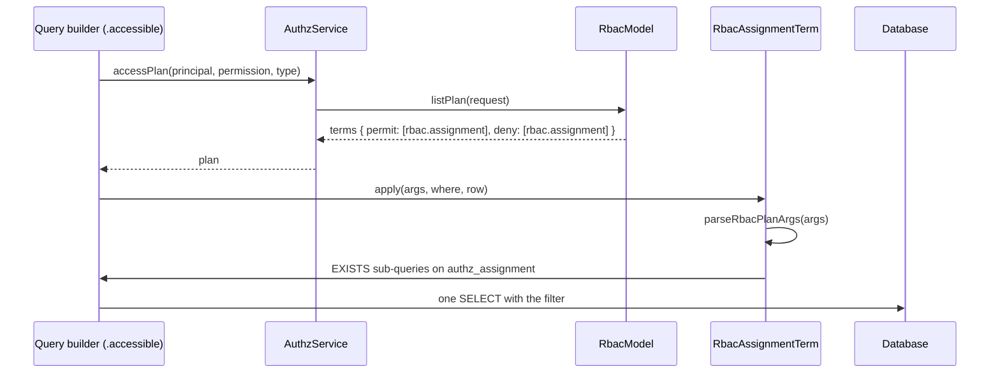

# List filter term (`rbac.assignment`)

The RBAC model answers a list plan with `rbac.assignment` terms: "a live assignment of one of these roles, held by these subjects, at the row, one of its ancestors or `$global`". `RbacAssignmentTerm` compiles each term into ORM conditions on the query builder, so `Task.where(...).accessible('task:read')` filters rows in one statement.

You use it whenever a `list: true` permission is granted through RBAC roles and a list runs through `@spinajs/authz-orm`. Importing `@spinajs/authz-rbac` registers the compiler.

## How it works

1. `.accessible(permission)` on a query builder of an `@AccessResource` model asks the domain for an access plan (`authz().accessPlan`); see [`@spinajs/authz-orm`](../authz-orm/README.md).
2. `RbacModel.listPlan` builds the RBAC part with `rbacListPlan(state)`:
   - a deny role held at `$global` or at the bare type gives `deny-all` (reason `role_denied`);
   - an unconditional grant held at `$global` or at the bare type gives `all`;
   - grants held at scopes give one permit term `rbac.assignment` with `global: false`, plus `relation.owner` / `relation.self` terms for relation grants held everywhere;
   - deny roles held at scopes give one deny term `rbac.assignment` with `global: true`;
   - nothing that grants the permission gives `abstain`.
3. `rbacListPlan` throws when the list cannot be planned exactly: a rule applies, a grant has a relation other than `owner`/`self`, a grant limits `on` by id, or a required tag sits on another assignment than the role. The engine turns the throw into a deny-all with `model_error`. Boot refuses most of these cases earlier through `rbacListSupport`.
4. authz-orm hands each term to the `PlanTermCompiler` whose `op` is `rbac.assignment`: `RbacAssignmentTerm.apply(args, where, row)`.
5. `parseRbacPlanArgs(args)` checks the exact shape and throws `Error` (`rbac.assignment: ...`) on anything else, an unknown key included.
6. `applyRbacAssignment(args, where, row)` adds the conditions (see [Conditions it adds](#conditions-it-adds)). A term with no roles or no subjects adds `where(false)`.
7. Every assignment sub-query keeps only live rows: `expires_at IS NULL OR expires_at > row.now()`, the database's current instant.



### Plan args

`RbacAssignmentPlanArgs`, the `args` of a term:

| Key | Type | Meaning |
| --- | --- | --- |
| `subjects` | `string[]` | Subject keys whose assignments count: the principal (`type:id`), the wildcard (`type:*`) and every set it reaches (`type:id#role`). A term carries every subject. |
| `roles` | `RbacPlanRole[]` | Roles that grant (permit term) or deny (deny term) the permission. |
| `global` | `boolean` | `true`: assignments at `$global` count too. Deny terms set it; permit terms do not. |

`RbacPlanRole`:

| Key | Type | Meaning |
| --- | --- | --- |
| `role` | `string` | The role name. |
| `scopeTypes` | `string[]` | Only assignments made at these scope types count (`grantedAt`, the role's `scopeTypes`). |
| `tag` | `string` | The counting assignment carries this tag (`requiresTag`). |
| `descendantsOnly` | `true` | At the row's ancestors only, never at the row (`implies` with `at: 'descendants'`). |
| `relation` | `'owner' \| 'self'` | And the row's owner (or self) column names one of the principals among `subjects`. |

`rbacPlanArgs(args)` returns the canonical form: subjects and scope types sorted and deduplicated, roles deduplicated and sorted. Equal plans are equal JSON, which keeps cache keys stable.

### Conditions it adds

- **Deny form.** When `global` is `true` and no role has `scopeTypes`, `tag`, `relation` or `descendantsOnly`, one `EXISTS` over `authz_assignment` matches the subjects and roles at the row, at an ancestor (an `EXISTS` on the ancestor table) or at `$global`.
- **Branches.** Otherwise the term ORs one `EXISTS` per branch: `direct` (scope is the row), `ancestor` (scope is a row of `authz_resource_ancestor` for the row) and, with `global`, `global` (scope type `$global`).
- **Roles.** Plain roles share one `role IN (...)` list. Each qualified role gets its own group: `role = ?`, `scope_type IN (...)` for `scopeTypes`, and a set match on `tags` for `tag`.
- **`descendantsOnly`** roles are left out of the `direct` branch.
- **Relations.** A relation role ANDs its `EXISTS` with a match of the row's relation column against the principals among `subjects`. Without a type column on the relation, only `user` principals can match.
- A term that matches nothing in any branch adds `where(false)`.

## Configuration

| Key | Type | Default | Allowed values | Meaning |
| --- | --- | --- | --- | --- |
| `authz.permissions.<permission>.list` | `boolean` | `false` | `true`, `false` | Only a `list: true` permission has a plan; see [Concepts](../authz/01-check-flow.md#concepts). |
| `authz.rbac.maxPlanSubjects` | any | none | none | Not read. A term carries every subject. A value left set logs one warning when the model initialises. |

```ts
authz: {
  permissions: { 'task:read': { list: true } },
  rbac: {
    roles: {
      'project.viewer': { scopeTypes: ['project'], grants: ['task:read'] },
      user: { grants: [{ permission: 'task:read', relation: 'owner' }] },
    },
  },
}
```

## Schema

The term reads two tables; it writes nothing.

### `authz_assignment`

| Column | Type | Meaning |
| --- | --- | --- |
| `subject_key` | str(200) | `type:id` or `type:id#role`; matched against `subjects`. |
| `role` | str(128) | Matched against `roles`. |
| `scope_type` | str(64) | The row's type (direct), an ancestor's type, or `$global`. |
| `scope_id` | str(64) | The row's id (direct) or an ancestor's id. |
| `tags` | str(512) | Stored as `,a,b,`; matched for `tag`. |
| `expires_at` | datetime | Compared with the database's now. |

The full table, its indexes and the store that writes it: [Database storage](02-database-storage.md#schema).

### `authz_resource_ancestor`

Owned by `@spinajs/authz-orm`; the `ancestor` branch and the deny form join it on `resource_type`, `resource_id`, `ancestor_type` and `ancestor_id`. See [`@spinajs/authz-orm`](../authz-orm/README.md).

## Services and extension points

| Service | DI token and lifetime | Default implementation | Alternatives | How to replace or extend |
| --- | --- | --- | --- | --- |
| `RbacAssignmentTerm` | `PlanTermCompiler` (`@spinajs/authz-orm/plan`), singleton, registered at import of `@spinajs/authz-rbac` | `RbacAssignmentTerm` (`op: 'rbac.assignment'`) | none | `DI.unregister(RbacAssignmentTerm)`, then register a `PlanTermCompiler` with the same `op` that wraps `applyRbacAssignment`. Two compilers for one `op` are a configuration error. |

Public functions:

| Export | Does |
| --- | --- |
| `RBAC_ASSIGNMENT_PLAN_OP` | The op name, `'rbac.assignment'`. |
| `rbacPlanArgs(args)` | Canonical, frozen args. |
| `parseRbacPlanArgs(args)` | Checks `unknown` args; throws `Error` naming the problem. |
| `applyRbacAssignment(args, where, row)` | Adds the term's conditions to a where-group. |
| `rbacListPlan(state)` | The RBAC list plan from the model state. |
| `rbacListSupport(sources, permission, type)` | `true`, or the reason a permission cannot be listed on a type. |

### `RbacAssignmentTerm`: custom implementation

Wrap the compiler when you need a policy on top of the SQL, such as a limit on how many subjects one list may carry. Parse the args, apply your check, then call `applyRbacAssignment`.

```ts sample
import { PlanTermCompiler } from '@spinajs/authz-orm/plan';
import type { PlanRow } from '@spinajs/authz-orm/plan';
import { RBAC_ASSIGNMENT_PLAN_OP, RbacAssignmentTerm, applyRbacAssignment, parseRbacPlanArgs } from '@spinajs/authz-rbac';
import { DI } from '@spinajs/di';
import type { IWhereBuilder } from '@spinajs/orm';

const MAX_SUBJECTS = 500;

export class CappedRbacAssignmentTerm extends PlanTermCompiler {
  readonly op = RBAC_ASSIGNMENT_PLAN_OP;

  apply(args: unknown, where: IWhereBuilder<unknown>, row: PlanRow): void {
    const parsed = parseRbacPlanArgs(args);
    if (parsed.subjects.length > MAX_SUBJECTS) {
      throw new Error(`rbac.assignment: ${parsed.subjects.length} subjects exceed the limit of ${MAX_SUBJECTS}`);
    }
    applyRbacAssignment(parsed, where, row);
  }
}

// Importing @spinajs/authz-rbac registers RbacAssignmentTerm; take it out before adding the wrapper.
DI.unregister(RbacAssignmentTerm);
DI.register(CappedRbacAssignmentTerm).as(PlanTermCompiler);
```

Swap the compilers at boot, before the first list runs.

- A second compiler for `rbac.assignment` does **not** replace `RbacAssignmentTerm`. With both registered, every `.accessible()` and `.withAccess()` query fails with `AuthzConfigError` (`authz-orm: two PlanTermCompilers for op "rbac.assignment" (...)`), whatever ops its plan holds. Registering the same instance twice is not a conflict. See [Plan term compilers](../authz-orm/02-plan-term-compilers.md).
- An error thrown by `apply` is not caught or wrapped: the query's `await` rejects with it, no statement reaches the database, and the builder keeps the caller's conditions.

## Important behaviour

- **Database clock.** Expiry in a list is judged by the database's now; a check uses `AuthzClock`. Keep both hosts on one time source ([Access lists](../authz-orm/01-access-lists.md)).
- **Every subject travels.** A principal in many sets gives a long `subject_key IN (...)` list. There is no cap.
- **Strict args.** `parseRbacPlanArgs` accepts only `subjects`, `roles` and `global`. Other keys, such as `membership` or `memberKeys`, are refused with an `Error`.
- **Rules block lists.** A `restrict`, `cap` or matching `threshold` rule makes the permission unlistable on that type: boot refuses it, and a plan that still meets one is a `model_error` deny-all.
- **Plan expiry.** The plan's `validUntil` is the earliest expiry among the assignments and set memberships that contributed.
- **Relations need the column.** A relation term on a model without an `owner`/`self` relation column adds nothing for that relation.

## Best practices

- Declare `list: true` only on permissions whose grants are plain, `owner`/`self`, tagged or `grantedAt`-limited; `rbacListSupport` names the grant that blocks a list.
- Give a team access by assigning a role on the resource to the team's set (`team:42#team.member`), not through a custom relation: lists support only `owner` and `self`.

## Patterns and antipatterns

```ts
// Don't: a custom relation works for single checks, but boot refuses the list permission (boot rule 12)
roles: { editor: { grants: [{ permission: 'task:read', relation: 'assignee' }] } }

// Do: assign a role on the resource; the list term follows the assignment
await authz().admin().assign(actor, { subject: { type: 'user', id: '42' }, role: 'task.editor', scope: { type: 'task', id: '7' } });
```

## Examples

### List the tasks a project viewer may read

```ts
// authz.permissions: { 'task:read': { list: true } }
// authz.rbac.roles: { 'project.viewer': { scopeTypes: ['project'], grants: ['task:read'] } }
const tasks = await Task.where('status', 'open').accessible('task:read');
// rbac.assignment { subjects: ['user:42'], roles: [{ role: 'project.viewer', scopeTypes: ['project'] }], global: false }
// matches tasks under a project where user 42 holds a live project.viewer assignment
```

## Migration

The SQL-text term API is gone. A custom term builds ORM conditions instead.

| Removed | Use instead |
| --- | --- |
| `RbacAssignmentSql` | `RbacAssignmentTerm` |
| `rbacAssignmentSql(args, row)` | `applyRbacAssignment(args, where, row)` |
| `sqliteDateTime` | nothing; the term compares with `row.now()` |
| `DEFAULT_MAX_PLAN_SUBJECTS`, `authz.rbac.maxPlanSubjects` | nothing; every subject is carried |
| `RELATION_OWNER_OP`, `RELATION_SELF_OP`, `RelationPlanArgs` from `@spinajs/authz-rbac` | the same names from `@spinajs/authz-orm/plan` |

Before:

```ts
import { PlanTermSql } from '@spinajs/authz';
import type { SqlFragment, SqlRowContext } from '@spinajs/authz';
import { RELATION_OWNER_OP, parseRbacPlanArgs, rbacAssignmentSql } from '@spinajs/authz-rbac';

export class AuditedAssignmentSql extends PlanTermSql {
  readonly op = 'rbac.assignment';
  toSql(args: unknown, row: SqlRowContext): SqlFragment {
    return rbacAssignmentSql(parseRbacPlanArgs(args), row);
  }
}
```

After:

```ts
import { PlanTermCompiler, RELATION_OWNER_OP } from '@spinajs/authz-orm/plan';
import type { PlanRow } from '@spinajs/authz-orm/plan';
import { applyRbacAssignment, parseRbacPlanArgs } from '@spinajs/authz-rbac';
import type { IWhereBuilder } from '@spinajs/orm';

export class AuditedAssignmentTerm extends PlanTermCompiler {
  readonly op = 'rbac.assignment';
  apply(args: unknown, where: IWhereBuilder<unknown>, row: PlanRow): void {
    applyRbacAssignment(parseRbacPlanArgs(args), where, row);
  }
}
```

## Related

- [`@spinajs/authz-orm`](../authz-orm/README.md): `PlanTermCompiler`, `PlanRow`, `.accessible()` and the ancestor table.
- [Roles and permissions](03-roles-and-permissions.md), [Ladders, tags and implied roles](06-ladders-tags-and-implied-roles.md) and [Rules](07-rules.md): what the plan reads.
- [How a check resolves](05-check-resolution.md): the single-object counterpart of the plan.
- [Database storage](02-database-storage.md): the `authz_assignment` table the term reads.
