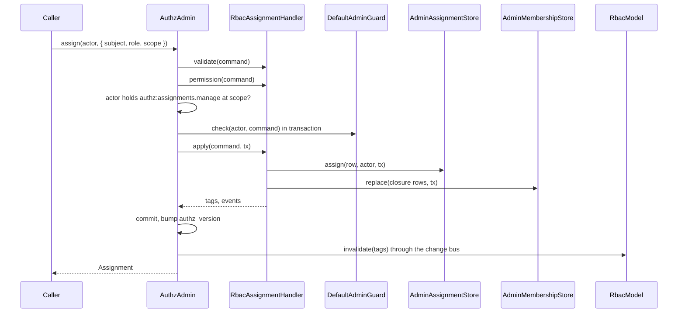

# Assigning roles

An assignment gives a role to a subject at a scope: `user:42` holds `accountant` at `org:7`. Every write of an assignment goes through `AuthzAdmin`, whose RBAC write handlers this package registers; config adds a few fixed assignments at `$global`.

Use it to give users, wildcards, teams and groups access, to make access temporary, and to take it away.

## How it works

`AuthzAdmin.assign(actor, grant)` (sugar for one `assignment.grant` command) runs:

1. `RbacAssignmentHandler.validate()`: loads the role definitions of every `RoleStore` of the domain once per batch (`roleIndex`) and checks the command. The role must exist (`unknown_role`), be assignable (`not_assignable`) and allow the scope type (`wrong_scope_type`). The scope must be `$global` or one resource with an id. Tags must be non-empty strings without `,`. `expiresAt` must lie in the future.
2. `RbacAssignmentHandler.permission()`: the actor needs `authz:assignments.manage` at the command's scope (or the permission `authz.admin.permissions` maps the command to). For an id-only command the handler loads the row to find its scope.
3. Inside the batch transaction, `DefaultAdminGuard.check()` refuses escalation, self-lockout, removing the last holder and changes to system roles ([Admin guard](09-admin-guard.md)).
4. `RbacAssignmentHandler.apply()`: with `replaceLadder: true` it first revokes the subject's other roles of the same ladder at that scope. Then `AdminAssignmentStore.assign()` inserts the row, or updates the row with the same subject, role and scope (expired rows included) and keeps its id.
5. `refreshMemberships()` recomputes `authz_subject_membership` for every subject whose role makes it a set member, and for every member below it ([Subject sets](#teams-groups-and-other-subject-sets)).
6. The handler returns the change tags (`subject:<principalKey>`, set keys, set members) and the events (`RoleAssigned`, `RoleRevoked`, `AssignmentChanged`).
7. After the commit `AuthzAdmin` publishes an `AuthzChange`. `RbacModel.invalidate(tags)` drops the cached assignments of those subjects, `RbacChangeAudience` names the principals to push `authz.changed` to, and the event sinks and the audit run.

A failed command rolls the whole batch back and is reported with its index; the sugar methods throw `AuthzAdminFailure` with the code and field.



## Ways to assign

| Path | Use it for | How |
| --- | --- | --- |
| `AuthzAdmin` in code | App flows: onboarding, invitations, ownership | `authz().admin().assign(actor, grant)`, `revoke(actor, id)`, `execute(actor, commands, opts)` |
| HTTP | Admin UIs | `POST /authz/assignments`, `PATCH`/`DELETE /authz/assignments/:id`, `POST /authz/commands` from [`@spinajs/authz-http-admin`](../authz-http-admin/README.md) |
| CLI | Operators, first admin | `authz:assign`, `authz:revoke` ([CLI commands](13-cli-commands.md)) |
| `authz.rbac.anonymousRoles` | Roles every anonymous caller holds | config, at `$global` |
| `authz.rbac.serviceRoles` | Roles of a fixed service principal | config, at `$global` |
| `authz.rbac.defaultRoles` | Roles a new user gets | read by `@spinajs/users` ([Default roles](../users/12-default-roles.md)) |
| Teams | Team and group membership | `@spinajs/teams` writes `team.member` and `group.member` assignments ([teams](../../packages/teams/README.md)) |

## Commands

| Command | Fields | Needs at | Effect |
| --- | --- | --- | --- |
| `assignment.grant` | `subject`, `role`, `scope`, `tags?`, `expiresAt?`, `replaceLadder?` | `scope` | Inserts the row or updates the one with the same subject, role and scope. `replaceLadder` revokes the subject's other roles of that ladder at the scope (`unknown_ladder` when the role is on none). |
| `assignment.revoke` | `id` | the row's scope | Deletes one row, expired rows too. |
| `assignment.revokeWhere` | `scope`, `subject?`, `role?` | `scope` | Deletes the live rows at the scope that match. Share link grants are left alone. |
| `assignment.setTags`, `addTags`, `removeTags` | `id`, `tags` | the row's scope | Replaces, adds or removes tags. |
| `assignment.setExpiry` | `id`, `expiresAt` (`Date` or `null`) | the row's scope | Moves the expiry; `null` never expires. A past date is refused: revoke instead. |
| `set.addMember` | `set: { role, scope }`, `member`, `expiresAt?` | `set.scope` | Assigns the set's `subjectSet` role to the member at the set's scope. |
| `set.removeMember` | `set: { role, scope }`, `member` | `set.scope` | Revokes those rows, expired ones too; `not_found` when there are none. |

Every one of them needs `authz:assignments.manage` by default. A command on a `link:<id>` subject is refused with `conflict`: a share link's grant changes through `link.update` and `link.revoke` ([Share links](08-share-links.md)).

## Scopes

- A scope is `{ type: '$global' }` (`GLOBAL`) or one resource `{ type, id }`. A type-level ref (`{ type: 'project' }`) and the id `'*'` are refused (`invalid_command`).
- An assignment at `org:7` applies to `org:7` and to every resource whose ancestors hold `org:7` (B13). The ancestors come from the domain's scope resolution, which `@spinajs/authz-orm` fills from `@Parent` columns.
- An assignment at `$global` applies everywhere.
- A role with `scopeTypes` may be held only at those types. It sits at `$global` only when `scopeTypes` lists `'$global'`.
- Deleting a resource row through the ORM runs `scope.forget`: `RbacScopeForgetter` removes the assignments, links and rules at that node and every grant whose subject is a set living there, so a later node with the same id inherits nothing.

## Subjects

| Subject | Written as | Holds the role for |
| --- | --- | --- |
| Principal | `{ type: 'user', id: '42' }` | That principal. |
| Wildcard | `{ type: 'user', id: '*' }` (stored `user:*`) | Every principal of the type; `anonymous:*` covers anonymous callers. `{ type: '*', ... }` is refused. |
| Subject set | `{ set: { role: 'team.member', scope: { type: 'team', id: '7' } } }` | Every holder of `team.member` at `team:7`. The set's role must be a `subjectSet` role. |

`RbacSubjectResolver` reads, per check, the assignments of the principal, its companions (the signed-in user behind a share link), the wildcard of each of their types and, for a `group` principal, its member set (`authz.rbac.groupPrincipal`).

### Teams, groups and other subject sets

1. Define a `subjectSet` role: `'team.member': { subjectSet: true, scopeTypes: ['team'], grants: ['team:read'] }`.
2. Make a principal a member: `set.addMember` (or `assignment.grant` of `team.member` at `team:7`).
3. Grant the set a role anywhere: `assignment.grant` with `subject: { set: { role: 'team.member', scope: { type: 'team', id: '7' } } }`, role `editor`, scope `project:3`. Every member now holds `editor` at `project:3`.
4. A role that extends `team.member`, or ranks above it on its ladder, makes its holder a member too (`team.owner` is a member of the team's set).
5. Nesting: grant a `subjectSet` role to a set (`{ set: team:9#team.member }` gets `team.member` at `team:7`) and the members of team 9 become members of team 7.

With `DbMembershipStore`, the write handlers keep `authz_subject_membership`, the transitive closure, in the batch transaction, so a nested set costs one indexed read per check. A chain deeper than `authz.rbac.maxSetDepth` fails with `set_too_deep`, and a cycle with `set_cycle`, before any row is written. A membership lives while any path to the set lives; its expiry is the latest expiry over all paths.

Without a membership store, sets are one level deep: only the principal's own assignments make it a member.

`@spinajs/teams` builds teams and groups on these sets (`team.member`, `group.member`, the `team` ladder); see the [storage overview](../authz/storage-and-check-flow.md#teams).

## Expiry and tags

- `expiresAt` ends an assignment. A row is live strictly before its expiry; an expired row contributes nothing and is not deleted.
- A decision carries `validUntil`, the earliest expiry among the assignments that shaped it (B14).
- A membership through a set ends at the earlier of the set row's expiry and the membership's.
- Tags (`['code', 'billing']`) are stored sorted and deduplicated; a grant with `requiresTag` counts only for assignments that carry the tag ([Tags](06-ladders-tags-and-implied-roles.md#tags-requirestag)).

## Configuration

| Key | Type | Default | Allowed values | Meaning |
| --- | --- | --- | --- | --- |
| `authz.rbac.anonymousRoles` | `string[]` | `[]` | role names assignable at `$global` | Roles every `anonymous` principal holds at `$global`. |
| `authz.rbac.serviceRoles` | `Record<string, string[]>` | `{}` | key `<type>:<id>` of a principal; roles assignable at `$global` | Roles a fixed principal holds at `$global`, such as `{ 'service:telemetry': ['telemetry'] }`. |
| `authz.rbac.defaultRoles` | `string[]` | none | role names | Read by `@spinajs/users` when it creates a user; checked at boot by its `DefaultRolesBootCheck`. |
| `authz.rbac.groupPrincipal` | `{ role?, scopeType? } \| null` | `{ role: 'group.member', scopeType: 'group' }` | a role name and a type, or `null` | The set a `group` principal speaks for; `null` turns it off. |
| `authz.rbac.maxSetDepth` | integer | `8` | `1` to `64` | Levels a set may lie above a member. |
| `authz.rbac.stores.membership` | `string[]` | `['DbMembershipStore']` next to `DbAssignmentStore`, else `[]` | registered store class names | The closure store. |
| `authz.admin.permissions` | object | none | see [AuthzAdmin](../authz/10-authz-admin.md) | Maps a command kind to your own permission instead of `authz:assignments.manage`. |

```ts
authz: {
  // A permission is checkable at $global and at its types: list every scope type you grant at.
  permissions: { 'authz:assignments.manage': { types: ['org', 'project'] } },
  rbac: {
    anonymousRoles: ['guest'],
    serviceRoles: { 'service:telemetry': ['telemetry'] },
    maxSetDepth: 4,
  },
}
```

Config assignments live in no store: `authz:revoke` and `AuthzAdmin` cannot remove them. A config role that is unknown, unassignable or not allowed at `$global` fails boot, and fails a role reload the same way.

## Errors

| Code | When |
| --- | --- |
| `unknown_role` | The role does not exist, or a set's role is not a `subjectSet` role. |
| `not_assignable` | The role has `assignable: false`. |
| `wrong_scope_type` | The role's `scopeTypes` leave out the scope type. |
| `unknown_ladder` | `replaceLadder: true` on a role that sits on no ladder. |
| `invalid_command` | A malformed field, a type-level scope, a past `expiresAt`. |
| `not_found` | No assignment with that id; no member to remove. |
| `conflict` | The subject is a share link; a concurrent batch granted the same subject, role and scope. |
| `forbidden` | The actor lacks the command's permission at the scope. |
| `escalation`, `self_lockout`, `last_holder`, `protected_role` | Refused by the [admin guard](09-admin-guard.md). |
| `set_cycle`, `set_too_deep` | The grant would close a set cycle or nest sets deeper than `authz.rbac.maxSetDepth`. |

## Important behaviour

- **One identity per subject, role and scope.** Granting the same triple again updates tags, expiry and grantor and keeps the id, `created_at` and `source`.
- **Batches are atomic.** A transfer grants the new holder first and revokes the old one in the same `execute` call; the guard checks each command against the batch's earlier writes.
- **Caches follow writes.** A local commit invalidates at once. Other nodes hear of it only with a cross-node change bus (`authz.bus.service: 'QueueChangeBus'`); until then they serve cached assignments for up to `authz.rbac.cache.assignmentsTtlSeconds`.
- **Other nodes may still honour a revoked assignment** from their caches until they hear of the change or the entry expires. Declare destructive permissions `consistency: 'fresh'` ([How a check resolves](05-check-resolution.md#fresh-checks)).
- **Set changes reach members.** A set grant tags `subject:<setKey>` and every live member (`*` past 1000 members), so their cached decisions drop.

## Best practices

- Grant roles at the narrowest scope that works (`project:3`, not `$global`), and set `scopeTypes` so the wrong scope is refused at write time.
- Give a team access by granting a role to the team's set, not to each member: membership changes then need no new grants.
- Use `expiresAt` for temporary access instead of a reminder to revoke.
- Pass a meaningful `reason` and, for retried requests, an `idempotencyKey` in `AuthzAdminOptions`.
- Run `AuthzAdmin` outside your own `db.transaction()`; `DbAuthzAdminBackend` refuses to nest ([Database storage](02-database-storage.md)).

## Patterns and antipatterns

```ts
// Don't: SYSTEM skips the admin guard, so a request handler acting for a user could escalate
await authz().admin().assign(SYSTEM, { subject: { type: 'user', id: targetId }, role: 'org.admin', scope: org });

// Do: act as the signed-in user; the guard and the permission check run
await authz().admin().assign(authz().current(), { subject: { type: 'user', id: targetId }, role: 'org.admin', scope: org });
```

```ts
// Don't: two calls; a failure between them leaves the project with two owners or none
await admin.assign(actor, { subject: newOwner, role: 'project.owner', scope: project });
await admin.revoke(actor, oldOwnerAssignmentId);

// Do: one batch, all or nothing
await admin.execute(actor, [
  { kind: 'assignment.grant', subject: newOwner, role: 'project.owner', scope: project },
  { kind: 'assignment.revoke', id: oldOwnerAssignmentId },
]);
```

## Examples

### Make a user accountant of one org for 30 days

```ts sample
import { authz } from '@spinajs/authz';
import type { Assignment } from '@spinajs/authz';

export async function grantAccountant(userId: string, orgId: string): Promise<Assignment> {
  const in30Days = new Date(Date.now() + 30 * 24 * 3600 * 1000);
  return authz()
    .admin()
    .assign(authz().current(), {
      subject: { type: 'user', id: userId },
      role: 'accountant',
      scope: { type: 'org', id: orgId },
      expiresAt: in30Days,
    }, { reason: 'quarter-end close' });
}
```

### Give a team edit rights on a project

```ts sample
import { authz } from '@spinajs/authz';
import type { AuthzCommandResult } from '@spinajs/authz';

export async function shareProjectWithTeam(teamId: string, projectId: string): Promise<readonly AuthzCommandResult[]> {
  return authz()
    .admin()
    .execute(authz().current(), [
      {
        kind: 'assignment.grant',
        subject: { set: { role: 'team.member', scope: { type: 'team', id: teamId } } },
        role: 'project.editor',
        scope: { type: 'project', id: projectId },
      },
    ]);
}
```

### Promote on a ladder and drop the old role

```ts
await authz().admin().assign(actor, { subject: { type: 'user', id: '42' }, role: 'maintainer', scope: { type: 'project', id: '3' }, replaceLadder: true });
// the subject's 'viewer' or 'editor' row at project:3 is revoked in the same transaction
```

### Revoke every role a user holds on a project

```ts
await authz().admin().execute(actor, [{ kind: 'assignment.revokeWhere', scope: { type: 'project', id: '3' }, subject: { type: 'user', id: '42' } }]);
```

## Related

- [Roles and permissions](03-roles-and-permissions.md): what a role gives.
- [Admin guard](09-admin-guard.md): what an actor may grant and revoke.
- [How a check resolves](05-check-resolution.md): how assignments are read and cached.
- [Database storage](02-database-storage.md): `authz_assignment`, `authz_subject_membership` and the backend.
- [AuthzAdmin](../authz/10-authz-admin.md): the command bus, permissions, idempotency and events.
