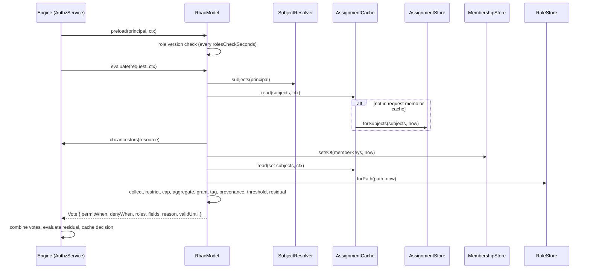

# How a check resolves

`RbacModel` is one `AuthorizationModel` of an authz domain. On every check the engine asks it for a vote: a permit filter, a deny filter, the effective roles, the fields and a reason. This page follows one check through the model, its caches and its stores.

## How it works

### Wiring

1. `registerRbac(container, configuration)` builds the stores, an `RbacModel` over them, an `RbacContributor` and an `RbacService`, and registers them in the domain's container ([Wiring the model](README.md#wiring-the-model)).
2. When the domain boots, the engine calls `RbacModel.init(ctx)`. It runs each extension's `init`, reads the role store's `version()` and `load()`, compiles the role graph (`compileRoles`) and builds the `AssignmentCache` from `authz.rbac.cache.*`. It reads `anonymousRoles` and `serviceRoles` and refuses a role that is unknown or not assignable at `$global`.
3. The engine calls `RbacContributor.contribute(domain)` after every model's `init`. It compiles the grant index (`RbacModel.grantIndex()`) and runs the extensions' `compile` hooks; a bad grant fails the boot.
4. The model routes a permission when some role grants or denies it (`applies`). Its capabilities: effects `permit` and `deny`, field sets, every resource type, and synchronous votes after a preload (`sync: 'after-preload'`).

### One check

1. **Preload.** `AuthzService.preload(principal)` (authz-http's principal middleware calls it on every request) makes the engine call `RbacModel.preload(principal, ctx)`. Every `authz.rbac.cache.rolesCheckSeconds` it re-reads the role store's `version()`; a new version reloads and recompiles the roles. It then reads the principal's assignments into the request and into the cross-request cache.
2. **Evaluate.** The engine calls `RbacModel.evaluate(request, ctx)`. Stale roles reload first.
3. **Gather (IO).** `readRbacInput` collects:
   - the subjects, from the `SubjectResolver` (default `RbacSubjectResolver`): the principal, its companions, a `group` principal's member set and the wildcard of each type;
   - their assignments, through `AssignmentCache.read()`, plus the config assignments of `anonymousRoles` and `serviceRoles` at `$global`;
   - the path: `[resource, ...ancestors, $global]` from `ctx.ancestors(resource)`; a type-level request (`{ type }`) gets `[{ type }, $global]` and a request on `$global` gets `[$global]`;
   - what each extension's `gather` adds, in order: the ladder and implies tables, the subject sets (`SetsExtension`, one more read through `MembershipStore.setsOf` and one for the sets' assignments), the rules on the path (`RulesExtension`), and last the token role narrowing.
4. **Nine steps (no IO).** `runRbacPipeline` runs `RBAC_STEPS` in `RBAC_STEP_NAMES` order over one `RbacState`:

   | Step | Does |
   | --- | --- |
   | `collect` | Keeps live assignments on the path whose role passes `ceiling.roles`; on a type-level request also those below it (`scoped`). Drops unknown roles and rows their role refuses. Then applies set memberships, adds implied roles, ranks ladder roles and records deny roles. |
   | `restrict` | Drops assignments made above a `restrict` rule's scope, unless their subject is in `allow`. |
   | `cap` | Clamps ladder ranks to `maxRole`, drops rows for `maxRole: null`, strips tags. |
   | `aggregate` | The effective role per ladder (`Vote.roles`) and the tags held. |
   | `grant` | The grants of the permission that the live roles reach. None: reason `no_access`, or `role_too_low` when a higher role of a held ladder would grant it. |
   | `tag` | `requiresTag`: refuses a grant (`tag_missing`) or narrows it to rows below a tagged scoped assignment. |
   | `provenance` | `grantedAt`: refuses a grant (`provenance` or `role_too_low`) or narrows it. |
   | `threshold` | `threshold` rules add deny entries with their own reason. |
   | `residual` | Each passing grant becomes a permit filter: its relations OR-ed, AND its `on` patterns, AND the rows below scoped assignments. Fields and `validUntil` are computed here. |
5. **Vote.** `permitWhen` is the OR of the permits (`FALSE` when none); `denyWhen` is the OR of deny-role and threshold entries; `reason` is the lowest-priority reason while nothing permits unconditionally; `roles`, `fields`, `validUntil` and `cacheable` come with it.
6. **Combine.** The engine combines the RBAC vote with the other models' (`deny-overrides` by default), evaluates a residual against the row when it has one, and caches the decision. See [`@spinajs/authz` concepts](../authz/01-check-flow.md#concepts).

A throw anywhere in the model (an unreadable row, a stale broken role store, a rule that cannot be decided for a type-level request) is a `model_error` deny: the model fails closed.



Without a membership store the `setsOf` read is skipped; without a rule store, `forPath` is.

### Lists, summaries and covers

- `RbacModel.listPlan()` runs the gather and the steps through `cap`, then `rbacListPlan` turns the state into `rbac.assignment` terms ([List filter term](01-list-filter-term.md)). Any live rule that can match the permission and type fails the plan.
- `RbacModel.summarize(principal, at)` lists the roles held at `at` and every permission some row is permitted for, marking conditional ones. The engine's `summary` and `covers` read it.

## Role definitions

- Roles compile once at `init` and stay in memory.
- They are marked stale by an invalidate tag that can reach role definitions (`role:<name>`, `model:rbac`, `*`, a tag of no known prefix) or by a role version check that sees a new `version()`.
- The next request reloads them: version first, then `load()`, compile and grant index; one reload runs at a time.
- A failed reload or version check logs a warning and makes every RBAC vote fail until a reload succeeds. `RbacModel.version()` then answers a distinct stale value, so the engine drops decisions cached under the old roles.

## Assignment cache

`AssignmentCache` holds the rows of each subject at two levels:

| Level | Lifetime | Bound |
| --- | --- | --- |
| Request memo (`ctx.cache`) | One request; also outlives the TTL inside it | none |
| Cross-request entries | `authz.rbac.cache.assignmentsTtlSeconds` | `authz.rbac.cache.maxSubjects` subjects, least recently used first |

- A cache miss reads `AssignmentStore.forSubjects(missing subjects, now)` once for all missing subjects. Concurrent requests join a read in flight.
- Rows only expire, so rows read at `t` serve any request at or after `t`; `collect` re-checks expiry against the request's instant.
- `RbacModel.invalidate(tags)`, called by the engine for every `AuthzChange`:

  | Tag | Assignment cache | Role definitions |
  | --- | --- | --- |
  | `subject:<key>` | Drops that subject and every subject set entry. | kept |
  | `role:<name>` | Drops everything. | stale |
  | `model:rbac` | Drops everything. | stale |
  | `scope:<key>`, `link:<id>` | Drops everything. | kept |
  | `policy:<id>`, `rule:<id>`, `model:<other>` | Drops nothing. | kept |
  | `*`, a tag of another prefix, a malformed list | Drops everything. | stale |

- Every invalidate moves a generation: a load that started before it answers its callers but stores nothing.
- A failed store read is never cached.
- Cached rows are deep-frozen copies shared by every request.

### Fresh checks

A permission declared `consistency: 'fresh'`, or a check with `fresh: true`, skips the request memo and the cross-request entries and reads the store; the rows it reads refresh both levels. Role definitions and rules may still come from memory until the change bus delivers a change. `filterNow`, the synchronous path, cannot read fresh and answers `undefined` for such a permission.

### Synchronous votes

`evaluate` returns a `Vote` without a promise when the roles are fresh, every subject's rows are cached (after a preload) and the request is type-level (B22). Otherwise it returns a promise.

## Configuration

| Key | Type | Default | Allowed values | Meaning |
| --- | --- | --- | --- | --- |
| `authz.rbac.cache.assignmentsTtlSeconds` | number | `60` | `>= 0` | How long a subject's rows serve later requests. `0` keeps nothing across requests. |
| `authz.rbac.cache.maxSubjects` | integer | `10000` | `>= 0` | Subjects held across requests. `0` keeps nothing. |
| `authz.rbac.cache.rolesCheckSeconds` | number | `60` | `>= 0`; `null` is refused | How often a preload re-reads the role store version. `0` never checks; roles then reload only on an invalidate. |

```ts
authz: { rbac: { cache: { assignmentsTtlSeconds: 30, maxSubjects: 50000, rolesCheckSeconds: 300 } } }
```

## Services and extension points

| Service | DI token and lifetime | Default implementation | Alternatives | How to replace or extend |
| --- | --- | --- | --- | --- |
| `RbacModel` | `AuthorizationModel`, one instance per `registerRbac` call (a factory registration) | `RbacModel` | none | Configure stores and extensions through `registerRbac`; see [Model extensions](12-model-extensions.md). |
| `RbacContributor` | `AuthzContributor`, per `registerRbac` call | `RbacContributor` | none | Extensions add refs through `RbacExtension.contribute`. |
| `RbacService` | `RbacService` class and the name `'RbacService'`, per `registerRbac` call | `RbacService` | none | Built over the model; pass `RegisterRbacOptions.service`. |
| `SubjectResolver` | `RbacModelOptions.subjects` (not DI) | `RbacSubjectResolver` | your own | Build `RbacModel` yourself with `subjects`; see [Custom stores](11-custom-stores.md#subjectresolver). |
| `RbacChangeAudience` | `ChangeAudience`, singleton, at import | `RbacChangeAudience` | none | Register another `ChangeAudience`; the router asks each. |

### `RbacService`

| Method | Returns |
| --- | --- |
| `rolesOf(principal, at = GLOBAL, { ceiling?, ctx? })` | The roles held at `at` (`RoleHolding[]`: role, scope, assignment id, source, expiry, effective role). `ceiling: false` gives the assigned roles before `ceiling.roles`, as a role switch needs. |
| `covers(holder, wanted, at?, ctx?)` | Whether `holder` (role names, or a preloaded principal) holds every grant of the `wanted` roles with no wider conditions. Synchronous; throws `AuthzConfigError` when it would need IO. |
| `coversAt(principal, wanted, at, ctx)` | `covers` over the whole path of `at`, the principal's ceiling and deny roles included. |
| `grantsOf(role)` | The compiled grants of the role's closure. |
| `linkPrincipal(id, companion?)`, `principalForToken(token, companion?)` | The `link` principal of a share link ([Share links](08-share-links.md)). |

### `RbacChangeAudience`

After an admin commit, the push router asks every `ChangeAudience` whom a change reaches. `RbacChangeAudience` answers from the change tags: `subject:<principalKey>` names that principal, `subject:<setKey>` the set's live members (through `MembershipStore.membersOf`), `link:<id>` the link principal. A wildcard subject, a tag of another kind or a missing membership store answers everyone. It names no objects, so clients refetch.

## Important behaviour

- **Fail closed.** A row with an unreadable `expiresAt`, an `ancestors` answer of `null`, a broken role reload or a rule that would differ per row of a type-level request throws, and the engine turns the throw into a `model_error` deny.
- **Ceilings narrow permits only.** `ceiling.roles` filters assignments by the assigned role's name; deny assignments always count.
- **`validUntil`** is the earliest expiry among the assignments, memberships and rules that shaped the vote, so the engine never caches a decision past the moment it changes.
- **Deny reasons** of the RBAC vote: `no_access`, `role_denied`, `tag_missing`, `provenance`, `role_too_low`, `threshold` (or a threshold rule's own `reason`). The engine reports the lowest `(priority, sortKey)` across models.
- **Unknown roles** in assignment rows are ignored and logged once per role.

## Best practices

- Outside HTTP (a job, a socket handler), call `authz().preload(principal)` before a burst of checks, so type-level checks and `filterNow` answer without IO.
- Keep `assignmentsTtlSeconds` short on a multi-node app without `QueueChangeBus`; it bounds how long another node honours a revoked row.
- Use `authz:explain <principal> <permission> [resource]` to see the roles, the reason and the trace of one decision ([CLI commands](13-cli-commands.md)).

## Examples

### List the global roles of the current user, before and after a role switch

```ts sample
import { DI } from '@spinajs/di';
import { authz, GLOBAL } from '@spinajs/authz';
import { RbacService } from '@spinajs/authz-rbac';

export async function globalRoles(): Promise<{ effective: string[]; assigned: string[] }> {
  const rbac = await DI.resolve(RbacService);
  const me = authz().current();
  const effective = await rbac.rolesOf(me, GLOBAL);
  const assigned = await rbac.rolesOf(me, GLOBAL, { ceiling: false });
  return { effective: effective.map((h) => h.effectiveRole), assigned: assigned.map((h) => h.role) };
}
```

`rolesOf` at a concrete resource reads its ancestors from `opts.ctx`, else from the `ancestors` option of `RbacServiceOptions` (`RegisterRbacOptions.service`); with neither it rejects with `AuthzConfigError`.

## Related

- [`@spinajs/authz`](../authz/README.md): the engine, combination, decision caches and `consistency: 'fresh'`.
- [Caching and invalidation](../authz/storage-and-check-flow.md#caching-and-invalidation): L1, L2 and the change bus around this model.
- [Ladders, tags and implied roles](06-ladders-tags-and-implied-roles.md) and [Rules](07-rules.md): what steps 2 to 8 read.
- [List filter term](01-list-filter-term.md): the list counterpart of this flow.
