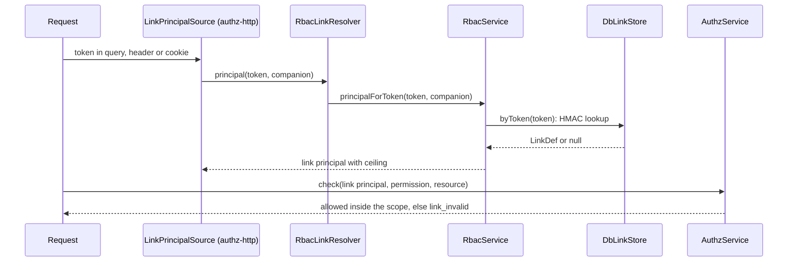

# Share links

A share link is a bearer token that gives a role on one resource, with an optional expiry. `AuthzAdmin` creates it and returns the token once; a request that carries the token runs as a `link` principal limited to the link's scope.

## How it works

### Creating a link

1. `AuthzAdmin.createLink(actor, { scope, role, tags?, expiresAt?, attributes? })` runs `link.create` through `RbacLinkHandler`.
2. `validate`: the scope is one resource with an id; the role exists, is assignable and allowed at the scope type; `expiresAt` lies in the future.
3. The actor needs `authz:links.manage` at the scope; `DefaultAdminGuard` refuses a role the actor does not cover there (`escalation`).
4. `AdminLinkStore.create()` writes the link row and an assignment of the role to the subject `link:<id>` at the link's scope, in the batch transaction. `DbLinkStore` draws 32 random bytes as a base64url token and stores only `v1:` and an HMAC-SHA256 of it under `authz.rbac.links.secret`.
5. The result carries `{ link, token }`. The token appears in no event, audit entry or list.

### Opening a link

1. authz-http's `LinkPrincipalSource` reads the token from the request (`authz.http.links`: query parameter, header or cookie). The principal the earlier sources found becomes the companion.
2. It resolves the `LinkResolver` from the root container. `RbacLinkResolver.principal(token, companion)` calls `RbacService.principalForToken`.
3. `LinkStore.byToken(token)` finds the live or expired link; `linkPrincipalOf` builds the principal:
   - type `link`, id the link's id, `attributes` the link's;
   - `ceiling: { resources: [link.scope], expiresAt, reason: 'link_invalid' }`;
   - the companion joins as a subject only when it has no ceiling, no `onBehalfOf` and is no link principal.
4. Checks run as that principal: the link's own assignment (and the companion's, if it joined) count, inside the ceiling. A check outside the scope, or after the expiry, is denied with `link_invalid`.
5. An unknown or revoked token gives the principal `link:unresolved` with `ceiling.resources: []`: every check is denied (B42).



## Commands

| Command | Fields | Needs at | Effect |
| --- | --- | --- | --- |
| `link.create` | `scope`, `role`, `tags?`, `expiresAt?`, `attributes?` | `scope` | Creates the link and its grant; returns `id` and `token`. |
| `link.update` | `id`, `expiresAt?`, `attributes?`, `role?`, `tags?` | the link's scope | A new role replaces the grant; new tags update it. |
| `link.revoke` | `id` | the link's scope | Removes the link and its assignments. |

All three need `authz:links.manage`. Sugar: `createLink(actor, l)`, `revokeLink(actor, id)`. Events: `LinkCreated`, `LinkUpdated`, `LinkRevoked`. Change tags: `link:<id>` and `subject:link:<id>`.

## Configuration

| Key | Type | Default | Allowed values | Meaning |
| --- | --- | --- | --- | --- |
| `authz.rbac.links.secret` | `string` | none | at least 32 characters | The HMAC key of `DbLinkStore` token hashes. Read at first use: a missing or short secret throws `AuthzConfigError` then, not at boot. |
| `authz.rbac.stores.links` | `string[]` | `['DbLinkStore']` | registered store class names, at most one | The link store. |
| `authz.http.links` | object | see authz-http | | Where requests carry the token. See [`@spinajs/authz-http`](../authz-http/README.md). |

```ts
authz: {
  rbac: { links: { secret: process.env.AUTHZ_LINK_SECRET } },
}
```

## Services and extension points

| Service | DI token and lifetime | Default implementation | Alternatives | How to replace or extend |
| --- | --- | --- | --- | --- |
| Link store | `LinkStore`, `AdminLinkStore`; per child container; by `registerRbacStores` | `DbLinkStore` | `MemoryLinkStore` (SHA-256 of the token, not registered) | `authz.rbac.stores.links`; see [Custom stores](11-custom-stores.md). |
| `LinkResolver` (authz-http) | resolved from the root container per request | none: without it every link is dead | `RbacLinkResolver` | `RbacModel` registers one in the container of the domain that lists it, so links work when root lists it: `authz.models: ['RbacModel']`. `'RbacModel'` in a child domain's `models` only registers it in that child's container, which authz-http does not read. |
| `RbacLinkHandler` | `AuthzWriteHandler`, singleton, at import | `RbacLinkHandler` | none | Add a before hook on `authz.admin.command` to refuse links your product forbids. |

`RbacService.linkPrincipal(id, companion?)` builds the principal of a link by id, for a host that resolves tokens itself.

## Important behaviour

- **Token shown once.** Lost tokens cannot be recovered; revoke the link and create a new one.
- **Changing the secret kills every link**: no stored hash matches any more.
- **A link's grant is the link's.** `assignment.*` commands on a `link:<id>` subject fail with `conflict`; change it with `link.update` or `link.revoke`.
- **A signed-in user's own access joins only when nothing would be lost.** A companion with a ceiling (role switch, token scopes) or an agent is left out, so the link gives its own access only. Its attributes and authn facts never reach conditions inside the link scope.
- **Expired links** keep their `expiresAt`, and the engine judges it at its own clock.
- **Deleting the resource** forgets its links (`scope.forget`).
- **Links need RBAC in root.** authz-http reads `LinkResolver` from the root container. With `'RbacModel'` listed only in a child domain's `models`, every link is dead; list it in `authz.models` as well.

## Best practices

- Load `authz.rbac.links.secret` from a secret store, not a committed config file, and give it 32 or more random characters.
- Always set `expiresAt` on links to external people.
- Grant links a dedicated low role (`file.viewer`) and cap it with a rule if your ladder could otherwise reach higher.

## Examples

### Share a file for a week

```ts sample
import { authz } from '@spinajs/authz';

export async function shareFile(fileId: string): Promise<string> {
  const { token } = await authz()
    .admin()
    .createLink(authz().current(), {
      scope: { type: 'file', id: fileId },
      role: 'file.viewer',
      expiresAt: new Date(Date.now() + 7 * 24 * 3600 * 1000),
      attributes: { purpose: 'review' },
    });
  return token;
}
```

## Related

- [Assigning roles](04-assigning-roles.md): the link's grant is an ordinary assignment to `link:<id>`.
- [Database storage](02-database-storage.md#authz_link): `authz_link` and the token hash.
- [How a check resolves](05-check-resolution.md): ceilings narrow permits only.
- [`@spinajs/authz-http`](../authz-http/README.md): principal sources and `authz.http.links`.
