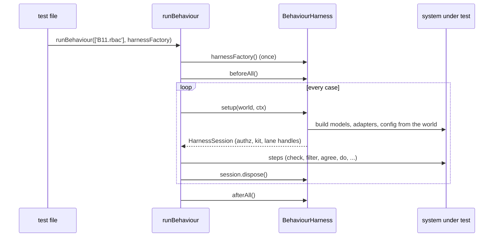

# Behaviour fixtures

The rules B01-B46 of the authz design (§17), written as data: worlds, steps and expected decisions. `runBehaviour` runs the rules you name against your system through a harness, so every engine, model and adapter is held to the same answers. Each package runs the parts it owns from its own tests.

## How it works

1. `runBehaviour(ids, harnessFactory, opts)` checks the selectors at registration: an unknown id, an unknown part or an empty list throws there.
2. `mergeFixtures` merges the catalogue (`BEHAVIOUR_FIXTURES`, or `opts.fixtures`) by rule id.
3. It calls `harnessFactory()` once and registers `describe('behaviour fixtures [<facets>]')`, then one `describe` per rule and per part and one `it` per case, titled with the part id: `B03.core deny-overrides: a deny beats a permit`.
4. `harness.beforeAll` and `harness.afterAll` run once around the cases.
5. Per case, the runner calls `harness.setup(world, ctx)`, checks that the session has the handles of the part's facets, runs the steps, then calls `session.dispose()`, also when a step failed.
6. A case with a `boot` expectation expects `setup` to reject with that error; with `orAtCall` a setup that succeeds may throw at the step instead.



## Selecting rules and parts

| Selector | Runs |
| --- | --- |
| `'B07'` | Every part of the rule. A part needing facets the harness lacks is a pending test naming them. |
| `'B07.rbac'` | That part only. Missing facets make it a failing test. |
| `{ strict: true }` | Missing facets and parts without cases fail instead of pending. |

A part without cases yet is pending with its note (who proposes the cases), or failing under `strict` or when named by part id.

## Configuration

`RunBehaviourOptions`:

| Key | Type | Default | Allowed values | Meaning |
| --- | --- | --- | --- | --- |
| `strict` | boolean | `false` | | Parts the harness cannot run, and parts without cases, fail instead of pending. |
| `timeoutMs` | number | mocha's | ms | Per case. |
| `fixtures` | `(BehaviourFixture \| FixtureExtension)[]` | `BEHAVIOUR_FIXTURES` | | Pass `[...BEHAVIOUR_FIXTURES, ...local]` to add lane-local parts ([Writing fixtures](11-writing-fixtures.md)). |
| `mocha` | `MochaLike` | the mocha globals | | `describe`, `it`, `before`, `after`; throws at registration when neither is there. |

Exports that describe the catalogue: `BEHAVIOUR_FIXTURES` (every fixture and extension), `BEHAVIOUR_RULES` (rule texts verbatim from design §17), `FACETS` (what each facet promises), `mergeFixtures(list)`.

## Facets

A harness declares the facets it has; a part lists the facets it needs.

| Facet | The harness promises |
| --- | --- |
| `engine` | `session.authz` answers `check`, `explain`, `checkMany` (and the others a step calls) for the world; `session.kit` is the `KitWorld` and its models are the ones the engine runs. |
| `boot` | `setup` runs the boot checks (design §6.5) and rejects with their `AuthzConfigError`. |
| `audit` | `session.audit.entries` lists every `DecisionAudit` record. |
| `clock` | `session.clock` is the engine's time source, starting at `world.now`; `advance` moves request time, expiry and cache TTLs. |
| `cache` | The L2 `DecisionCache` runs with `world.config.cache`. |
| `host` | `authz.current()` and `authz.runAs()` work, and `session.domains` serves the child domains of `world.domains`. |
| `bus` | `session.bus` is the `ChangeBus` every domain subscribes to. |
| `rbac`, `ladders`, `rules`, `links` | `world.rbac` is loaded into the lane's RBAC model named `rbac`, with ladders, rules and share links. |
| `abac`, `conditions` | `world.abac.policies` are loaded into the model named `abac`; the core `ConditionCompiler` is wired. |
| `rebac` | `world.rebac.tuples` are loaded into a real ReBAC model (reserved; the kit's `FakeTupleModel` needs only `engine`). |
| `admin`, `store`, `scopeAttributes` | `session.admin` is the domain's `AuthzAdmin`; data lives in DB-backed stores; scope attributes feed `ctx.attributes`. |
| `list`, `sql` | `session.list` returns the world rows a type-level residual selects, in memory or on SQL. |
| `orm`, `http`, `fs`, `queue`, `socket`, `email`, `configuration`, `token`, `authn`, `impersonation`, `canvas` | The lane handle of that adapter or flow ([Behaviour harnesses](10-behaviour-harnesses.md#lane-data-and-handles)). |

## The rules

The full text of each rule is in `BEHAVIOUR_RULES`. Parts marked *(no cases)* are stubs; they run as pending.

| Rule | Covers | Parts |
| --- | --- | --- |
| B01 | No routed model permits ⇒ denied, `no_access`. | `core`, `rbac` |
| B02 | An unregistered permission throws `AuthzConfigError`/`UnknownPermission` at boot or call, never `false`; a permission on a type outside its `types` throws. | `core`, `rbac`, `abac`, `rules`, `http`, `adapter` |
| B03 | `deny-overrides`, `permit-overrides`, `first-applicable`; evaluation order never changes the answer. | `core`, `abac` |
| B04 | A model that throws, sets `error` or times out is indeterminate (`model_error`). | `core`, `abac` |
| B05 | Boot refuses the combinations of design §6.5 with a message naming domain, model, type and permission. | `core`, `rbac`, `ladders`, `rules`, `abac`, `sql`, `orm` *(no cases)* |
| B06 | Residuals: `check` with a subject ⇔ the row is in `filter`; `.accessible()` and `.withAccess` agree with `checkAll`. | `core`, `rbac`, `accessible`, `rules` |
| B07 | A ceiling only narrows (permissions, resources, expiry, roles). | `core`, `rbac`, `token` |
| B08 | `delegation: 'intersect'`; deeper than `maxDelegation` throws. | `core`, `token` |
| B09 | No principal ⇒ `UNATTENDED` denies; `runAs(SYSTEM)`, `@Job` and `@Unscoped` are the audited bypasses. | `core`, `runAs`, `orm`, `http`, `queue`, `configuration`, `socket`, `email` |
| B10 | Anonymous principals and `authz.rbac.anonymousRoles`; `@Access` without `@AllowAnonymous` ⇒ 401. | `http`, `rbac` |
| B11 | RBAC effective roles: live assignments at `GLOBAL` or an ancestor. | `rbac` |
| B12 | `extends` inheritance; cycles, unknown roles and `assignable: false` are errors. | `rbac`, `implies`, `write`, `http`, `store` |
| B13 | A scoped assignment applies to its scope and descendants; `scopeTypes`. | `rbac`, `write`, `http` |
| B14 | Expired assignments, rules, links and policies count for nothing; `validUntil`; cache TTL. | `core`, `cache`, `rbac`, `store`, `abac` |
| B15 | A grant with a relation gives a `relation` residual. | `rbac` |
| B16 | Resource patterns `on:` and `{principal.*}` templates. | `rbac`, `fs` |
| B17 | Readable and writable fields; `hide`; `authz.fields.neverRead`; input stripping. | `core`, `rbac`, `abac`, `http`, `users` |
| B18 | ABAC deny beats RBAC permit; ABAC targets. | `abac` |
| B19 | Conditions become residuals; `needs_subject`. | `abac` |
| B20 | `.accessible()` on selects, updates and deletes; the test-env guard; `.withAccess`. | `orm`, `configuration` |
| B21 | Models without `@AccessResource` are not checked; `populate()` is not filtered. | `orm` |
| B22 | `filterNow` after `preload`; `undefined` when a model needs IO. | `core`, `rbac`, `orm` *(no cases)* |
| B23 | `@Access`, `also` and `@Policy` grouping; the 403 body; trace rules. | `http`, `configNamed` |
| B24 | Token principals, scopes, agent tokens; role switch sets `ceiling.roles`. | `token`, `roleSwitch` |
| B25 | `GET /user/access` and the auth flows that return the same object. | `http`, `rbac`, `authn` |
| B26 | Impersonation needs a strict superset (`covers`); the `AdminGuard` rules. | `core`, `abac`, `guard`, `http`, `impersonation` |
| B27 | Store writes bump `authz_version` and publish `AuthzChange`; caches drop. | `bus`, `domains`, `cache`, `store`, `events`, `queue`, `policyEvents` |
| B28 | authz-fs modes `off`, `enforce`, `audit`. | `fs` |
| B29 | Domain model lists merge with the parent's; disposing a domain. | `host`, `fs` |
| B30 | Queue initiators; handlers run as initiator, system or unattended; job status visibility. | `queue`, `status` |
| B31 | Ladders and `role_too_low`. | `ladders`, `rules` |
| B32 | `implies` and `bypass`. | `ladders`, `rules` |
| B33 | Subject sets, group principals, companions. | `sets` |
| B34 | `requiresTag` and `grantedAt` provenance. | `ladders` |
| B35 | Rules `restrict`, `cap`, `threshold`. | `rules`, `conditions` |
| B36 | The reported deny reason is the lowest `(priority, sortKey)`, independent of order. | `core`, `abac`, `rbac` |
| B37 | `delegation: 'inherit'`. | `core`, `token` |
| B38 | Share links: link principals, `link_invalid`, hashed tokens. | `rbac`, `store`, `admin`, `adminHttp`, `http` |
| B39 | Scope attributes `scope.<type>.*`; unresolvable refs fail closed. | `core`, `abac`, `orm` *(no cases)*, `store` |
| B40 | Canvas conformance over `fixtures/canvas-c6`. | `memory`, `sqlite`, `checkMany`, `list` *(all no cases)* |
| B41 | Production: no explain route, no trace in 403 bodies. | `http` |
| B42 | An invalid link never grants anything. | `rbac`, `canvas` *(no cases)* |
| B43 | `AuthzAdmin` commands: validated, guarded, transactional, versioned, audited, idempotent. | `admin`, `rules`, `policies`, `attributes`, `events`, `http` |
| B44 | Retired: lists on types with RBAC rules; boot rule 12 refuses them. | `retired` *(no cases)* |
| B45 | Instance roles carry no scoped grant. | `rbac` |
| B46 | Scope-attribute switches (`external_sharing`) act at check time. | `rules`, `links`, `store`, `cache`, `canvas` *(no cases)* |

## Important behaviour

The fixtures hold every engine to these readings, which the design leaves implicit (the package README lists them as D-F5-1 to D-F5-11):

- A residual is evaluated with SQL three-valued logic, as [`evaluateFilter`](12-filter-oracle.md) does: a check with a subject is allowed, or a row selected, only when the residual is TRUE.
- The reported deny reason is the lowest `(priority, sortKey)` among all deny sources, the core's included. Only `SYSTEM` and `UNATTENDED` skip the models.
- A permitting vote without `fields` contributes every field, before `hide` and `authz.fields.neverRead`.
- `authz.engine.maxDelegation` counts `onBehalfOf` hops: an agent acting for a user is one.
- Of a cached decision's tags, fixtures rely only on `subject:<principalKey>`, `model:<name>` of a voting model, and a model's `version()` change.
- An expected error message writes `$domain` where it names the domain; the runner puts in the harness's `domain` (default `'root'`).

## Best practices

- Run your package's parts with `{ strict: true }`, so a missing facet or handle fails instead of hiding as pending.
- Name parts, not bare rules (`'B07.rbac'`), when your harness covers only some parts of a rule.
- Grep the mocha output for the part id to see a lane's acceptance: every case title starts with it.

## Examples

### Run the core rules against the real host

```ts sample
import { hostHarness, runBehaviour } from '@spinajs/authz-testing';

runBehaviour(['B01.core', 'B03.core', 'B04.core', 'B06.core', 'B36.core'], () => hostHarness(), { strict: true });
```

### Run the RBAC parts against your RBAC harness

```ts
import { runBehaviour } from '@spinajs/authz-testing';
import { rbacHarness } from './support/rbac-harness.js';   // see Behaviour harnesses

runBehaviour(['B01.rbac', 'B11.rbac', 'B12.rbac', 'B13.rbac', 'B15.rbac'], () => rbacHarness(), { strict: true, timeoutMs: 30_000 });
```

## Related

- [Behaviour harnesses](10-behaviour-harnesses.md): write the harness a part needs.
- [Writing fixtures](11-writing-fixtures.md): worlds, steps, expectations and lane-local parts.
- [`packages/authz-testing/README.md`](../../packages/authz-testing/README.md#decisions): the decisions D-F5-1 to D-F5-11 fixture notes cite.
- [`@spinajs/authz-rbac`](../authz-rbac/README.md), [`@spinajs/authz-abac`](../authz-abac/README.md), [`@spinajs/authz-orm`](../authz-orm/README.md): packages that run their parts with their own harnesses.
