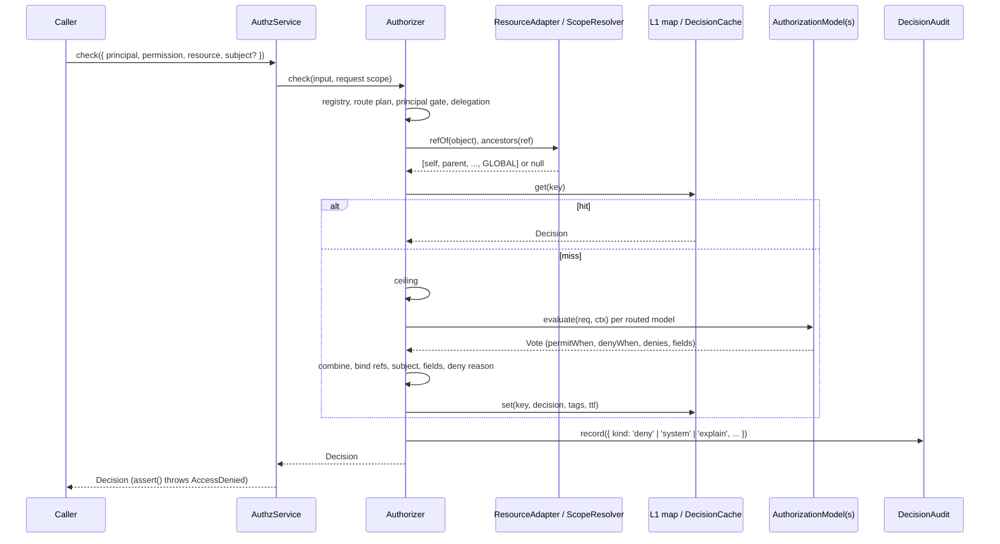
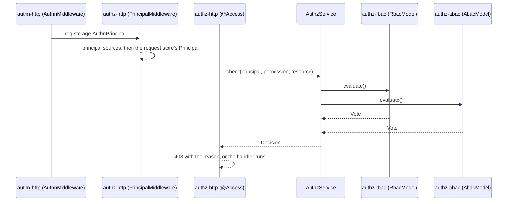

# How a check works

A check answers one question: may this principal do this action on this resource? `AuthzService.check()` runs the engine (`Authorizer`), which asks the authorization models of the domain, combines their votes and returns a `Decision`. Read this page first: every other page builds on its terms.

## Concepts

| Term | What it is | Type |
| --- | --- | --- |
| Principal | The caller: `user`, `anonymous`, `unattended`, `system`, `service`, `link`, `agent`, `group`, or an app type. It may carry a `ceiling`, an `onBehalfOf` principal, `companions`, `attributes` and the `authn` facts. `@spinajs/authn` defines it; `@spinajs/authz` re-exports it. | `Principal` |
| Resource | A reference `{ type, id? }`. No `id` means the whole type ("some row", a list). `GLOBAL` is `{ type: '$global' }`, the root of every resource tree. | `ResourceRef` |
| Permission | A name `resource:action`, such as `invoice:approve`. It must be registered ([Declaring permissions](02-permissions.md)). | `Permission`, `PermissionDef` |
| Model | A plug-in that votes on a check: RBAC (`@spinajs/authz-rbac`), ABAC (`@spinajs/authz-abac`) or your own ([Writing a model](08-writing-a-model.md)). The core knows no model. | `AuthorizationModel` |
| Vote | One model's answer: a `permitWhen` and a `denyWhen` filter, deny reasons, roles, fields and an expiry. | `Vote` |
| Residual filter | A predicate over one resource, such as `owner = me`. `TRUE` is "allowed on every row", `FALSE` is "denied". | `ResourceFilter` |
| Decision | The result: `allowed`, the `residual`, readable and writable `fields`, effective `roles`, the deny `reason`, `validUntil` and an optional `trace`. | `Decision` |
| Domain | A child DI container with its own models and config. The root domain is `root` ([Domains](05-domains.md)). | `AuthzDomains` |

`allowed: true` with a residual other than `TRUE` is a conditional allow: "yes, if the row matches". Pass the row (the `subject`) to get a definite answer ([Checking permissions](03-checking-permissions.md#conditional-allows)).

## How it works

1. **Entry.** Code calls `AuthzService.check(input)` (or `can`, `assert`, `checkMany`, `checkAll`). `DefaultAuthzService` hands the request to `Authorizer.check()` with the request's L1 cache, a `Map` kept in the async request store under `AuthzCache`. A call outside a request gets a fresh map.
2. **Permission.** `Authorizer.pipeline()` looks the permission up in the domain's registry. An unregistered name throws `UnknownPermission`. `fresh: true` on the input, or `consistency: 'fresh'` on the permission, marks the check fresh.
3. **Resource.** No resource means the type-level ref `{ type: <resource part of the permission> }`. An object goes to the first `ResourceAdapter` whose `accepts()` is true; its `refOf()` gives the ref and the object becomes the subject. A `{ type, id? }` object is used as the ref. A type outside the permission's `types` (other than `$global`) throws `AuthzConfigError`.
4. **Route.** The route table gives the combining algorithm and the models for `(permission, type)`, from `authz.combine`. A pair with no route runs `deny-overrides` over no model, so it denies `no_access`.
5. **Principal gate.** `SYSTEM` (the exported object itself) is allowed at once: no model runs, every field except `neverRead` is granted, and the check is audited as `system`. A non-object, `UNATTENDED`, or any principal of type `system` or `unattended` that is not the singleton is denied `unattended`.
6. **Delegation.** A principal with `onBehalfOf` is resolved with `resolveDelegation()`. `intersect` (the default) also runs the delegate's own check later and ANDs it in; `inherit` runs the models as the delegate with the agent as the actor. A chain longer than `authz.engine.maxDelegation`, or a cycle, throws `AuthzConfigError`; a forbidden delegate denies `delegate`.
7. **Ancestors.** A ref with an `id` asks its adapter, else its `ScopeResolver`, for `ancestors(ref)`: `[self, parent, ..., GLOBAL]`. `null` denies `unknown_resource`. A type with neither gets `[ref, GLOBAL]`.
8. **Cache.** Without a subject, outside `explain` and when not fresh, the engine reads the L1 map, then the L2 `DecisionCache` ([Caching and change propagation](06-caching-and-change-propagation.md)). A hit ends the check.
9. **Ceiling.** The principal's `ceiling` (and each `inherit` delegate's) is applied before any model runs: permission globs, resources and expiry. A failing ceiling denies `ceiling` (or its own `reason`); a resource ceiling narrows the residual.
10. **Models.** The routed models are filtered by `capabilities.principalTypes`. Each runs `evaluate(req, ctx)` within `authz.engine.modelTimeoutMs`. Under `deny-overrides` they run concurrently; under `permit-overrides` and `first-applicable` they run in plan order and stop at the deciding vote. A model that throws, times out or returns a malformed vote is indeterminate: its vote becomes permit `FALSE`, deny `TRUE`, reason `model_error`.
11. **Combine and bind.** The `Combinator` of the algorithm merges the votes into one allow filter, ANDed with the ceiling. `principal.*`, `actor.*`, `env.*` and `scope.*` refs are bound to values. An `intersect` delegate's residual is ANDed in.
12. **Subject.** When the check has a subject, the residual is evaluated against the row and becomes `TRUE` or `FALSE`. A row that fails denies `residual_false`.
13. **Fields.** For an allow, the readable and writable fields are combined from the votes, minus `authz.fields.neverRead`, and intersected with an `intersect` delegate's fields.
14. **Reason.** For a denial, the reason with the lowest `(priority, sortKey)` among the core denials and the votes' true `denies` wins (B36). No candidate gives `no_access`, or `residual_false` after a subject.
15. **Finish.** The `Decision` is frozen. A denial is audited as `deny` (`authz.audit.denials`); an `explain` call attaches the trace and is audited as `explain`. A cacheable decision is stored in L1 and L2.



### In an HTTP request

The core runs the same flow whoever calls it. In an HTTP app the principal and the call come from other packages:



`AuthzService.current()` reads the principal from the same async request store (`Principal` key), so code below the route checks without passing the principal around.

## Combining algorithms

| Algorithm | Allow filter | Use |
| --- | --- | --- |
| `deny-overrides` (default) | `(OR permitWhen) AND NOT (OR denyWhen)` | Any deny beats any permit (B03). The only algorithm access plans accept. |
| `permit-overrides` | `OR (permitWhen AND NOT denyWhen)` per vote | A model that permits wins over another's deny. |
| `first-applicable` | The first vote whose `permitWhen OR denyWhen` is not `FALSE` decides | Ordered models, such as a job type that only RBAC judges. |

An indeterminate vote counts as permit `FALSE`, deny `TRUE` under every algorithm, so a failing model fails closed (B04). A custom algorithm is a `Combinator` ([Writing a model](08-writing-a-model.md#custom-combining-algorithm)).

## Deny reasons

The decision reports one reason: the lowest `priority`, then the lowest `sortKey`, whatever the order of the models. `DEFAULT_DENY_PRIORITY` holds the defaults; a code it does not list gets `UNKNOWN_DENY_PRIORITY` (500).

| Code | Priority | Raised by |
| --- | --- | --- |
| `unknown_resource` | 0 | Core: `ancestors()` answered `null`; `checkAll` found no row. |
| `unattended` | 0 | Core: the principal gate. |
| `anonymous` | 0 | <!-- TODO(docs-hook): verify which package raises 'anonymous' --> |
| `role_denied` | 150 | RBAC deny roles. |
| `ceiling` | 200 | Core: the principal's ceiling. |
| `delegate` | 200 | Core: a forbidden delegate, or an `intersect` delegate that is denied. |
| `no_access` | 400 | Core: no model permits. |
| `role_too_low`, `tag_missing`, `provenance` | 410, 420, 430 | RBAC. |
| `needs_subject` | 500 | A model whose deny needs the row when none was given. |
| `model_error` | 900 | Core: an indeterminate vote, a failed combinator, binder or field step. |
| `residual_false` | 900 | Core: the row did not match the residual. |
| `invalid_request` | 500 (not listed) | Core: a `checkAll` entry with an unregistered permission or a wrong type. |

## Configuration

| Key | Type | Default | Allowed values | Meaning |
| --- | --- | --- | --- | --- |
| `authz.combine.default.algorithm` | `string` | `'deny-overrides'` | a built-in or registered `Combinator` name | Algorithm for every type without its own entry. |
| `authz.combine.default.models` | `string[]` | every model of the domain | model names | Models routed by default, in order. |
| `authz.combine.types.<type>` | `{ algorithm, models? }` | none | as above | Algorithm and models for one resource type. |
| `authz.engine.modelTimeoutMs` | `integer` | `2000` | `>= 1` | Time a model's `evaluate`, `listPlan`, `preload` or an adapter load may take. |
| `authz.engine.maxDelegation` | `integer` | `2` | `>= 0` | Longest `onBehalfOf` chain. |
| `authz.engine.explain` | `boolean` | `false` | | Builds a trace for every check and logs it at debug. Only `explain()` attaches it to the decision. |
| `authz.fields.neverRead` | `string[]` | `['Password']` | field globs | Removed from `read` and `write` for every principal, `SYSTEM` included (B17). |
| `authz.fields.write.mode` | `string` | `'strip'` | `'strip'`, `'reject'` | What `@spinajs/authz-http` does with body fields the decision does not let the caller write. |

```ts
export default {
  authz: {
    combine: {
      default: { algorithm: 'deny-overrides', models: ['rbac', 'abac'] },
      types: { job: { algorithm: 'first-applicable', models: ['rbac'] } },
    },
    engine: { explain: false, modelTimeoutMs: 2000, maxDelegation: 2 },
    fields: { neverRead: ['Password'], write: { mode: 'strip' } },
  },
};
```

`combine` is taken whole from the nearest domain that sets it; it is never merged key by key.

## Services and extension points

| Service | DI token and lifetime | Default implementation | Alternatives | How to replace or extend |
| --- | --- | --- | --- | --- |
| `AuthzService` | `AuthzService`, `@PerChildInstance`: one per domain container | `DefaultAuthzService` | none | Not meant to be replaced; extend the engine through models, adapters and combinators. |
| `Authorizer` | not in DI; `DefaultAuthzService` builds one per domain at boot | `Authorizer` | none | Exported for tests and harnesses. |
| `Combinator` | `Combinator`, every registration of the domain's container chain | `DenyOverrides`, `PermitOverrides`, `FirstApplicable` (built in, not in DI) | your own | `DI.register(MyCombinator).as(Combinator)` before the domain boots; name it in `authz.combine` ([Writing a model](08-writing-a-model.md#custom-combining-algorithm)). |
| `AuthzClock` | `AuthzClock`, `@Singleton` | `SystemClock` | `ManualClock` in `@spinajs/authz-testing` | `DI.register(MyClock).as(AuthzClock)` before the domain boots. Every instant of a check (`env.now`, expiry, cache TTL) comes from it. |

## Important behaviour

- **Fail closed.** A thrown or timed-out model, a malformed vote, a failed combinator, binder or field step all deny with `model_error` and are never cached.
- **`SYSTEM` and `UNATTENDED` are recognised by identity.** A copy of `SYSTEM` with `type: 'system'` is denied `unattended`. Code with no principal (CLI, cron, queue) gets `UNATTENDED` from `current()` and every check denies it (H2, B09). Use `runAs(SYSTEM, reason, fn)` on purpose.
- **A permission without a model denies.** A route with no model for a pair answers `no_access`. When every combine entry lists its models, boot logs a warning for each model none of them lists.
- **The ceiling runs before the models** and cannot be widened by them. A malformed ceiling denies `ceiling`.
- **`can()` returns `allowed`**, which is true for a conditional allow. See [Conditional allows](03-checking-permissions.md#conditional-allows).

## Related

- [Checking permissions](03-checking-permissions.md): every method that starts this flow.
- [Caching and change propagation](06-caching-and-change-propagation.md): the cache steps in detail.
- [Writing a model](08-writing-a-model.md): what a model must return.
- [storage-and-check-flow.md](storage-and-check-flow.md): file-by-file map of the pipeline and the tables of the family.
- [`@spinajs/authn`](../authn/README.md): where the principal comes from; see [Principal and authz](../authn/07-principal-and-authz.md).
