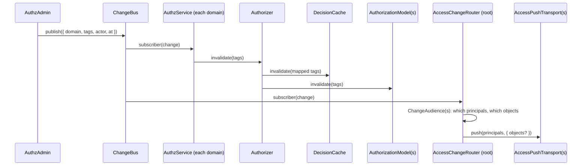

# Caching and change propagation

The engine caches decisions at two levels and drops them by tag when authorization data changes. A change travels from the writer (`AuthzAdmin`) over a `ChangeBus` to every domain's cache, and from there to connected clients as an `authz.changed` event.

## How it works

### Reading

1. **Key.** A check without a subject, outside `explain` and not fresh gets a decision key: domain, the principal's state (type, id, `authenticated`, `source`, `onBehalfOf`, `delegation`, `companions`, `ceiling`, `attributes` and the keyed `authn` facts), the actor, the permission, the ref and the version vector of the domain's models (`model.version()`). `principal.identity` is never part of it. A principal whose state cannot be read canonically is not cached.
2. **L1.** The request scope's map (the `AuthzCache` key of the async request store) is read first. Its entries die with the request, after their TTL, or when the engine's generation moves.
3. **L2.** On an L1 miss the domain's `DecisionCache` is read. A hit must match the domain, permission, ref and principal and must not be past `validUntil`; it is copied into L1 and audited like a fresh decision.

### Storing

4. A decision is stored only when it is cacheable: no vote is `cacheable: false`, no model faulted, no `env`-bound or `identity`-bound ref, and the TTL is positive.
5. The TTL is `min(authz.cache.ttlSeconds, validUntil - now)`. Models set `validUntil` from expiring grants, so a decision never outlives the grant it rests on.
6. The L2 entry carries tags: `*`, `model:<name>` per routed model, `subject:<type:id>` (and `link:<id>`) for the principal, its companions and its `onBehalfOf` chain, and `scope:<type:id>` for the resource and each ancestor (`scope:*` for a type-level check).

### Invalidating

7. `AuthzAdmin` commits a batch, then publishes `AuthzChange { domain, tags, actor, at }` on the `ChangeBus` ([AuthzAdmin](10-authz-admin.md#how-it-works)).
8. Every domain's `DefaultAuthzService` is subscribed. A change for its domain or an ancestor domain calls `Authorizer.invalidate(tags)`.
9. `invalidate` moves the generation (every L1 entry and preload mark of older requests is dropped), maps the tags to L2 tags (`subject:`, `link:`, `model:` and `scope:` pass; `scope:` also drops `scope:*`; any other tag drops everything) and calls `model.invalidate(tags)` on each model.
10. A model whose `version()` changes also moves the generation, recompiles the route table and clears the L2.



### Pushing changes to clients

The root domain's `AccessChangeRouter` turns each change into one `AccessChangedEvent` per registered `AccessPushTransport`:

1. With no transport registered it does nothing.
2. A change with a `*` tag goes to every session. Otherwise every `ChangeAudience` names the principal keys (or `'*'`) and, when exact, the changed objects. No audience, or one that fails, means every session.
3. The event is `{ objects? }`; absent `objects` means "refetch everything". Transports send it under `AUTHZ_CHANGED_EVENT` (`'authz.changed'`).
4. Audiences and transports are resolved per change, so ones registered after boot count. A failing transport is logged; the change is already committed.

## Configuration

| Key | Type | Default | Allowed values | Meaning |
| --- | --- | --- | --- | --- |
| `authz.cache.maxEntries` | `integer` | `10000` | `>= 0` | Entries of the L2 `LruDecisionCache`; `0` turns the L2 off. |
| `authz.cache.ttlSeconds` | `number` | `60` | `>= 0` | Longest life of a cached decision; `0` turns L1 and L2 off. |
| `authz.bus.service` | `string` | the last `ChangeBus` registration (`InProcessChangeBus`) | a registered `ChangeBus` class name | The bus every domain subscribes to and `AuthzAdmin` publishes on. Root only. |
| `authz.permissions.<name>.consistency` | `string` | `'cached'` | `'cached'`, `'fresh'` | `'fresh'`: every check of the permission skips L1, L2 and the models' assignment caches. |

```ts
export default {
  authz: {
    cache: { maxEntries: 10000, ttlSeconds: 60 },
    bus: { service: 'QueueChangeBus' },   // several nodes: from @spinajs/authz-queue
    permissions: { 'invoice:delete': { consistency: 'fresh' } },
  },
};
```

## Services and extension points

| Service | DI token and lifetime | Default implementation | Alternatives | How to replace or extend |
| --- | --- | --- | --- | --- |
| `DecisionCache` | `DecisionCache`, a factory: one instance per domain, given `{ maxEntries, clock }` | `LruDecisionCache` | your own | `DI.register((c, opts) => new MyCache(opts)).as(DecisionCache)` before boot. It must be a factory: a cache an `Authorizer` already used fails the boot. |
| `ChangeBus` | `ChangeBus`, `@Singleton` | `InProcessChangeBus` (this process only) | `QueueChangeBus` in [`@spinajs/authz-queue`](../authz-queue/README.md) | Register a class and name it in `authz.bus.service`. |
| `AccessChangeRouter` | `@Singleton`, started by the root domain | `AccessChangeRouter` | none | Extend through audiences and transports. |
| `ChangeAudience` | `ChangeAudience`, every registration | `RbacChangeAudience` in `@spinajs/authz-rbac` | your own | `@Injectable(ChangeAudience)`; answer `{ principals: string[] \| '*', objects? }`. |
| `AccessPushTransport` | `AccessPushTransport`, every registration | SSE in `@spinajs/authz-http`, the socket in `@spinajs/http-socket` | your own | `@Injectable(AccessPushTransport)`; implement `push(principals, event)`. |

### `DecisionCache`: custom implementation

Replace the L2 to observe or bound it differently. The interface is synchronous (`get`, `set`, `invalidate`), so a remote store does not fit; wrap the shipped LRU instead.

```ts sample
import { DI } from '@spinajs/di';
import { DecisionCache, LruDecisionCache } from '@spinajs/authz';
import type { Decision, LruDecisionCacheOptions } from '@spinajs/authz';

/** The L2 with hit and miss counters for a metrics endpoint. */
export class CountingDecisionCache extends DecisionCache {
  hits = 0;
  misses = 0;
  private readonly inner: LruDecisionCache;

  constructor(opts: LruDecisionCacheOptions) {
    super();
    this.inner = new LruDecisionCache(opts);
  }

  get(key: string): Decision | undefined {
    const found = this.inner.get(key);
    if (found) this.hits++;
    else this.misses++;
    return found;
  }

  set(key: string, d: Decision, tags: readonly string[], ttlMs: number): void {
    this.inner.set(key, d, tags, ttlMs);
  }

  invalidate(tags: readonly string[]): void {
    this.inner.invalidate(tags);
  }
}

// A factory, so every domain gets its own instance.
DI.register((_c, opts?: LruDecisionCacheOptions) => new CountingDecisionCache(opts ?? {})).as(DecisionCache);
```

## Important behaviour

- **The in-process bus does not cross nodes.** With `InProcessChangeBus`, a change written on one node never invalidates another node's caches; they serve old decisions until their TTL. An app on several nodes sets `authz.bus.service: 'QueueChangeBus'`.
- **Each node pushes to its own clients only.** The router runs on every node that hears the change.
- **Fresh is not free.** A `fresh` check reads the store on every call. Model snapshots (role definitions, rules) may still be served until the bus delivers a change.
- **A failing cache never fails a check.** A `get` or `set` that throws is logged; an `invalidate` that throws stops L2 use until a full invalidation succeeds.
- **A decision with a subject is never cached**, and neither is any decision of an `explain` call.

## Related

- [How a check works](01-check-flow.md): where the cache steps sit.
- [AuthzAdmin](10-authz-admin.md): the writer that publishes changes.
- [`@spinajs/authz-queue`](../authz-queue/README.md): `QueueChangeBus` for several nodes.
- [`@spinajs/authz-http`](../authz-http/README.md): `GET /user/access/events` (SSE) and `X-Access-Epoch`.
- [`@spinajs/http-socket`](../http-socket/README.md): pushes `authz.changed` over sockets.
