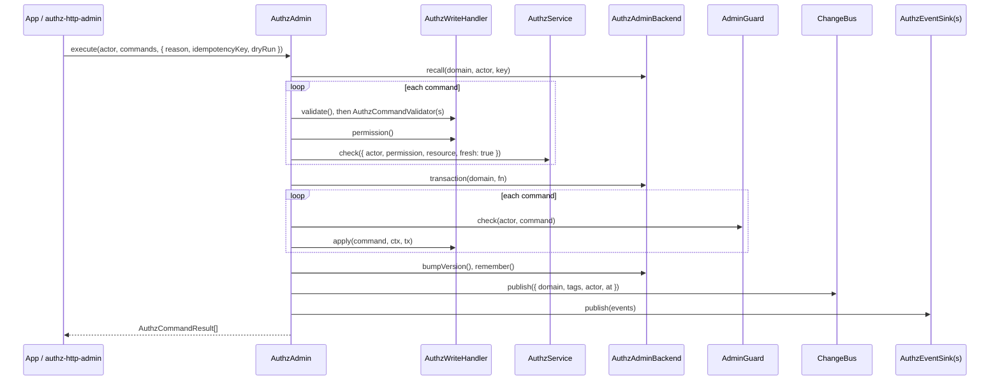

# AuthzAdmin

`AuthzAdmin` is the one write path for authorization data: role assignments, group membership, share links, rules, policies and scope attributes. It is a command bus: it validates each command, checks the actor's permission, runs a guard and applies the batch in one transaction, then invalidates caches, emits events and audits. No app writes `authz_*` tables directly (H22, B43).

The core owns the bus, scope attributes and `scope.forget`. The models own their commands: RBAC handles assignments, sets, links and rules ([`@spinajs/authz-rbac`](../authz-rbac/README.md)), ABAC handles policies ([`@spinajs/authz-abac`](../authz-abac/README.md)). [`@spinajs/authz-http-admin`](../authz-http-admin/README.md) serves it over HTTP.

## How it works

`DefaultAuthzAdmin.execute(actor, commands, opts)` (the sugar methods run one command through it):

1. **Setup.** On its first call it resolves the domain's `AuthzService`, the `AdminGuard` named by `authz.admin.guard.service`, the `AuthzAdminBackend` named by `authz.admin.backend` and the `authz.admin` keys, and keeps them; a setup that fails is retried on the next call. It publishes to, audits with and dates by the bus, audit and clock the domain's service booted with ([Domains](05-domains.md#services-and-extension-points)), so a later registration or config change does not reach it. With no guard configured every call throws `AuthzConfigError`: it fails closed.
2. **Batch.** A batch longer than `authz.admin.maxBatch` fails with `invalid_batch`. Each command is deep-copied and frozen, so the command checked is the command applied, audited and evented.
3. **Idempotency.** With `idempotencyKey`, a batch the backend already committed under `(domain, actor, key)` within 24 hours returns its stored results, unchanged.
4. **Phase A, outside the transaction.** For each command: the `AuthzWriteHandler` of its kind runs `validate()`, every `AuthzCommandValidator` runs, then the handler's `permission()` names the permission and resource. `authz.admin.permissions` may map it to another permission. The actor must be allowed **unconditionally** and **fresh** (no cache), else `forbidden`.
5. **Phase B, one transaction.** For each command the guard runs (`SYSTEM` skips it), then the handler's `apply()`. The guard sees the batch's own earlier writes. Then the backend bumps the domain's version and, with a key, stores the results.
6. **Failure.** The first `AuthzAdminFailure` rolls the batch back. The results list `ok: true, affected: 0` for the commands before it and the failure with its `code`, `message` and `field` at its index. Nothing is published. Any other error propagates.
7. **Dry run.** `dryRun: true` validates, guards and applies, then rolls back.
8. **After the commit.** It publishes one `AuthzChange` with the handlers' tags on the `ChangeBus` (caches drop their entries), sends the events to every `AuthzEventSink`, and writes one `admin` audit entry per command. Failures here are logged, never thrown: the batch is committed.



## Commands

| Kind | Handled by | Does |
| --- | --- | --- |
| `assignment.grant`, `assignment.revoke`, `assignment.revokeWhere`, `assignment.setTags`, `assignment.addTags`, `assignment.removeTags`, `assignment.setExpiry` | authz-rbac | Role assignments. |
| `set.addMember`, `set.removeMember` | authz-rbac | Members of subject sets (teams, groups). |
| `link.create`, `link.update`, `link.revoke` | authz-rbac | Share links. The token appears only in the command result, never in events, audit or the idempotency store. |
| `rule.put`, `rule.delete` | authz-rbac | Restrict, cap and threshold rules. |
| `policy.put`, `policy.delete` | authz-abac | ABAC policies. |
| `scope.setAttributes` | core `ScopeAttributeHandler` | Deep merge into a node's attributes; `null` removes a subtree. Validated against the type's schema. |
| `scope.replaceAttributes` | core `ScopeAttributeHandler` | Replaces a node's attributes. |
| `scope.forget` | core `ScopeForgetHandler` | Every model's data at one node (each `ScopeForgetter`), then its scope attributes. Data below the node needs one command per node. |

Sugar methods: `assign`, `revoke`, `createLink` (returns `{ link, token }`; a replayed key fails with `conflict`, because the token is shown once), `revokeLink`, `setTags`, `putRule`, `deleteRule`, `putPolicy`, `deletePolicy`, `setScopeAttributes`, `forgetScope`. Each throws `AuthzAdminFailure` instead of returning a failed result.

`list(actor, query)` reads for admin screens: `{ kind: 'assignments' | 'links' | 'rules' | 'policies' | 'attributes' | 'holders', scope?, ... }`. It checks `authz:<kind>.read` at the query's scope (mapped by `authz.admin.permissions` under `list.<kind>`), pages by `{ limit, offset }` (default 50, at most 500) and asks the `AuthzAdminReader` of the kind. Items never carry a link token or its hash. A `holders` query needs a `scope` and a `permission`; the RBAC reader refuses a page limit above 100 with `invalid_query` ([Holders](13-holders.md)).

## Permissions

A command needs its handler's permission at the command's scope, allowed unconditionally:

| Command family | Default permission |
| --- | --- |
| `assignment.*`, `set.*` | `authz:assignments.manage` |
| `link.*` | `authz:links.manage` |
| `rule.*` | `authz:rules.manage` |
| `policy.*` | `authz:policies.manage` |
| `scope.setAttributes`, `scope.replaceAttributes` | `authz:scope.manage` |
| `scope.forget` | `authz:scope.forget` |
| `list` of `<kind>` | `authz:<kind>.read` |

The core registers none of these names. Declare them in `authz.permissions` and grant them, or map each command to your own permission with `authz.admin.permissions`: an exact kind before its family (`assignment.*`), and within an entry the scope type before `*`.

## Configuration

| Key | Type | Default | Allowed values | Meaning |
| --- | --- | --- | --- | --- |
| `authz.admin.guard.service` | `string` | unset: every call fails | a registered `AdminGuard` class name | The guard. authz-rbac ships `DefaultAdminGuard` and sets it in its config. |
| `authz.admin.guard.privilegedPermission` | `string` | none | a permission name | Required unless both `preventSelfLockout` and `preventLastPrivilegedRemoval` are `false`. |
| `authz.admin.guard.protectSystemRole` | `boolean \| null` | `true` | | Read by the guard; `null` counts as on. The four switches default to `true` in the core schema. |
| `authz.admin.guard.preventEscalation` | `boolean \| null` | `true` | | Read by the guard. |
| `authz.admin.guard.preventSelfLockout` | `boolean \| null` | `true` | | Read by the guard. |
| `authz.admin.guard.preventLastPrivilegedRemoval` | `boolean \| null` | `true` | | Read by the guard. |
| `authz.admin.backend` | `string` | `'MemoryAuthzAdminBackend'` | a registered `AuthzAdminBackend` class name | Where batches run. `DbAuthzAdminBackend` (authz-rbac) uses the database. |
| `authz.admin.maxBatch` | `integer` | `100` | `>= 1` | Most commands per batch. |
| `authz.admin.permissions` | `object` | `{}` | `{ [kind or 'family.*']: permission \| { [scopeType or '*']: permission } }` | Maps commands to the app's permissions. |

```ts
export default {
  authz: {
    permissions: { 'authz:assignments.manage': {}, 'grants:manage': {} },
    admin: {
      guard: { service: 'DefaultAdminGuard', privilegedPermission: 'users:update' },
      backend: 'DbAuthzAdminBackend',
      maxBatch: 100,
      permissions: { 'assignment.*': { project: 'grants:manage' } },
    },
  },
};
```

The guard's rules (escalation, self-lockout, last holder, system roles) and `keepHolders` are documented with `DefaultAdminGuard` in [the authz-rbac admin guard page](../authz-rbac/09-admin-guard.md).

## Services and extension points

| Service | DI token and lifetime | Default implementation | Alternatives | How to replace or extend |
| --- | --- | --- | --- | --- |
| `AuthzAdmin` | `AuthzAdmin`, `@PerChildInstance`: one per domain | `DefaultAuthzAdmin` | none | Reach a domain's with `(await domains.service(name)).admin()`. |
| `AuthzAdminBackend` | `AuthzAdminBackend`, chosen by name | `MemoryAuthzAdminBackend` (in memory, one transaction at a time) | `DbAuthzAdminBackend` in authz-rbac | Register a class and name it in `authz.admin.backend`. |
| `AdminGuard` | `AdminGuard`, chosen by name | none in the core | `DefaultAdminGuard` in authz-rbac | Register a class and name it in `authz.admin.guard.service`. |
| `AuthzWriteHandler` | `AuthzWriteHandler`, every registration; one per kind | `ScopeAttributeHandler`, `ScopeForgetHandler` | RBAC and ABAC handlers | A model that owns new data registers a handler for new kinds. Two handlers for one kind fail. |
| `AuthzCommandValidator` | `AuthzCommandValidator`, every registration | `ListSupportValidator` | your own | Product rules on commands; throw `AuthzAdminFailure`. |
| `AuthzEventSink` | `AuthzEventSink`, every registration | `LogAuthzEventSink` | your own | Forward events (`RoleAssigned`, `RoleRevoked`, `ScopeAttributesChanged`, `ScopeForgotten`, ...). Every registered sink runs. |
| `AuthzAdminReader` | `AuthzAdminReader`, every registration; one per query kind | `ScopeAttributeReader` (`attributes`) | RBAC and ABAC readers | Answers `list()` for its kinds. |
| `ScopeForgetter` | `ScopeForgetter`, every registration | none in the core | RBAC and ABAC forgetters | Deletes a model's data at a node inside the `scope.forget` transaction. |
| `ListSupportGuard` | `ListSupportGuard`, every registration | none in the core | RBAC (rules), ABAC (policies) | Refuses a `rule.put` or `policy.put` that would make a `list: true` permission depend on the row (`not_list_filterable`). |
| `WritableScopeAttributeStore` | `WritableScopeAttributeStore`, the domain's registration | none | `DbScopeAttributeStore` (authz-orm), `MemoryScopeAttributeStore` | Register one instance under this token and `ScopeAttributeStore`. |

`forgetScopesInTx(container, scopes, tx, { actor, reason })` runs the `scope.forget` writes inside a transaction the caller owns, with no permission check, guard, version bump, publish or audit; authz-orm calls it when a resource row is deleted.

### Writing a handler

A handler gets the `AdminContext` that `AuthzAdmin` passes. These helpers keep handlers short:

| Helper | Use |
| --- | --- |
| `adminContainer(ctx)`, `adminActor(ctx)` | The domain container and the actor. |
| `requireAdminService(ctx, Token, who)` | Resolves a service from the domain container; throws `AuthzConfigError` naming `who` when the domain registers none. |
| `optionalAdminService(ctx, Token)` | The same, `undefined` when none is registered. |
| `readId`, `readRef`, `readScope`, `readNode`, `readPrincipal`, `readExpiry` | Copy a command field, or throw `AuthzAdminFailure` `invalid_command` naming the field. |
| `invalid(field, message)` | Builds that `invalid_command` failure. |

### `AuthzCommandValidator`: custom implementation

```ts sample
import { Injectable, Singleton } from '@spinajs/di';
import { AuthzAdminFailure, AuthzCommandValidator } from '@spinajs/authz';
import type { AdminContext, AuthzCommand, Principal } from '@spinajs/authz';

/** Contractors get access for a limited time only. */
@Singleton()
@Injectable(AuthzCommandValidator)
export class ContractorExpiryValidator extends AuthzCommandValidator {
  async validate(_actor: Principal, c: AuthzCommand, _ctx: AdminContext): Promise<void> {
    if (c.kind === 'assignment.grant' && c.role === 'contractor' && !c.expiresAt) {
      throw new AuthzAdminFailure('expiry_required', 'a contractor grant needs an expiry date', 'expiresAt');
    }
  }
}
```

The batch then answers `{ ok: false, kind: 'assignment.grant', error: { code: 'expiry_required', ... } }` and writes nothing.

### `AuthzEventSink`: custom implementation

3.0 ships no queue sink. An app that needs the events elsewhere registers its own:

```ts sample
import { Injectable, Singleton } from '@spinajs/di';
import { AuthzEventSink } from '@spinajs/authz';
import type { AuthzEvent } from '@spinajs/authz';

/** Sends every committed authz event to the security team's webhook. */
@Singleton()
@Injectable(AuthzEventSink)
export class WebhookAuthzEventSink extends AuthzEventSink {
  async publish(events: readonly AuthzEvent[]): Promise<void> {
    await fetch('https://hooks.example.com/authz-events', {
      method: 'POST',
      headers: { 'content-type': 'application/json' },
      body: JSON.stringify(events),
    });
  }
}
```

## Important behaviour

- **All or nothing.** A failed batch applies nothing, publishes nothing and reports the first failure with its index.
- **The actor's permission is checked fresh**, so an admin role revoked on another node is not honoured from a cache.
- **A conditional allow is not enough.** A command has no row to evaluate a residual against, so only `residual: TRUE` passes.
- **`SYSTEM` skips the guard** but not the permission check; `SYSTEM` is always allowed. It is audited.
- **Secrets never leave the result.** Keys matching `token`, `secret` or `password` are removed from events, audit entries and stored idempotent results.
- **The memory backend is per process.** `MemoryAuthzAdminBackend` keeps versions and idempotency keys in memory; memory stores write in place, so a reader outside the batch sees writes before the commit.
- **The version is bumped once per batch by the core**; handlers may bump it more. Do not rely on the count.

## Related

- [`@spinajs/authz-rbac`](../authz-rbac/README.md): assignment, set, link and rule commands, `DefaultAdminGuard`, `DbAuthzAdminBackend`.
- [`@spinajs/authz-abac`](../authz-abac/README.md): policy commands.
- [`@spinajs/authz-http-admin`](../authz-http-admin/README.md): `POST /authz/commands` and the REST routes over this service.
- [Caching and change propagation](06-caching-and-change-propagation.md): what happens after the commit.
- [Resource adapters and resolvers](09-adapters-and-resolvers.md#scope-attributes): scope attribute schemas.
