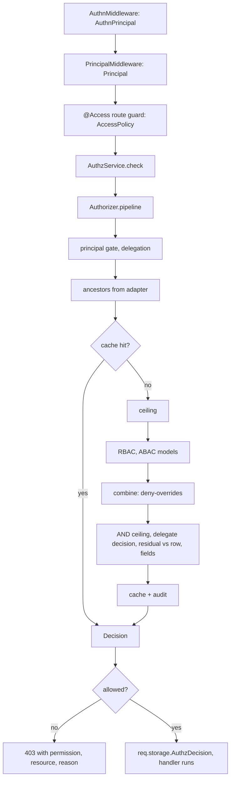

# Authorization internals: storage and check flow

This page describes where permission data lives and how a check reaches a decision. It is a map of
the current code, with file references, for people working on the authz packages. For
configuration and usage, read [the authz docs](./README.md); the check flow for users is
[How a check works](./01-check-flow.md). For how the `Principal` is built,
read [the authn internals page](../authn/01-authentication-flow.md).

Paths below are relative to `packages/`.

## Contents

- [What lives in config](#what-lives-in-config)
- [Permission names](#permission-names)
- [Tables](#tables)
- [Teams](#teams)
- [Store ports](#store-ports)
- [Check flow](#check-flow)
- [The RBAC model](#the-rbac-model)
- [The ABAC model](#the-abac-model)
- [Resource-level access](#resource-level-access)
- [ORM enforcement](#orm-enforcement)
- [Caching and invalidation](#caching-and-invalidation)
- [Admin writes](#admin-writes)
- [Other packages](#other-packages)

## What lives in config

Roles, ladders and permission definitions have no table. They are read from config:

| Key | Content |
|---|---|
| `authz.permissions` | Permission definitions (`host/config/schema.ts:44`) |
| `authz.combine` | Combining algorithm per resource type |
| `authz.rbac.roles.<name>` | `{ ladder, extends[], grants[], revoke[], implies[{role, at, tags, bypass}], subjectSet, deny, assignable, scopeTypes }` |
| `authz.rbac.ladders.<name>` | `{ roles[], resourceTypes? }` |
| `authz.rbac.*` | `rules[]`, `defaultRoles`, `anonymousRoles`, `serviceRoles`, `groupPrincipal`, `cache`, `maxSetDepth`, `stores` |
| `authz.abac.policies[]` | `Policy` objects (`authz/src/contracts/data.ts:63`) |
| `authz.fs.<filesystem>` | `{ mode: off/audit/enforce, domain, stampOwner, list, signedUrl }` |
| `authz.fsAcl` | `{ connection, relations }` |

The RBAC schema is in
[authz-rbac/src/stores/schema.ts:139-181](../../packages/authz-rbac/src/stores/schema.ts#L139-L181);
the grant schema at lines 25-40. A grant is a permission string, or:

```ts
{
  permission: 'document:update',
  relation: 'owner',                              // or 'self', a @Relation name, ...: resolved by a RelationResolver
  on: [{ type: 'project', id: '{principal.attributes.projectId}' }],
  fields: { read: [...], write: [...], hide: [...] },
  requiresTag: 'beta',
  grantedAt: 'project',
}
```

`ConfigRoleStore` reports a version that is the sha256 of `authz.rbac.roles` plus `ladders`, so a
config change changes cache keys.

## Permission names

- Format `resource:action`. Each part matches `[A-Za-z][A-Za-z0-9_.-]*`
  (`authz/src/contracts/permission.ts:29`).
- Globs are `*` or `<resource-glob>:<action-glob>`. `**` is not allowed.
- A `PermissionDef` carries `types`, `implies`, `fields`, `list` and `source`. Definitions come from
  config, from adapters and from models. The ORM adapter registers
  `<type>:read|create|update|delete` per resource model; authz-fs registers
  `fs:read|stat|list|write|delete|share|manage`.
- 3.0 has no `own`/`any` possession. "Own" is a grant with `relation: 'owner'` (or `'self'`), an
  `on` pattern, `fields`, `requiresTag` or `grantedAt`. `authz-convert` maps 2.x `verb:any` to a
  plain grant and `verb:own` to `relation:'owner'` (`'self'` for `selfResources`).

## Tables

None of the authz tables declares foreign keys.

### authz-rbac

[AuthzRbac_2026_10_01_00_00_00.ts](../../packages/authz-rbac/src/migrations/AuthzRbac_2026_10_01_00_00_00.ts),
connection `authz` (`db.Aliases.authz`, default `default`). Full schema:
[authz-rbac database storage](../authz-rbac/02-database-storage.md#schema).

**`authz_assignment`** (lines 10-30) holds every grant of a role to a subject at a scope.

| Column | Type | Notes |
|---|---|---|
| `id` | str(36) PK | |
| `subject_type` | str(32) | `user`, `team`, `link`, ... |
| `subject_id` | str(64) | |
| `subject_role` | str(128), default `''` | Empty for a principal; the set's role for a subject set |
| `subject_key` | str(200) | `type:id` or `type:id#role` |
| `role` | str(128) | |
| `scope_type` | str(64), default `$global` | |
| `scope_id` | str(64), default `''` | |
| `tags` | str(512), default `''` | Stored as `,a,b,` |
| `expires_at` | datetime | |
| `granted_by` | str(100) | |
| `source` | str(32), default `db` | Where the row came from; `DbAssignmentStore` writes `db` |
| `created_at` | datetime | |

Indexes: unique `authz_assignment_uq` on
`(subject_type, subject_id, subject_role, role, scope_type, scope_id)`; `authz_assignment_scope` on
`(scope_type, scope_id, role)`; `authz_assignment_expires` on `expires_at`;
`authz_assignment_subject` on `(subject_key, role)`.

| Table | Lines | Content |
|---|---|---|
| `authz_subject_membership` | 32-39 | Transitive closure of subject sets: PK `(member_key, set_key)`, `depth`, `expires_at`; index on `set_key` |
| `authz_rule` | 41-52 | Restrict, cap and threshold rules: `id` PK, `kind`, `scope_type`, `scope_id`, `definition` (JSON), `expires_at`, `created_by`, `created_at` |
| `authz_rule_subject` | 54-60 | PK `(rule_id, list, subject_type, subject_id, subject_role)` |
| `authz_link` | 62-74 | Share links: `id`, `token_hash` (unique, HMAC-SHA256 with `authz.rbac.links.secret`), `scope_type`, `scope_id`, `attributes`, `expires_at`, `revoked_at`, `created_by`, `created_at`. The link's grant is an `authz_assignment` row with subject `link:<id>` |
| `authz_version` | 76-79 | `domain` PK, `version` bigint. Bumped by every store write inside the admin transaction |

The stores and `DbAuthzAdminBackend` reach these tables only through the records in
`authz-rbac/src/stores/records.ts` (`AssignmentRecord`, `MembershipRecord`, `RuleRecord`,
`RuleSubjectRecord`, `LinkRecord`, `VersionRecord`) and `admin/db/record.ts` (`AdminIdempotencyRecord`).
Datetimes are luxon `DateTime` on a record and `Date` in the store API; the columns are the ORM's
`dateTime()` type and hold UTC instants (`TIMESTAMPTZ(3)` on PostgreSQL, ISO-8601 text on SQLite), and
the expiry filters compare them with the `AuthzClock` instant bound as a parameter; `definition` and `attributes`
are `@Json` columns; `authz_version.version` is `@Int64('string')`, the same text on every driver.

The other authz-rbac migration, `admin/db/AuthzAdminIdempotency_2026_10_02_00_01_00`, creates
`authz_admin_idempotency`: PK `(domain, actor, idem_key)`, `results`, `rows`, `expires_at`,
`created_at`. No authz-rbac migration reads or alters a 2.x table: 3.0 starts from an empty
database, and roles are granted as assignments.

### authz-abac

`AuthzAbac_2026_10_01_00_00_00.ts:11-29`, connection `authz`, creates **`authz_policy`**: `id` PK, `effect`,
`permissions` (globs), `resource_types`, `principal_types`, `actor_types`, `scope_type`,
`scope_id`, `condition`, `fields`, `reason`, `priority`, `expires_at`, `created_by`, `created_at`.
Index on `(scope_type, scope_id)`. Full schema:
[authz-abac database policy store](../authz-abac/06-database-policy-store.md#schema).

### authz-orm

Full schema of the ancestor and scope attribute tables:
[the `authz` connection and records](../authz-orm/03-authz-connection-and-records.md#schema).


| Table | Migration | Content |
|---|---|---|
| `authz_resource_ancestor` | `ancestors/AuthzResourceAncestor_2026_10_14_00_00_00.ts` | On connection `authz`: PK `(resource_type, resource_id, ancestor_type, ancestor_id)`, `depth`. Proper ancestors only, no self row and no `$global` row. Index on `(ancestor_type, ancestor_id)`. Kept current by `AncestorMiddleware` on writes. Read and written through `AncestorRecord` (`ancestors/record.ts`) |
| `authz_scope_attribute` | `scope-attributes/AuthzScopeAttribute_2026_10_02_00_00_00.ts` | On connection `authz`: PK `(scope_type, scope_id, path)`, `value_json`, `value_text`, `value_num` decimal(20,6), `updated_by`, `updated_at`. Read and written through `ScopeAttributeRecord` (`scope-attributes/records.ts`); `value_json` is a `@Json` column, but reads take the rows raw and parse it per row, so a value that is not JSON fails with an `AuthzConfigError` naming its path |
| `authz_scope_attribute_version` | same file | Single row: `id`, `version`. Read and written through `ScopeAttributeVersionRecord` |
| `authz_audit` | `audit/AuthzAudit_2026_10_01_00_00_00.ts` | On connection `authz-audit`: `id`, `at`, `kind`, `principal`, `permission`, `resource`, `reason`, `trace`; index on `at` |

### authz-fs

`AuthzFsAcl_2026_10_17_00_00_00.ts` creates **`fs_acl`** on the connection `authz.fsAcl.connection`
names (default `default`): `id` (PK), `fs`, `path`, `path_hash` (SHA-256 hex of the path),
`subject_key`, `relation`, `expires_at`, `granted_by`, `created_at`. `fs`, `path`, `path_hash`,
`subject_key` and `relation` are `exact()` (the driver's binary collation, so case variants of a path are two
rows). Unique key `(fs, path_hash, subject_key, relation)` and index `(fs, path_hash, relation)`; the hash
keeps the key under every driver's limit. See [File ACL](../authz-fs/03-file-acl.md).

## Teams

[Teams_2026_10_14_00_00_00.ts](../../packages/teams/src/migrations/Teams_2026_10_14_00_00_00.ts)
and `TeamsInvitations_2026_10_14_00_01_00.ts`:

| Table | Content |
|---|---|
| `teams` | `id`, `parent_id` (FK to `teams`), `slug` unique, `name`, `description`, `archived_at`, `deleted_at`, `created_by`, timestamps |
| `groups` | `id`, `team_id` (FK to `teams`), `parent_id` (FK to `groups`), `slug`, `name`. Unique `(team_id, slug)` |
| `team_invitations` | `team_id`, `group_id`, `role`, `email`, `token_hash` unique, `max_uses`, `uses`, `expires_at`, `revoked_at` |
| `team_invitation_uses` | `invitation_id`, `principal`, `used_at`; unique `(invitation_id, principal)` |

These foreign keys have no `ON DELETE CASCADE`.

Team membership has no table of its own. It is RBAC data:

- `Team` and `Group` are `@AccessResource` models with `@Parent` columns, so they appear in
  `authz_resource_ancestor`.
- A user joins a team through an `authz_assignment` row: role `team.member` at scope `team:<id>`.
  `team.member` and `group.member` are `subjectSet` roles, so the team itself can be a subject:
  `teamSet(id) = {set:{role:'team.member', scope:'team:<id>'}}` (`teams/src/subjects.ts`).
- Nested groups and sub-teams are set-to-set assignments (`teams/src/services/links.ts`). Their
  closure is `authz_subject_membership`.
- Roles, the ladder `team.member < team.admin < team.owner`, the deny policies for archived teams
  and the admin permission mapping are config in
  [teams/src/config/teams.ts](../../packages/teams/src/config/teams.ts#L16-L84).
- `principalTeams` (`teams/src/membership.ts`) combines `MembershipStore.setsOf` with
  `AssignmentStore.forSubjects`.

## Store ports

RBAC read ports are in `authz-rbac/src/contracts.ts`, admin write ports in
`authz-rbac/src/admin/ports.ts`.

| Port | Implementations |
|---|---|
| `RoleStore` (load, version) | `ConfigRoleStore` (default), `MemoryRoleStore` |
| `AssignmentStore`, `AdminAssignmentStore` | `DbAssignmentStore` (default; each write bumps the version), `MemoryAssignmentStore`, `MemoryAdminAssignmentStore` |
| `RuleStore`, `AdminRuleStore` | `ConfigRuleStore` (default), `DbRuleStore`, `MemoryRuleStore` |
| `LinkStore`, `AdminLinkStore` | `DbLinkStore` (default), `MemoryLinkStore` |
| `MembershipStore`, `AdminMembershipStore` | `DbMembershipStore` (default), `MemoryMembershipStore` |
| `SubjectResolver` | `RbacSubjectResolver` |
| `PolicyStore` (authz-abac) | `ConfigPolicyStore`, `DbPolicyStore`, `MemoryPolicyStore`; chosen by `authz.abac.stores` |
| `FileAclStore` (authz-fs) | `OrmFileAclStore` |

Defaults are in `authz-rbac/src/stores/defaults.ts`; override them with `authz.rbac.stores.*`.
Core ports (`ResourceAdapter`, `ScopeResolver`, `RelationResolver`, `ScopeAttributeStore`,
`DecisionCache`, `ChangeBus`, `DecisionAudit`) are in `authz/src/contracts/adapter.ts` and
`authz/src/contracts/service.ts`.

## Check flow



### 1. Principal

[`PrincipalMiddleware`](../../packages/authz-http/src/principals/middleware.ts#L33-L122) (order 10)
runs the `PrincipalSource`s in ascending order; the first non-null answer wins:

- `ServicePrincipalSource` (40): service header tokens.
- `AuthnPrincipalSource` (50): copies `req.storage.AuthnPrincipal`.
- `LinkPrincipalSource` (110): may replace the principal with a link principal and keep the
  original as a companion. A link principal's ceiling is `resources: [link.scope]`.

With no answer, the principal is `ANONYMOUS` when `authz.principals.anonymous.enabled` is on. The
result goes to `req.storage.Principal`, then `authz.preload(principal)` runs.

### 2. Route guard

[`@Access(permission | permissions[], options)`](../../packages/authz-http/src/access/decorators.ts#L38)
adds an `AccessPolicy`. Options: `resource` (`fromParam`, `fromBody`, `fromQuery`, `fromModel`),
`conditional: 'load' | 'action'`, `fields: 'filter'`, `domain`, `also`.

[`AccessPolicy.execute`](../../packages/authz-http/src/access/policy.ts#L67-L126):

1. 401 when there is no principal, or it is unauthenticated and the route lacks `@AllowAnonymous`.
2. Extracts the resource. The default is the type-level ref `{type: <permission resource>}`.
3. Calls `authz.check` per permission; one allowing permission is enough. A residual on a resource
   with an id is settled against the row the adapter loads, unless the rule says `conditional: 'action'`.
4. A denial becomes 403 `{error, permission, resource, reason}`. An allow is stored in
   `req.storage.AuthzDecision`.

Related: `@Unscoped(reason)` skips scoping and is audited; `AuthzFieldsMiddleware` filters fields.

The decorators live in `authz-http/src/access/decorators.ts` and `authz-orm/src/decorators.ts`,
exported from each package's `src/index.ts`. `src/api.ts` holds only the contract types.

### 3. Service

`AuthzService` (`authz/src/contracts/service.ts`) offers `check`, `can`, `assert` (throws
`AccessDenied`), `checkMany`, `checkAll`, `accessPlan`, `filter`, `filterNow`, `explain`,
`summary`, `covers`, `preload`, `runAs`, `invalidate` and `admin()`, and the optional `inspect`
(unaudited, uncached, for admin tools) and `ancestors`. `DefaultAuthzService`
(`authz/src/host/service.ts:106`) delegates to `Authorizer`.

### 4. Engine pipeline

[`Authorizer.pipeline`](../../packages/authz/src/engine/authorizer.ts#L1078-L1270):

1. Resolve the permission definition and the resource ref (from an object via the adapter's
   `refOf`).
2. Look up the route plan for `(permission, type)`. Without configuration the plan is
   `deny-overrides` with no models, so the default is deny.
3. `principalGate`: `SYSTEM` is allowed without running models. A non-object, `UNATTENDED`, or a
   `system`/`unattended` type that is not the singleton is denied `unattended`.
4. Delegation for `onBehalfOf` (intersect or inherit, `engine/delegation.ts`).
5. Build the decision cache key.
6. Load ancestors from the adapter. `null` is denied `unknown_resource`.
7. L1 then L2 cache lookup.
8. Apply the ceiling (`engine/ceiling.ts`).
9. Filter models by principal type, evaluate them, and combine.
10. AND the result with the ceiling and bind refs.
11. Intersect with the delegate's decision.
12. Evaluate the residual against the subject row, when given.
13. Compute fields, then pick the deny reason with the lowest priority
    (`contracts/decision.ts:81`).
14. `remember`: cache and audit. Denials are audited.

### 5. Combining

[`combinators.ts`](../../packages/authz/src/engine/combinators.ts#L21-L25):

- `DenyOverrides` = `(OR permitWhen) AND NOT (OR denyWhen)`.
- `PermitOverrides` and `FirstApplicable` are also available.
- A model that throws counts as permitWhen FALSE and denyWhen TRUE, so errors fail closed.

A `Decision` (`contracts/decision.ts:47`) has `allowed`, a `residual` filter (TRUE means
unconditional), `fields`, `roles`, `reason` and `validUntil`.

## The RBAC model

`RbacModel` (`authz-rbac/src/model/model.ts:57`). The gather phase
[`readRbacInput`](../../packages/authz-rbac/src/model/evaluate.ts#L414) builds:

- **Subjects**: the principal, its companions, the wildcard `type:*`, and for a `group` principal
  its member set.
- **Sets**: `SetsExtension` adds the sets the principal holds through its own assignments of
  `subjectSet` roles, plus nested sets from `MembershipStore.setsOf`. Team and group roles reach
  users this way.
- **Assignments** of those subjects from the store, plus config `anonymousRoles` and
  `serviceRoles`.
- **Path**: `[resource, ...ancestors, $global]`.
- Ladders, implied roles, sets and rules.

Steps then run in this order: collect (live assignments on the path, plus rows scoped below it for
type-level requests), memberships, implied roles, ranks, deny roles, restrict, cap, aggregate,
grant, tag, provenance, threshold, residual.

- Inheritance is the `extends` closure plus ladder edges, compiled with cycle refusal
  (`model/roles.ts`). `GrantIndex` is built in `model/grants.ts`.
- A role with `deny: true` beats every permit (`role_denied`, `model/deny.ts`).
- A grant's residual is its relation checks OR'd together, AND'd with its `on` patterns.

**Summaries.** `RbacModel.summarize(principal, at)` feeds `summary` and `covers`. It lists the roles
that hold at `at` after the ceiling and every permission a check would permit on some row. Each
permission runs the pipeline, so an entry agrees with the votes: it is `conditional` unless every
vote permits every row and denies none.

- At `$global` a permission is judged on `{ type: T }` for each of its types, so type and glob
  patterns and bare-type and scoped assignments count. It is listed when some type permits and does
  not deny everything, and its `fields` are the union over the permitting types.
- At any other `at` a permission is judged at `at`, if its types hold the type of `at`.
- `fields` are those of every grant that permits some row (`RBAC_SUMMARY_STEPS`), not the vote's own
  field rule, so an entry never shows fewer fields than the principal gets on a row.
- `roles` lists only the assignments that hold at `at` (at `$global`, the GLOBAL ones), after
  restrict and cap, each with its effective role. Permissions from bare-type or scoped assignments
  appear without their roles. At a bare type, rules that apply per row are not run, so `roles` there
  come before those rules.
- A rule that would apply per row of a type-level probe is left out of that probe, and the probe's
  permissions are listed as conditional. Rules only narrow, so nothing is lost.

## The ABAC model

`AbacModel` (`authz-abac/src/model/model.ts:46`, `evaluate` at lines 193-278):

- Policies are targeted by permission glob, resource and principal types, and scope.
- Conditions compile from the grammar in `authz/src/conditions/parse.ts`: `all`, `any`, `not`,
  `cmp`, `fn`, with refs to `principal.`, `actor.`, `resource.`, `env.` and `scope.<type>.`.
- permitWhen is the OR of permit policies, denyWhen the OR of deny policies.
- A deny that needs a row it does not have fails closed.

## Resource-level access

The only per-row ACL is the file ACL (`fs_acl`). Access to one resource comes from:

- an `authz_assignment` at that resource or at one of its ancestors. The engine walks
  `authz_resource_ancestor` for ORM models (`authz-orm/src/adapter.ts:62-86`) and path ancestors
  for files;
- a relation check on a grant: `@Owner`, `@Self` and `@Relation` columns on ORM models
  (`authz-orm/src/relations.ts`, [Column relations](./12-column-relations.md)), or `fs_acl` rows
  through `FsAclRelation` (`authz-fs/src/acl/`);
- a share link: an assignment to `link:<id>` at the link's scope.

## ORM enforcement

- [`AccessListMiddleware`](../../packages/authz-orm/src/lists/middleware.ts) turns
  `.accessible(perm)` into an `accessPlan`. `planFilter` (`lists/render.ts`) applies it to the query
  builder through the registered `PlanTermCompiler`s (`plan/index.ts`): permit terms OR-ed, deny
  terms under `whereNot()`, all built in a detached group, then AND'd with the caller's `where` by
  `restrict()`. Expiry is the database's now (`PlanRow.now()`). `.withAccess([...])` adds one
  `selectCondition()` boolean column per permission; `.within(refs)` is a correlated `whereExist()`
  on `authz_resource_ancestor`. Details: [Access lists](../authz-orm/01-access-lists.md) and
  [Plan term compilers](../authz-orm/02-plan-term-compilers.md).
- [`AccessGuardMiddleware`](../../packages/authz-orm/src/guard/middleware.ts#L58-L88) throws in
  test and warns in development when an `@AccessResource` model is selected without
  `.accessible`, `.unscoped` or SYSTEM. A single primary-key load is exempt. The warning names the
  first stack frame outside `di`, `util`, `orm`, any `orm-*` package, `authz` and `authz-orm`.

## Caching and invalidation

- L1 is per request (`run.scope`). L2 is `LruDecisionCache` (`authz/src/engine/cache.ts`), indexed
  by tags: `*`, `model:<m>`, principal tags and `scope:<key>` for the resource and its ancestors
  (`engine/cache-key.ts`).
- Cache keys include each model's `version()`. RBAC's version is the role store version; the RBAC
  model also keeps its own assignment cache with a TTL (`authz-rbac/src/model/cache.ts`).
- An admin commit bumps `authz_version` and publishes `AuthzChange{domain, tags}` on the
  `ChangeBus`. `DefaultAuthzService.onChange` calls `Authorizer.invalidate`, which bumps the
  generation, clears L2 by tag and calls `model.invalidate`.
- `InProcessChangeBus` is the default. `QueueChangeBus` from authz-queue spans nodes (select it with
  `authz.bus.service`).
- Clients hear about changes through the push router (`authz.changed`) and the SSE stream
  `GET /user/access/events`.
- A fresh check (`DecisionRequest.fresh`, or a permission with `consistency: 'fresh'`) reads neither
  L1 nor L2 and passes `fresh` to the models; `RbacModel` then reads assignments from the store past
  its request memo and `AssignmentCache` (`authz-rbac/src/model/cache.ts`), and the rows it reads
  refresh both. An access plan of a `consistency: 'fresh'` permission skips the L1 plan memo, sets
  `ListPlanRequest.fresh` for `listPlan`, and runs the models' nested checks fresh.

## Admin writes

[`AuthzAdminController`](../../packages/authz-http-admin/src/controllers/AuthzAdminController.ts#L87-L422),
base path `/authz`. The route policy is only `IsAuthenticated`; all permission and guard checks
happen in `AuthzAdmin`.

| Route | Purpose |
|---|---|
| `POST commands` | Batch `{commands, reason, idempotencyKey, dryRun}` |
| `GET`, `POST`, `PATCH /:id`, `DELETE /:id` on `assignments` | Role assignments |
| `GET`, `POST`, `PATCH /:id`, `DELETE /:id` on `links` | Share links |
| `GET`, `PUT /:id`, `DELETE /:id` on `rules` | Rules |
| `GET`, `PUT /:id`, `DELETE /:id` on `policies` | ABAC policies |
| `GET`, `PATCH`, `PUT` on `scopes/:type/:id/attributes` | Scope attributes |

Command kinds (`schemas/commands.ts:51`): `assignment.*`, `set.addMember`, `set.removeMember`,
`link.*`, `rule.*`, `policy.*`, `scope.setAttributes`, `scope.replaceAttributes`, `scope.forget`.

[`DefaultAuthzAdmin.run`](../../packages/authz/src/admin/admin.ts#L230-L319):

1. Phase A: validate, then require an allowed, unconditional permission, mapped by
   `authz.admin.permissions` (default `authz:*`).
2. Phase B, in one transaction: `AdminGuard.check` (`DefaultAdminGuard` in
   `authz-rbac/src/admin/guard.ts`: escalation, last holder, self-lockout), apply the command,
   bump the version.
3. After commit: publish on the `ChangeBus`, run event sinks, write the audit record.

Other routes in authz-http: `GET /user/access` (summary), `POST /user/access/checks`,
`GET /user/access/events` (SSE), and `GET /authz/explain`, which is off in production.

## Other packages

- **authz-queue**: `AuthzQueueHook` stamps `message.Initiator` (type, id, ceiling) on emit.
  Handlers run as `UNATTENDED` unless `runAs` is `'initiator'` or `'system'`. The
  `@spinajs/authz-queue/jobs` subpath registers `JobModel` as resource `job` with the initiator as
  owner, and every user gets `job:read` with `relation: 'owner'`.
- **Audit**: `DecisionAudit.record` takes kinds `deny`, `runAs`, `unscoped`, `explain`, `system`
  and `admin`. The default writes to the log (`host/audit.ts`); `authz-orm/src/audit/db-audit.ts`
  writes to `authz_audit`.
- **authz-convert**: a one-shot CLI that turns 2.x accesscontrol config into 3.0 config files. It
  stores nothing at run time.
