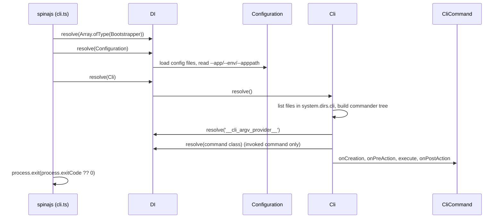

# Running the CLI

The `spinajs` bin boots the framework, builds the command tree from every discovered command and runs the one named on the command line. Use it from a terminal, an npm script or a CI step.

## How it works

1. **Entry.** `spinajs` runs `lib/cli.js` (`src/cli.ts`). Its import of `args.js` registers the default [argv provider](06-argv-provider.md) under `'__cli_argv_provider__'`.
2. **Module loading.** `@spinajs/di` loads every scanned file with `import()`.
3. **Bootstrappers.** `DI.resolve(Array.ofType(Bootstrapper))` returns every `Bootstrapper` registered by the modules loaded so far; the bin awaits `bootstrap()` on each.
4. **Configuration.** `await DI.resolve(Configuration)` loads every config file, including each `@spinajs/*` package's `system.dirs.cli` entry, and reads `--app`, `--env` and `--apppath` from `process.argv`.
5. **Logger.** `resolveCliLog()` returns the framework `Log` named `CLI` when an implementation is registered, else `InternalLoggerProxy`. It logs `Welcome to spinajs cli...` at `success` level.
6. **Run.** `await DI.resolve(Cli)` runs [`Cli.resolve()`](07-cli-service.md): it lists the command files, builds the commander tree and parses argv. The chosen command's `execute()` runs inside this call.
7. **Exit.** On success the bin calls `process.exit(process.exitCode ?? 0)`. On an error in any of steps 3 to 6 it logs the message (unless it is a `CommanderError`, which commander already logged) and calls `process.exit(-1)`. Before step 5 there is no logger yet, so the error goes to `console.error`.



## Command line

| Form | Result |
| --- | --- |
| `spinajs` | Prints the program help, exit code `0` |
| `spinajs --help`, `spinajs <command> --help` | Prints help to stdout, exit code `0` |
| `spinajs --version` | Prints the installed `@spinajs/cli` version, exit code `0` |
| `spinajs <command> [args] [options]` | Runs the command |
| `spinajs <parent> <child> [args] [options]` | Runs a [subcommand](02-commands.md#subcommands) |

The program is named `spinajs` with the description `SpinaJS command line interface`; neither is configurable.

### Framework options

These options belong to `@spinajs/configuration`. The default argv provider removes them before commander parses, so commands never see them and never reject them as unknown.

| Option | Forms removed | Purpose |
| --- | --- | --- |
| `--app` | `--app web`, `--app=web` | Selects the application whose config is loaded |
| `--env` | `--env production`, `--env=production` | Selects the environment |
| `--apppath` | `--apppath ./apps`, `--apppath=./apps` | Overrides the applications base directory |
| `--config-path` | `--config-path ./deploy/config`, `--config-path=./deploy/config` | Adds one config folder, as the `cfgCustomPaths` option does |

## Exit codes

| Situation | Exit code | Output |
| --- | --- | --- |
| Command finished, `process.exitCode` unset | `0` | Command output |
| Command finished and set `process.exitCode` | That value | Command output |
| Help, version, or no arguments | `0` | Help or version on stdout |
| Unknown command or option, missing required argument or option, value outside `choices`, conflicting options | `-1` (255 on POSIX) | Commander's message through `Log.error`, with a "did you mean" suggestion where one fits |
| `execute()` or a hook throws | `-1` | The error message through the `CLI` logger |
| The invoked command cannot be resolved from DI | `-1` | `Cannot resolve command ...` plus the error message |
| A bootstrapper or the configuration throws | `-1` | The error through `console.error`; no logger exists yet |

## Built-in command: `configuration:dump`

`DumpConfiguration` (`src/cli/DumpConfig.ts`) ships in this package's own command directory.

| Command | Option | Effect |
| --- | --- | --- |
| `configuration:dump` | `-p, --path <path>` | Logs the whole merged configuration (`Configuration.RootConfig`), or the value at the dotted `path`, as indented JSON through the `cli` logger at `info` level |

It is not exported from `@spinajs/cli`.

## Important behaviour

- `--help` and `--version` resolve `Cli` cleanly: commander throws a `CommanderError` with `exitCode` `0`, and `Cli.resolve()` swallows it.
- `--version` reads `@spinajs/cli/package.json` through `createRequire` anchored at `process.cwd()`. Run outside a project that has `@spinajs/cli` installed, it prints `0.0.0`.
- The welcome line is logged before every run, also before `--version` output. Pipe-friendly commands should write their result to stdout with `console.log`, as `@spinajs/orm-cli`'s `migrate-status` does, and not rely on being the only output.
- Only the invoked command and the commands on its dispatch path (its parents) are resolved from DI. A command whose dependencies are unavailable, eg. a database, does not break other commands. See [Commands](02-commands.md#how-it-works).
- `process.exit()` runs right after the command resolves. Work the command started but did not await (timers, open sockets, unflushed streams) is cut off.
- `configuration:dump` logs every configuration value, including secrets, to every configured log target.

## Best practices

- Report a condition with `process.exitCode = 1` and return, instead of throwing. The bin honours it and the output stays clean.
- Await everything in `execute()`. The bin exits as soon as `execute()` settles.
- Pass `--app` and `--env` to every `spinajs` call in CI, so the command reads the same config as the deployed app.
- Use `configuration:dump -p <path>` to check what a command will read, eg. `spinajs configuration:dump -p system.dirs.cli`.

## Patterns and antipatterns

```ts
// Don't: throwing for an expected result logs an error line and exits with -1, which CI cannot tell apart from a crash
public async execute(): Promise<void> {
  if (pending.length > 0) throw new Error('migrations pending');
}

// Do
public async execute(): Promise<void> {
  if (pending.length > 0) {
    console.log(`${pending.length} migrations pending`);
    process.exitCode = 1;
  }
}
```

## Examples

### Fail a CI step when a backup is older than a day

```ts sample
import { statSync } from 'fs';
import { CliCommand, Command, Option } from '@spinajs/cli';

interface BackupCheckOptions {
  file: string;
  maxAgeHours: number;
}

// spinajs backup:check --file /var/backups/db.sql.gz --env production
@Command('backup:check', 'Exits with code 1 when the backup file is missing or too old')
@Option('-f, --file <file>', true, 'backup file to check')
@Option('-m, --max-age-hours <hours>', false, 'maximum age in hours', 24, (v) => parseInt(v, 10))
export class BackupCheckCommand extends CliCommand {
  public async execute(options: BackupCheckOptions): Promise<void> {
    let ageHours: number;
    try {
      ageHours = (Date.now() - statSync(options.file).mtimeMs) / 3_600_000;
    } catch {
      console.log(`MISSING ${options.file}`);
      process.exitCode = 1;
      return;
    }

    console.log(`${ageHours > options.maxAgeHours ? 'STALE' : 'OK'} ${options.file} (${ageHours.toFixed(1)}h)`);
    if (ageHours > options.maxAgeHours) {
      process.exitCode = 1;
    }
  }
}
```

### npm scripts

```json
{
  "scripts": {
    "config:dump": "spinajs configuration:dump --env development",
    "migrate": "spinajs migrate-up --app api --env production"
  }
}
```

## Related

- [Command discovery](05-command-discovery.md): which files the bin loads as commands.
- [Argv provider](06-argv-provider.md): what argv the parser receives.
- [`Cli` service](07-cli-service.md): run the same flow from your own entry point.
