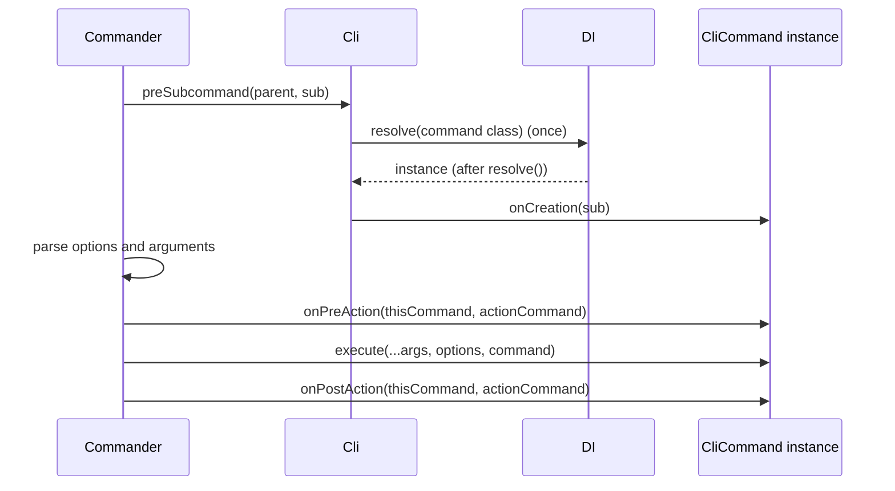

# Lifecycle hooks and commander access

`CliCommand` has three hooks you override: `onCreation` to change the raw commander command before it parses, and `onPreAction` / `onPostAction` to run code around `execute()`. The commander classes and types you need in them are re-exported from `@spinajs/cli`.

## How it works

For `spinajs <command> ...`:

1. **Select.** Commander matches `<command>` and fires the parent's `preSubcommand` hook, which `Cli` registered on the program and on every command.
2. **Resolve.** The hook resolves the command instance with `DI.resolve()` (memoized for the run), including its async `resolve()`.
3. **`onCreation(command)`.** Called with the commander `Command` of the selected command, before it parses its own arguments and options. Changes made here apply to this run's parsing and `--help`.
4. **Parse.** Commander parses options, reads `env`, applies `implies`, checks required and conflicting options, then processes arguments. Errors here stop the run before any action hook.
5. **`onPreAction(thisCommand, actionCommand)`.** Commander runs every `preAction` hook from the program down to the invoked command. `thisCommand` is the command whose instance the hook belongs to; `actionCommand` is the command about to run.
6. **`execute(...)`.**
7. **`onPostAction(thisCommand, actionCommand)`.** The same hooks in reverse order: the invoked command first, then its parents.

For `spinajs db migrate`, the order is:

```
db.onCreation(db) -> migrate.onCreation(migrate)
db.onPreAction(db, migrate) -> migrate.onPreAction(migrate, migrate)
migrate.execute(...)
migrate.onPostAction(migrate, migrate) -> db.onPostAction(db, migrate)
```



## Services and extension points

| Service | DI token and lifetime | Default implementation | Alternatives | How to replace or extend |
| --- | --- | --- | --- | --- |
| `CliCommand.onCreation(command: CommanderCommand): void \| Promise<void>` | method on the command instance | no-op | none | Override; may be async, `Cli` awaits it before the command parses |
| `CliCommand.onPreAction(thisCommand, actionCommand): void \| Promise<void>` | method on the command instance | no-op | none | Override; may be async, commander awaits it |
| `CliCommand.onPostAction(thisCommand, actionCommand): void \| Promise<void>` | method on the command instance | no-op | none | Override; may be async, commander awaits it |

### Re-exported commander API

`@spinajs/cli` re-exports commander 10 so commands do not depend on `commander` directly. The three classes whose names collide with this package's decorators get a `Commander` prefix.

| Export | commander name | Kind |
| --- | --- | --- |
| `CommanderCommand` | `Command` | class |
| `CommanderOption` | `Option` | class |
| `CommanderArgument` | `Argument` | class |
| `Help` | `Help` | class |
| `CommanderError` | `CommanderError` | class |
| `InvalidArgumentError` | `InvalidArgumentError` | class |
| `createCommand`, `createOption`, `createArgument` | same | functions |
| `CommandOptions`, `ExecutableCommandOptions`, `OptionValues`, `OptionValueSource`, `HookEvent`, `HelpConfiguration`, `OutputConfiguration`, `ParseOptions`, `AddHelpTextPosition` | same | types |

### `onCreation`: add what the decorators cannot express

Use it for commander features without a decorator field: hidden options, variadic options, an `Option` built with `createOption`, extra help sections that depend on runtime state.

```ts sample
import { Autoinject } from '@spinajs/di';
import { Configuration } from '@spinajs/configuration';
import { CliCommand, Command, CommanderCommand, CommanderOption, InvalidArgumentError } from '@spinajs/cli';

interface ReindexOptions {
  index: string[];
  shards: number;
  force?: boolean;
}

// spinajs search:reindex --index products --index customers --shards 4
@Command('search:reindex', 'Rebuilds search indexes')
export class ReindexCommand extends CliCommand {
  @Autoinject()
  protected Config: Configuration;

  public onCreation(command: CommanderCommand): void {
    const known = this.Config.get<string[]>('search.indexes', ['products', 'customers', 'orders']);

    command.addOption(
      new CommanderOption('-i, --index <name...>', 'indexes to rebuild')
        .choices(known)
        .makeOptionMandatory(true),
    );

    command.addOption(
      new CommanderOption('-s, --shards <n>', 'shards per index').default(1).argParser((v: string) => {
        const n = parseInt(v, 10);
        if (![1, 2, 4, 8].includes(n)) throw new InvalidArgumentError('Allowed: 1, 2, 4, 8.');
        return n;
      }),
    );

    command.addOption(new CommanderOption('--force', 'drop indexes even when a rebuild is running').hideHelp());
    command.addHelpText('after', `\nKnown indexes: ${known.join(', ')}`);
  }

  public async execute(options: ReindexOptions): Promise<void> {
    console.log(`Reindexing ${options.index.join(', ')} with ${options.shards} shard(s)${options.force ? ', forced' : ''}`);
  }
}
```

### `onPreAction` / `onPostAction`: wrap every subcommand from the parent

A parent's hooks run for each of its subcommands, so one parent can open and close a shared resource for the whole group. Check `actionCommand` to tell which command runs.

```ts sample
import { Log, Logger } from '@spinajs/log';
import { Argument, CliCommand, Command, CommanderCommand } from '@spinajs/cli';

@Command({ nameAndArgs: 'import', description: 'Data import commands' })
export class ImportCommand extends CliCommand {
  @Logger('import')
  protected Log: Log;

  private startedAt = 0;

  public onPreAction(_thisCommand: CommanderCommand, actionCommand: CommanderCommand): void {
    this.startedAt = Date.now();
    this.Log.info(`import ${actionCommand.name()} started`);
  }

  public onPostAction(_thisCommand: CommanderCommand, actionCommand: CommanderCommand): void {
    this.Log.info(`import ${actionCommand.name()} finished in ${Date.now() - this.startedAt} ms`);
  }

  public async execute(): Promise<void> {
    console.log('Run `spinajs import --help` to list import commands.');
  }
}

// In its own file: spinajs import products ./products.csv
@Command({ nameAndArgs: 'products', description: 'Imports products from a CSV file', parent: 'import' })
@Argument('file', true, 'CSV file')
export class ImportProductsCommand extends CliCommand {
  public async execute(file: string): Promise<void> {
    console.log(`importing products from ${file}...`);
  }
}
```

## Important behaviour

- `onCreation` may be async. `Cli` awaits it in the parent's `preSubcommand` hook, so options it adds after an `await` still apply to this run's parsing.
- `onCreation` runs only on the dispatch path. `spinajs --help` lists commands without calling it, so options and help text added there appear only in `spinajs <command> --help` and in that command's parsing.
- `onPostAction` does not run when `execute()` throws; commander stops the chain at the rejection. Release resources in `try`/`finally` inside `execute()` when they must always be released.
- Argument and option errors are raised before `onPreAction`, so a hook never sees invalid input.
- Hook errors are command errors: the run rejects and the bin exits with `-1`.

## Best practices

- Keep hooks for cross-cutting work (timing, audit lines, shared connections) and put the task itself in `execute()`.
- Import commander classes from `@spinajs/cli` (`CommanderOption`, `InvalidArgumentError`), not from `commander`. The versions then always match the parser `Cli` uses.

## Patterns and antipatterns

```ts
// Don't: execute() runs after parsing, which has already rejected --region as unknown
public async execute(options: { region?: string }, command: CommanderCommand): Promise<void> {
  command.addOption(new CommanderOption('--region <r>'));
}

// Do: add it in onCreation, which may be async and is awaited before parsing
public async onCreation(command: CommanderCommand): Promise<void> {
  const regions = await this.Api.regions();
  command.addOption(new CommanderOption('--region <r>').choices(regions));
}
```

## Related

- [Commands](02-commands.md): how the instance is resolved.
- [Arguments and options](03-arguments-and-options.md): the decorator fields that cover most cases.
- [commander documentation](https://github.com/tj/commander.js/tree/v10.0.0): the full API of the objects passed to the hooks.
