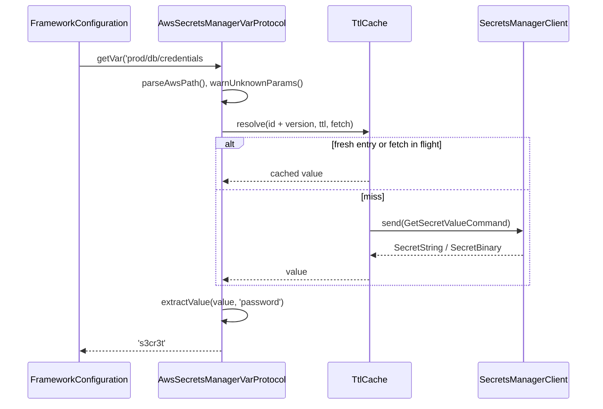

# Secrets Manager protocol

`aws-secrets://` replaces a config string with a secret from AWS Secrets Manager. Use it for passwords, API keys and other credentials you keep out of config files.

```
aws-secrets://<secretId>[?versionStage=<stage>][&versionId=<id>][&default=<value>|&optional=true][#<json.path>]
```

| Part | Meaning |
| --- | --- |
| `<secretId>` | Secret name or full ARN. Case-sensitive; colons in an ARN are kept. |
| `versionStage` | Version stage label, e.g. `AWSPREVIOUS`. |
| `versionId` | Exact version id. |
| `default`, `optional` | Fallback when the fetch fails. See [Fallbacks and failures](03-fallbacks-and-failures.md). |
| `#<json.path>` | Parse the secret as JSON and return one key; dot notation for nesting (`#db.password`). |

Query parameters follow one `?` and are joined with `&`. The id ends at the first `?` or `#`.

## How it works

1. Importing the package runs `@Singleton()` and `@Injectable(ConfigVarProtocol)` on `AwsSecretsManagerVarProtocol`: DI registers it under `ConfigVarProtocol` and as itself.
2. `FrameworkConfiguration.load()` merges all config sources and `onLoad()`, then calls `loadProtocolVars()`.
3. `loadProtocolVars()` resolves `DI.resolve(Array.ofType(ConfigVarProtocol))` and maps each instance by its `Protocol` getter (`'aws-secrets://'`).
4. It walks the config. For a string matching `<scheme>://<rest>` (web schemes such as `http://` skipped), it calls `protocol.getVar(rest, rawConfig)` and stores the result at that key. Strings of one object resolve in parallel.
5. `AwsSecretsManagerVarProtocol.getVar()` builds the `SecretsManagerClient` on its first call, from `aws.secretsManager` in the raw config.
6. `parseAwsPath()` splits the path into id, query parameters and JSON path; `warnUnknownParams()` logs every parameter other than `versionStage`, `versionId`, `default`, `optional`.
7. It builds `GetSecretValueCommand` input: `VersionId` and `VersionStage` as given, or `VersionStage: 'AWSCURRENT'` when neither is set.
8. `TtlCache.resolve()` returns a cached value for the same id and version, or sends the command. The raw result is `SecretString`, or `SecretBinary` as a `Buffer`.
9. With `#json.path`, `extractValue()` parses the value (string or UTF-8 binary) as JSON and returns the key. Without it, a string is returned as is, a binary secret as base64, a missing value as `''`.
10. A failed fetch goes to `resolveFallback()`. With no fallback the error is rethrown; `FrameworkConfiguration` logs it and keeps the raw `aws-secrets://...` string.



## Configuration

| Key | Type | Default | Allowed values | Meaning |
| --- | --- | --- | --- | --- |
| `aws.secretsManager` | object | `{}` | `SecretsManagerClientConfig` keys | Passed to `new SecretsManagerClient()`: `region`, `credentials`, `endpoint`, `maxAttempts`, ... |
| `aws.secretsManager.cacheTtl` | number (ms) | `300000` (`DEFAULT_CACHE_TTL`) | any number; `<= 0` disables caching | How long a fetched secret is reused. Removed before the client is built. See [Caching](04-caching.md). |
| `aws.secretsManager.logger` | - | - | - | Ignored: the client always logs through `createSdkLogger('AwsSecretsManagerVarProtocol')` into `InternalLogger`. |

```ts
aws: {
  secretsManager: {
    region: 'eu-central-1',
    maxAttempts: 5,
    cacheTtl: 60_000,
  },
},
```

## Services and extension points

| Service | DI token and lifetime | Default implementation | Alternatives | How to replace or extend |
| --- | --- | --- | --- | --- |
| `AwsSecretsManagerVarProtocol` | `ConfigVarProtocol` (one entry of the list) and `AwsSecretsManagerVarProtocol`; singleton; registered by decorators at import | itself | none shipped | Subclass it and `DI.unregister(AwsSecretsManagerVarProtocol)`; see [Replacing and extending](05-replacing-and-extending-the-aws-protocols.md) |
| `SecretsManagerClient` | not in DI; `protected Client` field | built on the first `getVar()` from `aws.secretsManager` | any client you assign | Assign `this.Client` in a subclass constructor |
| `TtlCache` | not in DI; `protected cache` field | `new TtlCache()` | any `TtlCache` | Override the field in a subclass; see [Caching](04-caching.md) |

## Important behaviour

- `SecretString` comes back as a string, even when it holds JSON. Add `#key` to get one value; the config layer does not parse JSON for you.
- `SecretBinary` comes back as a base64 string, because the config layer cannot hold a `Buffer`. With `#json.path` the binary payload is parsed as UTF-8 JSON first.
- A missing secret value (neither string nor binary) becomes `''`, so no config key stays `undefined`.
- A `#json.path` that names a missing key returns `''`. Array items are reachable by index: `#hosts.0`.
- A value that is not valid JSON makes `#json.path` throw `Cannot extract '<path>': value is not valid JSON (...)`. `?default=` and `?optional=true` cover this error like a failed fetch.
- The cache key is id plus `versionStage` plus `versionId`. All `#json.path` reads of one secret share one fetch.
- `my-secret` and `my-secret?versionStage=AWSCURRENT` use different cache keys and fetch twice, although AWS returns the same version.
- `versionId` and `versionStage` together are both sent; AWS decides whether they match.
- The client is built once per protocol instance. A later change of `aws.secretsManager` (region, credentials) takes effect only after a restart; `clearCache()` does not rebuild the client.
- `aws.secretsManager` is read from the raw config while other protocol values may still be loading. A protocol string inside `aws.secretsManager` (e.g. `region: 'aws-parameters://...'`) can reach the SDK unresolved.

## Best practices

- Store one JSON secret per resource (`prod/db/credentials` with `username`, `password`, `host`) and read keys with `#`. One fetch serves all of them.
- Pin `?versionStage=AWSPREVIOUS` only for a controlled rollback; the default `AWSCURRENT` follows rotation.
- Grant the runtime role `secretsmanager:GetSecretValue` on the secrets it reads, and `kms:Decrypt` when the secret uses a customer managed key.
- Keep `aws.secretsManager` plain: literal region and options, no protocol strings.

## Patterns and antipatterns

```ts
// Don't: three fetches of the same secret with different stages, and two `?` that make
// versionStage equal "AWSCURRENT?default=x"
db: {
  user: 'aws-secrets://prod/db/credentials?versionStage=AWSCURRENT#username',
  password: 'aws-secrets://prod/db/credentials?versionStage=AWSCURRENT?default=x#password',
  host: 'aws-secrets://prod/db/credentials#host',
},

// Do: one id, one fetch, parameters joined with &
db: {
  user: 'aws-secrets://prod/db/credentials#username',
  password: 'aws-secrets://prod/db/credentials#password',
  host: 'aws-secrets://prod/db/credentials?optional=true#host',
},
```

## Examples

### Read database credentials from one JSON secret

```ts sample
import '@spinajs/configuration-aws-secretmanager-protocol';
import { FrameworkConfiguration } from '@spinajs/configuration';
import { Configuration } from '@spinajs/configuration-common';
import { DI } from '@spinajs/di';

// prod/db/credentials holds {"username":"billing","password":"...","replica":{"host":"db-ro.internal"}}
export class BillingConfiguration extends FrameworkConfiguration {
  protected onLoad(): unknown {
    return {
      db: {
        user: 'aws-secrets://prod/db/credentials#username',
        password: 'aws-secrets://prod/db/credentials#password',
        replicaHost: 'aws-secrets://prod/db/credentials#replica.host',
      },
      stripe: {
        // binary secret, returned as base64
        webhookKey: 'aws-secrets://arn:aws:secretsmanager:eu-central-1:123456789012:secret:stripe-webhook-AbCdEf',
      },
      aws: {
        secretsManager: { region: 'eu-central-1', cacheTtl: 10 * 60 * 1000 },
      },
    };
  }
}

export async function databaseCredentials() {
  DI.register(BillingConfiguration).as(Configuration);
  const config = await DI.resolve<Configuration>(Configuration);

  return {
    user: config.get<string>('db.user'),
    password: config.get<string>('db.password'),
    replicaHost: config.get<string>('db.replicaHost'),
    webhookKey: Buffer.from(config.get<string>('stripe.webhookKey'), 'base64'),
  };
}
```

### Roll back to the previous secret version

```ts
db: {
  password: 'aws-secrets://prod/db/credentials?versionStage=AWSPREVIOUS#password',
},
```

## Related

- [Parameter Store protocol](02-parameter-store-protocol.md): the sibling protocol for non-secret settings.
- [Fallbacks and failures](03-fallbacks-and-failures.md): `?default=`, `?optional=true` and unresolved strings.
- [Caching](04-caching.md): TTL and de-duplication behind step 8.
- [`@spinajs/configuration`](../configuration/README.md): the loader that calls `getVar()`.
