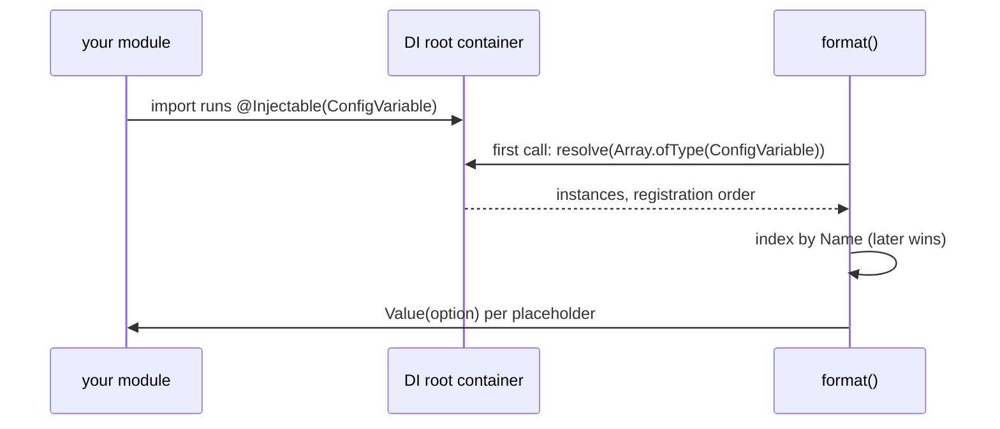

# Custom variables

Register a `ConfigVariable` subclass in DI to add a global `${name}` that every `format()` call can use: log layouts, log file paths, SQLite file names. The same mechanism overrides or removes a built-in variable.

```ts
abstract class ConfigVariable {
  abstract get Name(): string;              // the placeholder name, `${Name}`
  abstract Value(option?: string): string;  // `option` is the part after `:`, or null
}
```

## How it works

1. `@Injectable(ConfigVariable)` on your class runs when its module is imported. It calls `DI.register(YourClass).as(ConfigVariable)` and `DI.register(YourClass).asSelf()` on the root container.
2. On the first `format()` call, `DI.resolve(Array.ofType(ConfigVariable))` creates one instance of every registered class, in registration order.
3. Each instance is stored in a module-level map under its `Name`. A later class with the same `Name` replaces an earlier one.
4. For each `${Name:option}` with no matching custom var, `format()` calls `instance.Value(option)` and inserts the returned string.



## Services and extension points

| Service | DI token and lifetime | Default implementation | Alternatives | How to replace or extend |
| --- | --- | --- | --- | --- |
| `ConfigVariable` | `ConfigVariable` token, collected with `Array.ofType`; singleton in the root container (no lifetime decorator) | the [built-in variables](02-built-in-variables.md) | `ElectronPathVariables` in `@spinajs/electron` | **add**: `@Injectable(ConfigVariable)` on a new class. **override**: same `Name`, different class name. **extend**: subclass a built-in and override `Value()`. **remove**: `DI.unregister(BuiltInClass)`. All before the first `format()`. |

### When to register

- Register before the first `format()` call anywhere in the process. Log targets call `format()` early, so in an app the safe place is a module loaded at boot (a bootstrapper, or a file in a directory the app loads).
- A module is registered only when it is imported. Nothing scans for subclasses. In a standalone script or test, add a side-effect import (`import './variables/release.js'`) before the first `format()`.
- Register on the root container (`@Injectable` does this). `DI.child().register(...)` is not seen by `format()`.

### Registration rules that bite

- **Pass the base type.** `@Injectable()` without an argument registers the class only as itself; `${name}` then expands to `''`.
- **Use a unique class name.** The DI registry deduplicates by class name. A class named `HostnameVariable` that overrides `hostname` is silently dropped, because the built-in `HostnameVariable` is already registered. Name it `PodHostnameVariable`.
- **Later registration wins for the same `Name`.** Your module imports `@spinajs/configuration-common` first, so your class always registers after the built-ins and wins.

### Custom variable: add one

Add a `${release}` variable with a short and a full form, read from the build environment.

```ts sample
import { Injectable } from '@spinajs/di';
import { ConfigVariable, format } from '@spinajs/configuration-common';

@Injectable(ConfigVariable)
export class ReleaseVariable extends ConfigVariable {
  public get Name(): string {
    return 'release';
  }

  // ${release} -> "2.4.1+9f3c2ab", ${release:short} -> "2.4.1"
  public Value(option?: string): string {
    const version = process.env.APP_VERSION ?? '0.0.0';
    const commit = process.env.GIT_COMMIT ?? 'local';
    return option === 'short' ? version : `${version}+${commit.slice(0, 7)}`;
  }
}

console.log(format(null, 'starting ${release} (${release:short}) on ${hostname}'));
```

### Override a built-in

In Kubernetes, `os.hostname()` is the pod name only when `hostNetwork` is off. Report the node name from the downward API instead.

```ts sample
import { Injectable } from '@spinajs/di';
import { ConfigVariable, format } from '@spinajs/configuration-common';

// Not named `HostnameVariable`: the registry deduplicates by class name.
@Injectable(ConfigVariable)
export class NodeNameHostnameVariable extends ConfigVariable {
  public get Name(): string {
    return 'hostname';
  }

  public Value(): string {
    return process.env.K8S_NODE_NAME ?? process.env.HOSTNAME ?? 'unknown-node';
  }
}

console.log(format(null, '${hostname}'));
```

### Extend a built-in

Change the default format of `${datetime}` to ISO 8601 while keeping explicit options working.

```ts sample
import { Injectable } from '@spinajs/di';
import { DateTime } from 'luxon';
import { ConfigVariable, DateTimeLogVariable, format } from '@spinajs/configuration-common';

// Inherits Name = 'datetime'; registered later than the built-in, so it wins.
@Injectable(ConfigVariable)
export class IsoDateTimeVariable extends DateTimeLogVariable {
  public Value(option?: string): string {
    return option ? super.Value(option) : DateTime.now().toISO() ?? '';
  }
}

// "2026-10-17T10:02:11.123+02:00 boot" and "2026 boot"
console.log(format(null, '${datetime} boot'), format(null, '${datetime:yyyy} boot'));
```

### Remove a built-in

Stop `${user}` from leaking the OS account name into shared logs. `DI.unregister()` removes the class from every token it was registered under.

```ts sample
import { DI } from '@spinajs/di';
import { UserVariable, format } from '@spinajs/configuration-common';

DI.unregister(UserVariable);

// "by " - the placeholder is now unknown and expands to ''
console.log(format(null, 'by ${user}'));
```

## Important behaviour

- **The variable set is frozen after the first `format()`.** It is held in a module-level map, not in the DI cache, so `DI.clearCache()` and later registrations do not change it.
- **One instance per class.** The instance is created once and reused; keep `Value()` free of per-call state, or compute it inside `Value()`.
- **`Value()` must return a string.** A number or `undefined` is passed to `String.replace` and coerced; `undefined` prints `undefined`.
- **`option` is `null`, not `undefined`, when absent** (`format()` passes `v[3] ?? null`). Test with `option ?? default` or `if (option)`, not `option === undefined`.
- **Errors propagate.** A `Value()` that throws makes the whole `format()` call throw, which can break a log write.
- **Custom vars still win.** `format({ release: 'dev' }, '${release}')` prints `dev`, whatever `ReleaseVariable` returns.

## Best practices

- Keep `Value()` cheap and synchronous; it runs for every placeholder of every formatted log line.
- Read changing inputs (`process.env`, a clock) inside `Value()`, and immutable ones in the constructor.
- Guard unknown options: return `''` or the default form, never throw.
- For a value only one call site needs, pass a function in `customVars` instead of registering a global.

## Patterns and antipatterns

```ts
// Don't: registered only as itself, never collected by format(); ${tenant} prints ''
@Injectable()
export class TenantVariable extends ConfigVariable { /* ... */ }

// Do
@Injectable(ConfigVariable)
export class TenantVariable extends ConfigVariable { /* ... */ }
```

```ts
// Don't: format() runs before the variable module is imported, so ${tenant} stays '' for the whole process
console.log(format(null, '${tenant} booting'));
await import('./variables/tenant.js');

// Do: import variable modules before the first format()
import './variables/tenant.js';
console.log(format(null, '${tenant} booting'));
```

## Examples

### Tag every log line with the request's tenant

A global variable cannot see per-request data unless it reads it from an async context. `AsyncLocalStorage` makes `${tenant}` correct per request without passing it to every log call.

```ts sample
import { AsyncLocalStorage } from 'node:async_hooks';
import { Injectable } from '@spinajs/di';
import { ConfigVariable, format } from '@spinajs/configuration-common';

export const requestContext = new AsyncLocalStorage<{ tenant: string; requestId: string }>();

@Injectable(ConfigVariable)
export class TenantVariable extends ConfigVariable {
  public get Name(): string {
    return 'tenant';
  }

  // ${tenant} -> "acme", ${tenant:request} -> "req-42"
  public Value(option?: string): string {
    const ctx = requestContext.getStore();
    if (!ctx) {
      return '-';
    }
    return option === 'request' ? ctx.requestId : ctx.tenant;
  }
}

requestContext.run({ tenant: 'acme', requestId: 'req-42' }, () => {
  console.log(format({ message: 'order created' }, '[${tenant}/${tenant:request}] ${message}'));
});
```

## Related

- [Templating with `format()`](01-templating.md): lookup order between custom vars and globals.
- [Built-in variables](02-built-in-variables.md): the classes you can override, extend or remove.
- [`@spinajs/di`](../di/README.md): `@Injectable`, `Array.ofType`, `DI.unregister`.
