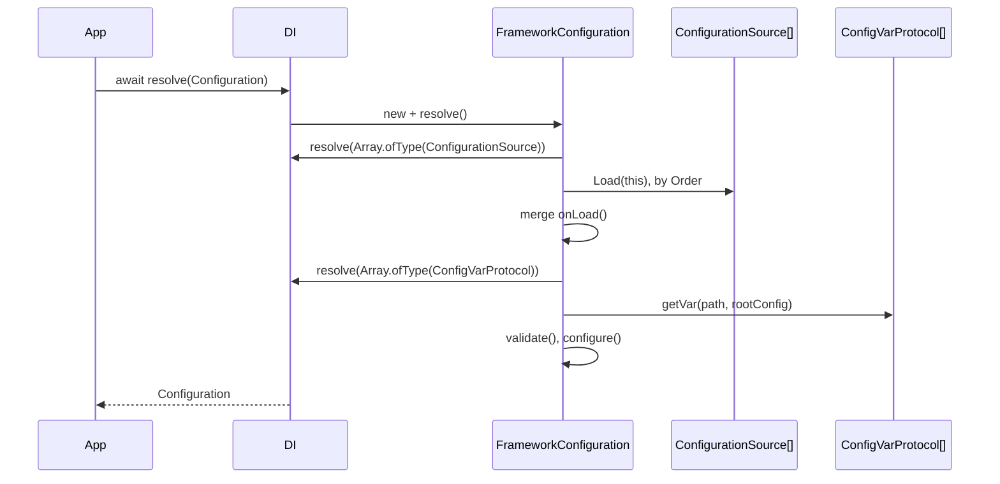

# The `Configuration` service

`Configuration` is the abstract class every SpinaJS service reads settings through. This package defines the contract; [`@spinajs/configuration`](../configuration/README.md) supplies the implementation. Depend on the abstract type, and replace or subclass the implementation when an app or a test needs config from somewhere else.

## Contract

`Configuration` extends `AsyncService` from `@spinajs/di`, so resolving it is asynchronous and runs its `resolve()`.

| Member | Kind | Meaning |
| --- | --- | --- |
| `RootConfig` | abstract getter, `IConfigLike` | the whole merged configuration object |
| `RunApp` | `string` | the running app name (`--app` CLI flag or `ConfigurationOptions.app`) |
| `AppBaseDir` | `string` | where app configs are looked up (`--apppath` or `ConfigurationOptions.appBaseDir`) |
| `get<T>(path, defaultValue?)` | abstract | value at `path` (`'http.port'` or `['http', 'port']`); `defaultValue` when missing |
| `set(path, value)` | abstract | overwrite the value at `path` |
| `merge(path, value)` | abstract | deep-merge `value` into the existing value at `path` |
| `mergeSource(sourceClass)` | abstract, async | load one `ConfigurationSource` after boot |
| `load()` | abstract, async | reload from all sources |
| `onLoad()` | protected abstract | returns extra config to merge after the sources; the hook for subclasses |

### Related types

| Type | Shape | Used by |
| --- | --- | --- |
| `ConfigurationOptions` | `{ app?, appBaseDir?, cfgCustomPaths?, watchFileChanges? }` | the `FrameworkConfiguration` constructor |
| `IConfigLike` | `{ [key: string]: unknown; onConfigLoad?(config): Promise<IConfigLike> \| undefined }` | `RootConfig`, `ConfigurationSource.Load()` |
| `IConfigurable` | `{ configure(this: Configuration): void }` | a top-level config section with a `configure` hook |
| `IConfigEntryOptions` | `{ defaultValue?, required? }`, augmentable | `@Config(path, options)` in `@spinajs/configuration` |
| `IConfigurationSchema` | `{ $configurationModule: string }` | JSON schemas that validate one config section |
| `IFrameworkVersion` | `{ major: number; minor: number }` | version struct; no consumer in this repo |

## How it works

This is the flow of `FrameworkConfiguration`, the default implementation in `@spinajs/configuration`.

1. `await DI.resolve(Configuration)` creates the last class registered under `Configuration` and awaits its `resolve()`.
2. `resolve()` throws `InvalidOperation` when no `ConfigurationSource` is registered.
3. `loadSources()` resolves every `ConfigurationSource` and sorts them by `Order`. See [Configuration sources](05-configuration-sources.md).
4. `load()` sets `process.env`, merges every source's `Load()` result in order, with every value registered as `'__configuration__'` in DI in the package layer, then merges `onLoad()`.
5. `load()` resolves protocol values (`fs-path://...`) through `ConfigVarProtocol`s. See [Config var protocols](06-config-var-protocols.md).
6. `validate()` checks each section against its `IConfigurationSchema`; it throws `InvalidConfiguration` on violations.
7. `configure()` calls `configure()` on every top-level section that has one, with `this` bound to the `Configuration`.
8. The instance is cached as a singleton; `@Config('path')` properties and `DI.get(Configuration)` read it from then on.



## Services and extension points

| Service | DI token and lifetime | Default implementation | Alternatives | How to replace or extend |
| --- | --- | --- | --- | --- |
| `Configuration` | `Configuration`, singleton (no lifetime decorator); one per container that registers it | `FrameworkConfiguration` (`@spinajs/configuration`, Node) | `BrowserFrameworkConfiguration` (`@spinajs/configuration` browser entry), `ElectronRendererConfiguration` (`@spinajs/electron`) | **replace**: `DI.register(MyConfig).as(Configuration)` before the first resolve. **extend**: subclass `FrameworkConfiguration` and override `onLoad()`. **per container**: `child.register(MyConfig).as(Configuration)`. |
| `IConfigurable.configure` | none: a function on a top-level config section | none | none | add `configure()` to a config file section |
| `IConfigLike.onConfigLoad` | none: a function exported by a JS config file | none | none | export `onConfigLoad` from a `.js` / `.cjs` config file |
| `IConfigEntryOptions` | TypeScript declaration merging | `defaultValue`, `required` | `expose`, `exposeOptions` from `@spinajs/configuration-db-source` | `declare module '@spinajs/configuration-common'` |

### When to register a replacement

- `DI.resolve(Configuration)` picks the **last** class registered under `Configuration`. `@spinajs/configuration` registers `FrameworkConfiguration` when imported, so register yours after that import.
- Register before anything resolves `Configuration`. The instance is cached; a later registration is ignored until `DI.clearCache()`.
- A child container that registers its own `Configuration` gets its own instance; `@Config` reads the configuration of the nearest container that registers one.

### `Configuration`: custom implementation

Replace the whole service when config does not come from files at all, for example in unit tests or a worker that receives its config from a parent process. Implement every abstract member.

```ts sample
import { DI, Class } from '@spinajs/di';
import { Configuration, ConfigurationSource, IConfigLike } from '@spinajs/configuration-common';
import _ from 'lodash';

/** In-memory configuration for unit tests: no files, no sources, no schema validation. */
export class InMemoryConfiguration extends Configuration {
  private data: Record<string, unknown>;

  constructor(initial: Record<string, unknown> = {}) {
    super();
    this.data = _.cloneDeep(initial);
    this.RunApp = 'test';
    this.AppBaseDir = process.cwd();
  }

  public get RootConfig(): IConfigLike {
    return this.data as IConfigLike;
  }

  public get<T>(path: string[] | string, defaultValue?: T): T {
    return _.get(this.data, path, defaultValue) as T;
  }

  public set(path: string[] | string, value: unknown): void {
    _.set(this.data, path, value);
  }

  public merge(path: string[] | string, value: unknown): void {
    this.set(path, _.merge({}, this.get(path, {}), value));
  }

  public async mergeSource(source: Class<ConfigurationSource>): Promise<void> {
    const instance = (await DI.resolve(source)) as ConfigurationSource;
    _.merge(this.data, await instance.Load(this));
  }

  public async load(): Promise<void> {
    _.merge(this.data, this.onLoad());
  }

  protected onLoad(): unknown {
    return {};
  }
}

export async function bootTestConfiguration() {
  DI.register(InMemoryConfiguration).as(Configuration);
  const cfg = await DI.resolve(Configuration, [{ http: { port: 0 }, db: { DefaultConnection: 'sqlite' } }]);
  cfg.set('logger.level', 'trace');
  return cfg.get<number>('http.port', 8080); // 0
}
```

### `FrameworkConfiguration`: extend instead of replace

Keep file loading, protocols and validation, and add values in code. `onLoad()` runs after all sources, so its result overrides file values. This is how `@spinajs/http-socket-example` sets its defaults.

```ts sample
import { DI } from '@spinajs/di';
import { Configuration, FrameworkConfiguration } from '@spinajs/configuration';

/** Forces quiet logging and an ephemeral HTTP port in integration tests. */
export class IntegrationTestConfiguration extends FrameworkConfiguration {
  protected onLoad(): unknown {
    return {
      logger: {
        targets: [{ name: 'Empty', type: 'BlackHoleTarget' }],
        rules: [{ name: '*', level: 'trace', target: 'Empty' }],
      },
      http: { port: 0 },
    };
  }
}

export async function startForTests() {
  DI.clearCache();
  DI.register(IntegrationTestConfiguration).as(Configuration);
  return await DI.resolve(Configuration);
}
```

## Hooks in config files

`FrameworkConfiguration` supports two hooks a config file can carry. Both are typed here.

| Hook | Where | When it runs | `this` and arguments | Return |
| --- | --- | --- | --- | --- |
| `onConfigLoad(config)` | exported by a `.js` / `.cjs` config file (`JsFileSource` only, not JSON) | right after the file is required, before it is merged | `config` is the file's exports | the object to merge instead of the exports |
| `configure()` | a function on any top-level section (`IConfigurable`) | once, in `resolve()`, after validation | `this` is the `Configuration` | ignored |

```ts sample
import type { Configuration } from '@spinajs/configuration-common';
import { Settings } from 'luxon';

// config/luxon.js: configure a third-party library from the final, validated config
export default {
  app: {
    timezone: 'Europe/Warsaw',
  },
  luxon: {
    configure(this: Configuration) {
      Settings.defaultZone = this.get<string>('app.timezone', 'utc');
    },
  },
};
```

## `IConfigEntryOptions` augmentation

`@Config(path, options)` in `@spinajs/configuration` accepts `IConfigEntryOptions`. Packages add options to it with declaration merging; `@spinajs/configuration-db-source` adds `expose` and `exposeOptions`. Only code that reads the options (the `'__configuration_property__'` DI values `@Config` registers) gives them meaning.

```ts sample
import { DI } from '@spinajs/di';
import type { IConfigEntryOptions } from '@spinajs/configuration-common';

declare module '@spinajs/configuration-common' {
  interface IConfigEntryOptions {
    /** Mask the value in config dumps and admin UIs. */
    sensitive?: boolean;
  }
}

/** Lists the config paths declared with `@Config(path, { sensitive: true })`. */
export function sensitivePaths(): string[] {
  const entries = DI.get(Array.ofType<{ path: string; options?: IConfigEntryOptions }>('__configuration_property__')) ?? [];
  return entries.filter((e) => e.options?.sensitive === true).map((e) => e.path);
}
```

## Important behaviour

- **`get()` returns `undefined`, not `null`, for a missing key** in `FrameworkConfiguration`, despite the contract comment.
- **`configure()` runs once.** It is called from `resolve()`, not from a later `load()`.
- **`mergeSource()` in `FrameworkConfiguration` does not merge.** It loads the source and appends it to the source list, but the loaded values reach the live config only on the next `load()`. `BrowserFrameworkConfiguration.mergeSource()` merges immediately.
- **The replacement is chosen by registration order.** Two packages that both register a `Configuration` leave the last one imported in charge.

## Best practices

- Inject `Configuration` (the abstract class), never `FrameworkConfiguration`, so tests can swap the implementation.
- Prefer subclassing `FrameworkConfiguration` with `onLoad()` over a full replacement; you keep protocols, schema defaults and validation.
- Use `configure()` sections for third-party globals (luxon zones, HTTP agents) that must see the final config.
- Call `DI.clearCache()` before registering a test configuration, or the previous instance is reused.

## Patterns and antipatterns

```ts
// Don't: binds the service to the Node implementation; tests cannot swap it
@Autoinject(FrameworkConfiguration)
protected Config: FrameworkConfiguration;

// Do
@Autoinject(Configuration)
protected Config: Configuration;
```

```ts
// Don't: registered after the first resolve, so the cached FrameworkConfiguration stays in use
await DI.resolve(Configuration);
DI.register(IntegrationTestConfiguration).as(Configuration);

// Do
DI.register(IntegrationTestConfiguration).as(Configuration);
await DI.resolve(Configuration);
```

## Related

- [`@spinajs/configuration`](../configuration/README.md): `FrameworkConfiguration`, `@Config`, schemas and file loading.
- [Configuration sources](05-configuration-sources.md): what `load()` reads.
- [Config var protocols](06-config-var-protocols.md): how `fs-path://` and similar values are resolved during `load()`.
