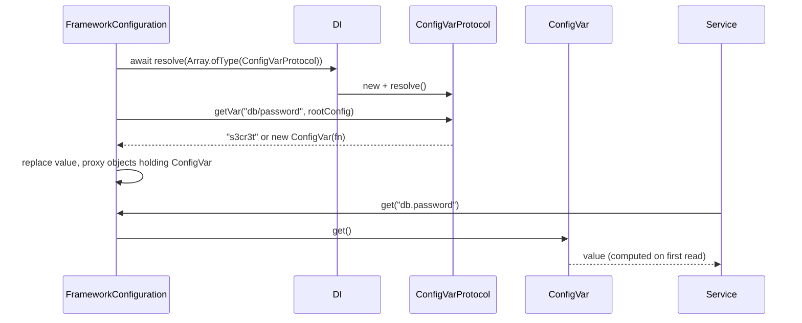

# Config var protocols

A config value written as `<protocol>://<path>` (`"fs-path://local/uploads"`, `"aws-parameters://prod/db/password"`) is resolved at load time by the `ConfigVarProtocol` registered for that prefix. The protocol returns the real value, or a `ConfigVar` that computes it on first read. Use a protocol to keep secrets and environment-specific paths out of config files.

```ts
abstract class ConfigVarProtocol extends AsyncService {
  abstract get Protocol(): string;   // the prefix, including "://", e.g. "vault://"
  abstract getVar(path: string, configuration: any): Promise<string | number | boolean | ConfigVar | {} | undefined>;
}

class ConfigVar {
  constructor(protected lazyVal: () => any);
  get(): any;                        // runs lazyVal once, then returns the cached value
}
```

## How it works

This is the flow in `FrameworkConfiguration.load()` (`@spinajs/configuration`), after all sources and `onLoad()` are merged.

1. `loadProtocolVars()` calls `await DI.resolve(Array.ofType(ConfigVarProtocol))` on the root container. Each protocol is created once and its `resolve()` awaited. With no protocols registered it logs a warning and stops.
2. Protocols are indexed by `Protocol`. A later protocol with the same prefix replaces an earlier one.
3. The whole config is walked. For every string property that contains `://`:
   - prefixes `http://`, `https://`, `ws://`, `wss://`, `ftp://`, `ftps://`, `file://`, `data://`, `blob://` are skipped (case-insensitive);
   - the value is matched against `^([a-zA-Z0-9-]+://)+(.+)$`;
   - an unknown prefix logs `Protocol ... is not registered` and leaves the string as is.
4. `protocol.getVar(path, rootConfig)` is awaited, where `path` is the text after the prefix and `rootConfig` is the raw merged config object. The return value replaces the string.
5. If `getVar()` throws, the error is logged and the original string stays.
6. Every object that holds a `ConfigVar` is wrapped in a proxy. Reading that key (directly or via `configuration.get()`) returns `configVar.get()`.



## Shipped protocols

| Protocol | Class | Package | Returns |
| --- | --- | --- | --- |
| `fs-path://<fsName>/<path>` | `ConfigurationFsPathProtocol` (`@Singleton()`) | `@spinajs/configuration-fs-protocol` | a `ConfigVar` resolving the path on the named `@spinajs/fs` filesystem; `null` until the filesystem exists |
| `aws-parameters://<name>` | `AwsParameterStoreVarProtocol` (`@Singleton()`) | `@spinajs/configuration-aws-secretmanager-protocol` | the parameter value from AWS Systems Manager Parameter Store, cached with a TTL |

This package ships no protocol of its own.

## Services and extension points

| Service | DI token and lifetime | Default implementation | Alternatives | How to replace or extend |
| --- | --- | --- | --- | --- |
| `ConfigVarProtocol` | `ConfigVarProtocol`, collected with `Array.ofType` on the root container; singleton; `AsyncService`, so `resolve()` is awaited | none | `fs-path://`, `aws-parameters://` | **add**: `@Injectable(ConfigVarProtocol)` on a subclass. **override**: register another class with the same `Protocol` (and a different class name). **remove**: `DI.unregister(ProtocolClass)`. Register before `Configuration` resolves. |
| `ConfigVar` | none: a value class returned from `getVar()` | `ConfigVar`, memoizes the first truthy result | none | subclass and override `get()`; the proxy checks `instanceof ConfigVar`, so subclasses are dereferenced too |

### When to register

- Before the first `DI.resolve(Configuration)`, or before a later `configuration.load()`. Protocols are resolved on every `load()`.
- On the root container. `loadProtocolVars()` uses the global `DI`, even for a `Configuration` in a child container.
- Do not inject `Configuration` into a protocol: protocols run while `Configuration` is still resolving. Read settings from the second `getVar()` argument.

### `ConfigVarProtocol`: custom implementation

Resolve `vault://<secret path>#<field>` from HashiCorp Vault's KV v2 API. The token is read once in `resolve()`; the Vault address comes from config loaded by earlier sources.

```ts sample
import { Injectable } from '@spinajs/di';
import { ConfigVarProtocol } from '@spinajs/configuration-common';

@Injectable(ConfigVarProtocol)
export class VaultProtocol extends ConfigVarProtocol {
  private token = '';

  public get Protocol(): string {
    return 'vault://';
  }

  public async resolve(): Promise<void> {
    await super.resolve();
    this.token = process.env.VAULT_TOKEN ?? '';
  }

  // "vault://secret/data/db#password" -> path = "secret/data/db#password"
  public async getVar(path: string, configuration: any): Promise<string | undefined> {
    const address: string = configuration?.vault?.address ?? 'http://127.0.0.1:8200';
    const [secretPath, field = 'value'] = path.split('#');

    const response = await fetch(`${address}/v1/${secretPath}`, { headers: { 'X-Vault-Token': this.token } });
    if (!response.ok) {
      throw new Error(`vault: cannot read ${secretPath} (${response.status})`);
    }

    const body = (await response.json()) as { data: { data: Record<string, string> } };
    return body.data.data[field];
  }
}
```

```js
// config/db.prod.js
module.exports = {
  vault: { address: 'https://vault.internal:8200' },
  db: { Connections: [{ Name: 'main', Password: 'vault://secret/data/db#password' }] },
};
```

## `ConfigVar`: lazy values

Return a `ConfigVar` from `getVar()` when the value cannot be computed at load time: it depends on a service that resolves after `Configuration`, or it is expensive and rarely read.

- `get()` calls the function on first read and caches the result.
- Only a **truthy** result is cached. `null`, `undefined`, `0`, `false` and `''` are recomputed on every read. `fs-path://` relies on this: it returns `null` until the filesystem is registered, then resolves on a later read.
- The function must be synchronous. A returned promise is cached as is and `configuration.get()` returns the promise.

### Extend `ConfigVar`

Subclass `ConfigVar` when the cached value must expire, for example a short-lived credential. `cache` and `lazyVal` are protected.

```ts sample
import { Injectable } from '@spinajs/di';
import { ConfigVar, ConfigVarProtocol } from '@spinajs/configuration-common';

/** Recomputes its value after `ttlMs`, instead of caching it forever. */
export class ExpiringConfigVar extends ConfigVar {
  private loadedAt = 0;

  constructor(lazyVal: () => unknown, private ttlMs: number) {
    super(lazyVal);
  }

  public get() {
    if (Date.now() - this.loadedAt > this.ttlMs) {
      this.cache = undefined;
      this.loadedAt = Date.now();
    }
    return super.get();
  }
}

// "token-file://payments" reads ./tokens/payments.token, re-read at most once a minute
@Injectable(ConfigVarProtocol)
export class TokenFileProtocol extends ConfigVarProtocol {
  public get Protocol(): string {
    return 'token-file://';
  }

  public async getVar(path: string): Promise<ConfigVar> {
    const { readFileSync } = await import('node:fs');
    return new ExpiringConfigVar(() => readFileSync(`./tokens/${path}.token`, 'utf8').trim(), 60_000);
  }
}
```

## Important behaviour

- **Protocol names are case-sensitive and must include `://`.** `Protocol` returning `'vault'` or `'Vault://'` never matches `vault://...`.
- **Allowed prefix characters are letters, digits and `-`.** `my_vault://x` does not match the pattern and stays a plain string.
- **Strings directly inside arrays are not resolved.** `hosts: ['vault://a']` stays as written; `hosts: [{ url: 'vault://a' }]` is resolved.
- **All values resolve in parallel.** Do not expect another protocol value to be resolved when your `getVar()` runs; the second argument holds the raw strings.
- **A failing protocol does not fail the boot.** The error is logged and the raw `vault://...` string remains, which schema validation may then reject.
- **`ConfigVar`s inside the `system` section are not dereferenced.** `system` is copied without the proxy, so a `ConfigVar` there is returned as the holder; call `.get()` on it.
- **Values are resolved again on every `load()`.** A protocol that calls a remote API is called on each reload.

## Best practices

- Throw a descriptive error from `getVar()` on failure; it ends up in the boot log with the key and protocol.
- Return a `ConfigVar` when the value depends on services resolved after `Configuration` (filesystems, ORM connections).
- Keep `getVar()` idempotent; it runs on every reload.
- Give each protocol a distinctive prefix that cannot collide with a URL scheme a user may write in config.

## Patterns and antipatterns

```ts
// Don't: Configuration is still resolving when protocols run
@Injectable(ConfigVarProtocol)
export class VaultProtocol extends ConfigVarProtocol {
  @Autoinject(Configuration)
  protected Config: Configuration;
  // ...
}

// Do: read settings from the second argument
public async getVar(path: string, configuration: any) {
  const address = configuration?.vault?.address;
  // ...
}
```

## Examples

### Read Docker secrets

`docker-secret://db_password` reads `/run/secrets/db_password`, the file Docker and Swarm mount for a secret.

```ts sample
import { readFile } from 'node:fs/promises';
import { join } from 'node:path';
import { Injectable } from '@spinajs/di';
import { ConfigVarProtocol } from '@spinajs/configuration-common';

@Injectable(ConfigVarProtocol)
export class DockerSecretProtocol extends ConfigVarProtocol {
  public get Protocol(): string {
    return 'docker-secret://';
  }

  public async getVar(path: string, configuration: any): Promise<string> {
    const dir: string = configuration?.secrets?.dir ?? '/run/secrets';
    return (await readFile(join(dir, path), 'utf8')).trim();
  }
}
```

## Related

- [The `Configuration` service](04-configuration-service.md): where protocol resolution sits in `load()`.
- [`@spinajs/configuration-fs-protocol`](../configuration-fs-protocol/README.md): `fs-path://`, a lazy protocol.
- [`@spinajs/configuration-aws-secretmanager-protocol`](../configuration-aws-secretmanager-protocol/README.md): `aws-parameters://`.
