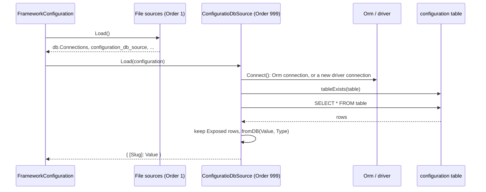

# Database configuration source

`ConfiguratioDbSource` reads the `configuration` table and merges every row with `Exposed` set into the configuration, at the path stored in `Slug`. It loads last, so a database value overrides the same key from config files.

## How it works

1. `FrameworkConfiguration` resolves every `ConfigurationSource` with `Array.ofType(ConfigurationSource)` and sorts them by `Order`. `ConfiguratioDbSource.Order` is `999`, so it runs after the file sources (`Order` `1`).
2. `ConfiguratioDbSource.Load(configuration)` reads `configuration_db_source` with the fallback `{ connection: 'default', table: 'configuration' }`.
3. `Connect()` reads `db.Connections` from what earlier sources loaded. It throws when the key is missing.
4. `Connect()` turns the name `default` into the value of `db.DefaultConnection`, then finds the entry whose `Name` matches. It throws when none matches.
5. When `Orm` is already resolved (`DI.has(Orm)`), `Connect()` takes `Orm.Connections.get(name)` and pings it. A failed ping only logs a warning.
6. Otherwise `Connect()` checks the driver is registered (`DI.check(Driver)`), resolves it with the connection options and calls `connect()`. On failure it calls `disconnect()` and throws.
7. `CheckTable()` calls `schema().tableExists(table)`. A missing table logs a warning: run the migration first.
8. `Load()` selects every row of the table and keeps the rows whose `Exposed` value is truthy. The filter runs in memory, so it works for any boolean storage.
9. `DbConfigValueConverter.fromDB()` converts each `Value` according to the row's `Type` column. See [Entry types](04-entry-types-and-converter.md).
10. `Load()` returns an object built with `_.set(result, row.Slug, row.Value)`. `FrameworkConfiguration` merges it into the config.

`Load()` never throws. Every failure in steps 3 to 8 is logged on the `configuration-db-source` channel and the source returns `{}`.



## Configuration

| Key | Type | Default | Allowed values | Meaning |
| --- | --- | --- | --- | --- |
| `configuration_db_source.connection` | `string` | `'default'` | `'default'` or a `Name` from `db.Connections` | Connection the source reads from. `'default'` means the value of `db.DefaultConnection`. |
| `configuration_db_source.table` | `string` | `'configuration'` | any table name | Table the source reads from. |
| `db.Connections` | `IDriverOptions[]` | none | ORM connection options | Must come from a source with `Order` lower than `999`. |
| `db.DefaultConnection` | `string` | none | a `Name` from `db.Connections` | Used when `configuration_db_source.connection` is `'default'`. |

The two `configuration_db_source` keys affect the load path only. Exposing and watching always use the `DbConfig` model, bound to the `configuration` table on the `default` connection.

```js
// config/db.js, loaded by the file source before the db source runs
export default {
  configuration_db_source: {
    connection: 'default',
    table: 'configuration',
  },
  db: {
    DefaultConnection: 'sqlite',
    Connections: [
      {
        Driver: 'orm-driver-sqlite',
        Name: 'sqlite',
        Filename: './app.sqlite',
        Migration: { OnStartup: true },
      },
    ],
  },
};
```

## Schema

### `configuration`

Created by the migration `configuration_db_source_2022_02_08_01_13_00` on the `default` connection, with a unique index `configuration_unique_slug` on `Slug`.

| Column | Type | Meaning |
| --- | --- | --- |
| `Id` | `int`, primary key, auto increment | Row id. |
| `Slug` | `string(64)`, not null, unique | Config path, the same string passed to `@Config()` and `Configuration.get()`. |
| `Value` | `text` | Current value in canonical text form, converted by `Type`. |
| `Default` | `text` | The `defaultValue` declared in code, in canonical text form. |
| `Required` | `boolean`, default `0` | Copied from `@Config({ required })`. Informational. |
| `Exposed` | `boolean`, not null, default `0` | Only rows with this flag reach the configuration. |
| `Watch` | `boolean`, not null, default `0` | Copied from `exposeOptions.watch`. Informational: polling follows the code declaration, not this column. |
| `Group` | `string(32)` | Display grouping for admin UIs. Not part of the path. |
| `Label` | `string(64)` | Human-readable name. |
| `Description` | `string(256)` | Help text. |
| `Environment` | `string(32)` | Not read by any shipped code. Free for your own source, see [Custom configuration source](07-custom-configuration-source.md). |
| `Meta` | `text` (JSON) | `exposeOptions.meta`: `min`, `max`, `minDate`, `maxDate`, `oneOf`, `manyOf`, `file`. |
| `Type` | `enum`, not null | One of the 15 entry types, see [Entry types](04-entry-types-and-converter.md). |

The migration's `down()` is empty: rolling it back leaves the table.

### `DbConfig` model

`DbConfig<T = unknown>` maps the table with `@Connection('default')` and `@Model('configuration')`. `Value` and `Default` carry `@DbConfigValue('Type')`, `Meta` carries `@Json()`. Use it to read or write rows from code; [`@spinajs/configuration-http`](../configuration-http/README.md) uses it for its endpoints.

## Services and extension points

| Service | DI token and lifetime | Default implementation | Alternatives | How to replace or extend |
| --- | --- | --- | --- | --- |
| Database source | `ConfigurationSource` (list, resolved with `Array.ofType`), `@Singleton`; registered at import by `@Injectable(ConfigurationSource)` | `ConfiguratioDbSource` | none shipped; file sources and `StaticConfigurationSource` from `@spinajs/configuration` sit in the same list | Subclass and override `Load()`, `Connect()`, `CheckTable()` or `Order`; `DI.unregister(ConfiguratioDbSource)` to drop the default. See [Custom configuration source](07-custom-configuration-source.md). |
| Table migration | `@Migration('default')`, picked up by the ORM migration runner | `configuration_db_source_2022_02_08_01_13_00` | none | Write your own `OrmMigration` for another connection or table name, see the example below. |
| Row model | `@Model('configuration')` on `@Connection('default')` | `DbConfig` | none | Not replaceable: the bootstrapper and `@spinajs/configuration-http` import it directly. |
| Value conversion | `DbConfigValueConverter`, `@Singleton`, resolved by class | `DbConfigValueConverter` | none | `DI.register(MyConverter).as(DbConfigValueConverter)`. See [Custom value converter](08-custom-value-converter.md). |

## Important behaviour

- **First boot loads nothing.** The ORM needs the configuration, so the first `Configuration` load runs before `Orm` resolves. The migration runs when `Orm` resolves, so on an empty database the table is missing and the source logs a warning. Call `Configuration.load()` again after `Orm` resolves to pick the rows up.
- **The source may open its own connection.** When `Orm` is not resolved yet, `Connect()` creates a driver connection of its own and does not close it. With SQLite `Filename: ':memory:'` that connection is a different, empty database.
- **`onLoad()` is too late.** `FrameworkConfiguration` merges `onLoad()` and the `__configuration__` DI values after all sources ran. Put `db.Connections` in a config file or a `StaticConfigurationSource` with a lower `Order`.
- **Set both keys or none.** `Load()` reads `configuration_db_source` before schema defaults are applied. A partial object such as `{ table: 'app_settings' }` leaves `connection` undefined, so `Connect()` fails and nothing loads.
- **Database wins.** The source loads last, and a later source overrides earlier ones for the same key.
- **`Group` is not a path segment.** A row with `Slug: 'mailer.from'` and `Group: 'mailer'` is read at `mailer.from`, never at `mailer.mailer.from`.
- **Hidden rows stay hidden.** A row with `Exposed` = `0` is never loaded, even when its `Slug` matches a `@Config` option.
- **Reload rereads.** `Configuration.load()` runs every source again, this one included.

## Best practices

- Keep the configuration table on the `default` connection unless you only need read-only loading. `expose` and `watch` always write through `DbConfig` on `default`.
- Turn on `Migration: { OnStartup: true }` on the `default` connection, so the bundled migration creates the table.
- Read exposed values through `@Config` or `Configuration.get()`, not through `DbConfig` queries: the configuration already holds the converted value.

## Patterns and antipatterns

```ts
// Don't: onLoad() is merged after every source, so the db source never sees the connection
class AppConfig extends FrameworkConfiguration {
  protected onLoad() {
    return { db: { DefaultConnection: 'sqlite', Connections: [/* ... */] } };
  }
}

// Do: a source that loads before the db source (Order lower than 999)
DI.register(StaticConfigurationSource({ db: { DefaultConnection: 'sqlite', Connections: [/* ... */] } }, 0)).as(ConfigurationSource);
```

## Examples

### Read settings from a dedicated configuration database

The application data lives on `app`; settings live in `config-db`, in a table named `app_settings`. The bundled migration only creates `configuration` on `default`, so this migration creates the custom table.

```ts sample
import { DI } from '@spinajs/di';
import { ConfigurationSource, StaticConfigurationSource } from '@spinajs/configuration';
import { Migration, OrmDriver, OrmMigration } from '@spinajs/orm';
import '@spinajs/configuration-db-source';

DI.register(
  StaticConfigurationSource(
    {
      configuration_db_source: { connection: 'config-db', table: 'app_settings' },
      db: {
        DefaultConnection: 'app',
        Connections: [
          { Driver: 'orm-driver-sqlite', Name: 'app', Filename: './app.sqlite' },
          { Driver: 'orm-driver-sqlite', Name: 'config-db', Filename: './config.sqlite', Migration: { OnStartup: true } },
        ],
      },
    },
    0,
  ),
).as(ConfigurationSource);

@Migration('config-db')
export class CreateAppSettingsTable extends OrmMigration {
  public async up(connection: OrmDriver): Promise<void> {
    await connection.schema().createTable('app_settings', (table) => {
      table.int('Id').primaryKey().autoIncrement();
      table.string('Slug', 64).notNull();
      table.text('Value');
      table.text('Default');
      table.boolean('Required').default().value(0);
      table.boolean('Exposed').notNull().default().value(0);
      table.boolean('Watch').notNull().default().value(0);
      table.string('Group', 32);
      table.string('Label', 64);
      table.string('Description', 256);
      table.string('Environment', 32);
      table.text('Meta');
      table.enum('Type', ['number', 'file', 'float', 'string', 'json', 'date', 'datetime', 'time', 'boolean', 'time-range', 'date-range', 'datetime-range', 'range', 'oneOf', 'manyOf']).notNull();
    });

    await connection.index().unique().table('app_settings').name('app_settings_unique_slug').columns(['Slug']);
  }

  public async down(_connection: OrmDriver): Promise<void> {
    return;
  }
}
```

The source reads `Slug`, `Value`, `Type` and `Exposed`. The other columns mirror the bundled migration, so rows look the same in both tables.

### Seed a setting from a script

```ts sample
import { DbConfig } from '@spinajs/configuration-db-source';

export async function seedSupportEmail(): Promise<void> {
  await DbConfig.insert({
    Slug: 'support.email',
    Value: 'support@example.com',
    Type: 'string',
    Group: 'support',
    Label: 'Support e-mail',
    Exposed: true,
  });
}
```

After the next `Configuration.load()`, `Configuration.get('support.email')` returns `'support@example.com'`.

## Related

- [Exposing options](02-exposing-options.md): how rows get created from `@Config` declarations.
- [Entry types and the value converter](04-entry-types-and-converter.md): how `Value` text becomes a typed value.
- [`@spinajs/configuration`](../configuration/README.md): source ordering and `StaticConfigurationSource`.
- [ORM migrations](../orm/10-migrations.md): `Migration.OnStartup` and how `@Migration` classes run.
