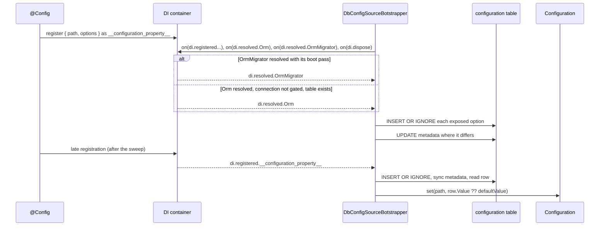

# Exposing options

`@Config(path, { expose: true, exposeOptions })` declares an option that lives in the `configuration` table. The package inserts a row for it once, keeps the row's metadata in sync with the code, and never overwrites a `Value` an admin changed.

Use it for settings an operator changes at runtime: sender addresses, limits, feature flags, templates.

## How it works

1. `@Config(path, options)` from `@spinajs/configuration` registers `{ path, options }` in DI under the value list `__configuration_property__`. The DI container emits `di.registered.__configuration_property__`.
2. `DbConfigSourceBotstrapper.bootstrap()` runs with the other bootstrappers. It registers the `configuration_db_source` schema and subscribes to the DI events below, dropping the subscriptions of an earlier `bootstrap()` first. It does no database work. `di.dispose` removes the subscriptions.
3. **When the `configuration` table is ready**, the bootstrapper sweeps the exposed options into it once. It is ready when either fires first:
   - `di.resolved.OrmMigrator`: the migrator ran its boot pass, so the bundled migration created the table. A migrator resolved with `MigrateOnStartup: false` (a migration tool) ran no pass and is ignored;
   - `di.resolved.Orm`, when `DbConfig`'s connection is not a `Migration.OnStartup` connection (`driver.AwaitsStartupMigration` is false) and `driver.schema().tableExists('configuration')` answers `true`: a deployment migrated by `migrate-up` that resolves no migrator.

   The sweep reads every `__configuration_property__` entry with `expose: true`:
   1. `normalizeFileEntryOptions()` checks each entry; a `type: 'file'` entry without `meta.file.fs` throws. See [File entries](05-file-entries-and-validators.md).
   2. For each entry in parallel, `DbConfigValueConverter.toDB()` turns `defaultValue` into canonical text for `exposeOptions.type`.
   3. `DbConfig.insert(row, InsertBehaviour.InsertOrIgnore)` writes the row. An existing `Slug` is left untouched.
   4. `syncMetadata()` reads the row back and rewrites `Group`, `Label`, `Description`, `Meta`, `Type`, `Watch`, `Required` and `Default` when any differs from the code. `Value` is never rewritten.
   5. Entries with `watch: true` join the watched set and the watch timer starts. See [Watching options](03-watching-options.md).
   6. Database errors are logged as `Failed to persist exposed config options to db`, not thrown. The bootstrapper then asks the database again whether the table exists; when it does not, late registrations are skipped again (step 5) and the next ready event sweeps once more.
4. **After the sweep**, every new `__configuration_property__` registration (a lazily imported service, a plugin) runs `syncConfigOption()`:
   1. `normalizeFileEntryOptions()` runs synchronously, so a misdeclared file entry throws out of the `@Config` decorator or `DI.register()` call.
   2. The row is inserted and its metadata synced as in step 3.
   3. The stored row is read back and `Configuration.set(path, row.Value ?? defaultValue)` updates the live configuration. A row whose `Exposed` flag an admin cleared is left out, as the source does.
   4. With `watch: true` the slug joins the watched set and arms the timer if it was idle.
   5. Errors are logged as `Failed to sync exposed config option ... with db`, not thrown.
5. Registrations made before the sweep are skipped by the step 4 handler and handled in step 3.

The values themselves reach the configuration through the [database source](01-database-source.md) on `Configuration.load()`, or through step 4.3 for late registrations.



## Decorators

These options are added to `IConfigEntryOptions` of `@spinajs/configuration-common` by a `declare module` augmentation in this package. They type-check only when the package is imported somewhere in the program.

| Decorator | Target | Options | Effect |
| --- | --- | --- | --- |
| `@Config(path, options)` | property | `expose?: boolean` | `true` inserts a row with `Slug` = `path` and `Exposed` = `true`. |
| | | `exposeOptions.type: ConfigurationEntryType` | Stored in `Type`; drives conversion. Required in practice: `Type` is `NOT NULL`, and metadata sync is skipped without it. |
| | | `exposeOptions.group?: string` | Stored in `Group`. Display only, max 32 characters. |
| | | `exposeOptions.label?: string` | Stored in `Label`, max 64 characters. |
| | | `exposeOptions.description?: string` | Stored in `Description`, max 256 characters. |
| | | `exposeOptions.meta?: IConfigurationEntryMeta` | Stored as JSON in `Meta`: `min`, `max`, `minDate`, `maxDate`, `oneOf`, `manyOf`, `file`. |
| | | `exposeOptions.watch?: boolean` | Stored in `Watch`; `true` polls the row, see [Watching options](03-watching-options.md). |
| | | `defaultValue` (from `@spinajs/configuration`) | Seeds `Value` and `Default` in canonical text. |
| | | `required` (from `@spinajs/configuration`) | Stored in `Required`. Not enforced by this package. |

### Row written per option

| Column | Written from | On insert | On metadata sync |
| --- | --- | --- | --- |
| `Slug` | `path` | yes | match key |
| `Value` | `toDB(defaultValue)` | yes | never |
| `Default` | `toDB(defaultValue)` | yes | yes |
| `Group`, `Label`, `Description`, `Meta`, `Type` | `exposeOptions` | yes | yes |
| `Watch` | `exposeOptions.watch ?? false` | yes | yes |
| `Required` | `required` | yes | yes |
| `Exposed` | `true` | yes | never |

## Configuration

This feature has no config keys of its own. The table and connection are fixed: `DbConfig` on the `default` connection.

## Services and extension points

| Service | DI token and lifetime | Default implementation | Alternatives | How to replace or extend |
| --- | --- | --- | --- | --- |
| Option registry | value list `'__configuration_property__'`, one `{ path, options }` value per registration | filled by `@Config` | `DI.register({ path, options }).asValue('__configuration_property__')` from your code | Register entries yourself to expose options without a decorated property, see the example below. |
| Exposing bootstrapper | `Bootstrapper` (list), singleton; `@Injectable(Bootstrapper)` at import | `DbConfigSourceBotstrapper` | none | Subclass it, see [Customizing the bootstrapper](09-customizing-the-bootstrapper.md). |
| Default serialization | `DbConfigValueConverter`, `@Singleton`, injected with `@Autoinject` | `DbConfigValueConverter` | none | `DI.register(MyConverter).as(DbConfigValueConverter)` before bootstrappers resolve, see [Custom value converter](08-custom-value-converter.md). |
| Option typing | `declare module '@spinajs/configuration-common'` on `IConfigEntryOptions` | `expose`, `exposeOptions` | none | Augment `IConfigEntryOptions` again in your package to add typed options of your own; read them from `__configuration_property__` entries. |

### Option registry: expose options without a decorator

Register entries yourself when the set of options is only known at runtime, for example one sender address per installed mail channel. Each registration behaves like a `@Config` declaration: before `Orm` resolves it is picked up in step 3, after that it is synced at once (step 4). Read the value with `Configuration.get(path)`.

```ts sample
import { DI } from '@spinajs/di';
import { Configuration } from '@spinajs/configuration';
import '@spinajs/configuration-db-source';

const MAIL_CHANNELS = ['orders', 'invoices', 'newsletter'];

export function exposeChannelSenders(): void {
  for (const channel of MAIL_CHANNELS) {
    DI.register({
      path: `mailer.channels.${channel}.from`,
      options: {
        defaultValue: `${channel}@example.com`,
        expose: true,
        exposeOptions: { type: 'string', group: 'mailer', label: `Sender for ${channel}`, watch: true },
      },
    }).asValue('__configuration_property__');
  }
}

export async function senderOf(channel: string): Promise<string> {
  const cfg = await DI.resolve(Configuration);
  return cfg.get<string>(`mailer.channels.${channel}.from`);
}
```

## Important behaviour

- **The table gates everything.** Nothing is written until `OrmMigrator` resolved, or the `Orm` resolved on a database whose `configuration` table already exists. On a `Migration.OnStartup` connection an app that resolves only `Orm` never writes rows: model queries there wait for the migrator.
- **One sweep per `bootstrap()`.** Whichever event comes first sweeps; the later ones do nothing, unless the sweep failed on a table that does not exist.
- **Code never overwrites an admin's value.** `InsertOrIgnore` keeps an existing row; the metadata sync touches every column except `Value` and `Exposed`.
- **The unique index makes it idempotent.** `InsertOrIgnore` relies on `configuration_unique_slug`. A custom table without it gets a duplicate row per restart.
- **`Default` is overwritten.** A changed `defaultValue` in code updates `Default` on the next start, never `Value`.
- **Column limits apply.** A `Slug` longer than 64 characters or a `Group` longer than 32 fails the insert on strict databases; the error is logged, not thrown.
- **Missing `type` fails the insert.** `Type` is `NOT NULL`; the insert error is logged and the option keeps its `defaultValue`.
- **Late sync respects `Exposed`.** Step 4.3 skips a row whose `Exposed` flag an admin cleared, so the configuration keeps the value it had.
- **Writes are fire-and-forget.** Step 3 does not block the `Orm` resolve; rows may land a moment later.

## Best practices

- Always set `exposeOptions.type`. It decides the stored text form and the type you read back.
- Always set `defaultValue`. Without it `Value` stays `NULL` and the option reads as `null` until an admin sets it.
- Keep `group` and `label` short and human-readable: admin UIs show them, and they are rewritten from code on every start.
- Use `meta.min`/`meta.max` or `meta.oneOf` to document the allowed range; [`@spinajs/configuration-http`](../configuration-http/README.md) validates writes against them.

## Patterns and antipatterns

```ts
// Don't: Group is not part of the path - this reads 'retries', not 'mailer.retries'
@Config('retries', { expose: true, exposeOptions: { type: 'number', group: 'mailer' } })
protected Retries: number;

// Do: put the full path in the first argument; group is only a UI label
@Config('mailer.retries', { defaultValue: 3, expose: true, exposeOptions: { type: 'number', group: 'mailer' } })
protected Retries: number;
```

```ts
// Don't: rely on InsertOrIgnore to push a new default to running installations
@Config('billing.vatRate', { defaultValue: 0.23, expose: true, exposeOptions: { type: 'float' } })

// Do: write the new value explicitly, in a migration or an admin action
await DbConfig.update({ Value: '0.23' }).where('Slug', 'billing.vatRate');
```

## Examples

### Let support staff tune the order export batch size

```ts sample
import { Config } from '@spinajs/configuration';
import '@spinajs/configuration-db-source';

export class OrderExportJob {
  @Config('orders.export.batchSize', {
    defaultValue: 500,
    required: true,
    expose: true,
    exposeOptions: {
      type: 'number',
      group: 'orders',
      label: 'Export batch size',
      description: 'Orders sent to the ERP per request',
      meta: { min: 50, max: 5000 },
    },
  })
  protected BatchSize: number;

  public batches(orderIds: number[]): number[][] {
    const result: number[][] = [];
    for (let i = 0; i < orderIds.length; i += this.BatchSize) {
      result.push(orderIds.slice(i, i + this.BatchSize));
    }
    return result;
  }
}
```

The first start inserts `orders.export.batchSize` with `Value` = `'500'`. After an admin sets `'1000'`, the next `Configuration.load()` (or a restart) makes `BatchSize` return `1000`. Add `watch: true` to skip the restart.

## Related

- [Database configuration source](01-database-source.md): loads the rows written here.
- [Watching options](03-watching-options.md): `watch: true`.
- [Entry types and the value converter](04-entry-types-and-converter.md): what `type` each value needs.
- [`@spinajs/configuration`](../configuration/README.md): `@Config`, `defaultValue` and `required`.
