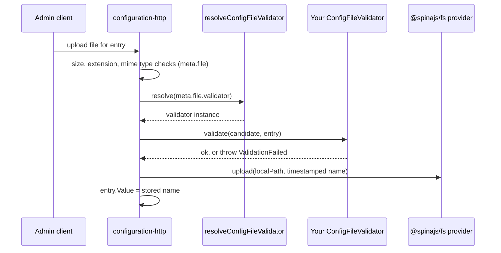

# File entries and validators

An entry with `type: 'file'` stores a file name in `Value`. Its `meta.file` options say which `@spinajs/fs` provider holds the file and what an upload must look like. A `ConfigFileValidator` adds your own content checks, for example "the template must contain the Offer sheet".

This package declares the options and the validator contract. The upload itself, and the checks against these options, run in [`@spinajs/configuration-http`](../configuration-http/README.md).

## How it works

1. You declare the entry with `@Config(path, { expose: true, exposeOptions: { type: 'file', meta: { file: {...} } } })`.
2. Before the row is written, `normalizeFileEntryOptions(path, exposeOptions)` runs:
   - `type: 'file'` without a non-empty `meta.file.fs` throws `Configuration entry '<path>' has type 'file' but no exposeOptions.meta.file.fs`.
   - A class in `meta.file.validator` is replaced by its name (`configFileValidatorName()`), because `Meta` is stored as JSON.
3. The row's `Meta` holds the normalized options, for example `{ file: { fs: 'fs-templates', extensions: ['xlsx'], validator: 'OfferTemplateValidator' } }`.
4. On upload, `@spinajs/configuration-http` checks the file name length, `maxSize` (default `CONFIG_FILE_DEFAULT_MAX_SIZE`), `extensions` and `mimeTypes` (detected from content).
5. When `meta.file.validator` is set, it calls `resolveConfigFileValidator(name)`. That function resolves every class registered under `ConfigFileValidator` and returns the first whose instance `ServiceName`, or class name, equals `name`. An unknown name is an error.
6. `validator.validate(candidate, entry)` runs. Throwing `ValidationFailed` from `@spinajs/validation` rejects the upload; its message goes back to the client. Any other error is a server error.
7. A passing file is stored under a timestamped name in the `fs` provider, and `Value` is pointed at it.



## Configuration

`IConfigurationFileOptions`, set at `exposeOptions.meta.file`:

| Key | Type | Default | Allowed values | Meaning |
| --- | --- | --- | --- | --- |
| `meta.file.fs` | `string` | none, required | a registered `@spinajs/fs` provider name | Where the file is stored. |
| `meta.file.extensions` | `string[]` | any | lowercase, without the dot | Allowed file name extensions. |
| `meta.file.mimeTypes` | `string[]` | any | mime type strings | Compared with the type detected from the file content. |
| `meta.file.maxSize` | `number` (bytes) | `CONFIG_FILE_DEFAULT_MAX_SIZE` (10 MB) | any positive number | Largest accepted file. |
| `meta.file.validator` | `string` or `Class<ConfigFileValidator>` | none | a validator class, its class name, or its `ServiceName` | Custom content check. Stored as a name. |

```ts
@Config('offers.calculatorTemplate', {
  defaultValue: 'calculator.xlsx',
  expose: true,
  exposeOptions: {
    type: 'file',
    group: 'templates',
    label: 'Offer calculator template',
    meta: {
      file: {
        fs: 'fs-excel-templates',
        extensions: ['xlsx'],
        mimeTypes: ['application/vnd.openxmlformats-officedocument.spreadsheetml.sheet'],
        maxSize: 10 * 1024 * 1024,
        validator: 'OfferTemplateValidator',
      },
    },
  },
})
protected Template: string;
```

## Services and extension points

| Service | DI token and lifetime | Default implementation | Alternatives | How to replace or extend |
| --- | --- | --- | --- | --- |
| File validator | abstract class `ConfigFileValidator`, any number of registrations; `@Injectable(ConfigFileValidator)`; singleton unless the class says otherwise | none | your classes | Extend `ConfigFileValidator`, implement `validate()`, register with `@Injectable(ConfigFileValidator)`, reference it from `meta.file.validator`. |
| Validator lookup | `resolveConfigFileValidator(name)`, exported function | matches instance `ServiceName`, then class name | none | Set `public ServiceName = '...'` on a validator to give it a stable name independent of the class name. |
| Option check | `normalizeFileEntryOptions(path, exposeOptions)`, exported function | called by the bootstrapper | none | Call it in your own tooling to validate declarations before deployment. |

### File validator: custom implementation

Write a validator when the file's content matters, not only its type. Implement `validate(file, entry)`:

- `file: IConfigFileCandidate` gives `localPath` (temp file, removed after the upload), `originalName`, `size` and `mimeType`.
- `entry: DbConfig` is the row being changed: read `entry.Slug` or `entry.Meta` to share one validator between entries.
- Throw `ValidationFailed` with an admin-readable message to reject.

Register it at import time with `@Injectable(ConfigFileValidator)`. The class must be imported before an upload happens; it does not need to exist when the row is written.

```ts sample
import { readFile } from 'node:fs/promises';
import { Injectable } from '@spinajs/di';
import { Config } from '@spinajs/configuration';
import { ValidationFailed } from '@spinajs/validation';
import { ConfigFileValidator, DbConfig, IConfigFileCandidate } from '@spinajs/configuration-db-source';

const REQUIRED_COLUMNS = ['sku', 'name', 'price'];

@Injectable(ConfigFileValidator)
export class PriceListValidator extends ConfigFileValidator {
  public ServiceName = 'price-list-csv';

  public async validate(file: IConfigFileCandidate, entry: DbConfig): Promise<void> {
    const content = await readFile(file.localPath, 'utf8');
    const header = content.split(/\r?\n/, 1)[0].toLowerCase().split(';');
    const missing = REQUIRED_COLUMNS.filter((c) => !header.includes(c));

    if (missing.length > 0) {
      throw new ValidationFailed(`${entry.Label ?? entry.Slug}: missing columns ${missing.join(', ')}`, []);
    }
  }
}

export class PriceImport {
  @Config('shop.priceList', {
    defaultValue: 'prices.csv',
    expose: true,
    exposeOptions: {
      type: 'file',
      group: 'shop',
      label: 'Price list',
      meta: { file: { fs: 'fs-price-lists', extensions: ['csv'], maxSize: 2 * 1024 * 1024, validator: 'price-list-csv' } },
    },
  })
  protected PriceList: string;
}
```

## Important behaviour

- **Misdeclared entries fail at startup.** A `type: 'file'` entry without `meta.file.fs` throws when `Orm` resolves, or from the `@Config` decorator when the class loads after that. The message names the slug.
- **A validator class must be defined before use in ESM.** `validator: OfferTemplateValidator` reads the class when the decorator runs. If the validator's module evaluates later, the decorator hits its temporal dead zone and throws. Use the string form when import order is not guaranteed.
- **Lookup resolves every validator.** `resolveConfigFileValidator()` instantiates each registered `ConfigFileValidator` until one matches. Keep their constructors and `resolve()` cheap.
- **`ServiceName` wins over the class name.** A validator with `ServiceName = 'price-list-csv'` is not found by its class name.
- **Only `ValidationFailed` is a rejection.** Any other error from `validate()` becomes a server error for the client.
- **`maxSize` and the default apply in `configuration-http`.** This package only stores them.

## Best practices

- Give validators a `ServiceName`: the name stored in `Meta` then survives a class rename.
- Read `file.localPath` only inside `validate()`: the temp file is removed right after the upload.
- Put cheap checks (`extensions`, `mimeTypes`, `maxSize`) in `meta.file` and only content checks in the validator.

## Patterns and antipatterns

```ts
// Don't: a plain Error becomes a 500 and hides the reason from the admin
throw new Error('Wrong template');

// Do: ValidationFailed rejects the upload with a readable message
throw new ValidationFailed('Template is missing the Offer sheet', []);
```

## Examples

### Check a validator's name before deployment

```ts sample
import { configFileValidatorName, normalizeFileEntryOptions, resolveConfigFileValidator } from '@spinajs/configuration-db-source';

export async function assertValidatorRegistered(slug: string, validator: string): Promise<void> {
  normalizeFileEntryOptions(slug, { type: 'file', meta: { file: { fs: 'fs-templates', validator } } });

  const found = await resolveConfigFileValidator(configFileValidatorName(validator));
  if (!found) {
    throw new Error(`Validator ${validator} of ${slug} is not registered`);
  }
}
```

## Related

- [`@spinajs/configuration-http`](../configuration-http/README.md): upload endpoint and the `meta.file` checks.
- [Exposing options](02-exposing-options.md): when `normalizeFileEntryOptions()` runs.
- [`@spinajs/validation`](../validation/README.md): `ValidationFailed`.
