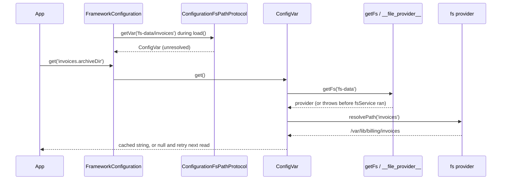

# `fs-path://` values

Write `fs-path://<provider>/<path>` anywhere in configuration to get the absolute path of `<path>` inside the named `@spinajs/fs` provider. Use it to keep folder locations (uploads, archives, caches) tied to provider definitions instead of repeating base paths.

## How it works

1. Importing `@spinajs/configuration-fs-protocol` runs `@Singleton()` and `@Injectable(ConfigVarProtocol)` on `ConfigurationFsPathProtocol`: it is registered under `ConfigVarProtocol` and under itself.
2. `FrameworkConfiguration.load()` merges all sources, then calls `loadProtocolVars()`. It resolves `Array.ofType(ConfigVarProtocol)` and maps each instance by its `Protocol` (`'fs-path://'`).
3. `loadProtocolVars()` walks every string value: at the root, in nested objects, and in objects inside arrays. A value with `://` that is not a web scheme (`http://`, `file://` and the like) and matches `^([a-zA-Z0-9-]+://)+(.+)$` is looked up by its prefix, case-sensitively.
4. `ConfigurationFsPathProtocol.getVar(rest)` gets the part after `fs-path://` and returns a `ConfigVar` at once. Nothing is resolved yet. The configuration stores the `ConfigVar` in place of the string.
5. `load()` wraps every object that holds a `ConfigVar` in a proxy whose getter calls `ConfigVar.get()`.
6. On each read (`Configuration.get()`, a `@Config()` property, a property access on a config object), `ConfigVar.get()` runs the resolver while it has no truthy cached value:
   1. It splits `rest` with `/^(.*)\/(.*)/` into a provider name and a path. The match is greedy: the split is at the **last** `/`.
   2. `getFs(name)` resolves the `__file_provider__` factory, which returns the provider instance `fsService` registered under that name.
   3. `provider.resolvePath(path)` returns the result.
7. A string result is cached for the life of the `ConfigVar`. Any failure logs a warning and returns `null`, and the next read tries again.



## Configuration

The package has no configuration keys of its own. The value depends on the provider definitions of `@spinajs/fs`:

| Key | Type | Default | Allowed values | Meaning |
| --- | --- | --- | --- | --- |
| `fs.providers[].name` | `string` | none | any name without `/` | The `<provider>` part of `fs-path://<provider>/<path>` |
| `fs.providers[].service` | `string` | none | a registered `fs` class name (`fsNative`, `fsTemp`, ...) | Decides which `resolvePath()` runs, see [Provider path resolution](03-provider-path-resolution.md) |
| `fs.providers[].basePath` | `string` | none | a directory | `fsNative` joins `<path>` onto it; with no `basePath`, `<path>` comes back unchanged and relative |

Value forms:

| Value | Provider name | Path passed to `resolvePath()` | Result with `basePath: '/var/lib/billing'` |
| --- | --- | --- | --- |
| `fs-path://fs-data/invoices` | `fs-data` | `invoices` | `/var/lib/billing/invoices` |
| `fs-path://fs-data/` | `fs-data` | `''` | `/var/lib/billing` |
| `fs-path://fs-data/invoices/2026` | `fs-data/invoices` | `2026` | `null` (unknown provider) |
| `fs-path://fs-data` | none | none | `null` (invalid format) |
| `fs-path:///invoices` | `''` | `invoices` | `null` (provider not found) |

```ts
const config = {
  fs: {
    defaultProvider: 'fs-data',
    providers: [
      { service: 'fsNative', name: 'fs-data', basePath: '/var/lib/billing' },
      { service: 'fsNative', name: 'fs-logs', basePath: '/var/log/billing' },
    ],
  },
  invoices: { archiveDir: 'fs-path://fs-data/invoices' },
  audit: { exportDirs: [{ dir: 'fs-path://fs-logs/audit' }] },
};
```

## Services and extension points

| Service | DI token and lifetime | Default implementation | Alternatives | How to replace or extend |
| --- | --- | --- | --- | --- |
| `ConfigurationFsPathProtocol` | `ConfigVarProtocol` and itself, singleton, registered on import | `ConfigurationFsPathProtocol` | none shipped | Subclass or unregister it, see [Replacing or extending the protocol](02-replacing-or-extending-the-protocol.md) |
| File provider | `'fs'` (class list), one instance per provider name, created by `fsService` | `fsNative` | `fsTemp`; `fsS3`, `fsFTP`, `fsOneDrive` (no local paths) | Override `resolvePath()`, see [Provider path resolution](03-provider-path-resolution.md) |

## Important behaviour

- **Lazy, with retry.** `fsService` registers providers after `Configuration` is resolved. A read before that returns `null` and logs `Cannot resolve fs-path variable ... yet`. The same read succeeds once `fsService` is resolved.
- **Cached once truthy.** `ConfigVar` caches only truthy values. After the first string result, later changes to the provider do not change the value.
- **Every failure is `null`, never an exception.** An unknown provider name, a path that escapes `basePath` (`IOFail`) and a provider without local paths (`MethodNotImplemented`) all log the same warning and return `null` on every read. A typo in the provider name never fails the boot.
- **Split at the last `/`.** `fs-path://fs-data/invoices/2026` asks for provider `fs-data/invoices` and returns `null`. Use one path segment, or the subclass in [Replacing or extending the protocol](02-replacing-or-extending-the-protocol.md).
- **Default values do not apply.** `Configuration.get('invoices.archiveDir', '/tmp')` returns `null`, not `'/tmp'`, while the value is unresolved: `_.get` uses the default only for `undefined`.
- **Schema validation can erase the value.** `FrameworkConfiguration.validate()` runs before `fsService`, with `coerceTypes: true`. If the module schema types the key as `string`, Ajv coerces the unresolved `null` to `''` and writes it over the `ConfigVar`. The key then stays `''` forever. A key typed `['string', 'null']` keeps the `ConfigVar`.
- **Strings directly in arrays are not resolved.** `exportDirs: ['fs-path://fs-logs/audit']` stays the raw string. Wrap each entry in an object: `[{ dir: 'fs-path://fs-logs/audit' }]`.
- **Copying dereferences.** Spreading or serializing a config object (`{ ...config.get('invoices') }`, `JSON.stringify`) reads every value at that moment and copies `null` if the providers are not up yet.
- **Platform separators.** `fsNative.resolvePath()` uses `path.join`, so the result uses `\` on Windows.
- **Case-sensitive prefix.** `FS-PATH://...` is not matched and logs `Protocol ... is not registered`.

## Best practices

- Read `fs-path://` keys through `@Config()` or `Configuration.get()` at use time, in `resolve()` or later, not in a constructor.
- Resolve `fsService` before the first component that needs the path, so the first read already returns a string.
- In a module schema, type `fs-path://` keys as `['string', 'null']`.
- Keep the path part to one segment, or end it with `/` to get the provider base path itself.

## Patterns and antipatterns

```ts
// Don't: the value is read once in the constructor, before fsService ran, and stays null
export class InvoiceArchive {
  protected ArchiveDir = DI.get(Configuration)!.get<string>('invoices.archiveDir');
}

// Do: a @Config() property reads the current value on every access
export class InvoiceArchive extends AsyncService {
  @Config('invoices.archiveDir')
  protected ArchiveDir: string | null;
}
```

```ts
// Don't: the schema coerces the unresolved value to '' at boot and the path is lost
archiveDir: { type: 'string' }

// Do
archiveDir: { type: ['string', 'null'] }
```

## Examples

### Write the monthly invoice export into the archive folder

```ts sample
import '@spinajs/configuration-fs-protocol';
import { writeFile } from 'node:fs/promises';
import { join } from 'node:path';
import { Configuration } from '@spinajs/configuration';
import { DI } from '@spinajs/di';
import { fsService } from '@spinajs/fs';

export async function exportInvoices(month: string, csv: string): Promise<string> {
  const config = await DI.resolve(Configuration);

  // registers the providers, so fs-path:// values resolve from here on
  await DI.resolve(fsService);

  const archiveDir = config.get<string | null>('invoices.archiveDir');
  if (!archiveDir) {
    throw new Error('invoices.archiveDir is not resolvable, check the fs-data provider');
  }

  const file = join(archiveDir, `invoices-${month}.csv`);
  await writeFile(file, csv, 'utf8');
  return file;
}
```

### Read a path that sits inside an array

```ts sample
import { Configuration } from '@spinajs/configuration';
import { DI } from '@spinajs/di';

export async function auditExportDirs(): Promise<string[]> {
  const config = await DI.resolve(Configuration);
  const entries = config.get<{ dir: string | null }[]>('audit.exportDirs', []);

  return entries.map((e) => e.dir).filter((dir): dir is string => !!dir);
}
```

## Related

- [Replacing or extending the protocol](02-replacing-or-extending-the-protocol.md): change the parsing, or add a sibling protocol.
- [Provider path resolution](03-provider-path-resolution.md): what decides the final string.
- [`@spinajs/configuration`](../configuration/README.md): protocol discovery, the lazy proxy and schema validation.
- [`@spinajs/fs`](../fs/README.md): provider configuration and `fsService`.
