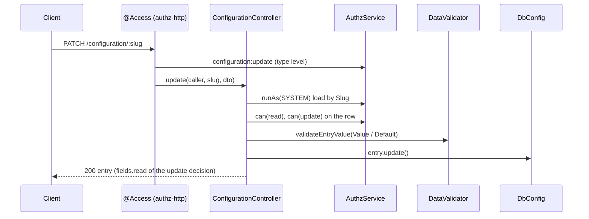

# Configuration API

`ConfigurationController` exposes the rows of the `configuration` table over HTTP: list them, read one by slug, and change its `Value`, `Default` and `Watch`. Use it to let operators tune exposed options at runtime.

It does **not** create or delete entries and does **not** change `Slug`, `Group` or `Type`.

## How it works

### `GET /configuration`

1. `@Access('configuration:read', { fields: 'filter' })` checks the route permission: 401 without a principal, 403 without the permission.
2. `ConfigurationController.list()` builds `DbConfig.where('Group', group)` when `?group=` is set, else `DbConfig.query()`.
3. `.accessible('configuration:read')` limits the rows to what the caller may read. When the authorization model has no list plan for the caller (for example a grant with a row condition), the call fails with 403.
4. Each row goes through `present()`: `DbConfig.dehydrate()` plus `Meta` as an object.
5. `@Access` drops the fields outside the read grant's field set. The response is `200` with an array.

### `GET /configuration/:slug`

1. `@Access('configuration:read', { fields: 'filter' })` checks the route permission.
2. `entryFor()` loads the row by `Slug` inside `authz().runAs(SYSTEM, 'configuration-http:load', ...)`.
3. `entryFor()` calls `authz().can(caller, 'configuration:read', { type: 'configuration', id }, entry)`. A missing row and a refused row both answer `404`, so slugs cannot be probed.
4. The response is `200` with the entry, filtered by the read field set.

### `PATCH /configuration/:slug`

1. `@Access('configuration:update', { fields: 'filter' })` checks the route permission. Body fields outside the update grant's `fields.write` are stripped, or answered with 400 when `authz.fields.write.mode` is `reject`.
2. The body is validated against the `UpdateConfigDto` schema (`configuration.http.updateConfigDTO`): `Value` is required, `Watch` is a boolean.
3. `entryFor()` loads the row as `SYSTEM` and checks **both** `configuration:read` and `configuration:update` on it. A refusal answers `404`.
4. `validateEntryValue()` checks `Value`, then `Default` when sent, against the entry `Type`, `Meta` and the schema registered under the slug ([Value validation](02-value-validation.md)). A failure answers `400` with `{ error: { message } }`.
5. A `SchemaCompileError` is logged and answers `500` with `configuration schema '<slug>' is invalid`.
6. The controller assigns `Value`, `Default` and `Watch`; `DbConfigValueConverter` turns them into the canonical stored string on update.
7. `updateEntry()` runs `entry.update()`. When a change was pending and zero rows were affected, it throws `ConfigWriteRefused` (403): the row left the caller's update scope between the check and the write.
8. The response is `200` with the stored entry, filtered by the update decision's `fields.read`.



## HTTP surface

| Method | Path | Permission | Success | Errors |
| --- | --- | --- | --- | --- |
| `GET` | `/configuration` | `configuration:read` | `200`, array of entries | `401`, `403` |
| `GET` | `/configuration/:slug` | `configuration:read` | `200`, one entry | `401`, `403`, `404` |
| `PATCH` | `/configuration/:slug` | `configuration:update` (route), `configuration:read` + `configuration:update` (row) | `200`, the updated entry | `400`, `401`, `403`, `404`, `500` |

Query parameter of the list: `group` (string, optional), compared with `Group`.

### Request body of `PATCH`: `UpdateConfigDto`

| Field | Type | Required | Meaning |
| --- | --- | --- | --- |
| `Value` | depends on `Type` | yes | New value, in its JSON form: a string for `date`, an array for `manyOf` and `*-range`, an object for `json`. |
| `Default` | depends on `Type` | no | New default, validated like `Value`. |
| `Watch` | `boolean` | no | Whether the running app reloads this entry on the watch poll. |

### Response entry

Every column of `DbConfig`, `Value` and `Default` in their canonical stored string form:

| Field | Example | Meaning |
| --- | --- | --- |
| `Id` | `4` | Primary key. |
| `Slug` | `"app.maxUsers"` | Config path. |
| `Value` | `"50"` | Numbers as `"50"`, booleans as `"true"`, `manyOf` as a JSON string, ranges joined by `;`. |
| `Default` | `"5"` | Same form as `Value`. |
| `Group`, `Label`, `Description` | `"app"` | Display metadata. |
| `Meta` | `{ "min": 1, "max": 100 }` | Parsed object, or `null`. |
| `Type` | `"number"` | One of the entry types of `@spinajs/configuration-db-source`. |
| `Required`, `Watch`, `Exposed` | `true` | Flags as stored. |
| `Environment` | `null` | As stored. |

## Errors

| Status | Cause | Body |
| --- | --- | --- |
| `400` | `Value` / `Default` breaks the type, `Meta` or slug schema | `{ error: { message: "Value is invalid" } }` ([message format](02-value-validation.md#error-messages)) |
| `400` | Body field outside `fields.write` (reject mode), or DTO schema failure | authz-http / http error body |
| `401` | No principal | authz-http error body |
| `403` | No route permission; list refused by the list plan; `ConfigWriteRefused` | authz-http error body |
| `404` | Unknown slug, or the row check refused it | `configuration entry <slug> not found` |
| `500` | The slug schema cannot be compiled | `{ error: { message: "configuration schema '<slug>' is invalid" } }` |

## Configuration

| Key | Type | Default | Allowed values | Meaning |
| --- | --- | --- | --- | --- |
| `system.dirs.controllers` | `string[]` | adds `<root>/node_modules/@spinajs/configuration-http/lib/controllers` | directories | Where `ConfigurationController` is discovered. `<root>` is `WORKSPACE_ROOT_PATH` or `process.cwd()`. |

Permissions and roles are on the [Access control](04-access-control.md) page.

## Services and extension points

| Service | DI token and lifetime | Default implementation | Alternatives | How to replace or extend |
| --- | --- | --- | --- | --- |
| `ConfigurationController` | Not a DI service; discovered from `system.dirs.controllers` | `ConfigurationController` | None | The package has no switch to remove it. Add routes in your own controller with the exported helpers ([Value validation](02-value-validation.md#custom-routes-over-the-validation-helpers)). |
| `DataValidator` | Resolved by `@Autoinject()` into the controller (singleton from `@spinajs/validation`) | `DataValidator` | Any subclass registered as `DataValidator` | Add value schemas instead ([Value schemas](03-value-schemas.md)). |
| `DbConfigValueConverter` | Owned by `@spinajs/configuration-db-source` | `DbConfigValueConverter` | None | Produces the stored form returned by every route. |

## Important behaviour

- The list returns every row of the table the caller may read, exposed or not; there is no `Exposed` filter.
- `PATCH` writes to the database only. The running app picks the value up on the db-source watch poll, and only for entries with `Watch = true`.
- `PATCH` needs `configuration:read` on the row as well as `configuration:update`, because the response carries the entry. A principal with update only gets `404`.
- A row refused by the row check answers `404`, not `403`; the route-level check still answers `403`.
- `PATCH` never moves or deletes files of `type: 'file'` entries. Use [`ConfigFileUploads.commit`](05-file-uploads.md) to point a file entry at a stored file.
- `Default` is optional: when it is not sent, the stored `Default` stays as it is.

## Best practices

- Send values in their JSON form: `"2021-06-15"` for `date`, `["a", "c"]` for `manyOf`, an object for `json`. The response returns the stored string form.
- Set `watch: true` in `exposeOptions` for options that operators change at runtime; without it a `PATCH` waits for a restart.
- Filter by `?group=` in an admin UI that shows one settings section at a time.

## Patterns and antipatterns

```ts
// Don't: reading the stored form back as a typed value. `Value` of a number entry is the string "50".
const max: number = (await res.json()).Value;

// Do: parse by Type, or read the typed value through Configuration in the server.
const entry = await res.json();
const max = Number(entry.Value);
```

## Examples

### Raise the user limit from an admin panel

```http
PATCH /configuration/app.maxUsers
Content-Type: application/json

{ "Value": 50, "Default": 5, "Watch": true }
```

```json
{ "Id": 2, "Slug": "app.maxUsers", "Value": "50", "Default": "5", "Watch": true, "Type": "number", "Meta": { "min": 1, "max": 100 }, "Group": "app" }
```

A `Value` of `999` answers `400`, and the stored value stays `"50"`.

### Expose an option with bounds the API enforces

```ts sample
import { Config } from '@spinajs/configuration';
import '@spinajs/configuration-db-source';

export class ReportSettings {
  @Config('reports.pageSize', {
    defaultValue: 50,
    expose: true,
    exposeOptions: {
      type: 'number',
      group: 'reports',
      label: 'Rows per report page',
      meta: { min: 10, max: 500 },
      watch: true,
    },
  })
  protected PageSize!: number;
}
```

## Related

- [Value validation](02-value-validation.md): the checks `PATCH` runs.
- [Access control](04-access-control.md): permissions, field sets and row checks of every route.
- [`@spinajs/configuration-db-source`](../configuration-db-source/README.md): entry types, `exposeOptions` and the watch poll.
- [`@spinajs/authz` HTTP adapter](../authz-http/README.md): `@Access`, `fields: 'filter'`, 401 / 403 bodies.
