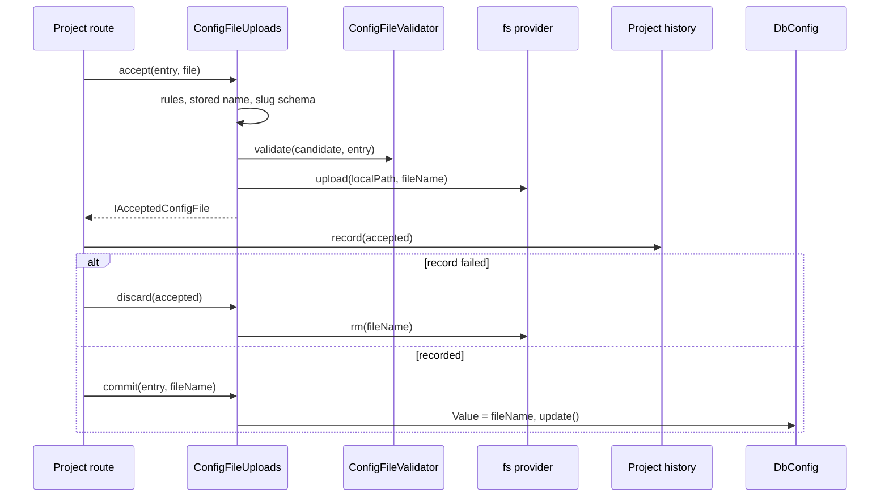

# File uploads

`ConfigFileUploads` is the upload pipeline for configuration entries of `type: 'file'`, such as an offer template or a price list. It checks the file against the entry's `meta.file` rules, stores it on the entry's `@spinajs/fs` provider under a timestamped name, and points `Value` at it.

The package has **no** upload route. The project writes the route, composes `accept` → its own record step → `commit`, and owns everything after acceptance: history, download, archive.

## How it works

### `accept(entry, file)`: validate and store

1. `configFileOptions(entry)` reads `entry.Meta.file`. An entry whose `Type` is not `file`, or one without `meta.file.fs`, throws `NotAFileEntry` (400).
2. `FileInfoService.getInfo(localPath)` detects the mime type from content. A detector error is logged and gives `''`.
3. `checkFileRules(options, candidate)` returns the first broken rule, in this order:
   1. original name over `ORIGINAL_NAME_MAX_LENGTH` (255) characters;
   2. extension over `EXTENSION_MAX_LENGTH` (16) characters;
   3. size over `maxSize` (default `CONFIG_FILE_DEFAULT_MAX_SIZE`, 10 MB);
   4. extension outside `extensions`, compared lowercase;
   5. detected mime type outside `mimeTypes`.

   A broken rule throws `ConfigFileRejected` (400) with an admin-facing message.
4. When `meta.file.validator` is set, `resolveConfigFileValidator(name)` finds the [`ConfigFileValidator`](06-file-validators.md) and runs `validate(candidate, entry)`. A `ValidationFailed` becomes `ConfigFileRejected` with the same message. An unregistered name throws a plain `Error` (500).
5. `storedFileName(file.Name, DateTime.utc())` builds the stored name ([Naming](#stored-file-name)).
6. The stored name is validated like a `PATCH` `Value`: `Type`, `Meta` and the [slug schema](03-value-schemas.md). A failure throws `ConfigFileRejected`; an uncompilable schema throws a plain `Error` after logging.
7. `getFs(meta.file.fs)` resolves the provider. An unregistered provider throws a plain `Error` naming the slug and the provider.
8. A file with the same name on the provider throws `ConfigFileRejected` (`uploaded a moment ago, try again`).
9. `_fileHash(localPath)` computes the sha256; `provider.upload(localPath, fileName)` stores the file. A failed upload removes the partial file and rethrows.
10. In every case, success or failure, the multipart temp file at `file.OriginalFile.filepath` is removed.
11. The result is an `IAcceptedConfigFile`. `Value` is **not** changed yet.

### `commit(entry, fileName)`: point `Value` at a stored file

1. `configFileOptions(entry)` checks the entry is a file entry (`NotAFileEntry`).
2. The name is validated against `Type`, `Meta` and the slug schema (`ConfigFileRejected`, or a plain `Error` for an uncompilable schema).
3. `entry.Value = fileName`, then `entry.update()`. Zero rows affected throws `ConfigWriteRefused` (403).
4. Any failure restores `entry.Value` in memory, so a caller that keeps the instance never sees a value the database did not accept.

### `discard(accepted)`: undo an accepted file

Removes `accepted.fileName` from `accepted.fs`. Best effort: any error, an unregistered provider included, is logged as a warning and swallowed.



### Stored file name

`storedFileName(originalName, uploadedAt)` returns `<base>-<yyyyMMdd-HHmmss>.<ext>`:

- `base` is the original name without extension, with every character outside `[\w.-]` replaced by `_`, cut to 100 characters, `file` when empty.
- The timestamp is the upload time in UTC.
- `ext` is the original extension, lowercase; a name without extension has no dot.

`Oferta Q3 (v2).XLSX` uploaded at 2026-09-16 12:15:30 UTC becomes `Oferta_Q3__v2_-20260916-121530.xlsx`.

### `IAcceptedConfigFile`

| Field | Type | Meaning |
| --- | --- | --- |
| `entry` | `DbConfig` | The entry passed to `accept`. |
| `fs` | `string` | `meta.file.fs`, the provider holding the file. |
| `fileName` | `string` | Name on the provider. |
| `originalName` | `string` | Name sent by the client. |
| `size` | `number` | Bytes. |
| `hash` | `string` | sha256 of the content, hex. |
| `mimeType` | `string` | Content-detected type; `''` when detection failed. |

## Configuration

The rules come from `exposeOptions.meta.file` of the entry, declared with `@Config` in `@spinajs/configuration-db-source` and stored in `Meta`:

| Key | Type | Default | Allowed values | Meaning |
| --- | --- | --- | --- | --- |
| `exposeOptions.meta.file.fs` | `string` | required | a registered `@spinajs/fs` provider name | Where accepted files are stored. |
| `exposeOptions.meta.file.extensions` | `string[]` | any | lowercase, no dot | Allowed extensions. |
| `exposeOptions.meta.file.mimeTypes` | `string[]` | any | mime types | Allowed content-detected types. |
| `exposeOptions.meta.file.maxSize` | `number` | `10485760` (10 MB) | bytes | Largest accepted file. |
| `exposeOptions.meta.file.validator` | `string \| Class<ConfigFileValidator>` | none | registered validator | Extra content check ([File validators](06-file-validators.md)); stored as the name. |

```ts
@Config('offers.calculatorTemplate', {
  defaultValue: 'calculator.xlsx',
  expose: true,
  exposeOptions: {
    type: 'file',
    group: 'templates',
    label: 'Offer calculator template',
    meta: { file: { fs: 'fs-templates', extensions: ['xlsx'], mimeTypes: [FileTypeEnum.xlsx], maxSize: 5 * 1024 * 1024 } },
  },
})
protected CalculatorTemplate!: string;
```

## Services and extension points

| Service | DI token and lifetime | Default implementation | Alternatives | How to replace or extend |
| --- | --- | --- | --- | --- |
| `ConfigFileUploads` | `ConfigFileUploads` (`@Injectable()`), singleton; inject with `@Autoinject()` or `DI.resolve(ConfigFileUploads)` | `ConfigFileUploads` | Your subclass | [Customizing the upload service](07-upload-service-customization.md) |
| `ConfigFileValidator` | `ConfigFileValidator`, every class registered with `@Injectable(ConfigFileValidator)`; resolved by name per upload | none | Your validators | [File validators](06-file-validators.md) |
| `FileInfoService` | `FileInfoService`, singleton, `@Autoinject()` into `ConfigFileUploads` | `DefaultFileInfo` (`exiftool`) from `@spinajs/fs` | Your detector | [Customizing the upload service](07-upload-service-customization.md#fileinfoservice-custom-mime-detection) |
| Storage provider | Named `@spinajs/fs` provider, resolved with `getFs(meta.file.fs)` on each upload | per entry | Any `fs` implementation (`fsNative`, S3, FTP, ...) | Configure `fs.providers` and name it in `meta.file.fs`. |
| Exported helpers | `configFileOptions()`, `checkFileRules()`, `storedFileName()`, `fileExtension()`, `ORIGINAL_NAME_MAX_LENGTH`, `EXTENSION_MAX_LENGTH` | — | — | Reuse in a custom pipeline or to show the rules in a UI. |

### Errors

| Error | Status | Thrown by | When |
| --- | --- | --- | --- |
| `NotAFileEntry` | 400 | `accept`, `commit`, `configFileOptions` | `Type` is not `file`, or `meta.file.fs` is missing. |
| `ConfigFileRejected` | 400 | `accept`, `commit` | A rule, the validator, the slug schema, or a name taken within the same second. |
| `ConfigWriteRefused` | 403 | `commit` | The update matched no row (outside the caller's update scope, or the row is gone). Reload the entry before retrying. |
| `Error` | 500 | `accept`, `commit` | Unregistered validator or provider; uncompilable slug schema. |

## Important behaviour

- `accept` always removes the multipart temp file. Anything the route does **before** `accept` (a permission check, a lookup) owns the temp file and must remove it on its own failure path.
- `accept` reads the formidable temp file at `file.OriginalFile.filepath`. Declare the route parameter as `@File()` without an `fs` option: with `fs` set, `@spinajs/http` copies the file to that provider and deletes the temp file first.
- `accept` never changes `Value`; `commit` is the only way a file entry's `Value` should change outside a `PATCH`. A "restore an earlier version" action goes through `commit` too.
- `PATCH /configuration/:slug` never moves or deletes files.
- `commit` does no authz check of its own. The route guards it.
- The stored name has one-second resolution. Two uploads of the same name within one second: the second is refused.
- `discard` never throws.

## Best practices

- Record the history row between `accept` and `commit`, and call `discard` when the record fails; the file then never sits on the provider without a history row.
- Use `accepted.hash` to detect a re-upload of identical content before recording it.
- Set `mimeTypes` together with `extensions`: the extension is what the client claims, the mime type is what the content is.

## Patterns and antipatterns

```ts
// Don't: commit first. A failed history insert leaves Value pointing at a file nobody recorded.
await uploads.commit(entry, accepted.fileName);
await recordVersion(accepted);

// Do: record, discard on failure, then commit.
try {
  await recordVersion(accepted);
} catch (err) {
  await uploads.discard(accepted);
  throw err;
}
await uploads.commit(entry, accepted.fileName);
```

## Examples

### Upload a new offer template with history

```ts sample
import { rm } from 'node:fs/promises';
import { BaseController, BasePath, File, Ok, Param, Post } from '@spinajs/http';
import type { IUploadedFile } from '@spinajs/http';
import { Access, CurrentPrincipal } from '@spinajs/authz-http';
import { SYSTEM, authz } from '@spinajs/authz';
import type { Principal } from '@spinajs/authz';
import { Autoinject } from '@spinajs/di';
import { ResourceNotFound } from '@spinajs/exceptions';
import { Connection, Model, ModelBase, Primary } from '@spinajs/orm';
import { DbConfig } from '@spinajs/configuration-db-source';
import { ConfigFileUploads } from '@spinajs/configuration-http';

@Connection('default')
@Model('config_file_versions')
export class ConfigFileVersion extends ModelBase<ConfigFileVersion> {
  @Primary()
  public Id!: number;
  public Slug!: string;
  public FileName!: string;
  public OriginalName!: string;
  public Hash!: string;
  public UploadedBy!: string;
}

@BasePath('configuration-files')
export class ConfigurationFilesController extends BaseController {
  @Autoinject()
  protected Uploads!: ConfigFileUploads;

  @Post(':slug')
  @Access('configuration:update')
  public async upload(@CurrentPrincipal() caller: Principal, @Param() slug: string, @File() file: IUploadedFile) {
    const service = authz();
    const entry = await service.runAs(SYSTEM, 'configuration-files:load', async () => DbConfig.where('Slug', slug).first());
    const ref = { type: 'configuration', id: String(entry?.Id) };
    if (!entry || !(await service.can(caller, 'configuration:update', ref, entry))) {
      // accept() has not run, so the temp file is still ours to remove
      await rm(file.OriginalFile.filepath, { force: true });
      throw new ResourceNotFound(`configuration entry ${slug} not found`);
    }

    const accepted = await this.Uploads.accept(entry, file);
    try {
      await ConfigFileVersion.insert({
        Slug: entry.Slug,
        FileName: accepted.fileName,
        OriginalName: accepted.originalName,
        Hash: accepted.hash,
        UploadedBy: String(caller.id),
      });
    } catch (err) {
      await this.Uploads.discard(accepted);
      throw err;
    }

    await this.Uploads.commit(entry, accepted.fileName);
    return new Ok({ Slug: entry.Slug, Value: accepted.fileName });
  }

  /** Points the entry back at a file uploaded earlier. */
  @Post(':slug/restore/:version')
  @Access('configuration:update')
  public async restore(@CurrentPrincipal() caller: Principal, @Param() slug: string, @Param() version: number) {
    const service = authz();
    const entry = await service.runAs(SYSTEM, 'configuration-files:load', async () => DbConfig.where('Slug', slug).first());
    const previous = await ConfigFileVersion.where({ Id: version, Slug: slug }).first();
    if (!entry || !previous || !(await service.can(caller, 'configuration:update', { type: 'configuration', id: String(entry.Id) }, entry))) {
      throw new ResourceNotFound(`configuration file version ${version} of ${slug} not found`);
    }

    await this.Uploads.commit(entry, previous.FileName);
    return new Ok({ Slug: entry.Slug, Value: previous.FileName });
  }
}
```

## Related

- [File validators](06-file-validators.md): the content check run during `accept`.
- [Customizing the upload service](07-upload-service-customization.md): subclass `ConfigFileUploads`, swap mime detection.
- [Value schemas](03-value-schemas.md): the slug schema the stored name must pass.
- [`@spinajs/configuration-db-source`](../configuration-db-source/README.md): `meta.file`, `ConfigFileValidator`, `CONFIG_FILE_DEFAULT_MAX_SIZE`.
- [`@spinajs/fs`](../fs/README.md): providers, `getFs`, `FileInfoService`.
- [`@spinajs/http`](../http/README.md): `@File()` and `IUploadedFile`.
