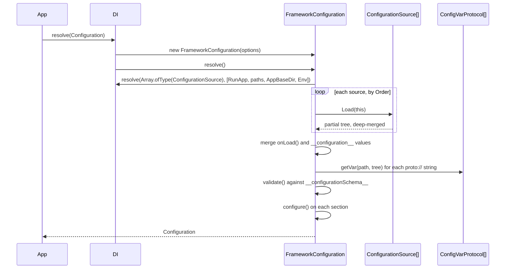

# Configuration service

`FrameworkConfiguration` is the Node implementation of the abstract `Configuration` service. It builds the configuration tree once, when it is first resolved, and answers every read from that tree. Resolve it before anything reads config: `await DI.resolve(Configuration)`.

## How it works

`FrameworkConfiguration.resolve()` runs once per container, when the service is first resolved:

1. **Check sources.** `Container.hasRegistered(ConfigurationSource)` must be true, or it throws `InvalidOperation('No configuration sources configured...')`. `JsFileSource` and `JsonFileSource` register themselves on import, so a Node app always passes.
2. **Check options.** `cfgCustomPaths` must be an array, or it throws `InvalidArgument`.
3. **Build the validator.** `initValidator()` creates the Ajv instance (see [Schema validation](06-schema-validation.md)).
4. **Resolve the sources.** `loadSources()` resolves `Array.ofType(ConfigurationSource)` with the constructor arguments `[RunApp, CustomConfigPaths, AppBaseDir, Env]` and sorts them by `Order`, ascending.
5. **Load.** `load()` builds the tree:
   1. resets the tree to `{}`;
   2. sets `process.env` to `process.env`, merged with the `process.env` DI value of its container, plus `APP_ENV` (see [Environments](02-environments.md));
   3. merges this package's defaults: `app.*`, and the `configuration.*` flags derived from that `APP_ENV`;
   4. calls `Load(this)` on each source in order and deep-merges the result;
   5. merges what `onLoad()` returns (`null` in `FrameworkConfiguration`; subclasses override it);
   6. deep-merges every `__configuration__` DI value at the root;
   7. with an app (`RunApp`), appends `<AppBaseDir>/<RunApp>/<name>` to every `system.dirs.<name>` list (`applyAppDirs()`);
   8. resolves protocol strings with `loadProtocolVars()` (see [Config var protocols](05-config-var-protocols.md));
   9. wraps each object that holds a `ConfigVar` in a proxy, so reading the key returns the var's value.
6. **Validate.** `validate()` checks every registered schema in the container lineage, applies defaults and coercion, and throws one `InvalidConfiguration` listing every violation.
7. **Configure.** `configure()` calls `configure()` on every top-level section that defines one, with `this` bound to the configuration.
8. DI caches the instance. Every later `DI.resolve(Configuration)` in that container returns it.

A failure in steps 1 to 7 rejects the resolve, and DI does not cache the instance.



## Reading and writing

| Method | Effect |
| --- | --- |
| `get<T>(path, defaultValue?)` | Returns the value at `path` (`'a.b.c'` or `['a', 'b', 'c']`), with lodash `_.get` semantics. `defaultValue` is returned when the value is `undefined`, or is a `ConfigVar` that reads `null` (not ready yet). Throws `InvalidConfiguration` when `path` is inside a module a late schema refused. |
| `set(path, value)` | Replaces the value at `path`, creating missing objects. Not validated. |
| `merge(path, value)` | Deep-merges `value` into the object at `path`; arrays are concatenated. A no-op when nothing is stored at `path`. Not validated. |
| `load()` | Rebuilds the tree from the sources, as in step 5. Values set with `set()` and schema defaults are lost; the tree is not validated again. |
| `mergeSource(sourceClass)` | Resolves a source, deep-merges what it loads into the current tree and adds it to the source list for later `load()` calls. Protocol strings it brings are not resolved until the next `load()`. |
| `RootConfig` | The whole tree. |
| `RunApp`, `AppBaseDir`, `Env` | The app name, the apps directory and the environment from the options or the command line. |
| `validateModule(schema)` | Checks one schema against the loaded tree; used by [`registerConfigurationSchema`](06-schema-validation.md). |
| `FrameworkConfiguration.checkedIn(container)` | The configuration of `container` that passed validation but is not cached by DI yet. |

## Configuration

`FrameworkConfiguration` takes `ConfigurationOptions` as its only constructor argument. Pass it as the resolve options: `DI.resolve(Configuration, [options])`.

| Option | Command line | Type | Default | Meaning |
| --- | --- | --- | --- | --- |
| `app` | `--app <name>` | `string` | `''` | App name. Adds the app's config directories (see [Config files](03-config-files.md)). |
| `appBaseDir` | `--apppath <dir>` | `string` | `<cwd>/../apps/` | Directory that holds the apps; `<appBaseDir>/<app>/config` is searched. |
| `cfgCustomPaths` | none | `string[]` | `[]` | Extra config directories, searched after all others. |
| `watchFileChanges` | none | `boolean` | none | Declared in the contract; not read by any shipped implementation. |
| none | `--env <name>` | `string` | `APP_ENV` | Environment name (see [Environments](02-environments.md)). |

The options win over the command line. Command-line values must be separate tokens: `--env prod`, not `--env=prod`.

`load()` sets this package's defaults before the sources merge, so a source can override them:

| Key | Type | Default | Meaning |
| --- | --- | --- | --- |
| `configuration.isDevelopment` | `boolean` | from the resolved `APP_ENV` | See [Environments](02-environments.md). |
| `configuration.isProduction` | `boolean` | from the resolved `APP_ENV` | See [Environments](02-environments.md). |
| `configuration.isLocal` | `boolean` | from the resolved `APP_ENV` | See [Environments](02-environments.md). |
| `app.name` | `string` | `'spinajs'` | Application name. |
| `app.version` | `string` | `'1.0.0'` | Application version. |
| `process.env` | `object` | the process environment | Filled by `load()`, not by a file. |

## Configure hooks

A top-level section may carry a `configure` function. It runs after validation, with `this` bound to the `Configuration`. Use it to set up third-party libraries from config, or to derive values.

```js
// config/locale.js
export default {
  locale: {
    default: 'pl',
    configure() {
      this.set('locale.fallback', this.get('locale.default'));
    },
  },
};
```

## Services and extension points

| Service | DI token and lifetime | Default implementation | Alternatives | How to replace or extend |
| --- | --- | --- | --- | --- |
| Configuration | `Configuration`, singleton per container (`@Injectable(Configuration)`) | `FrameworkConfiguration` | `BrowserFrameworkConfiguration` ([browser entry](10-browser-configuration.md)), `ElectronRendererConfiguration` (`@spinajs/electron`) | Subclass and `DI.register(MyConfiguration).as(Configuration)` before the first resolve. See [Replacing the configuration service](09-replacing-the-configuration-service.md). |
| Configuration sources | `ConfigurationSource`, resolved as `Array.ofType` | `JsFileSource`, `JsonFileSource` | `ConfiguratioDbSource` (`@spinajs/configuration-db-source`), `StaticConfigurationSource(...)` | See [Custom configuration sources](04-custom-configuration-sources.md). |
| Protocols | `ConfigVarProtocol`, resolved as `Array.ofType` in the configuration's container | none | `fs-path://`, `aws-secrets://`, `aws-parameters://` | See [Config var protocols](05-config-var-protocols.md). |
| Schemas | `__configurationSchema__` values in the container lineage | none | none | See [Schema validation](06-schema-validation.md). |
| Code-only config | `__configuration__` values (`DI.register(obj).asValue('__configuration__')`) | none | none | See [Custom configuration sources](04-custom-configuration-sources.md#the-__configuration__-value). |
| Environment override | `process.env` value (`DI.register(env).asValue('process.env')`) | none | none | Merged over `process.env` in `load()`; see [Environments](02-environments.md). |

### Configuration: extend the default service

Override these protected members of `FrameworkConfiguration`; all run inside `resolve()` or `load()`:

| Member | When it runs | Override to |
| --- | --- | --- |
| `onLoad(): unknown` | `load()`, after the sources | Merge values from code (tests, workers). |
| `loadSources(): void` | `resolve()`, before `load()` | Choose the sources; set `this.Sources = []` to skip files. |
| `configure(): void` | `resolve()`, after validation | Run extra setup; call `super.configure()` to keep section hooks. |
| `initValidator(): void` | `resolve()`, first | Add Ajv keywords or formats to `this.Validator` after `super.initValidator()`. |

```ts sample
import { DI } from '@spinajs/di';
import { Configuration, FrameworkConfiguration } from '@spinajs/configuration';

class AppConfiguration extends FrameworkConfiguration {
  protected onLoad(): unknown {
    return {
      http: { port: Number(process.env.PORT ?? 8080) },
    };
  }

  protected initValidator(): void {
    super.initValidator();
    this.Validator.addFormat('semver', /^\d+\.\d+\.\d+$/);
  }
}

async function main() {
  DI.register(AppConfiguration).as(Configuration);

  const configuration = await DI.resolve(Configuration);
  console.log(configuration.get<number>('http.port'));
}

void main();
```

## Important behaviour

- Merge rules for every source, `onLoad()` and `merge()`: objects merge deeply, scalars from the later source win, **arrays are concatenated**. A later file cannot shorten or replace an array a package config defines; it can only append to it.
- `JsFileSource` and `JsonFileSource` both have `Order` `1`. For the same scalar key, the JSON value wins over the JS value.
- Every top-level object loaded from a file gets a `__file__` array with the paths it came from, for debugging.
- `set()` and `merge()` do not validate, and `load()` does not validate again. A `load()` drops the defaults schemas applied at boot.
- `merge(path, value)` writes nothing when `path` holds no object yet. Use `set()` for a new key.
- The `system` section is not wrapped in a proxy: a `ConfigVar` stored directly under `system` is returned as the `ConfigVar` object.
- Reading `configuration.get()` before `resolve()` finishes returns the partial tree; read config in your service's `resolve()` or later.

## Best practices

- Resolve the configuration first in your entry point (`await DI.resolve(Configuration)`), before any service that reads config.
- Read config through `@Config` or `get()` with a `defaultValue`, and register a schema with defaults for every module you own.
- Put derived values in the section's `configure()` hook, not in a service constructor.

## Patterns and antipatterns

```ts
// Don't: merge() into a key no source defines writes nothing
configuration.merge('featureFlags', { betaCheckout: true });

// Do
configuration.set('featureFlags.betaCheckout', true);
```

## Examples

### Boot an app with its own config directory

```ts sample
import { join } from 'path';
import { DI } from '@spinajs/di';
import { Configuration } from '@spinajs/configuration';

async function main() {
  DI.setESMModuleSupport();

  const configuration = await DI.resolve(Configuration, [
    {
      app: 'admin',
      appBaseDir: join(process.cwd(), 'apps'),
      cfgCustomPaths: [join(process.cwd(), 'deploy', 'config')],
    },
  ]);

  console.log(configuration.RunApp, configuration.get<string>('app.name'));
}

void main();
```

## Related

- [Config files](03-config-files.md): where the file sources look and in which order.
- [Schema validation](06-schema-validation.md): what `validate()` checks.
- [Replacing the configuration service](09-replacing-the-configuration-service.md): subclasses and custom implementations.
- [`@spinajs/di`](../di/README.md): `AsyncService`, lifetimes and child containers.
