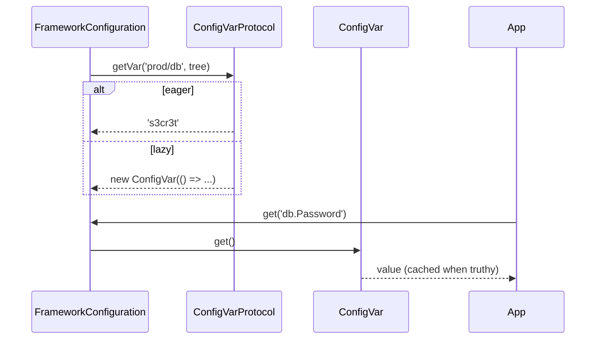

# Config var protocols

A protocol turns a config string such as `fs-path://fs-temp/uploads` or `aws-secrets://prod/db` into a value when the configuration loads. Register a `ConfigVarProtocol` to keep secrets, paths or computed values out of config files. A protocol can return the value at once, or a `ConfigVar` that computes it on first read.

## How it works

1. **Collect.** At the end of `FrameworkConfiguration.load()`, `loadProtocolVars()` resolves `Array.ofType(ConfigVarProtocol)` in the configuration's container (the nearest one that registers any) and indexes them by `Protocol`. With none registered it logs a warning and stops.
2. **Walk.** It walks the merged tree, objects and arrays, all branches in parallel.
3. **Match.** For each string property or array element that contains `://`:
   1. a value starting with `http://`, `https://`, `ws://`, `wss://`, `ftp://`, `ftps://`, `file://`, `data://` or `blob://` is left alone;
   2. the value is matched against `<name>://<rest>`, where `<name>` is letters, digits and `-`;
   3. an unregistered `<name>://` logs a warning and the string stays.
4. **Resolve.** `await protocol.getVar(rest, tree)` replaces the string with its result. An error is logged with `InternalLogger.error` and the string stays.
5. **Wrap.** Each object that now holds a `ConfigVar` is wrapped in a proxy. Reading such a key calls `ConfigVar.get()`, which runs the factory and caches a truthy result.



## Configuration

Protocol strings go anywhere a string value goes:

```js
// config/db.js
export default {
  db: {
    Connections: [
      {
        Name: 'main',
        Driver: 'orm-driver-mysql',
        Password: 'aws-secrets://prod/db-password',
      },
    ],
  },
  uploads: {
    dir: 'fs-path://fs-local/uploads',
  },
};
```

## Services and extension points

| Service | DI token and lifetime | Default implementation | Alternatives | How to replace or extend |
| --- | --- | --- | --- | --- |
| Protocol | `ConfigVarProtocol` (abstract, an `AsyncService`), resolved as `Array.ofType` in the configuration's container; singleton by default | none | `ConfigurationFsPathProtocol` (`fs-path://`, `@spinajs/configuration-fs-protocol`), `AwsSecretsManagerVarProtocol` (`aws-secrets://`) and `AwsParameterStoreVarProtocol` (`aws-parameters://`) (`@spinajs/configuration-aws-secretmanager-protocol`) | Extend `ConfigVarProtocol`, register with `@Injectable(ConfigVarProtocol)` in the configuration's container (or an ancestor) before the configuration resolves. Two protocols with the same `Protocol` string: the later registration wins. |
| Lazy value | `ConfigVar`, a plain class | none | none | Return `new ConfigVar(() => value)` from `getVar()`. |

The contract:

| Member | Meaning |
| --- | --- |
| `abstract get Protocol(): string` | The prefix, **including** `://`: `'vault://'`. |
| `abstract getVar(path, configuration): Promise<value>` | `path` is the text after the prefix. `configuration` is the raw merged tree (a plain object, not the `Configuration` service). Return a string, number, boolean, object, `undefined` or a `ConfigVar`. |
| `resolve()` | From `AsyncService`; runs once before the first `getVar()`. Open clients here. |

### ConfigVarProtocol: custom implementation

Read values from HashiCorp Vault, with the address and token taken from the config tree. The client opens once in `resolve()`.

```ts sample
import { DI, Injectable } from '@spinajs/di';
import { Configuration, ConfigVarProtocol } from '@spinajs/configuration';

interface VaultClient {
  read(path: string): Promise<Record<string, string>>;
}

declare function connectVault(url: string, token: string): VaultClient;

@Injectable(ConfigVarProtocol)
export class VaultProtocol extends ConfigVarProtocol {
  protected Client: VaultClient;

  public get Protocol() {
    return 'vault://';
  }

  public async resolve(): Promise<void> {
    await super.resolve();
    this.Client = connectVault(process.env.VAULT_ADDR ?? 'http://127.0.0.1:8200', process.env.VAULT_TOKEN ?? '');
  }

  // vault://secret/data/db#password -> the `password` field of secret/data/db
  public async getVar(path: string): Promise<string | undefined> {
    const [secretPath, field] = path.split('#');
    const secret = await this.Client.read(secretPath);
    return secret[field];
  }
}

async function main() {
  // config/db.js: export default { db: { Password: 'vault://secret/data/db#password' } }
  const configuration = await DI.resolve(Configuration);
  console.log(configuration.get<string>('db.Password') !== undefined);
}

void main();
```

### ConfigVar: lazy values

Return a `ConfigVar` when the value depends on a service that starts after the configuration, or is expensive and often unused. The factory runs on the first read of the key. A falsy result (`null`, `''`, `0`) is not cached, so the next read runs the factory again; this lets a value appear once its service is up.

```ts sample
import { Injectable } from '@spinajs/di';
import { ConfigVar, ConfigVarProtocol } from '@spinajs/configuration';

/** `tenant://<key>`: the value for the current tenant, read when the key is first used. */
@Injectable(ConfigVarProtocol)
export class TenantProtocol extends ConfigVarProtocol {
  public static Current: Record<string, string> | null = null;

  public get Protocol() {
    return 'tenant://';
  }

  public getVar(key: string): Promise<ConfigVar> {
    return Promise.resolve(new ConfigVar(() => TenantProtocol.Current?.[key] ?? null));
  }
}
```

## Important behaviour

- Protocols resolve only during `load()`. A protocol string written with `set()` or `merge()` stays a string.
- All protocol calls run in parallel. `getVar()` receives the tree as it is at that moment: another key's protocol string may still be unresolved. Read only plain values from it.
- `getVar()` errors do not stop the boot: the raw `proto://...` string stays in the config, and a schema with a `format` or `pattern` is the place to catch it.
- A child container that registers any `ConfigVarProtocol` uses only its own protocols; one that registers none uses those of the nearest ancestor that does.
- A `ConfigVar` is read through a proxy, so `get('db.Password')` returns its value. Copying the section with `{ ...section }` or `JSON.stringify` reads every var. A `ConfigVar` directly under `system`, or as an array element, is returned as the `ConfigVar` object.
- Schema validation reads only the vars whose keys the schema names; other vars stay lazy (see [Schema validation](06-schema-validation.md)).
- The match needs a letter, digit or `-` name: `my_proto://x` is not a protocol string.

## Best practices

- Keep secrets as protocol strings in the committed config, and give the protocol a `default` / `optional` parameter when the shipped protocol supports one (the AWS protocols do).
- Return a `ConfigVar` for any value that depends on a service started after the configuration, and return `null` until it is ready.
- Open network clients in `resolve()`, not per `getVar()` call.

## Patterns and antipatterns

```ts
// Don't: the prefix must include ://, or no string matches
public get Protocol() {
  return 'vault';
}

// Do
public get Protocol() {
  return 'vault://';
}
```

## Examples

### Expand a path from an environment variable

```ts sample
import { DI, Injectable } from '@spinajs/di';
import { join } from 'path';
import { Configuration, ConfigVarProtocol } from '@spinajs/configuration';

/** `datadir://logs` -> `<DATA_DIR>/logs`, or `<cwd>/data/logs` when DATA_DIR is unset. */
@Injectable(ConfigVarProtocol)
export class DataDirProtocol extends ConfigVarProtocol {
  public get Protocol() {
    return 'datadir://';
  }

  public getVar(path: string): Promise<string> {
    return Promise.resolve(join(process.env.DATA_DIR ?? join(process.cwd(), 'data'), path));
  }
}

async function main() {
  // config/log.js: export default { logger: { dir: 'datadir://logs' } }
  const configuration = await DI.resolve(Configuration);
  console.log(configuration.get<string>('logger.dir'));
}

void main();
```

## Related

- [Configuration service](01-configuration-service.md#how-it-works): where protocols run in `load()`.
- [`@spinajs/configuration-fs-protocol`](../configuration-fs-protocol/README.md): `fs-path://`, a lazy protocol.
- [`@spinajs/configuration-aws-secretmanager-protocol`](../configuration-aws-secretmanager-protocol/README.md): AWS protocols with caching and fallbacks.
- [`@spinajs/configuration-common`](../configuration-common/README.md): `ConfigVarProtocol` and `ConfigVar`.
