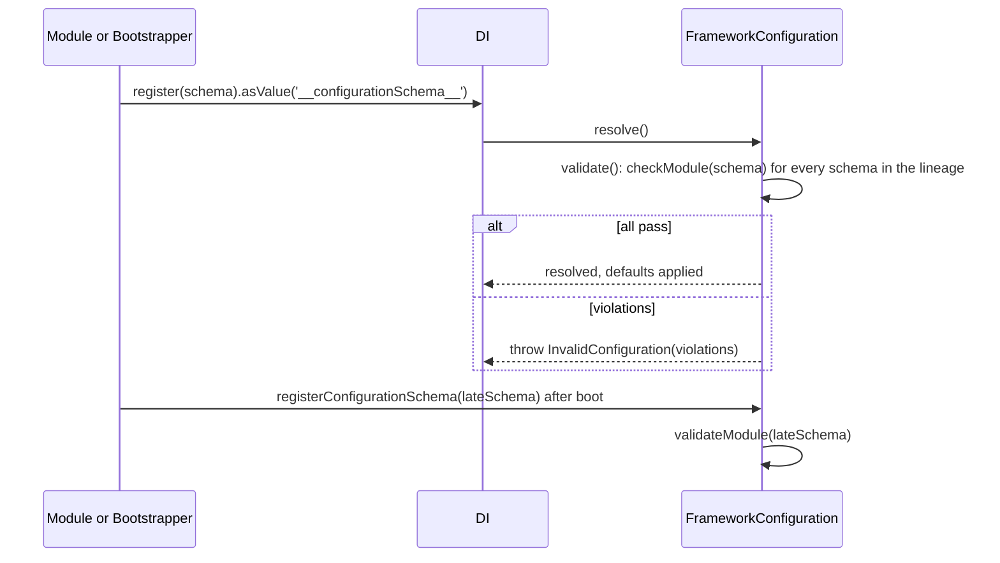

# Schema validation

Every module can register a JSON schema for its config section. The configuration checks each section against its schema at boot, fills defaults, coerces types and fails the boot with one `InvalidConfiguration` that lists every bad value by its full path. A schema registered after boot is checked at once.

## How it works

At boot, in `FrameworkConfiguration.resolve()`:

1. **`initValidator()`** creates one Ajv 8 instance with `allErrors`, `removeAdditional: true`, `useDefaults: true`, `coerceTypes: true` and `$data: true`, adds `ajv-merge-patch` (`$merge`, `$patch`), `ajv-formats` and `ajv-keywords`, and declares the `$configurationModule` keyword.
2. **`validate()`** collects the `__configurationSchema__` values of the configuration's container and of every ancestor, nearest first. Schemas that are the same object, or share an `$id`, count once.
3. For each schema, **`checkModule()`** reads the value at `$configurationModule`:
   - `undefined`: validates `{}`. When that passes, `{}` with the schema defaults is stored at the path. Otherwise a warning is logged and the path stays unset.
   - anything else (`null` included): validates a deep copy first. Only when the copy passes is the stored value validated in place, which applies defaults and coercion.
4. Violations of all schemas are logged and thrown together as `InvalidConfiguration`. The configuration's resolve rejects and DI does not cache it.

After boot, `registerConfigurationSchema(schema, container)`:

1. adds the schema to `container` as a `__configurationSchema__` value, unless the same object or `$id` is already there;
2. finds the configuration of the nearest container in the lineage that registers a `Configuration`;
3. when that configuration is resolved (or validated and about to be cached), calls `validateModule(schema)`:
   - pass: defaults and coercion are applied, and a module refused earlier is released;
   - fail: the module is marked refused and `InvalidConfiguration` is thrown. Every later `get()` of a path inside the module throws the same error until a check passes.
4. When that configuration is registered but not resolved yet, the schema is applied when it boots.



## Configuration

A schema is a JSON Schema (draft-07, as Ajv 8 reads it) with one extra keyword:

| Keyword | Type | Meaning |
| --- | --- | --- |
| `$configurationModule` | `string` | Dotted path of the section the schema checks: `'mailer'`, `'authn.audit'`. |
| `$id` | `string` | Recommended. Names the schema in violations and deduplicates registrations. Must be unique. |

```ts
export const MAILER_SCHEMA = {
  $id: 'spinajs/mailer.configuration.schema.json',
  $configurationModule: 'mailer',
  type: 'object',
  properties: {
    fromAddress: { type: 'string', format: 'email' },
    retryCount: { type: 'integer', minimum: 0, default: 3 },
    timeoutMs: { type: 'integer', minimum: 1, default: 2000 },
  },
  required: ['fromAddress'],
};
```

## Services and extension points

| Service | DI token and lifetime | Default implementation | Alternatives | How to replace or extend |
| --- | --- | --- | --- | --- |
| Schemas | `__configurationSchema__` values, read from the container cache across the lineage | none | none | `registerConfigurationSchema(schema)`, `registerConfigurationSchemaAtImport(schema)` or `DI.register(schema).asValue('__configurationSchema__')`. |
| Validator | `FrameworkConfiguration.Validator` (protected Ajv instance), built by `initValidator()` | Ajv 8 with the options above | none | Subclass `FrameworkConfiguration`, call `super.initValidator()`, then add keywords or formats. See [Replacing the configuration service](09-replacing-the-configuration-service.md). |
| Error | `InvalidConfiguration` (extends `Error`) | none | none | Catch it around `DI.resolve(Configuration)` or `registerConfigurationSchema()`. |

`InvalidConfiguration` carries:

| Property | Type | Meaning |
| --- | --- | --- |
| `message` | `string` | `Invalid configuration: <path> <message> ( schema <name> ); ...` |
| `violations` | `ConfigurationViolation[]` | `{ path, schema, message }` per bad value. `path` is the full config path (`mailer.retryCount`), with JSON Pointer escapes decoded; for `required` and `additionalProperties` it names the key. `schema` is the `$id`, else the `$configurationModule`. |
| `validationExceptions` | `ErrorObject[]` | The raw Ajv errors. |

Register a schema in one of three ways:

| Function | When | On a bad value |
| --- | --- | --- |
| `registerConfigurationSchema(schema, container = DI.RootContainer)` | In a `Bootstrapper`, or any code after the schema's module is known | Throws `InvalidConfiguration` when the configuration is already resolved. |
| `registerConfigurationSchemaAtImport(schema, container = DI.RootContainer)` | At a module's top level, for modules that can load after boot (directory scans, CLI commands) | Never throws `InvalidConfiguration`; the violations are logged and reads of the module throw. |
| `DI.register(schema).asValue('__configurationSchema__')` | Before the configuration resolves | Failed at boot only; no late check. |

### Schemas: register for a module

Register at import, so a late-loaded module is still checked, and again in a `Bootstrapper`, because `DI.clearCache()` drops the import-time registration and a module's top level runs once per process.

```ts sample
import { Bootstrapper, DI, Injectable } from '@spinajs/di';
import { Config, Configuration, registerConfigurationSchema, registerConfigurationSchemaAtImport } from '@spinajs/configuration';

export const MAILER_SCHEMA = {
  $id: 'spinajs/mailer.configuration.schema.json',
  $configurationModule: 'mailer',
  type: 'object',
  properties: {
    fromAddress: { type: 'string', format: 'email', default: 'no-reply@example.com' },
    retryCount: { type: 'integer', minimum: 0, default: 3 },
  },
};

registerConfigurationSchemaAtImport(MAILER_SCHEMA);

@Injectable(Bootstrapper)
export class MailerConfigBootstrapper extends Bootstrapper {
  public bootstrap(): void {
    registerConfigurationSchema(MAILER_SCHEMA);
  }
}

class Mailer {
  // always set: the schema default fills it when no file does
  @Config('mailer.retryCount')
  protected RetryCount: number;

  public get retries() {
    return this.RetryCount;
  }
}

async function main() {
  await DI.resolve(Configuration);
  console.log(DI.resolve(Mailer).retries);
}

void main();
```

### Validator: add a keyword

```ts sample
import { DI } from '@spinajs/di';
import { Configuration, FrameworkConfiguration, InvalidConfiguration } from '@spinajs/configuration';

class StrictConfiguration extends FrameworkConfiguration {
  protected initValidator(): void {
    super.initValidator();
    this.Validator.addFormat('cron', /^(\S+\s+){4}\S+$/);
  }
}

async function main() {
  DI.register(StrictConfiguration).as(Configuration);
  DI.register({
    $id: 'app/jobs.schema.json',
    $configurationModule: 'jobs',
    type: 'object',
    properties: { cleanup: { type: 'string', format: 'cron', default: '0 3 * * *' } },
  }).asValue('__configurationSchema__');

  try {
    await DI.resolve(Configuration);
  } catch (err) {
    if (err instanceof InvalidConfiguration) {
      err.violations.forEach((v) => console.error(`${v.path}: ${v.message} (${v.schema})`));
    }
    throw err;
  }
}

void main();
```

## Important behaviour

- Validation **changes** the config: defaults are filled, types are coerced (`'7'` becomes `7` for an `integer`), and properties outside the schema are removed where the schema sets `additionalProperties: false`.
- A failing check leaves the stored value untouched: it is checked on a copy first. Defaults and coercion apply only to a value that passes.
- `null` counts as configured. `{ mailer: null }` is a violation of an object schema, not an unconfigured module.
- An unconfigured module gets its defaults only when `{}` passes the schema. With a `required` key and no default, the module stays `undefined` and only a warning is logged; the boot does not fail.
- `set()`, `merge()` and `load()` do not validate. A `load()` also drops the defaults; nothing re-applies them.
- A schema registered in an ancestor container applies to a child's configuration. A schema registered in a child does not apply to the parent's.
- Two different schemas with the same `$id` count as one: the first one found (nearest container first, or first registered) is used and the other is ignored.
- A late schema that refuses a value makes reads of that module throw, but not the import: `registerConfigurationSchemaAtImport` swallows the error so other modules loaded with it still load.
- A late schema registered on a container whose own configuration is registered but not resolved does not check the parent's configuration; it waits for its own.
- Only `FrameworkConfiguration` and its subclasses run schemas. A custom `Configuration` implementation and `BrowserFrameworkConfiguration` ignore them.
- Validation reads only the `ConfigVar`s under keys the schema names; other lazy values stay lazy.
- `$data` references are supported: `maximum: { $data: '1/max' }`.

## Best practices

- Give every schema a unique `$id` with your package name in it; violations name it.
- Put defaults in the schema, not in `@Config` options, so `get()`, `@Config` and other readers agree.
- Use `registerConfigurationSchemaAtImport` in the module that defines the schema and `registerConfigurationSchema` in a `Bootstrapper`; both are idempotent.
- Catch `InvalidConfiguration` in your entry point and print `violations`, one per line.

## Patterns and antipatterns

```ts
// Don't: a default here is invisible to Configuration.get() and to other readers
@Config('mailer.retryCount', { defaultValue: 3 })
protected RetryCount: number;

// Do: the schema default is written into the config at boot
// { $configurationModule: 'mailer', properties: { retryCount: { type: 'integer', default: 3 } } }
@Config('mailer.retryCount')
protected RetryCount: number;
```

```ts
// Don't: set() is not validated; a bad value reaches the service
configuration.set('mailer.retryCount', -1);

// Do: re-check the module after changing it
configuration.set('mailer.retryCount', -1);
registerConfigurationSchema(MAILER_SCHEMA); // throws InvalidConfiguration, reads of mailer.* throw
```

## Examples

### Fail fast with a readable report

```ts sample
import { DI } from '@spinajs/di';
import { Configuration, InvalidConfiguration } from '@spinajs/configuration';

async function main() {
  try {
    await DI.resolve(Configuration);
  } catch (err) {
    if (!(err instanceof InvalidConfiguration)) throw err;
    for (const v of err.violations) {
      console.error(`config ${v.path}: ${v.message} [${v.schema}]`);
    }
    process.exit(1);
  }
}

void main();
```

## Related

- [Configuration service](01-configuration-service.md#how-it-works): where validation runs in the boot.
- [Injecting config values](07-injecting-config-values.md): reading validated values.
- [`@spinajs/validation`](../validation/README.md): validates request data; a separate Ajv instance.
- [`@spinajs/configuration-http`](../configuration-http/README.md): validates runtime edits of exposed values.
