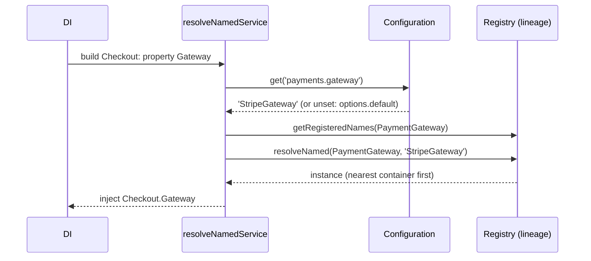

# Config-selected services

Register several implementations of one abstract service, then let a config value pick which one a class gets. Switching from a fake payment gateway to Stripe, from SMTP to a black hole, or adding a notification channel becomes a config change, not a code change. Three decorators cover one service, one service with options, and an ordered list of services.

## Which one to use

| You need | Use | Config value | Injected |
| --- | --- | --- | --- |
| One implementation, picked by name, with a default | `@AutoinjectNamedService(path, Type, { default, is, optional })` | `'StripeGateway'` | the instance |
| An ordered list of implementations, keyed | `@AutoinjectNamedServices(path, Type, { lineage: true, keyBy })` | `[{ name: 'sms', service: 'SmsChannel' }, ...]` | `Map<key, instance>` |
| Implementations built with per-entry options (connections) | `@AutoinjectService(path, Type)` | `'Name'`, `{ service: 'Name', ...options }` or a list of those | the instance, or `Map<ServiceName, instance>` for a list |
| The same, from a function | `resolveNamedService()`, `resolveNamedServices()`, `service()`, `_service()` | as above | a promise of the above |

An implementation's **name** is its class name, or the function name of a factory registered with `DI.register(factory).as(Type)`.

## How it works

### `@AutoinjectNamedService` and `resolveNamedService`

1. The decorator adds a property dependency whose resolver calls `resolveNamedService(container, path, Type, options)` when the instance is built. The class's resolve therefore returns a promise.
2. It finds the nearest container in the lineage that registers a `Configuration` and resolves it first if needed.
3. It reads the value at `path`. A value that is set and not a string throws `InvalidOption('<path> must be a string')`.
4. An unset or `''` value takes `options.default`:
   - a string: that name;
   - a subclass of `Type`: its class name;
   - any other function: a picker, called with the registered names, that returns a name or `undefined`.
   No default, or a picker that returns `undefined`, throws `InvalidOption`; with `optional: true` it gives `undefined` instead (the decorator injects `undefined`). An unknown name still throws.
5. `container.getRegisteredNames(Type)` lists the names registered across the lineage. A name not in it throws `InvalidOption('<path> "<name>": no <Type> is registered under that name (registered: ...)')`.
6. `container.resolveNamed(Type, name)` resolves the registration nearest to the container; its lifetime applies.
7. `options.is(instance)`, when given, must return `true`, or `InvalidOption('<path> "<name>" is not an <Type>')` is thrown.

### `@AutoinjectNamedServices` and `resolveNamedServices`

1. The decorator resolves `resolveNamedServices(container, path, Type, options)` when the instance is built; the class's resolve returns a promise.
2. The value at `path` must be a list; unset gives an empty `Map`. Anything else throws `InvalidOption('<path> must be a list')`.
3. Each entry needs a string `[keyBy]` and a string `service`, or `InvalidOption` is thrown. A key listed twice throws `InvalidOption`.
4. A `service` not registered for `Type` in the lineage throws `ServiceNotFound`.
5. The instance is resolved with `resolveNamed`. Its own `[keyBy]` property must equal the entry's key, or `InvalidOption` is thrown.
6. The result is a `Map` keyed by `[keyBy]`, in list order.

### `@AutoinjectService`

1. When the instance is built, the decorator reads `path` from the **resolved** configuration of the nearest container that registers one. Not resolved yet: `InvalidOperation`.
2. The value becomes service requests: a string `'Name'` is `{ service: 'Name' }`; an object is `{ service: obj.service, options: obj }`; a list maps each object the same way. An empty value logs a warning and leaves the property `undefined`.
3. DI takes the types registered for `Type` in the nearest container that has any, finds each by class name (`ServiceNotFound` when missing) and resolves it with `options` as the first constructor argument.
4. A list is injected as a `Map` keyed by each instance's `ServiceName`, or its class name when `ServiceName` is empty.

### `service()` and `_service()`

`service(path, Type, options?)` reads `cfg(path).service` from the root configuration, finds the registered type of that class name in the root container and resolves it. Resolution errors are wrapped in `ResolveException('Cannot resolve service from <path>: ...')`. `_service()` returns `() => service(...)`.



## Decorators

| Decorator | Target | Options | Effect |
| --- | --- | --- | --- |
| `@AutoinjectNamedService(path, Type, options?)` | property | `default?: string \| Class<T> \| (registered: readonly string[]) => string \| undefined`; `is?: (instance) => boolean` | Injects the one `Type` named at `path`. Resolve becomes async. |
| `@AutoinjectNamedServices(path, Type, options)` | property | `lineage: true`; `keyBy: string`, the entry and instance property used as the map key | Injects `Map<string, Type>` in list order. Resolve becomes async. |
| `@AutoinjectService(path, Type?)` | property | none; `Type` defaults to the property's design type (pass it for maps and arrays) | Injects the instance named at `path`, built with the entry as its constructor options; a `Map` for a list. |

## Configuration

The paths are yours; the shapes are fixed:

```js
export default {
  payments: {
    // @AutoinjectNamedService: a registered name, or '' / unset for the default
    gateway: 'StripeGateway',
  },
  notifications: {
    // @AutoinjectNamedServices with keyBy: 'name'
    channels: [
      { name: 'email', service: 'EmailChannel' },
      { name: 'sms', service: 'SmsChannel' },
    ],
  },
  storage: {
    // @AutoinjectService: each entry is passed to the constructor
    buckets: [
      { service: 'S3Bucket', name: 'avatars', bucket: 'acme-avatars', region: 'eu-central-1' },
      { service: 'S3Bucket', name: 'invoices', bucket: 'acme-invoices', region: 'eu-west-1' },
    ],
  },
};
```

## Services and extension points

| Service | DI token and lifetime | Default implementation | Alternatives | How to replace or extend |
| --- | --- | --- | --- | --- |
| Any service picked by `@AutoinjectNamedService` | your abstract `Type`; each implementation registered with `@Injectable(Type)` or `DI.register(Impl).as(Type)`; its own lifetime | `options.default` | every registration of `Type` in the lineage | Register a new implementation and put its name in config. A child container can register its own and win for its scope. |
| Any list picked by `@AutoinjectNamedServices` | as above | none (empty `Map`) | every registration of `Type` | Register an implementation whose `[keyBy]` property matches the entry, add the entry. |
| Any service built by `@AutoinjectService` | your `Type`; implementations registered under it, usually `@NewInstance()` | none | every registration of `Type` | Register an implementation that takes the entry as its constructor argument. |
| Config name of a registration | the class name, or a factory's function name | class name | named factory | `DI.register(namedFactory).as(Type)` where the function's `name` is the config name. |

Known users in this monorepo: `@spinajs/email` (`email.connections`, `@AutoinjectService`), `@spinajs/queue` (`queue.connections`, `queue.retention`), `@spinajs/http-socket` (`http.socket.idempotency`), `@spinajs/authn` (`authn.strategies`, `authn.mfa.steps`, `authn.mfa.policy.service`, `authn.throttle.service`).

### One service by name: custom implementation

A checkout uses `FakeGateway` unless config names another gateway. Adding Stripe is one class and one config line.

```ts sample
import { AsyncService, DI, Injectable } from '@spinajs/di';
import { AutoinjectNamedService, Configuration } from '@spinajs/configuration';

export abstract class PaymentGateway {
  public abstract charge(orderId: string, amountCents: number): Promise<string>;
}

@Injectable(PaymentGateway)
export class FakeGateway extends PaymentGateway {
  public charge(orderId: string): Promise<string> {
    return Promise.resolve(`fake-${orderId}`);
  }
}

@Injectable(PaymentGateway)
export class StripeGateway extends PaymentGateway {
  public async charge(orderId: string, amountCents: number): Promise<string> {
    // call the Stripe API here
    return `stripe-${orderId}-${amountCents}`;
  }
}

@Injectable()
export class Checkout extends AsyncService {
  // payments.gateway: 'StripeGateway' in prod config; unset in dev
  @AutoinjectNamedService('payments.gateway', PaymentGateway, { default: FakeGateway })
  protected Gateway: PaymentGateway;

  public pay(orderId: string, amountCents: number) {
    return this.Gateway.charge(orderId, amountCents);
  }
}

async function main() {
  await DI.resolve(Configuration);
  const checkout = await DI.resolve(Checkout);
  console.log(await checkout.pay('order-1', 4999));
}

void main();
```

A picker chooses among whatever is registered, which suits plugins that register themselves:

```ts
@AutoinjectNamedService('payments.gateway', PaymentGateway, {
  default: (registered) => registered.find((name) => name !== 'FakeGateway') ?? 'FakeGateway',
  is: (instance) => typeof (instance as PaymentGateway).charge === 'function',
})
protected Gateway: PaymentGateway;
```

### Ordered list: custom implementation

Notification channels run in the order config lists them. Each channel carries the `name` that config uses as its key.

```ts sample
import { AsyncService, DI, Injectable, Singleton } from '@spinajs/di';
import { AutoinjectNamedServices, Configuration } from '@spinajs/configuration';

export abstract class NotificationChannel {
  public abstract readonly name: string;
  public abstract send(userId: string, text: string): Promise<void>;
}

@Singleton()
@Injectable(NotificationChannel)
export class EmailChannel extends NotificationChannel {
  public readonly name = 'email';
  public async send(userId: string, text: string) {
    console.log(`email to ${userId}: ${text}`);
  }
}

@Singleton()
@Injectable(NotificationChannel)
export class SmsChannel extends NotificationChannel {
  public readonly name = 'sms';
  public async send(userId: string, text: string) {
    console.log(`sms to ${userId}: ${text}`);
  }
}

@Injectable()
export class Notifier extends AsyncService {
  // notifications.channels: [{ name: 'email', service: 'EmailChannel' }, { name: 'sms', service: 'SmsChannel' }]
  @AutoinjectNamedServices('notifications.channels', NotificationChannel, { lineage: true, keyBy: 'name' })
  protected Channels: Map<string, NotificationChannel>;

  public async notify(userId: string, text: string) {
    for (const channel of this.Channels.values()) {
      await channel.send(userId, text);
    }
  }
}

async function main() {
  await DI.resolve(Configuration);
  const notifier = await DI.resolve(Notifier);
  await notifier.notify('user-42', 'Your export is ready');
}

void main();
```

### Services with options: custom implementation

`@AutoinjectService` passes each entry to the implementation's constructor, so one class serves several connections. Mark the class `@NewInstance()`: a singleton is built once, so every entry gets the first entry's instance and the `Map` ends up with one key.

```ts sample
import { DI, IMappableService, Injectable, NewInstance } from '@spinajs/di';
import { AutoinjectService, Configuration } from '@spinajs/configuration';

export abstract class Bucket implements IMappableService {
  public abstract ServiceName: string;
  public abstract put(key: string, body: Buffer): Promise<void>;
}

interface S3BucketOptions {
  service: 'S3Bucket';
  name: string;
  bucket: string;
  region: string;
}

@NewInstance()
@Injectable(Bucket)
export class S3Bucket extends Bucket {
  public ServiceName: string;

  constructor(protected Options: S3BucketOptions) {
    super();
    this.ServiceName = Options.name;
  }

  public async put(key: string, body: Buffer) {
    console.log(`s3://${this.Options.bucket}/${key} (${body.length} bytes, ${this.Options.region})`);
  }
}

export class AvatarStore {
  // storage.buckets: [{ service: 'S3Bucket', name: 'avatars', bucket: 'acme-avatars', region: 'eu-central-1' }, ...]
  @AutoinjectService('storage.buckets', Bucket)
  protected Buckets: Map<string, Bucket>;

  public save(userId: string, image: Buffer) {
    return this.Buckets.get('avatars')!.put(`${userId}.png`, image);
  }
}

async function main() {
  await DI.resolve(Configuration);
  const store = DI.resolve(AvatarStore);
  await store.save('user-42', Buffer.from('png'));
}

void main();
```

### Config name: register under another name

The config name is the registration's `name`. To expose an implementation under a stable name that is not its class name, register a named factory:

```ts sample
import { DI } from '@spinajs/di';
import { resolveNamedService, Configuration } from '@spinajs/configuration';

abstract class Clock {
  public abstract now(): Date;
}

class SystemClock extends Clock {
  public now() {
    return new Date();
  }
}

// config: time.clock: 'system'
const system = { system: () => new SystemClock() }.system;
DI.register(system).as(Clock);

async function main() {
  await DI.resolve(Configuration);
  const clock = await resolveNamedService(DI.RootContainer, 'time.clock', Clock, { default: 'system' });
  console.log(clock.now().toISOString());
}

void main();
```

A factory is called on every resolve and its result is not cached.

## Important behaviour

- A class with `@AutoinjectNamedService` or `@AutoinjectNamedServices` resolves **asynchronously**: `DI.resolve(MyClass)` returns a promise even when the class is not an `AsyncService`. Await it.
- `@AutoinjectNamedService(s)` resolve the configuration first when it is registered but not resolved. Do not use them in classes the configuration itself resolves (sources, protocols): the resolve would wait on itself.
- `@AutoinjectService` needs the configuration already resolved; it throws `InvalidOperation` otherwise.
- Lookup is per container. `@AutoinjectNamedService(s)` search the whole lineage and take the registration nearest the resolving container, so a child can override one implementation. `@AutoinjectService` uses only the nearest container that registers anything for `Type`.
- Names match `name` exactly and are case-sensitive. A minifier that renames classes breaks config names; register named factories in bundled builds.
- `@AutoinjectNamedServices` passes nothing from the entry to the instance; the instance reads its own settings (with `@Config`). `@AutoinjectService` passes the whole entry, `service` key included.
- `@AutoinjectNamedServices` checks `instance[keyBy] === entry[keyBy]`. A typo in config fails at resolve with both names in the message.
- `service()` expects an object `{ service: 'Name' }` at `path`; a plain string is not accepted. It looks in the root container only.
- An unknown name fails when the owning class is resolved, not at boot. Resolve such classes in a `Bootstrapper` or at startup to fail early.

## Best practices

- Prefer `@AutoinjectNamedService` with a `default` for a single pluggable service; the error messages list the registered names.
- Give abstract services an `is` duck check when implementations can come from a second copy of the package (cjs and mjs builds), where `instanceof` fails.
- Use `@AutoinjectService` only when each entry carries constructor options, and mark those implementations `@NewInstance()`.
- Register implementations in the same module as the abstract class, or import them before the consumer resolves.

## Patterns and antipatterns

```ts
// Don't: a singleton is built once; the map holds only the first entry's bucket
@Injectable(Bucket)
export class S3Bucket extends Bucket { /* ... */ }

// Do
@NewInstance()
@Injectable(Bucket)
export class S3Bucket extends Bucket { /* ... */ }
```

```ts
// Don't: the resolve is async; this is a pending promise
const checkout = DI.resolve(Checkout) as Checkout;
checkout.pay('order-1', 100);

// Do
const checkout = await DI.resolve(Checkout);
await checkout.pay('order-1', 100);
```

## Examples

### Different gateway per tenant container

```ts sample
import { DI, Injectable, PerChildInstance } from '@spinajs/di';
import { AutoinjectNamedService, Configuration, ConfigurationSource, FrameworkConfiguration, StaticConfigurationSource } from '@spinajs/configuration';

abstract class TaxCalculator {
  public abstract rate(): number;
}

@Injectable(TaxCalculator)
class PolishVat extends TaxCalculator {
  public rate() {
    return 0.23;
  }
}

@Injectable(TaxCalculator)
class GermanVat extends TaxCalculator {
  public rate() {
    return 0.19;
  }
}

@PerChildInstance()
class InvoiceService {
  @AutoinjectNamedService('tax.calculator', TaxCalculator, { default: 'PolishVat' })
  public Tax: TaxCalculator;
}

async function tenant(calculator: string) {
  const child = DI.child();
  child.register(StaticConfigurationSource({ tax: { calculator } })).as(ConfigurationSource);
  child.register(class TenantConfiguration extends FrameworkConfiguration {}).as(Configuration);
  child.register(InvoiceService).asSelf();
  return (await child.resolve(InvoiceService)) as InvoiceService;
}

async function main() {
  const de = await tenant('GermanVat');
  const pl = await tenant('');
  console.log(de.Tax.rate(), pl.Tax.rate());
}

void main();
```

## Related

- [Injecting config values](07-injecting-config-values.md): `@Config` for plain values.
- [Replacing the configuration service](09-replacing-the-configuration-service.md#one-configuration-per-child-container): a configuration per child container.
- [`@spinajs/di`](../di/README.md): `getRegisteredNames`, `resolveNamed`, lifetimes.
- [`@spinajs/email`](../email/README.md), [`@spinajs/queue`](../queue/README.md): packages configured this way.
