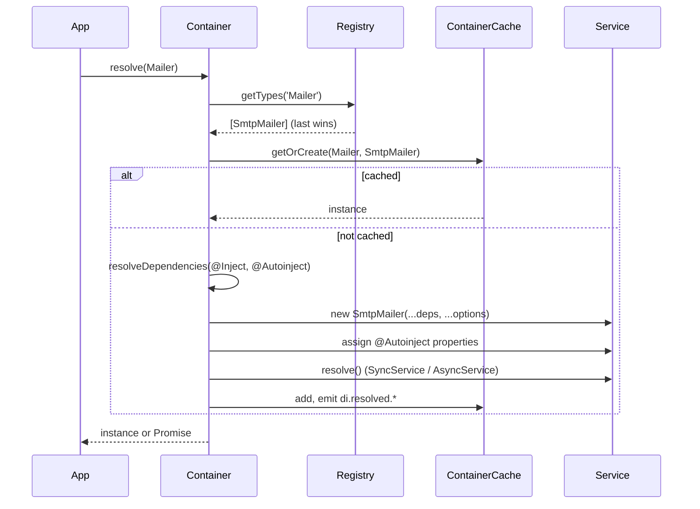

# Resolving services

Resolving turns a key into an instance: the container picks the registration, builds its dependencies, creates the object, and caches it according to its lifetime. Use `resolve()` to build or reuse, `get()` to read only what is already built, and `resolveOptional()` when a missing registration is a valid case.

## How it works

`Container.resolve(type, options?, check?)` for a single class or string key:

1. **Argument check.** A falsy `type` throws `InvalidArgument('argument \`type\` cannot be null or undefined')`.
2. **Strict check.** When `options === true` or `check === true`, `hasRegistered(type)` must be true in this container or an ancestor, or it throws `Error('Type <Name> is not registered at container')`.
3. **Lists.** `Array.chainOf(T)` and `Array.ofType(T)` branch off here; see [Multiple implementations](06-multiple-implementations.md).
4. **Pick the registration** (`getCurrentType`): the last entry under the key. No entry: the class itself; for a string key, the result is `null`.
5. **Factory.** A factory function is called on every resolve with `(container, ...options)`; see [Factories](08-factories.md).
6. **Owner and target** (`resolveType`): the container that owns the key's registration is found (this one or the nearest ancestor), and registrations are followed to the final class (`followRegistered`).
7. **Descriptor** (`extractDescriptor`): the lifetime and the injection list of the class and all its base classes.
8. **Cache** (`ContainerCache.getOrCreate`): a singleton-like lifetime returns the cached instance when there is one. Otherwise the dependencies are resolved and the instance is created and cached; see [Lifetimes](04-lifetimes.md).
9. **Create** (`getNewInstance`): `new Class(...injected, ...options)`; then `@Autoinject` properties are assigned; then `SyncService.resolve()` runs, or `AsyncService.resolve()` is awaited.
10. **Result.** The instance, or a `Promise` of it when anything on the way is asynchronous.



## API

| Call | Returns | Notes |
| --- | --- | --- |
| `DI.resolve(type, options?, check?)` / `container.resolve(...)` | Instance, `Promise`, list, or `null` for an unknown string key | `options` is an array of extra constructor arguments; pass `true` as the second or third argument for the strict check |
| `container.resolveOptional(type, options?)` | Instance, or `undefined` when nothing is registered here or in an ancestor | Never builds an unregistered class |
| `DI.get(key)` / `container.get(key, parent = true)` | The last cached instance under `key`, or `undefined` | Never builds. `get(Array.ofType(T))` returns every cached instance under `T`. Factory results and `@NewInstance()` objects are never cached |
| `DI.has(key)` / `container.isResolved(key, parent = true)` | `true` when an instance is cached under `key` | Not the same as `DI.check(key)`, which asks the registry |
| `_resolve(type, options?, check?)` | `() => DI.resolve(type, options, check)` | A thunk over the root container, for lazy defaults |

`resolve`, `get`, `getRegisteredTypes` and `check` are also exported at the top level of `@spinajs/di`, next to the `DI` namespace.

## Sync or async

`resolve()` returns a `Promise` when:

- the class extends `AsyncService` (its `resolve()` is awaited), or
- any dependency, at any depth, resolves to a promise, or
- a `resolveFunc` of a [custom injection](11-custom-injection-decorators.md) returns one.

The return type (`ResolveResult<T>`) only knows the first case: `T extends AsyncService ? Promise<T> : T`. A plain class with an `AsyncService` dependency is typed `T` but arrives as a `Promise`. `await` the result whenever the graph contains an async service; awaiting a plain object is harmless.

## Constructor options

`options` are appended after the `@Inject` constructor arguments: `@Inject(Db) class Repo { constructor(db, table) }` gets `DI.resolve(Repo, ['users'])` as `(db, 'users')`.

They are used only when an instance is created. A cached singleton is returned as is, whatever options you pass on the next call. Use `@NewInstance()` or `@PerInstanceCheck()` for classes that take per-call arguments; see [Lifetimes](04-lifetimes.md).

## Errors

| Error | When |
| --- | --- |
| `InvalidArgument` (`@spinajs/exceptions`) | `type` is `null` or `undefined`; `get()` or `isResolved()` is given an `Array.chainOf(T)` |
| `Error('Type <Name> is not registered at container')` | Strict check, nothing registered |
| `Error('Circular dependency detected for <Name>')` | A singleton is requested again, synchronously, while it is being created |
| `ServiceNotFound` | A `serviceFunc` names a service that is not registered; `resolveNamed` finds no such name |
| `ResolveException` | A `@PerInstanceCheck()` class has no `__checkInstance__` |
| Anything a constructor or `resolve()` throws | Passed through; an async failure rejects the returned promise |

## Important behaviour

- Resolving an abstract base class with no registration creates an instance of the abstract class itself; JavaScript allows it. Use the strict check, `@Autoinject(Base, { check: true })` or `resolveOptional()` where that would be a mistake.
- Concurrent async resolves of one singleton share one creation: the second caller gets the same promise, and `AsyncService.resolve()` runs once.
- `get()` returns the **last** cached instance under a key; `get(Array.ofType(key))` returns all of them.
- `DI.get()` and `DI.has()` look in ancestors by default (`parent = true`).

## Best practices

- In application code, prefer `@Autoinject` over calling `DI.resolve()` inside methods; the dependency stays visible and replaceable.
- Use `DI.resolve()` at the edges: entry files, CLI commands, test setup, callbacks from libraries that do not go through the container.
- Pass `check: true` (or `@Autoinject(Base, { check: true })`) for abstract bases that must have a registration, so a missing plugin fails loudly.

## Patterns and antipatterns

```ts
// Don't: Cache gets an async dependency, so this is a Promise typed as ReportBuilder
const builder = DI.resolve(ReportBuilder);
builder.build(); // TypeError: builder.build is not a function

// Do
const builder = await DI.resolve(ReportBuilder);
builder.build();
```

```ts
// Don't: get() never builds; it is undefined until something resolves Mailer
const mailer = DI.get(Mailer)!;

// Do
const mailer = DI.resolve(Mailer);
```

## Examples

### Purge old audit rows from a scheduled job

```ts sample
import { AsyncService, DI, Inject } from '@spinajs/di';

class Database extends AsyncService {
  public rows = [{ id: 1, at: new Date('2020-01-01') }, { id: 2, at: new Date() }];

  public async resolve() {
    // open the connection pool here
    await super.resolve();
  }
}

@Inject(Database)
class AuditPurger {
  constructor(protected readonly db: Database, protected readonly days: number) {}

  public purge() {
    const limit = Date.now() - this.days * 24 * 3600 * 1000;
    this.db.rows = this.db.rows.filter((r) => r.at.getTime() >= limit);
    return this.db.rows.length;
  }
}

async function nightlyJob() {
  // Database is async, so AuditPurger arrives as a promise even though it is a plain class.
  const purger = await DI.resolve(AuditPurger, [90]);
  console.log('rows left', purger.purge());
}

void nightlyJob();
```

### Use an optional integration only when installed

```ts sample
import { DI } from '@spinajs/di';

abstract class MetricsSink {
  public abstract count(name: string): void;
}

function recordSignup() {
  // undefined when no package registered a MetricsSink
  const sink = DI.RootContainer.resolveOptional(MetricsSink);
  sink?.count('signup');
}

recordSignup();
```

## Related

- [Registering services](01-registering-services.md): which registration a resolve picks.
- [Injection decorators](03-injection-decorators.md): how dependencies are declared.
- [Lifetimes](04-lifetimes.md): when a resolve reuses an instance.
- [Service lifecycle](10-service-lifecycle.md): `SyncService` and `AsyncService` initialization.
