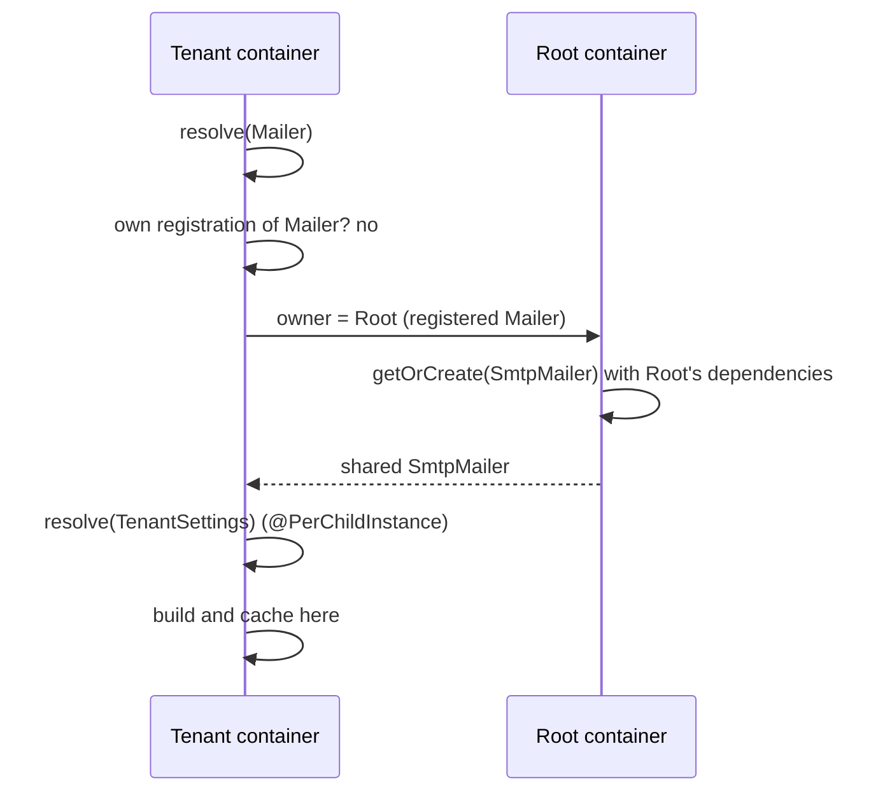

# Child containers

A child container inherits every registration and cached instance of its parent and can override any of them for one scope: a tenant, a domain, a database connection, a test. Use it when part of the app needs a different implementation or its own instances without touching the rest.

## How it works

1. `DI.child()` or `container.child()` creates a container of the parent's class, `new Container(parent)` by default. The parent keeps it in its children set until the child emits `di.dispose`.
2. **Lookup.** A key the child has not registered is looked up in the parent, then the grandparent, up to the root. A key the child registers hides the parent's list for single resolves and for `Array.ofType`. `Array.chainOf` merges all levels; see [Multiple implementations](06-multiple-implementations.md).
3. **Owner.** For each resolve the container finds the **owner** of the key: the nearest container, starting at itself, that registered the key. A key registered nowhere is owned by the resolving container. A container created with `child({ isolateSingletons: true })` owns every key resolved through it (or through a plain child of it) that it reaches before the registering ancestor, and never reuses an ancestor's cached instance.
4. **Where the instance is built and cached:**
   - `Singleton`, `PerInstance`, `PerInstanceCheck`: in the owner, with the owner's dependencies.
   - `PerChildContainer`: in the resolving container.
   - `NewInstance` and factories: in the resolving container, never cached.
5. **Disposal.** `child.dispose()` disposes the child's own children, then every `Service` in the child's cache, then clears the cache and emits `di.dispose`. `child.dispose({ plainOwners: true })` also calls `dispose()` on cached instances that are not a `Service`. The parent's instances are untouched. See [Service lifecycle](10-service-lifecycle.md).



### Which container owns an instance

| Situation | Instance lives in |
| --- | --- |
| Root registers `Mailer`; a child resolves it | Root, shared by every child |
| Root registers `Mailer`; the child registers `TenantMailer` as `Mailer` | The child, for the child; root keeps its own |
| The child registers the same class again (`child.register(SmtpMailer).asSelf()`) | The child gets its own instance |
| Nobody registers `Report`; the root resolves it first | Root; children reuse it |
| Nobody registers `Report`; a child resolves it first | That child; a sibling builds its own |
| The child already holds a cached instance of the class | The child's instance wins over the owner's |
| `@PerChildInstance()` class, registered anywhere | Every container that resolves it |
| Root registers `Mailer`; a `child({ isolateSingletons: true })` resolves it | That child; root caches nothing, and disposing the child disposes it |

A singleton built in the root gets root dependencies, even when a child resolves it and has its own registration for one of those dependencies. `@Autoinject(Container)` in it receives the root container.

## Container API

| Member | Meaning |
| --- | --- |
| `Parent` | The parent container, `undefined` for the root and for a standalone container |
| `Registry` | The `Registry`: what is registered under which key, and the values from `asValue` / `asMapValue` |
| `Cache` | The `ContainerCache`: built instances, iterable as `{ key, value }`; `has` and `get` also see the registry's values |
| `child(options?)` | A new child of this container; `{ isolateSingletons: true }` makes it own the singletons resolved through it |
| `dispose(options?)` | Dispose children and cached services, clear the cache; `{ plainOwners: true }` also disposes cached non-`Service` instances that have a `dispose()` |
| `isCached(instance, parent = false)` | `true` when this container's cache holds `instance` |
| `clear()`, `clearCache()`, `clearRegistry()` | Empty this container's cache and registry; values go with the registry |
| `getCacheStats()` | `{ size, entries, childrenCount }` for memory checks; `size` counts cached instances, not values |
| `snapshot()` / `restore(snapshot)` | Copy this container's registrations, values (with the entries of `asMapValue` maps), cache and listeners. `restore` waits for resolves in flight, puts the copy back, then disposes the children and every `Service` cached since the snapshot, and repeats until a pass finds nothing new (at most 5 passes, then a warning), so what that disposal resolved or registered is taken back too. `DI.snapshot()` / `DI.restore()` act on the root |
| `DI.RootContainer` | The root `IContainer`; every `DI.*` function works on it |

## Services and extension points

| Service | DI token and lifetime | Default implementation | Alternatives | How to replace or extend |
| --- | --- | --- | --- | --- |
| Any registered service, per scope | The same key in a child; lifetime of the child's class | The parent's registration | Your class or factory | `child.register(Impl).as(Base)` before the child resolves `Base` |
| The container | `Container`; created with `new Container(parent?)` | `Container` | A subclass of `Container` | Override `protected getNewInstance()` or `protected resolveDependencies()`; see the limits below |

### A per-tenant override

Create one child per tenant, register the tenant's implementations in it, and resolve the tenant's services from it. Register before the first resolve in that child.

```ts sample
import { Autoinject, DI, IContainer, Injectable } from '@spinajs/di';

abstract class InvoiceNumbering {
  public abstract next(seq: number): string;
}

@Injectable(InvoiceNumbering)
class YearlyNumbering extends InvoiceNumbering {
  public next(seq: number) {
    return `${new Date().getFullYear()}/${seq}`;
  }
}

class PrefixedNumbering extends InvoiceNumbering {
  constructor(protected readonly prefix: string) {
    super();
  }

  public next(seq: number) {
    return `${this.prefix}-${seq}`;
  }
}

class InvoiceService {
  @Autoinject()
  protected Numbering: InvoiceNumbering;

  public issue(seq: number) {
    return this.Numbering.next(seq);
  }
}

const tenants = new Map<string, IContainer>();

function tenantContainer(tenant: string): IContainer {
  let container = tenants.get(tenant);
  if (!container) {
    container = DI.child();
    if (tenant === 'acme') {
      container.register(() => new PrefixedNumbering('ACME')).as(InvoiceNumbering);
    }
    tenants.set(tenant, container);
  }
  return container;
}

// InvoiceService is registered nowhere, so each tenant container builds its own.
console.log(tenantContainer('acme').resolve(InvoiceService).issue(7));
console.log(tenantContainer('globex').resolve(InvoiceService).issue(7), YearlyNumbering.name);
// ACME-7
// 2026/7
```

### A custom container

Subclass `Container` to observe or change instance creation. `getNewInstance(type, injections, options)` creates one object; `resolveDependencies(entries)` resolves a class's injection list.

```ts sample
import { Class, Container, Factory, IResolvedInjection } from '@spinajs/di';

class CountingContainer extends Container {
  public readonly Created = new Map<string, number>();

  protected getNewInstance(type: Class<unknown> | Factory<unknown>, injections?: IResolvedInjection[], options?: unknown[]) {
    this.Created.set(type.name, (this.Created.get(type.name) ?? 0) + 1);
    return super.getNewInstance(type, injections, options);
  }
}

class ReportBuilder {}

const container = new CountingContainer();
container.resolve(ReportBuilder);
container.resolve(ReportBuilder);
console.log(container.Created);
// Map(1) { 'ReportBuilder' => 1 }
```

Limits of a custom container:

- `child()` creates the child with `new this.constructor(parent)`, so children inherit the subclass and its constructor must accept `(parent?: IContainer)`.
- The container caches itself under its runtime class name and under `'Container'`, so `@Autoinject(Container)` inside a `CountingContainer` gets that container.
- `@Injectable` and `DI.register()` write to the root container. A standalone container (`new Container()` with no parent) sees none of those registrations.

## Important behaviour

- A child does not see registrations made in a sibling, and the root never sees a child's registrations.
- Resolving in a child writes nothing into the child's registry when an ancestor owns the key, so a later root registration stays visible to the child.
- `DI.*` calls always use the root, even inside an object a child built. Use `@Autoinject`, `@LazyInject` or the injected container for scoped lookups.
- `dispose()` on the root disposes every live child first.
- A disposed child is removed from its parent's children set, but it stays usable: its registry is kept and its cache is rebuilt on the next resolve.
- `get()` and `isResolved()` look in ancestors by default, also on a `child({ isolateSingletons: true })`: they can return an ancestor's cached instance while `resolve()` in that child builds its own.
- A value belongs to the container it was registered in. `dispose()` disposes a value that is a `Service`, but the value stays registered until `uncache`, `clearRegistry()` or `clear()`.
- Import every module before `snapshot()`. `restore()` puts registrations, values and value maps back as they were, so what a decorator registered when its module was first imported after the snapshot is gone, and importing the module again does not run the decorator again.

## Best practices

- Keep one child per scope and reuse it; every `child()` call is a fresh, empty override layer.
- Call `dispose()` on a scope's child when the scope ends, so its `PerChildContainer` services and its own singletons release their resources.
- Pass the scope's container to code that resolves at runtime (`@Autoinject(Container)`), instead of calling `DI.resolve()`.

## Patterns and antipatterns

```ts
// Don't: DI.resolve() reads the root, so the tenant override is ignored
class InvoiceJob {
  public run() {
    return DI.resolve(InvoiceNumbering).next(1);
  }
}

// Do: resolve from the container that built the job
class InvoiceJob {
  @Autoinject(Container)
  protected Container: Container;

  public run() {
    return this.Container.resolve(InvoiceNumbering).next(1);
  }
}
```

## Examples

### Isolate a test from the app's registrations

```ts sample
import { DI, Injectable } from '@spinajs/di';

abstract class ExchangeRates {
  public abstract rate(from: string, to: string): Promise<number>;
}

@Injectable(ExchangeRates)
class HttpExchangeRates extends ExchangeRates {
  public async rate(): Promise<number> {
    throw new Error('no network in tests');
  }
}

async function testConversion() {
  const scope = DI.child();
  scope.register(() => ({ rate: async () => 4.5 })).as(ExchangeRates);

  const rates = scope.resolve(ExchangeRates);
  console.log((await rates.rate('EUR', 'PLN')) * 10);

  await scope.dispose();
  console.log(DI.resolve(ExchangeRates) instanceof HttpExchangeRates);
}

void testConversion();
```

## Related

- [Lifetimes](04-lifetimes.md): `@PerChildInstance()` and the singleton cache.
- [Multiple implementations](06-multiple-implementations.md): `Array.ofType` versus `Array.chainOf` across levels.
- [Service lifecycle](10-service-lifecycle.md): what `dispose()` calls.
- [Named services](07-named-services.md): looking up a registration by name across the lineage.
