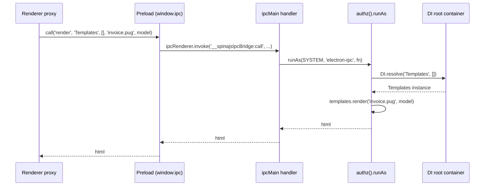

# Main process IPC bridge

Importing `@spinajs/electron` in the main process registers three `ipcMain` channels. Each one takes a service name (or an ORM connection name) and a method name, looks the target up in the root DI container and calls the method with the renderer's arguments. Use it to reach any main-process service from a renderer without writing IPC handlers by hand.

## How it works

`exposeIpcBridge()` runs once, when the main entry is first imported, and logs `Electron main process exposed spinajs IPC bridge !` to the `ipc` logger. When no `Log` is registered yet (`@spinajs/log` not imported before `@spinajs/electron`), it skips that line.

| Channel | Registered with | Main-side function | Renderer call |
| --- | --- | --- | --- |
| `__spinajsIpcBridge:call` | `ipcMain.handle` | `callService(method, service, resolveArgs, ...args)` | `call(method, service, resolveArgs, ...args)` |
| `__spinajsIpcBridge:callSync` | `ipcMain.on` | `callServiceSync(event, method, service, ...args)` | `callSync(method, service, ...args)` |
| `__spinajsIpcBridge:callOnOrmConnection` | `ipcMain.handle` | `callOnOrmConnection(connection, method, ...args)` | `callOnOrmConnection(connection, method, ...args)` |

### Async service call (`call`)

1. The renderer calls `window.ipc.__spinaJsIpcBridge.call(method, service, resolveArgs, ...args)`, which runs `ipcRenderer.invoke('__spinajsIpcBridge:call', ...)`.
2. `callService()` wraps the work in `authz().runAs(SYSTEM, 'electron-ipc', fn)`. When `service` is `'Log'` it skips `runAs`.
3. `DI.resolve(service, resolveArgs)` resolves the service by its DI name in the root container. It creates the service if nothing resolved it yet, and awaits an async service.
4. The method runs with `...args`; its awaited result goes back to the renderer.
5. Errors:
   - No registration under `service`: the call rejects (`no service named: <service> exists in DI container`).
   - `method` is not a function on the service: the call rejects (`not found in service named: <service>`).
   - The method throws or rejects: the call rejects with a new `Error` whose message ends in `cause: <original message>`.

### Sync service call (`callSync`)

1. The renderer calls `callSync(method, service, ...args)`, which runs `ipcRenderer.sendSync('__spinajsIpcBridge:callSync', ...)` and blocks the renderer until main answers.
2. `callServiceSync()` takes the service with `DI.get(service)`: only an instance that is already resolved. It never creates one.
3. The method runs and its return value is written to `event.returnValue`.
4. Every failure (no instance, no method, method throws) writes an `Error` to `event.returnValue`. The preload script throws it in the renderer.

`callSync` does **not** run as `SYSTEM`: it cannot await `runAs`, so it runs unattended. An authz check or a scoped ORM query inside it is denied.

### ORM connection call (`callOnOrmConnection`)

1. The renderer calls `callOnOrmConnection(connection, method, ...args)`.
2. `callOnOrmConnection()` runs as `SYSTEM`, takes the resolved `Orm` with `DI.get(Orm)` and reads `Orm.Connections.get(connection)`.
3. The method runs on that `OrmDriver` and its result goes back.
4. Errors:
   - `Orm` not resolved yet, or no connection under that name: the call rejects.
   - The driver method rejects: the call rejects with a new `Error` (`callOnOrmConnection() failed, method: <method>, connection: <connection>`) whose `cause` is the driver error.



## Configuration

The bridge reads no configuration keys. Its behaviour depends on keys of other packages:

| Key | Type | Default | Allowed values | Meaning |
| --- | --- | --- | --- | --- |
| `authz.audit.runAs` | `boolean` | see [`@spinajs/authz`](../authz/04-host-boot-and-configuration.md#configuration) | | When on, every `call` and `callOnOrmConnection` (except calls to `Log`) writes one `runAs` audit entry with reason `electron-ipc`. |

## Services and extension points

| Service | DI token and lifetime | Default implementation | Alternatives | How to replace or extend |
| --- | --- | --- | --- | --- |
| Any main-process service you want the renderer to call | The service's DI name (class name or string token), root container, any lifetime | Your registration | | Register it in the main process. The renderer addresses it by that name. |
| IPC handlers | `ipcMain` channels `__spinajsIpcBridge:*`, registered at import | `exposeIpcBridge()` (not exported) | | Not replaceable from outside. Wrap or filter calls in your own preload instead, see [Preload script](02-preload-script.md#preload-bridge-custom-implementation). |

### Exposed service: custom implementation

The bridge has no allowlist and no registration step of its own: whatever the main DI container can resolve by name, a renderer can call. To expose a new capability, register a service in the main process and call it by its DI name from the renderer.

- The DI name is the class name for `@Injectable()`, `@Singleton()` and `DI.register(X).as(X)`, or the string you pass to `as('...')`.
- For `callSync`, resolve the service in main before the renderer calls it: `callSync` only finds instances that already exist.
- Arguments and results cross IPC with the structured clone algorithm. Class instances arrive as plain objects, functions and promises cannot cross.

Main process: an update checker, registered under its class name.

```ts sample
import '@spinajs/log';
import '@spinajs/electron';
import { DI, Singleton } from '@spinajs/di';
import { app } from 'electron';

interface IUpdateInfo {
  current: string;
  latest: string;
  available: boolean;
}

@Singleton()
export class UpdateService {
  public async check(channel: 'stable' | 'beta'): Promise<IUpdateInfo> {
    const response = await fetch(`https://updates.example.com/${channel}/latest.json`);
    const { version } = (await response.json()) as { version: string };
    return { current: app.getVersion(), latest: version, available: version !== app.getVersion() };
  }

  public currentVersion(): string {
    return app.getVersion();
  }
}

app.whenReady().then(async () => {
  // Resolve now so that callSync('currentVersion', 'UpdateService') finds the instance.
  await DI.resolve(UpdateService);
});
```

Renderer: a typed proxy that calls it.

```ts
import { DI, Singleton } from '@spinajs/di';
import '@spinajs/electron';

interface IUpdateInfo {
  current: string;
  latest: string;
  available: boolean;
}

@Singleton()
export class UpdateService {
  public check(channel: 'stable' | 'beta'): Promise<IUpdateInfo> {
    return window.ipc.__spinaJsIpcBridge.call<IUpdateInfo>('check', 'UpdateService', [], channel);
  }

  public currentVersion(): string {
    return window.ipc.__spinaJsIpcBridge.callSync<string>('currentVersion', 'UpdateService');
  }
}

const updates = await DI.resolve(UpdateService);
const info = await updates.check('stable');
```

Giving the renderer proxy the same class name as the main service keeps the call sites identical in both processes. More proxy patterns are in [Renderer service proxies](03-renderer-services.md).

## Important behaviour

- **No access control.** Any renderer with the bridge can call any method of any service in the main root container, and any method of any ORM connection, including `executeOnDb()` with raw SQL. Load only trusted content in such windows, or expose a restricted bridge from your preload.
- **Calls run as `SYSTEM`.** `call` and `callOnOrmConnection` run inside `authz().runAs(SYSTEM, 'electron-ipc', ...)`, so authz checks and scoped queries in them pass. An app that never booted authz gets `AuthzConfigError` from `authz()`, and the call then runs without `runAs`.
- **`Log` calls skip `runAs`.** Renderer log lines would otherwise write one audit entry each.
- **`callSync` runs unattended.** Authz checks and scoped ORM queries inside it are denied.
- **`callSync` never creates services.** It uses `DI.get()`. A service nobody resolved yet gives `no service named: <service> exists in DI container`.
- **`callSync` needs a cloneable return value.** A method that returns a promise cannot answer a sync call. <!-- TODO(docs-hook): verify what the renderer receives when event.returnValue is set to a Promise -->
- **Error shapes differ per channel.** Every failure on `call` and `callOnOrmConnection` rejects. On `callSync` main answers with an `Error` value, which the preload throws.
- **Root container only.** Services are resolved with `DI.resolve()` / `DI.get()` on the root container, never a child container.
- **Import order.** The bridge resolves the `ipc` logger at import. Import `@spinajs/log` before `@spinajs/electron`, so `Log` has its factory registered.
- **Main process only.** The main entry imports `ipcMain` and `app`. Importing it anywhere else fails.

## Best practices

- Give each renderer feature its own main-process facade service (`UpdateService`, `InvoiceService`) and call that, instead of calling `Orm` or `Configuration` methods with arbitrary arguments.
- Resolve every service a renderer reaches with `callSync` before you create the window.
- Prefer `call` over `callSync`: it does not block the renderer and it runs as `SYSTEM`.

## Patterns and antipatterns

```ts
// Don't: a sync call to an async method; the promise cannot cross the sync channel.
const html = window.ipc.__spinaJsIpcBridge.callSync<string>('render', 'Templates', 'invoice.pug', model);

// Do
const html = await window.ipc.__spinaJsIpcBridge.call<string>('render', 'Templates', [], 'invoice.pug', model);
```

```ts
// Don't: raw SQL from the renderer runs as SYSTEM with no checks.
await window.ipc.__spinaJsIpcBridge.callOnOrmConnection('default', 'executeOnDb', `DELETE FROM invoices WHERE id = ${id}`, [], QueryContext.Delete);

// Do: a main-process service that owns the rule.
await window.ipc.__spinaJsIpcBridge.call('cancel', 'InvoiceService', [], id);
```

## Examples

### Expose invoice rendering to the renderer

Main process: register the service; the renderer calls `render` by name.

```ts sample
import '@spinajs/log';
import '@spinajs/electron';
import { DI, Injectable } from '@spinajs/di';
import { app } from 'electron';

interface IInvoice {
  number: string;
  total: number;
}

@Injectable()
export class InvoicePrinter {
  public async render(invoice: IInvoice): Promise<string> {
    return `<h1>Invoice ${invoice.number}</h1><p>Total: ${invoice.total.toFixed(2)}</p>`;
  }
}

app.whenReady().then(async () => {
  await DI.resolve(InvoicePrinter);
});
```

Renderer:

```ts
import '@spinajs/electron';

const html = await window.ipc.__spinaJsIpcBridge.call<string>('render', 'InvoicePrinter', [], { number: 'FV/2026/10/17', total: 199.9 });
document.querySelector('#preview')!.innerHTML = html;
```

## Related

- [Preload script](02-preload-script.md): the renderer side of these channels.
- [Renderer service proxies](03-renderer-services.md): the proxies that call `Configuration`, `Intl`, `Templates` and `EmailService` over this bridge.
- [`@spinajs/authz`](../authz/01-check-flow.md#concepts): `SYSTEM`, `runAs` and unattended principals.
- [`@spinajs/di`](../di/README.md): how DI names and lifetimes decide what `DI.resolve(name)` returns.
