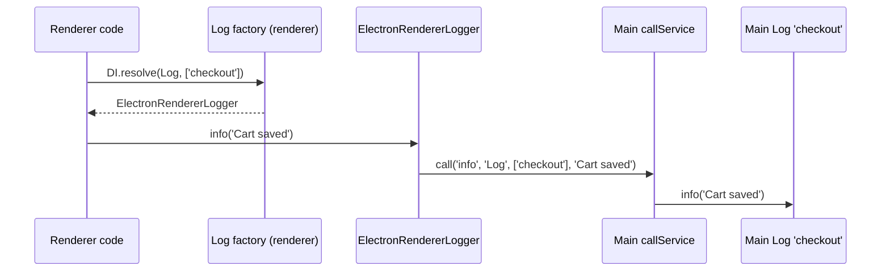

# Renderer logging

The renderer entry replaces the `Log` registration with a factory that returns `ElectronRendererLogger`. Each log call in the renderer is sent to the main process and written by the main logger of the same name, with its rules and targets. Use it to keep one set of log files for the whole app.

## How it works

1. Importing the renderer entry registers, in the renderer root container:
   - `logFactoryFunction` as `Log` and as `'__log__'`;
   - `ElectronRendererLogger` as `'__logImplementation__'`.
2. `DI.resolve(Log, ['checkout'])` (or `@Logger('checkout')`) calls the factory with `logName = 'checkout'`.
3. The factory returns `ElectronRendererLogger.Loggers.get('checkout')` when present, otherwise `container.resolve('__logImplementation__', ['checkout'])`.
4. `new ElectronRendererLogger('checkout')` sets `Name` and adds itself to `Log.Loggers`, so the next resolve of `checkout` returns the same instance.
5. `logger.info('Cart saved', ...)` calls `window.ipc.__spinaJsIpcBridge.call('info', 'Log', ['checkout'], 'Cart saved', ...)` and does not await it.
6. In main, `callService()` resolves `DI.resolve('Log', ['checkout'])`, the main logger named `checkout`, and calls `info('Cart saved', ...)` on it, without `runAs`.



## Configuration

The renderer logger reads no configuration. Levels, rules and targets come from the main process `logger` configuration of [`@spinajs/log`](../log/README.md), applied to the logger name you pass.

## Services and extension points

| Service | DI token and lifetime | Default implementation | Alternatives | How to replace or extend |
| --- | --- | --- | --- | --- |
| Log factory | `Log` and `'__log__'`; factory function, runs on every resolve | `logFactoryFunction` in `renderer.ts` (not exported) | | `DI.register(myFactory).as(Log)` after importing the renderer entry. The last registration wins. |
| Logger implementation | `'__logImplementation__'`; one instance per name (`@NewInstance()`, cached in `Log.Loggers`) | `ElectronRendererLogger` | | `DI.register(MyLogger).as('__logImplementation__')`. |

### `ElectronRendererLogger` members

| Member | Behaviour |
| --- | --- |
| `constructor(name)` | Sets `Name` and stores the instance in `Log.Loggers` under `name`. |
| `trace`, `debug`, `info`, `warn`, `error`, `fatal`, `security`, `success` | Forward all arguments with `call(<level>, 'Log', [Name], ...args)`. Fire and forget. |
| `child()`, `write()` | Throw `Method not implemented.` |
| `setLevel()`, `getLevel()`, `addVariable()`, `timeStart()` and the other `Log` members | Inherited from `Log` in `@spinajs/log-common`; they act on the renderer object only and do not filter forwarded calls. |

### Logger implementation: custom implementation

Subclass the shipped logger to add renderer-side behaviour, such as sending `trace` lines only while a debug flag is set. Mark the subclass `@NewInstance()` as well, so each name keeps its own instance.

```ts
import { DI, NewInstance } from '@spinajs/di';
import { Log } from '@spinajs/log-common';
import { ElectronRendererLogger } from '@spinajs/electron';

@NewInstance()
export class NamedRendererLogger extends ElectronRendererLogger {
  public trace(...args: unknown[]): void {
    if (localStorage.getItem('debug-trace') === '1') {
      window.ipc.__spinaJsIpcBridge.call('trace', 'Log', [this.Name], ...args);
    }
  }
}

DI.register(NamedRendererLogger).as('__logImplementation__');

const log = DI.resolve(Log, ['checkout']);
log.info('Cart saved, %d items', 3);
```

The inherited constructor adds the instance to `Log.Loggers`, so the factory returns it on the next resolve of that name.

### Log factory: custom implementation

Replace the factory to keep some loggers local, eg. send `ui-*` loggers to the DevTools console and everything else to main.

```ts
import { DI, IContainer } from '@spinajs/di';
import { Log } from '@spinajs/log-common';
import '@spinajs/electron';

const rendererLogFactory = (container: IContainer, logName: string) => {
  if (logName.startsWith('ui-')) {
    return container.resolve('ConsoleLog', [logName]);
  }
  return container.resolve('__logImplementation__', [logName]);
};

DI.register(rendererLogFactory).as(Log);
DI.register(rendererLogFactory).as('__log__');
```

`ConsoleLog` stands for any `Log` subclass you register under that name.

## Important behaviour

- **One logger per name.** Each name gets its own `ElectronRendererLogger`, kept in the static `Log.Loggers` map; resolving the same name again returns that instance.
- **Fire and forget.** Log methods return before main writes the line; a failed IPC call is not reported to the caller.
- **No `runAs` audit.** Main runs `Log` calls without `authz().runAs()`, so renderer log lines write no audit entries.
- **Arguments are cloned.** `Error` objects arrive in main as plain errors with `message` and `stack`; functions in the arguments break the call.
- **Import order in the renderer.** If the renderer bundle also imports `@spinajs/log`, the module imported last wins the `Log` registration.

## Best practices

- Use the same logger names in renderer and main for one feature, eg. `checkout`, so one log rule covers both.
- Pass structured fields as the first argument (`log.info({ cartId }, 'Cart saved')`); they reach the main logger unchanged.
- Allow all `Log` methods in a restricted preload, see [Preload script](02-preload-script.md#preload-bridge-custom-implementation).

## Patterns and antipatterns

```ts
// Don't: child() throws in the renderer.
const child = log.child('payment');

// Do: resolve another named logger.
const paymentLog = DI.resolve(Log, ['checkout-payment']);
```

## Related

- [Main process IPC bridge](01-main-process-bridge.md): the `call` channel used for every log line.
- [`@spinajs/log`](../log/README.md): main-side loggers, rules and targets.
