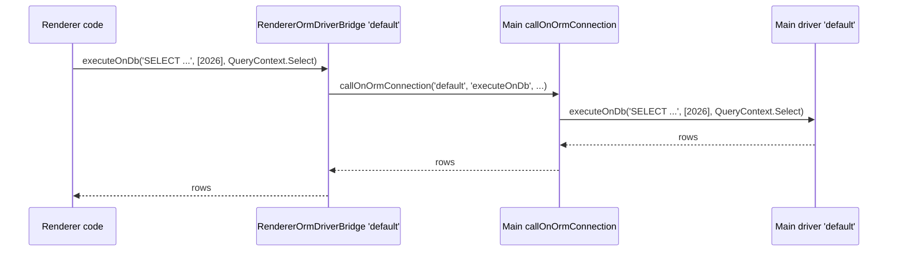

# Renderer ORM bridge

The renderer entry registers `ElectronRendererOrm` as `Orm` and `RendererOrmDriverBridge` under the `orm-driver-sqlite`, `orm-driver-mysql` and `orm-driver-mssql` tokens. The renderer `Orm` then opens one bridge per configured connection, and the bridge forwards raw statements and `tableInfo()` to the main-process connection of the same name. The database itself is only ever opened in main.

It does **not** run query builders: `RendererOrmDriverBridge.execute(builder)` resolves with the driver itself, not with rows. Model queries such as `await Invoice.where(...)` do not reach the database from the renderer.

## How it works

1. `await DI.resolve(Orm)` in the renderer creates `ElectronRendererOrm`, a plain subclass of `Orm` from [`@spinajs/orm`](../orm/README.md), and runs its full `resolve()`.
2. `Orm` reads `db.Connections` through the renderer `Configuration` proxy, so it sees the main configuration.
3. For each connection it resolves `connection.Driver` (eg. `orm-driver-sqlite`) and gets a `RendererOrmDriverBridge` built with that connection's options.
4. `connect()`, `disconnect()` and `ping()` resolve at once without IPC.
5. `executeOnDb(stmt, params, context)` calls `callOnOrmConnection(Options.Name, 'executeOnDb', stmt, params, context)`.
6. `tableInfo(name, schema)` calls `callOnOrmConnection(Options.Name, 'tableInfo', name, schema)`.
7. In main, `callOnOrmConnection()` runs the method on `Orm.Connections.get(name)` as `SYSTEM`, see [Main process IPC bridge](01-main-process-bridge.md#orm-connection-call-callonormconnection).



## Configuration

The bridge uses the main ORM configuration, read over IPC. See [`@spinajs/orm` connections](../orm/01-connections.md#configuration) for every key.

| Key | Type | Default | Allowed values | Meaning |
| --- | --- | --- | --- | --- |
| `db.Connections[].Name` | `string` | required | name of a main connection | The bridge forwards to the main connection with this name. |
| `db.Connections[].Driver` | `string` | required | `orm-driver-sqlite`, `orm-driver-mysql`, `orm-driver-mssql` | Must be a token registered in the renderer; other tokens fail with `ORM connection driver ... not registerd`. |

## Services and extension points

| Service | DI token and lifetime | Default implementation | Alternatives | How to replace or extend |
| --- | --- | --- | --- | --- |
| Renderer ORM | `Orm` and `ElectronRendererOrm`; singleton; `@Injectable(Orm)` | `ElectronRendererOrm` (no members of its own) | | Subclass `ElectronRendererOrm` and `DI.register(MyOrm).as(Orm)` before the first `DI.resolve(Orm)`. |
| Driver bridge | `orm-driver-sqlite`, `orm-driver-mysql`, `orm-driver-mssql`; resolved with the connection options on each connection open | `RendererOrmDriverBridge` | | Register it (or a subclass) under more tokens, eg. `orm-driver-postgres`; or replace a token with your subclass. |

### `RendererOrmDriverBridge` members

| Member | Behaviour |
| --- | --- |
| `supportedFeatures()` | `{ events: false, insertReturning: false }`. |
| `execute(builder)` | Resolves with the driver. Runs no query. |
| `executeOnDb(stmt, params, context)` | Forwards to the main connection. |
| `tableInfo(name, schema?)` | Forwards to the main connection. |
| `ping()` | Resolves `true` without IPC. |
| `connect()`, `disconnect()` | Resolve with the driver without IPC. |
| Transactions (`_begin`, `_commit`, `_rollback`, savepoints, `_dispose`) | No-ops. `transaction(fn)` still runs `fn`, with no transaction in the database. |

### Driver bridge: custom implementation

Subclass the bridge to add real health checks, or register it under a driver token the renderer lacks. This one pings the main connection and supports a Postgres connection.

```ts
import { DI } from '@spinajs/di';
import { Orm } from '@spinajs/orm';
import { RendererOrmDriverBridge } from '@spinajs/electron';

export class PingingOrmBridge extends RendererOrmDriverBridge {
  public ping(): Promise<boolean> {
    return window.ipc.__spinaJsIpcBridge.callOnOrmConnection(this.Options.Name, 'ping');
  }
}

DI.register(PingingOrmBridge).as('orm-driver-sqlite');
DI.register(PingingOrmBridge).as('orm-driver-postgres');

const orm = await DI.resolve(Orm);
const alive = await orm.Connections.get('default')!.ping();
```

Register before the first `DI.resolve(Orm)` in the renderer; connections are created during that resolve. The last registration under a token wins.

### Renderer ORM: custom implementation

`ElectronRendererOrm` runs the same `resolve()` as the main `Orm`. Subclass it to change what the renderer `Orm` does on boot, eg. pass `IOrmOptions` so the renderer never runs the boot migration pass:

```ts
import { DI } from '@spinajs/di';
import { Orm } from '@spinajs/orm';
import { ElectronRendererOrm } from '@spinajs/electron';

export class ReadOnlyRendererOrm extends ElectronRendererOrm {
  constructor() {
    super({ MigrateOnStartup: false });
  }
}

DI.register(ReadOnlyRendererOrm).as(Orm);
const orm = await DI.resolve(Orm);
```

## Important behaviour

- **Query builders return the driver.** `execute(builder)` resolves with the bridge, so model and builder queries in the renderer yield a driver object instead of rows. Use `executeOnDb()` or a main-process service.
- **Raw statements run as `SYSTEM`.** `executeOnDb()` reaches the main connection with no authz checks and no statement filter.
- **No transactions.** Each statement is a separate IPC call with no connection held open. Do transactional work in a main-process service.
- **Same connection names.** The renderer must use the main connection names; an unknown name rejects with `connection: <name>`.
- **Driver errors resolve.** A rejected main `executeOnDb()` resolves in the renderer with an `Error` whose `cause` is the driver error. Check `instanceof Error`.
- **Missing tokens.** `orm-driver-postgres` and `orm-driver-mysql-ssh` are not registered in the renderer.
- **Full `Orm` boot in the renderer.** Model registration, migration discovery and the boot migration pass run in the renderer too. <!-- TODO(docs-hook): verify whether the renderer boot migration pass reaches the main database through executeOnDb/tableInfo -->

## Best practices

- Keep data access in main-process services and call them with `call`; use the renderer bridge for read-only, ad hoc statements.
- Pass bindings as `params`, never build SQL from renderer input.
- Resolve the main `Orm` before opening any window; `callOnOrmConnection` rejects until it is resolved.

## Patterns and antipatterns

```ts
// Don't: returns the bridge driver, not invoices.
const invoices = await Invoice.where('Year', 2026);

// Do: a main-process service that runs the model query.
const invoices = await window.ipc.__spinaJsIpcBridge.call<IInvoice[]>('list', 'InvoiceService', [], 2026);
```

## Examples

### Read a dashboard total with a raw statement

```ts
import { DI } from '@spinajs/di';
import { Orm, QueryContext } from '@spinajs/orm';
import { RendererOrmDriverBridge } from '@spinajs/electron';

const orm = await DI.resolve(Orm);
const connection = orm.Connections.get('default') as RendererOrmDriverBridge;

const rows = await connection.executeOnDb('SELECT SUM(total) AS total FROM invoices WHERE year = ?', [2026], QueryContext.Select);
if (rows instanceof Error) {
  throw rows;
}

document.querySelector('#year-total')!.textContent = String(rows[0].total);
```

`executeOnDb()` is declared on `RendererOrmDriverBridge`, not on `OrmDriver`, hence the cast.

## Related

- [Main process IPC bridge](01-main-process-bridge.md#orm-connection-call-callonormconnection): the `callOnOrmConnection` channel.
- [`@spinajs/orm` connections](../orm/01-connections.md): connection configuration and drivers in main.
- [`@spinajs/orm-sql`](../orm-sql/README.md): `executeOnDb()` in the main SQL drivers.
