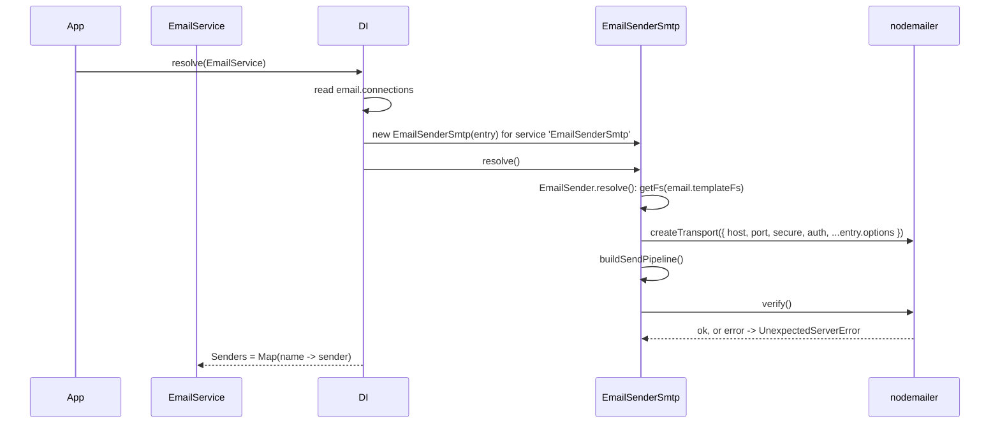

# SMTP connection

Each entry in `email.connections` with `service: 'EmailSenderSmtp'` becomes one `EmailSenderSmtp` instance with its own `nodemailer` transporter. The instance connects to the SMTP server and verifies it when it is resolved, so a wrong host or password fails the boot, not the first mail.

## How it works

1. **Registration.** Importing `@spinajs/email-smtp-transport` runs `@Injectable(EmailSender)` and `@NewInstance()` on `EmailSenderSmtp`. The class is registered under the `EmailSender` token and as itself.
2. **Selection.** `EmailService` (from `@spinajs/email`) injects its `Senders` map with `@AutoinjectService('email.connections', EmailSender)`. For every connection entry, DI finds the `EmailSender` registration whose class name equals the entry's `service`, and resolves it with the whole entry as the constructor argument.
3. **Construction.** `new EmailSenderSmtp(options)` stores the entry in `Options`. `ServiceName` returns `Options.name`, so the `Senders` map is keyed by connection name.
4. **`EmailSender.resolve()`.** The base class reads `email.templateFs` and looks up that filesystem with `getFs()`. A name that is not registered throws `ResolveException`.
5. **`EmailSenderSmtp.resolve()` builds the transporter options.** `host`, `port`, `secure` (from `ssl`) and `auth: { user, pass }` (from `user` and `password`) are merged with `Object.assign` with the entry's `options` object, which wins.
6. **Logs and creates the transporter.** It logs `Creating connection to smtp: <user>@<host>:<port>` at `info`, then calls `nodemailer.createTransport(options)`.
7. **Builds the send pipeline.** `buildSendPipeline()` creates the timeout and retry pipeline; see [Send resilience](03-send-resilience.md).
8. **Verifies.** `Transporter.verify()` opens a connection, runs `EHLO`, TLS and authentication, and closes it. On failure it logs at `error` and throws `UnexpectedServerError('Cannot verify smtp connection <name> (<host>:<port>)')` with the `nodemailer` error as its cause.
9. **Ready.** It logs `Email smtp connection <name> on host <host> established !` at `success`.



## Configuration

Keys of one entry in `email.connections`. The JSON schema of `@spinajs/email` validates them; `name` and `service` are required.

| Key | Type | Default | Allowed values | Meaning |
| --- | --- | --- | --- | --- |
| `email.connections[].service` | `string` | none, required | `'EmailSenderSmtp'`, or the class name of any other `EmailSender` registration | Selects the transport class. |
| `email.connections[].name` | `string` | none, required | unique among connections | Connection name; `IEmail.connection` refers to it. |
| `email.connections[].host` | `string` | `nodemailer` default (`localhost`) | host name or IP | SMTP server. |
| `email.connections[].port` | `number` | `nodemailer` default (`587`, or `465` when `ssl` is `true`) | TCP port | SMTP port. |
| `email.connections[].ssl` | `boolean` | `false` | `true`, `false` | Passed as `secure`. `true` opens TLS at connect (port 465). `false` connects in plain text and upgrades with `STARTTLS` when the server offers it. |
| `email.connections[].user` | `string` | none | any | SMTP user, passed as `auth.user`. |
| `email.connections[].password` | `string` | none | any | SMTP password, passed as `auth.pass`. |
| `email.connections[].options` | `object` | none | any `nodemailer` SMTP transport option | Merged over the options above; see [Raw nodemailer options](#raw-nodemailer-options). |
| `email.connections[].defaults.mailFrom` | `string` | none | email address | Sender used when `IEmail.from` is empty. |
| `email.connections[].templates.defaults` | `object` | none | any | Values added to every template model; see [Sending mail](02-sending-mail.md). |
| `email.connections[].resilience.retries` | `number` | `2` | `0` or more | See [Send resilience](03-send-resilience.md). |
| `email.connections[].resilience.delay` | `number` | `500` | ms, `0` or more | See [Send resilience](03-send-resilience.md). |
| `email.connections[].resilience.timeout` | `number` | `30000` | ms | See [Send resilience](03-send-resilience.md). |
| `email.connections[].redirectTo` | `string[]` | none | email addresses | Read by `EmailService`, not by this transport. See [`@spinajs/email`](../email/README.md). |
| `email.templateFs` | `string` | `'email-templates'` | a registered `fs` provider name, or `''` | Filesystem for string templates. Every sender resolves it at boot. |

```ts
// config/email.ts
export default {
  email: {
    defaultConnection: 'smtp-main',
    templateFs: 'email-templates',
    connections: [
      {
        service: 'EmailSenderSmtp',
        name: 'smtp-main',
        host: 'smtp.example.com',
        port: 465,
        ssl: true,
        user: process.env.SMTP_USER,
        password: process.env.SMTP_PASSWORD,
        defaults: { mailFrom: 'Example <no-reply@example.com>' },
        templates: { defaults: { supportUrl: 'https://example.com/support' } },
        resilience: { retries: 2, delay: 500, timeout: 30000 },
      },
    ],
  },
};
```

### Raw nodemailer options

`options` is merged with `Object.assign`, one level deep. Any `nodemailer` SMTP transport option works there, for example:

| You want | `options` value |
| --- | --- |
| A connection pool for bulk mail | `{ pool: true, maxConnections: 5, maxMessages: 100 }` |
| DKIM signing | `{ dkim: { domainName: 'example.com', keySelector: 'mail', privateKey: '<PEM>' } }` |
| OAuth2 instead of a password | `{ auth: { type: 'OAuth2', user: 'app@example.com', clientId: '...', clientSecret: '...', refreshToken: '...' } }` |
| No authentication on a relay that offers `AUTH` | `{ auth: {} }` |
| Socket timeouts | `{ connectionTimeout: 10000, greetingTimeout: 10000, socketTimeout: 60000 }` |
| A self-signed certificate on a dev server | `{ tls: { rejectUnauthorized: false } }` |

An `auth` object in `options` replaces the one built from `user` and `password` as a whole.

## Services and extension points

| Service | DI token and lifetime | Default implementation | Alternatives | How to replace or extend |
| --- | --- | --- | --- | --- |
| SMTP sender | `EmailSender` token, and `EmailSenderSmtp` as itself; `@NewInstance()`, one instance per connection entry | `EmailSenderSmtp` | `BlackHoleEmailSender` (`@spinajs/email`), any `EmailSender` subclass | Set `service` of the entry to another class name, or subclass `EmailSenderSmtp`; see [Extending the SMTP sender](04-extending-the-smtp-sender.md) |
| `nodemailer` transporter | `protected Transporter`, created in `resolve()`; not in DI | SMTP transport from `createTransport()` | any `nodemailer` option via `options` | Override `resolve()`, call `super.resolve()`, then adjust `this.Transporter` |

## Important behaviour

- The SMTP server must be reachable at boot. `resolve()` calls `verify()`, so `DI.resolve(EmailService)` rejects with `UnexpectedServerError` when one connection fails. Every service that injects `EmailService` fails with it.
- Every sender needs the filesystem named by `email.templateFs` at boot, even a sender that sends only text. The shipped default is `'email-templates'`: register an `fs` provider with that name, or set `email.templateFs` to `''`.
- `service` is matched against the class name, not against a string token. A subclass is selected by its own class name.
- `@NewInstance()`: two entries with `service: 'EmailSenderSmtp'` get two senders and two transporters. `DI.resolve(EmailSenderSmtp, [entry])` outside `EmailService` also builds and verifies a new one each time.
- `auth` is always an object with `user` and `pass` keys, even when both are empty. A server that advertises `AUTH` then gets a login attempt with an empty user. Pass `options: { auth: {} }` to turn authentication off.
- `options: { auth: null }` crashes `resolve()` with a `TypeError`: the connect log line reads `options.auth.user`. Use `{}`.
- The `info` connect log line includes the SMTP user name. The password is never logged.
- The transporter is never closed. With `pool: true` the pooled sockets stay open until the process exits.

## Best practices

- Keep credentials out of config files: read them from the environment or from a secret configuration source (`@spinajs/configuration-aws-secretmanager-protocol`).
- Use `service: 'BlackHoleEmailSender'` for the same connection name in test and CI config, so boot does not need an SMTP server.
- Set `defaults.mailFrom` on every connection, so callers can leave `from` empty and the sender domain stays consistent with SPF and DKIM.
- Turn on `pool: true` only for connections that send in bursts; a pool keeps sockets open.

## Patterns and antipatterns

```ts
// Don't: null crashes resolve() with a TypeError, the connect log line reads options.auth.user
{ service: 'EmailSenderSmtp', name: 'relay', host: 'relay.internal', port: 25, options: { auth: null } }

// Do: an empty auth object turns authentication off
{ service: 'EmailSenderSmtp', name: 'relay', host: 'relay.internal', port: 25, options: { auth: {} } }
```

```ts
// Don't: resolve the sender by its token. DI picks the last EmailSender registration
// and constructs it without a connection entry.
const sender = await DI.resolve(EmailSender);

// Do: go through EmailService, which builds one sender per configured connection
const emails = await DI.resolve(EmailService);
await emails.send({ connection: 'smtp-main', to: ['ops@example.com'], subject: 'Report', text: '...' });
```

## Examples

### Separate transactional and bulk connections

```ts sample
import '@spinajs/email-smtp-transport';
import { DI } from '@spinajs/di';
import { EmailService } from '@spinajs/email';

export const config = {
  email: {
    defaultConnection: 'transactional',
    connections: [
      {
        service: 'EmailSenderSmtp',
        name: 'transactional',
        host: 'smtp.example.com',
        port: 587,
        user: process.env.SMTP_USER,
        password: process.env.SMTP_PASSWORD,
        defaults: { mailFrom: 'Example <no-reply@example.com>' },
      },
      {
        service: 'EmailSenderSmtp',
        name: 'newsletter',
        host: 'bulk.smtp.example.com',
        port: 587,
        user: process.env.BULK_SMTP_USER,
        password: process.env.BULK_SMTP_PASSWORD,
        defaults: { mailFrom: 'Example News <news@example.com>' },
        options: { pool: true, maxConnections: 5, maxMessages: 100 },
        resilience: { retries: 0 },
      },
    ],
  },
};

export async function sendNewsletter(recipients: string[], issue: string) {
  const emails = await DI.resolve(EmailService);

  for (const to of recipients) {
    await emails.sendDeferred({
      connection: 'newsletter',
      to: [to],
      subject: `Example News: ${issue}`,
      template: 'newsletter.hbs',
      model: { issue },
    });
  }
}
```

### Check the SMTP credentials of one entry

A script that verifies one connection entry without booting the email service. `DI.resolve()` runs `resolve()`, which verifies the connection.

```ts sample
import { DI } from '@spinajs/di';
import { EmailConnectionOptions } from '@spinajs/email';
import { EmailSenderSmtp } from '@spinajs/email-smtp-transport';
import { UnexpectedServerError } from '@spinajs/exceptions';

export async function checkSmtp(entry: EmailConnectionOptions): Promise<boolean> {
  try {
    await DI.resolve(EmailSenderSmtp, [entry]);
    return true;
  } catch (err) {
    if (err instanceof UnexpectedServerError) {
      return false;
    }
    throw err;
  }
}
```

## Related

- [Sending mail](02-sending-mail.md): what the sender does with each `IEmail`.
- [Send resilience](03-send-resilience.md): the `resilience` keys.
- [Extending the SMTP sender](04-extending-the-smtp-sender.md): subclass the sender and select it with `service`.
- [`@spinajs/email`](../email/README.md): `EmailService`, the `email.*` keys, `redirectTo` and `BlackHoleEmailSender`.
- [`@spinajs/fs`](../fs/README.md): registering the `email-templates` filesystem.
