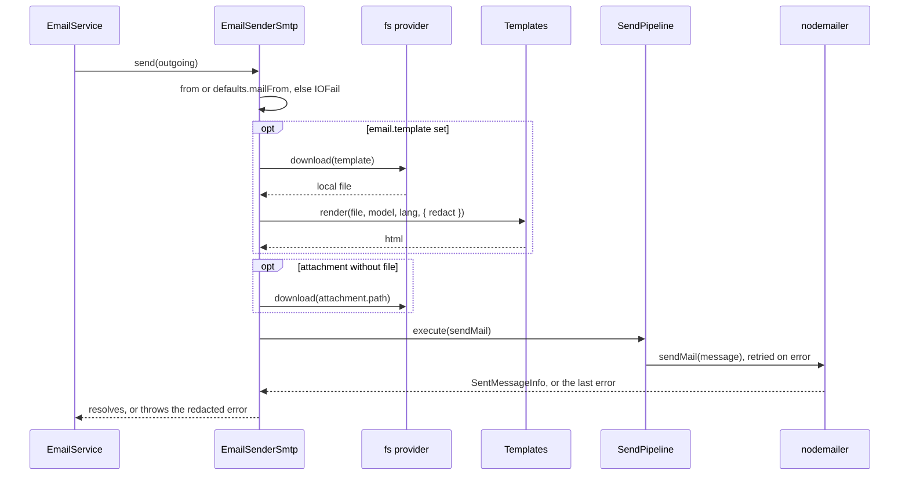

# Sending mail

`EmailSenderSmtp.send(email)` turns one `IEmail` into a `nodemailer` message and sends it. It picks the sender address, renders the template, resolves the attachment files, and keeps secret values out of errors and logs.

Call it through `EmailService.send()` or `sendDeferred()` from `@spinajs/email`. The service adds recipient redirection, the attachment read check, metrics and the `EmailSent` event; a direct `send()` call has none of them.

## How it works

1. **Entry.** `EmailService.send(email)` reads the attachments, applies `redirectTo`, and calls `Senders.get(email.connection).send(outgoing)`.
2. **Sender address.** With neither `email.from` nor `defaults.mailFrom` set, `send()` throws `IOFail('Email from address is required. ...')`.
3. **Template filesystem.** Only when `email.template` is set:
   - a string is downloaded from the `email.templateFs` filesystem, resolved at boot;
   - an `IEmailTemplate` (`{ file, fs }`) is downloaded from `getFs(template.fs)`.
4. **Render.** `Templates.render(file, { ...templates.defaults, ...email.model }, email.lang, { redact })` returns the HTML body. `@spinajs/templates` picks the engine by file extension. A render error is logged at `error` and rethrown, redacted. It is not retried.
5. **Message.** `send()` builds the `nodemailer` message; see [Field mapping](#field-mapping).
6. **Attachments.** Each attachment becomes `{ cid, filename: name, path }`. `path` is `attachment.file` when the email service already read it. Otherwise `attachmentFile()` downloads `attachment.path` through `attachment.provider`, or through `fs.defaultProvider`.
7. **Send.** `SendPipeline.execute(() => Transporter.sendMail(message))` sends with timeout and retries; see [Send resilience](03-send-resilience.md).
8. **Failure.** The last error is redacted with `redactError(err, email.redact)`, logged at `error` with the connection, subject and recipient count, and rethrown.
9. **Success.** It logs the addresses, `messageId` and server response at `trace`.



## Field mapping

| `IEmail` field | `nodemailer` field | Notes |
| --- | --- | --- |
| `from` | `from` | Falls back to `defaults.mailFrom`. |
| `to` | `to` | Joined with `,`. Required. |
| `cc`, `bcc` | `cc`, `bcc` | Joined with `,`. |
| `replyTo` | `replyTo` | |
| `subject` | `subject` | |
| `text` | `text` | Sent as is, next to `html` when both are set. |
| `template`, `model`, `lang` | `html` | Rendered by `Templates`; `html` is empty without a template. |
| `attachements[]` | `attachments[]` | `name` to `filename`, `cid` kept, the local file to `path`. |
| `redact` | none | Passed to `Templates.render()` and `redactError()`. |
| `templateId`, `priority`, `tag`, `emailId` | none | Ignored by this transport. |
| `connection`, `schedule`, `retryCount` | none | Used by `EmailService` and the queue. |

## Configuration

| Key | Type | Default | Allowed values | Meaning |
| --- | --- | --- | --- | --- |
| `email.connections[].defaults.mailFrom` | `string` | none | address or `Name <address>` | Sender when `IEmail.from` is empty. |
| `email.connections[].templates.defaults` | `object` | none | any | Merged into every template model of this connection. `IEmail.model` keys win over it. |
| `email.templateFs` | `string` | `'email-templates'` | a registered `fs` provider name | Filesystem for string templates. |
| `email.attachments.check` | `boolean` | `true` | `true`, `false` | Read by `EmailService`. `true`: the service reads every attachment and the transport sends `file`. `false`: the transport reads `path` itself. |
| `fs.defaultProvider` | `string` | none | a registered `fs` provider name | Filesystem for attachments without `provider`. |

```ts
// config/email.ts
export default {
  email: {
    templateFs: 'email-templates',
    attachments: { check: true },
    connections: [
      {
        service: 'EmailSenderSmtp',
        name: 'smtp-main',
        host: 'smtp.example.com',
        port: 587,
        defaults: { mailFrom: 'Example <no-reply@example.com>' },
        templates: { defaults: { productName: 'Example', supportUrl: 'https://example.com/support' } },
      },
    ],
  },
  fs: {
    defaultProvider: 'fs-local',
    providers: [
      { service: 'fsNative', name: 'fs-local', basePath: '/var/app/data' },
      { service: 'fsNative', name: 'email-templates', basePath: '/var/app/templates/email' },
    ],
  },
};
```

## Services and extension points

| Service | DI token and lifetime | Default implementation | Alternatives | How to replace or extend |
| --- | --- | --- | --- | --- |
| Template renderer | `Templates` class, injected with `@Autoinject(Templates)`; singleton (DI default) | `Templates`, which picks a `TemplateRenderer` by file extension from the engines you import (`@spinajs/templates-handlebars`, `@spinajs/templates-pug`, ...) | any `TemplateRenderer` subclass | Import or register another engine; or `DI.register(MyTemplates).as(Templates)` before `EmailService` resolves; see [`@spinajs/templates`](../templates/README.md) |
| Template and attachment files | `fs` providers by name (`__file_provider__`) | the providers in `fs.providers` | `fs-s3`, `fs-ftp`, any `fs` subclass | Point `email.templateFs`, `IEmailTemplate.fs` or `attachment.provider` at another provider |
| Message mapping | `send()`, public, on `EmailSenderSmtp` | the mapping above | none | Override `send()` in a subclass; see [Extending the SMTP sender](04-extending-the-smtp-sender.md) |

## Important behaviour

- `IEmail.model` keys override connection `templates.defaults` of the same name: the model is built as `{ ...templates.defaults, ...email.model }`.
- A string template with `email.templateFs` set to `''` fails with `IOFail`: no template filesystem is resolved. Use an `IEmailTemplate` object or set `email.templateFs`.
- An `IEmailTemplate` with an unregistered `fs` fails before rendering; the `fs` package throws `ResolveException`.
- A template is downloaded from its filesystem on every send. Compile caching is up to `@spinajs/templates` (`templates.cache.mode`).
- `IEmail.templateId` is ignored. A mail with only `templateId` goes out with no HTML body.
- A text-only mail (no `template`) skips the filesystem and `Templates` entirely.
- With `email.redact` set, both the render error and the send error are replaced by a new `Error` with the secret values, raw and URI-encoded, replaced by `[redacted]`. The new error has no `cause` and no stack of the original.
- With no `redact`, the original error object is thrown, `nodemailer` fields such as `responseCode` included.
- Recipient addresses are logged at `trace` only; `error` lines carry the recipient count.
- `send()` does not change the `IEmail` it gets.

## Best practices

- Put the secret values of a mail in `redact`, for example a reset token and the link that holds it. `EmailService.sendDeferred()` refuses such a mail, so use `send()`.
- Send `text` next to `template`: clients that block HTML show the text part.
- Keep inline images as attachments with a `cid`, and reference them in the template as `cid:<id>`.
- Leave `email.attachments.check` on: the email service reads each attachment as the sending user, so a guarded filesystem checks `fs:read` for that user.

## Patterns and antipatterns

```ts
// Don't: a secret in the model without `redact`. A rejected send logs the server
// response, which may quote the message and its link.
await emails.send({ connection: 'smtp-main', to: [user.email], subject: 'Reset your password', template: 'reset.hbs', model: { link } });

// Do: list the secret values, and send in-process
await emails.send({ connection: 'smtp-main', to: [user.email], subject: 'Reset your password', template: 'reset.hbs', model: { link }, redact: [token, link] });
```

## Examples

### Send a password reset link without leaking the token

```ts sample
import '@spinajs/email-smtp-transport';
import { DI } from '@spinajs/di';
import { EmailService } from '@spinajs/email';

export async function sendPasswordReset(address: string, token: string) {
  const link = `https://app.example.com/password-reset?token=${encodeURIComponent(token)}`;
  const emails = await DI.resolve(EmailService);

  await emails.send({
    connection: 'smtp-main',
    to: [address],
    subject: 'Reset your password',
    template: 'password-reset.hbs',
    model: { link },
    text: `Open ${link} to set a new password.`,
    lang: 'en',
    redact: [token, link],
  });
}
```

### Send an invoice from S3 with an inline logo

The template comes from a separate filesystem, the PDF from S3, and the logo is embedded with a `cid`.

```ts sample
import '@spinajs/email-smtp-transport';
import { DI } from '@spinajs/di';
import { EmailService } from '@spinajs/email';

export async function sendInvoice(address: string, invoiceNo: string) {
  const emails = await DI.resolve(EmailService);

  await emails.send({
    connection: 'smtp-main',
    to: [address],
    bcc: ['accounting@example.com'],
    replyTo: 'billing@example.com',
    subject: `Invoice ${invoiceNo}`,
    template: { file: 'invoice.pug', fs: 'billing-templates' },
    model: { invoiceNo },
    attachements: [
      { name: `invoice-${invoiceNo}.pdf`, path: `invoices/${invoiceNo}.pdf`, provider: 'fs-s3-invoices' },
      { name: 'logo.png', path: 'branding/logo.png', cid: 'logo' },
    ],
  });
}
```

## Related

- [SMTP connection](01-smtp-connection.md): `defaults`, `templates` and the template filesystem at boot.
- [Send resilience](03-send-resilience.md): what happens when `sendMail` fails.
- [`@spinajs/email`](../email/README.md): `IEmail`, `redact`, `redirectTo`, the attachment check and `EmailSent`.
- [`@spinajs/templates`](../templates/README.md): engines, `lang` and render options.
